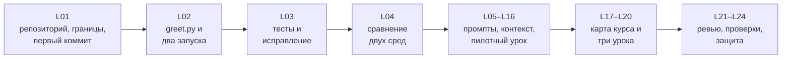
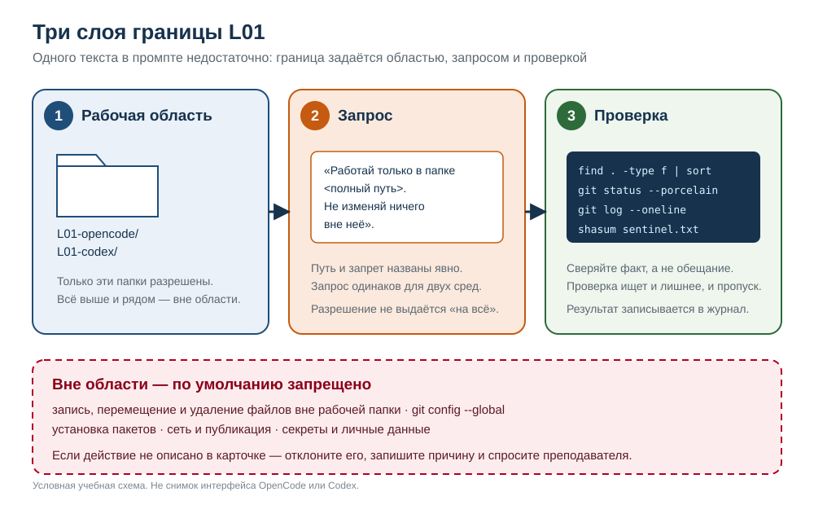
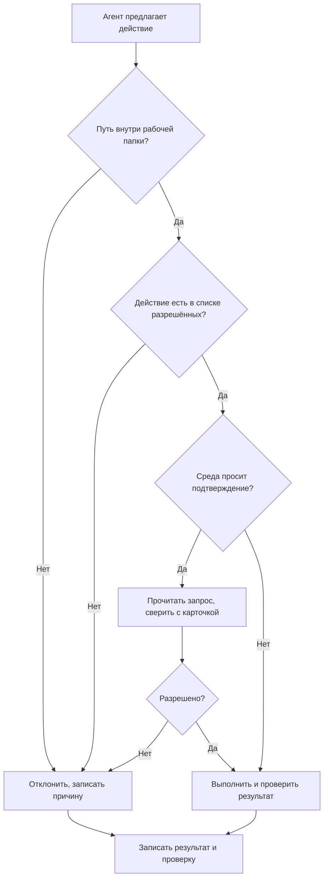
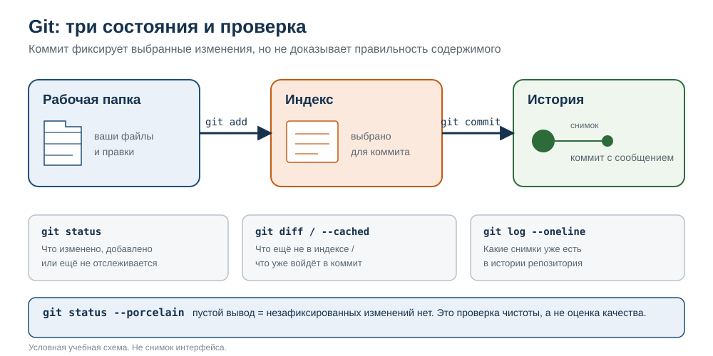

# L01. Среда, полномочия, Git

> **Основной учебник занятия.** Прочитайте обязательную часть до практики. Разделы «Углубление» отмечены как необязательные: они не добавляют работы сверх 150 минут и не нужны для сдачи.

<a id="passport"></a>
## Паспорт занятия

| Поле | Значение |
|---|---|
| Курс | «Разработка с помощью агентов на примере создания курса Python в OpenCode и Codex» |
| Модуль | 1. Рабочая основа |
| Занятие | L01. Среда, полномочия, Git |
| Время | 150 минут: 75 минут объяснения и демонстрации + 75 минут практики |
| Формат группы | В утверждённой программе точный размер группы и число оценщиков не зафиксированы. Занятие рассчитано на индивидуальную работу с двумя средами; при работе в парах один участник наблюдает и фиксирует разрешения. Организатор определяет состав группы до занятия. |
| Среда просмотра Markdown | Не указана. Руководство использует GitHub-Flavored Markdown, Mermaid и локальные SVG. Если Mermaid не отображается, используйте текстовые описания и таблицы после каждой схемы. |
| Вход | Пустые рабочие папки `L01-opencode/` и `L01-codex/`, карточки структуры и границ, форма журнала |
| Артефакт | Дерево из шести файлов, первый коммит, журнал разрешений и сравнения |
| Следующий шаг | L02: добавить в репозиторий `greet.py` и `run_greeting.py`, запустить функцию на двух входах |

**Статус проверки.** Текст сверен с утверждённой программой и картой занятий 4 ноября 2026 года. Проверка структуры, выполненная локально, даёт `PASS` на эталонном дереве и `FAIL` на дереве с лишним файлом. OpenCode и Codex в ходе подготовки не запускались: их интерфейс, названия режимов и поведение разрешений нужно сверить с установленной версией до занятия. Тайминг 75/75 остаётся проектным допущением до пилота.

<a id="how-to-read"></a>
## Как читать руководство

| Часть | Что делать | Обязательно? |
|---|---|---|
| Разделы 1–6 | Прочитать, выполнить практику, проверить себя | Да, в пределах 150 минут |
| Раздел 7 «Углубление» | Читать после сдачи или при затруднении | Нет |
| Раздел 8 «Словарь» | Использовать как справку | По необходимости |
| Раздел 9 «Источники и статус» | Проверить, откуда взяты требования | По необходимости |

В руководстве есть два разных примера:

- **Учебный пример** в разделе 4 — репозиторий `reading-notes/`. Он нужен, чтобы освоить команды и журнал без копирования оцениваемой работы.
- **Практика** в разделе 5 — оцениваемая задача `L01-opencode/` и `L01-codex/`. Её точное условие находится в [`practice_card.md`](practice_card.md).

Не смешивайте эти примеры: разные имена файлов, разное сообщение коммита, разные записи журнала.

**Обязательной домашней работы нет.** Всё обязательное выполняется в пределах 150 минут занятия. Раздел «Углубление» — необязательное чтение, а не задание.

<a id="readiness"></a>
## Готовность комплекта и открытые входы

Для занятия нужны:

- [`practice_card.md`](practice_card.md) — точное условие, тайминг и критерии;
- [`snapshot/structure_card.md`](snapshot/structure_card.md) — дерево и содержание файлов;
- [`snapshot/boundary_card.md`](snapshot/boundary_card.md) — разрешённые и запрещённые действия;
- [`../shared/run_journal.md`](../shared/run_journal.md) — форма журнала;
- две пустые рабочие папки без `.git`;
- доступ к OpenCode и Codex;
- терминал, Git и Python 3 для записи версий.

Если чего-то не хватает, сообщите преподавателю до первого запроса. Не заменяйте отсутствующую среду вымышленной попыткой и не приписывайте агенту ручную работу.

**Что в источниках не зафиксировано:** точный размер группы, версии OpenCode и Codex, видимые названия моделей, вид запроса разрешения, доступность записи для запасного сценария, поддержка Mermaid в вашем просмотрщике. Эти сведения не выдумываются: в журнале пишется фактическое наблюдение или «недоступно».

<a id="toc"></a>
## Оглавление

1. [Цели и результаты](#goals)
2. [Обязательный маршрут на 150 минут](#route)
3. [Теория: среда, полномочия, Git](#theory)
   - [3.1. Агент: «умеет» не значит «разрешено»](#agent-capability)
   - [3.2. Рабочая область и три слоя границы](#workspace)
   - [3.3. Режим подтверждений и журнал разрешений](#approvals)
   - [3.4. Git: рабочая папка, индекс, коммит](#git-states)
   - [3.5. Дерево, `.gitignore` и лишние файлы](#tree)
   - [3.6. Сравнение OpenCode и Codex](#comparison)
   - [3.7. Приёмка: что доказывает каждый артефакт](#acceptance)
4. [Учебный пример: `reading-notes/`](#learning-example)
5. [Практика: оцениваемая задача](#practice)
6. [Самопроверка](#self-check)
7. [Углубление (необязательно)](#advanced)
8. [Словарь](#glossary)
9. [Источники и статус проверки](#sources)

<a id="goals"></a>
## 1. Цели и результаты

<a id="goals-outcomes"></a>
### 1.1. Что вы сможете к концу занятия

| Результат | Как вы его покажете |
|---|---|
| 1. Создаёте изолированную рабочую папку и называете границы | Показываете путь к рабочей копии, называете одно разрешённое и одно запрещённое действие |
| 2. Фиксируете запрос разрешения или отказ и объясняете решение | В `notes/permissions.md` и журнале есть запись «что запрошено → что решено → почему» |
| 3. Создаёте требуемое дерево и первый коммит | `find`, `git status --porcelain` и `git log --oneline` дают ожидаемый результат |
| 4. Сравниваете две попытки по одинаковым полям | В журнале есть обе среды, одинаковый запрос, различия условий и ограниченный вывод |

**Главная мысль занятия:** агент может многое технически, но делать он должен только то, что разрешено областью, запросом и вашим решением. Коммит и журнал нужны не для красоты, а чтобы другой человек мог проверить, что именно произошло.

<a id="goals-prereq"></a>
### 1.2. Предпосылки

- Опыт отдельных задач с AI-агентом: вы уже видели, что агент может предложить команду или изменить файл.
- Умение открыть терминал в нужной папке и прочитать вывод команды.
- Знание Python, Git и тестов **не требуется**. Все команды Git объясняются с нуля.
- Если терминал открывается с трудом, преподаватель добавит `pwd`, `ls`, `git --version`, `python3 --version` в демонстрацию. Это не добавляет темы Python.

<a id="goals-not"></a>
### 1.3. Что в занятие не входит

Сегодня **не** нужно:

- писать функции и тесты;
- создавать `AGENTS.md` — постоянные правила проекта появятся на L11;
- собирать уроки Python-курса — они появятся на L16–L20;
- устанавливать пакеты, настраивать глобальный Git или подключать сеть;
- сравнивать скорость инструментов или делать вывод «кто лучше». Сравнение ограничено одним снимком и одним запросом.

<a id="goals-project"></a>
### 1.4. Связь со сквозным проектом

У L01 нет предыдущего артефакта: занятие начинается с пустой папки. Это сделано специально, чтобы вы увидели, как из пустого места появляется проверяемая основа. Следующий шаг — L02, где в этот репозиторий добавляется первая Python-функция.



*Рис. A. Место L01 в цепочке проекта. Схема показывает, что L01 — фундамент для L02–L24.*

**Текстовая версия:** L01 создаёт репозиторий и границы → L02 добавляет функцию → L03 добавляет тесты → L04 сравнивает две среды → L05–L16 отрабатывают промпты и контекст → L17–L20 собирают Python-курс → L21–L24 проверяют и защищают проект.

**Что заметить на схеме:** L01 — не «подготовка к чему-то», а фундамент. Без коммита на L04 нечего сравнивать; без границ нельзя доказать, что изменение сделал агент, а не человек.

**Как это помогает следующему шагу:** сегодняшний коммит станет базой для L02. Если вы сохраните чистый репозиторий и журнал, на следующем занятии сможете добавить функцию, не пересобирая основу.

<a id="route"></a>
## 2. Обязательный маршрут на 150 минут

<a id="route-theory"></a>
### 2.1. Первые 75 минут: объяснение и демонстрация

| Минуты | Что происходит | Что делать вам |
|---:|---|---|
| 0–8 | Цель, артефакт, правила безопасности, первичная среда | Записать, что сдаёте, и какая среда назначена первичной |
| 8–20 | Что может агент; разница между «умеет» и «разрешено» | Классифицировать 3 действия: разрешено / запрещено / спросить |
| 20–32 | Демонстрация 1: пустая папка, запрос, разрешение | Предсказать, запросит ли среда разрешение, и сравнить с наблюдением |
| 32–44 | Git: рабочая папка, индекс, коммит | Объяснить соседу, что доказывает и что не доказывает коммит |
| 44–56 | Демонстрация 2: попытка выйти за область | Сформулировать порядок действий при нарушении |
| 56–68 | Демонстрация 3: дерево, лишние файлы, `.gitignore`, чистый статус | Сверить дерево с карточкой |
| 68–75 | Брифинг практики, две копии, журнал | Записать свой маршрут и первичную среду |

**Проверка маршрута:** 8 + 12 + 12 + 12 + 12 + 12 + 7 = 75 минут.

<a id="route-practice"></a>
### 2.2. Вторые 75 минут: практика

| Минуты | Шаг | Промежуточная проверка |
|---:|---|---|
| 0–10 | Прочитать карточку, проверить две пустые копии, записать условия | Обе папки пусты, `.git` нет, версии и режим записаны |
| 10–28 | Попытка 1: новый сеанс, запрос, наблюдение разрешений | Появилось дерево; есть хотя бы одно событие разрешения или запись «запросов не было» |
| 28–46 | Попытка 2: тот же запрос во второй среде | Вторая копия заполнена или недоступность записана |
| 46–61 | Проверка дерева, `git init`, `git add`, `git commit`, `git status`, `git log` | Ровно шесть файлов, коммит с нужным сообщением, `git status --porcelain` пуст |
| 61–69 | Заполнить журнал и сравнение | Обе среды, разрешения, diff/список файлов, проверки, предел вывода |
| 69–75 | Самопроверка и сдача | Чек-лист из раздела 5.10 выполнен |

**Проверка маршрута:** 10 + 18 + 18 + 15 + 8 + 6 = 75 минут.

<a id="route-open"></a>
### 2.3. Что открыть и что получить

До старта у вас должно быть:

```text
<папка участника>/
  L01-opencode/        пустая папка, без .git
  L01-codex/           пустая папка, без .git
  journal-L01.md       журнал вне репозиториев
```

Также откройте:

- [`practice_card.md`](practice_card.md) — полное условие;
- [`snapshot/structure_card.md`](snapshot/structure_card.md) — дерево и требования к файлам;
- [`snapshot/boundary_card.md`](snapshot/boundary_card.md) — что разрешено и запрещено;
- [`../shared/run_journal.md`](../shared/run_journal.md) — форма журнала.

Журнал лежит **вне** репозитория, чтобы не нарушать точное дерево. Внутри репозитория журналом разрешений служит `notes/permissions.md`.

<a id="route-start"></a>
### 2.4. Как определить стартовое состояние

Проверьте каждую папку:

```bash
cd <путь-к-L01-opencode>
pwd
ls -la
test -d .git && echo "ЕСТЬ .git — это не стартовое состояние" || echo "OK: .git нет"
```

Повторите для `L01-codex`. Если папка не пуста или содержит `.git`, остановитесь и сообщите преподавателю: это не то стартовое состояние, для которого составлена карточка.

<a id="route-allowed"></a>
### 2.5. Что разрешено менять

Кратко; полный список — в [`snapshot/boundary_card.md`](snapshot/boundary_card.md).

| Разрешено | Запрещено |
|---|---|
| Создавать и изменять файлы внутри `L01-opencode/` и `L01-codex/` | Писать, перемещать или удалять файлы вне этих папок |
| `git init`, `git status`, `git add`, `git commit`, `git log`, `git diff` | `git config --global`, изменение глобальных настроек |
| `python3 --version`, `git --version` для записи условий | Установка пакетов, сетевые команды, публикация |
| Разрешать или отклонять запросы инструмента и записывать решение | Секреты, токены, личные данные |
| Записывать наблюдения в журнал | Удаление чужих файлов и «уборка» вне своей папки |

Если действие не описано в карточке, считайте его запрещённым до разрешения преподавателя.

**Недоверенные команды.** Команды из ответов агента, чужих README, чатов и интернета не считаются доверенными. Выполняйте только то, что разрешено карточкой; если команда выходит за область или непонятна — отклоните и спросите.

<a id="theory"></a>
## 3. Теория: среда, полномочия, Git

<a id="agent-capability"></a>
### 3.1. Агент: «умеет» не значит «разрешено»

<a id="agent-problem"></a>
#### Какую проблему решает понятие

AI-агент — это не только чат, который пишет текст. В зависимости от среды он может читать файлы, создавать и изменять их, предлагать команды и запускать их. Если вы не различаете «технически может» и «разрешено делать», вы теряете контроль: агент может изменить файл, который вы не собирались трогать, или выполнить команду, которая влияет на всю систему.

Понятие **полномочий** нужно, чтобы отделить возможность инструмента от вашего решения. Вы не «запрещаете агенту думать» — вы ограничиваете последствия его действий.

<a id="agent-structure"></a>
#### Как устроено

Удобно думать о четырёх слоях:

| Слой | Что задаёт | Пример L01 |
|---|---|---|
| Возможности инструмента | Что среда умеет технически | читать, писать, запускать команды |
| Политика | Что среда разрешает без вопроса, что спрашивает, что блокирует | режим подтверждений, sandbox, правила путей |
| Ваше решение | Что вы разрешаете или отклоняете в конкретном запросе | «разрешить запись в `notes/`» / «отклонить `git config --global`» |
| Свидетельство | Как вы докажете, что произошло | журнал, `find`, `git status`, diff |

**Ключевая формула:**

```text
разрешённое действие = путь внутри области
                     + действие из списка разрешённых
                     + ваше подтверждение, если среда его просит
                     + запись в журнал
```

<a id="agent-example"></a>
#### Простой пример и разбор по шагам

**Вход:** агент предлагает создать файл `notes/example.md` внутри рабочей папки.

**Действие:** вы проверяете путь, действие и режим.

**Результат:** файл создан; в журнале есть запись «запрошено создание `notes/example.md` → разрешено, потому что путь внутри области».

**Проверка:** `find . -type f` показывает файл; `git status` показывает его как неотслеживаемый; `notes/permissions.md` содержит запись.

| Шаг | Вопрос | Ответ в примере |
|---:|---|---|
| 1 | Что именно просит инструмент? | Создать `notes/example.md` |
| 2 | Путь внутри рабочей папки? | Да |
| 3 | Действие в списке разрешённых? | Да, создание файла внутри области |
| 4 | Нужно подтверждение? | Возможно; зависит от режима |
| 5 | Что записать? | Текст запроса, решение, причину, результат |

<a id="agent-project"></a>
#### Как это применяется в сквозном проекте

В оцениваемой практике агент получает запрос, который начинается так:

```text
Работай только в папке <полный путь к этой рабочей копии>.
Создай ровно такую структуру:
...
Не создавай других файлов. Не изменяй ничего вне этой папки.
Не выполняй установку пакетов, сетевые команды и git config --global.
Если для шага нужно разрешение, запроси его и жди ответа.
```

Это не «магическая фраза», а контракт. Он связывает три вещи:

1. **Область:** полный путь к рабочей копии.
2. **Результат:** ровно шесть файлов, перечисленных в карточке.
3. **Проверка:** после работы вы запускаете `find`, `git status`, `git log` и сверяете с карточкой.

<a id="agent-errors"></a>
#### Где типично ошибаются

| Ошибка | Как заметить | Что проверить перед принятием результата |
|---|---|---|
| Считать, что «агент умный, значит, безопасный» | В журнале нет ни одного решения | Прочитать запросы и записать хотя бы одно событие или фактическое отсутствие запросов |
| Разрешать всё подряд | В журнале только «разрешено», без причины | Сверять каждое действие со списком разрешённых |
| Путать отказ агента и блокировку средой | В журнале написано «агент отказался», но нет текста | Записать, что именно наблюдалось: отказ, запрос, ошибка или блокировка |
| Считать, что промпт — это граница | Файл появился вне папки | Проверять путь и `sentinel.txt`, а не только текст запроса |
| Приписывать агенту ручную правку | В журнале «агент создал», а вы правили вручную | Все ручные правки записывать отдельно |

<a id="agent-check"></a>
#### Как проверить понимание

1. Чем «агент умеет» отличается от «агенту разрешено»?  
   *Подсказка: представьте, что инструмент технически может удалить файл, но карточка это запрещает.*
2. Почему одного предложения в промпте недостаточно для границы?  
   *Подсказка: подумайте о пути, режиме подтверждений и проверке.*
3. Что записать, если среда вообще не запросила разрешение?  
   *Подсказка: это тоже наблюдение, но его нужно подтвердить режимом или поведением.*

**Мини-упражнение.** Отнесите действия к категориям «разрешено», «запрещено», «нужно уточнить»:

- создать `notes/session-log.md` внутри рабочей папки;
- выполнить `git config --global user.name "Учебный"`;
- прочитать `README.md` внутри рабочей папки;
- создать файл `../outside.txt`;
- выполнить `git status`;
- установить пакет `requests`.

*Подсказка: сверяйтесь с таблицей из раздела 2.5. Если действие не описано — «нужно уточнить», а по умолчанию отклоняем.*

<a id="workspace"></a>
### 3.2. Рабочая область и три слоя границы

<a id="workspace-problem"></a>
#### Какую проблему решает понятие

Агент видит не «ваш проект» целиком, а файловую систему и рабочую папку, которую вы указали. Если рабочая папка выбрана слишком широко — например, домашний каталог, — агент технически может дотянуться до чужих файлов. Если граница задана только словами в промпте, а среда не ограничена, слова остаются пожеланием.

**Рабочая область** — это папка, внутри которой агенту разрешено работать. В L01 таких папок две: `L01-opencode/` и `L01-codex/`. Всё, что выше или рядом, — вне области, даже если технически доступно.

<a id="workspace-structure"></a>
#### Как устроено: три слоя



*Рис. 1. Три слоя границы: область, запрос и проверка. Это учебная схема, а не снимок интерфейса OpenCode или Codex.*

**Что заметить:** граница — не одна строчка, а три согласованных слоя. Если хотя бы один слой отсутствует, появляется щель.

**Как это помогает следующему шагу:** перед каждым запросом проверяйте все три слоя. Перед сдачей проверяйте, что каждый слой оставил свидетельство.

| Слой | Вопрос | Пример L01 | Свидетельство |
|---|---|---|---|
| 1. Область | Где агенту разрешено работать? | `L01-opencode/`, `L01-codex/` | Полный путь в журнале и `notes/permissions.md` |
| 2. Запрос | Что именно нужно сделать и что нельзя? | «Работай только в папке…», «не создавай других файлов» | Дословный запрос в журнале |
| 3. Проверка | Как вы убедитесь, что граница не нарушена? | `find`, `git status`, `sentinel.txt` | Вывод команд и запись в журнале |



*Рис. B. Решение о действии: путь → разрешение → подтверждение → проверка и запись. Схема показывает, где остановить опасное действие.*

**Текстовая версия:** сначала проверяем путь; потом действие; потом необходимость подтверждения; затем выполняем и записываем. Любой ответ «нет» ведёт к отклонению, а не к «попробуем посмотреть, что будет».

**Что заметить:** подтверждение — не формальность, а последняя точка, где можно остановить опасное действие. Если среда не спрашивает, ответственность за проверку пути и diff всё равно остаётся на вас.

**Как это помогает следующему шагу:** перед каждым запросом пройдите по схеме сверху вниз. Если хотя бы один ответ «нет» или «непонятно», действие отклоняется и записывается.

<a id="workspace-example"></a>
#### Простой пример и разбор по шагам

**Вход:** рабочая папка `/tmp/l01-demo`; агент предлагает создать `../outside-demo.txt`.

**Действие:** вы проверяете путь. `../outside-demo.txt` находится выше рабочей папки, значит, вне области.

**Результат:** действие отклонено; файл не создан (или создан — тогда это инцидент).

**Проверка:** `ls ../outside-demo.txt` не должен находить файл; `sentinel.txt` рядом с папками не изменился; в журнале есть запись об отказе.

| Шаг | Наблюдение | Запись |
|---:|---|---|
| 1 | Запрос содержит `../` | «Запрошено создание файла вне рабочей папки» |
| 2 | Путь выше области | «Отклонено: путь вне области» |
| 3 | Проверка после отказа | `ls ../outside-demo.txt` → файла нет |
| 4 | Проверка следов | `shasum -a 256 sentinel.txt` совпадает с исходным |

<a id="workspace-project"></a>
#### Как это применяется в сквозном проекте

В практике преподаватель может положить `sentinel.txt` рядом с рабочими папками. Его хеш записывается до занятия. После работы хеш проверяется снова. Если он изменился, значит, агент или человек вышел за область. Это **критическое событие**, а не «мелкая правка».

В `notes/permissions.md` вы фиксируете:

```text
## Область
/полный/путь/к/L01-opencode

## Разрешено
- создавать и изменять файлы внутри этой папки
- git init, git status, git add, git commit, git log, git diff

## Запрещено
- запись вне этой папки
- git config --global
- установка пакетов, сеть, секреты

## Запросы и решения
- запрошено: создание README.md → разрешено, путь внутри области
- запрошено: git config --global → отклонено, запрещено карточкой
```

<a id="workspace-errors"></a>
#### Где типично ошибаются

| Ошибка | Как заметить | Что проверить |
|---|---|---|
| Открыть как рабочую папку родительский каталог | В запросе путь шире, чем `L01-opencode/` | Путь в журнале должен совпадать с рабочей копией |
| Задать область только в промпте | Среда пишет файлы без ограничения | Проверить настройки области и `external_directory`/sandbox в установленной версии |
| Не проверить путь `../` | Файл появился рядом с папкой | Остановиться, удалить, проверить `sentinel.txt`, записать инцидент |
| Считать, что «агент не понял» — это безопасно | Агент сделал не то, но вы не записали | Записать, что именно было неясно, и уточнить запрос |
| Игнорировать символические ссылки | Путь выглядит внутри, но ведёт наружу | Проверять реальный путь, а не только текст |

<a id="workspace-check"></a>
#### Как проверить понимание

1. Почему `../outside.txt` считается нарушением, даже если файл создан «случайно»?  
   *Подсказка: важна не причина, а факт изменения вне области.*
2. Назовите три слоя границы и по одному свидетельству для каждого.  
   *Подсказка: область → запрос → проверка.*
3. Что делать, если агент не понял область и создал файл не там?  
   *Подсказка: остановить, записать, безопасно отменить, проверить следы, сообщить.*

**Мини-упражнение.** Нарисуйте на бумаге свою рабочую папку и три файла, которые лежат «рядом». Для каждого файла отметьте: внутри области или вне. Затем проверьте себя командой `pwd` и `find`.

<a id="approvals"></a>
### 3.3. Режим подтверждений и журнал разрешений

<a id="approvals-problem"></a>
#### Какую проблему решает понятие

Среда может выполнять часть действий автоматически, часть — спрашивать, часть — блокировать. Если вы не знаете режим, вы не понимаете, почему агент писал без вопросов или почему команда не выполнилась. Журнал разрешений превращает эти события в проверяемое свидетельство: что запрошено, что разрешено, что отклонено и почему.

<a id="approvals-structure"></a>
#### Как устроено

| Элемент | Что означает |
|---|---|
| Запрос | Среда показывает, какое действие собирается выполнить |
| Решение | Вы разрешаете, разрешаете один раз, разрешаете на сеанс или отклоняете |
| Причина | Почему решение такое: путь, действие, правило карточки |
| Результат | Что фактически изменилось: файл, команда, вывод |
| Запись | Где и когда это зафиксировано |

**Важно:** отсутствие запросов — не всегда ошибка. Это может быть настройка среды. Но тогда вы обязаны записать режим и проверять diff/список файлов вручную.

<a id="approvals-docs"></a>
#### Что известно из официальной документации

Сведения ниже проверены по официальной документации 4 ноября 2026 года. Они описывают продукты в целом, а не обязательно установленную у вас версию. Перед занятием преподаватель сверяет фактические названия и поведение.

| Среда | Что говорит официальная документация | Ссылка |
|---|---|---|
| OpenCode | Действия разрешений: `allow` (без подтверждения), `ask` (спросить), `deny` (заблокировать). Есть авто-режим `--auto`, который подтверждает запросы, кроме явно запрещённых. Для путей вне рабочей папки используется `external_directory`. При ответе на запрос обычно доступны варианты «один раз», «всегда в этом сеансе», «отклонить». | [opencode.ai/docs/permissions](https://opencode.ai/docs/permissions/) |
| Codex | Локально используются sandbox и политика подтверждений. Типичный режим `workspace-write` + `on-request`: можно читать, редактировать и запускать команды в рабочей области; для выхода за пределы рабочей области или сети требуется подтверждение. Сеть по умолчанию выключена. | [developers.openai.com/codex/agent-approvals-security](https://developers.openai.com/codex/agent-approvals-security) |

**Как это читать:** это ориентиры для объяснения, а не гарантия того, что вы увидите на экране. Названия пунктов, модели и поведение могут отличаться. В журнале фиксируется **наблюдаемое** действие, а не название кнопки из документации.

<a id="approvals-example"></a>
#### Простой пример и разбор по шагам

**Вход:** агент просит разрешение на создание `notes/permissions.md`.

**Действие:** вы читаете запрос, сверяете путь и действие с карточкой, разрешаете.

**Результат:** файл создан; в журнале появилась запись.

**Проверка:** `find . -type f` показывает файл; `notes/permissions.md` содержит запись; журнал содержит текст запроса и решение.

| Что наблюдали | Как записать |
|---|---|
| «Запрошено создание `notes/permissions.md`» | «Разрешено: путь внутри области, действие из карточки» |
| «Запрошено `git config --global`» | «Отклонено: глобальная настройка запрещена» |
| Запросов не было | «Среда не запросила разрешение; режим — <фактический>; проверял diff вручную» |
| Запрос непонятен | «Отклонено до уточнения; причина — не смог сопоставить с карточкой» |

<a id="approvals-project"></a>
#### Как это применяется в сквозном проекте

В оцениваемой работе `notes/permissions.md` — обязательный файл. В нём должны быть разделы:

```text
# Журнал разрешений L01
## Область
## Разрешено
## Запрещено
## Запросы и решения
```

В `notes/session-log.md` фиксируются дата, среда, что сделано и проверка. Общий журнал `journal-L01.md` лежит вне репозитория и содержит сравнение двух сред.

<a id="approvals-errors"></a>
#### Где типично ошибаются

| Ошибка | Как заметить | Что проверить |
|---|---|---|
| «Разрешить всё», чтобы не мешало | Журнал пуст, файлы появились | Не включать авто-подтверждение, если доступен режим подтверждения |
| Записать «разрешений не было» без режима | В журнале нет объяснения | Указать режим и способ ручной проверки |
| Записать решение задним числом по памяти | Нет времени, текста запроса, пути | Записывать сразу; если восстановить нельзя — пометить «недоступно» |
| Путать отказ агента и блокировку средой | Формулировка не соответствует наблюдению | Записать точный текст/поведение |
| Считать, что одно разрешение покрывает все будущие | Агент делает похожее действие без вопроса | Проверять, не выдано ли «всегда в этом сеансе» |

<a id="approvals-check"></a>
#### Как проверить понимание

1. Что означает режим `ask`?  
   *Подсказка: среда останавливается и спрашивает, а не выполняет молча.*
2. Почему запись «разрешений не было» недостаточна?  
   *Подсказка: нужна связь с режимом и ручной проверкой.*
3. Чем «запрошено» отличается от «разрешено»?  
   *Подсказка: это два разных события; журнал фиксирует оба.*

**Мини-упражнение.** Прочитайте три записи и найдите слабую:

- «Разрешено создать README.md».
- «Отклонено `git config --global`, потому что запрещено карточкой».
- «Всё прошло хорошо».

*Подсказка: в третьей записи нет действия, решения, причины и проверки.*

<a id="git-states"></a>
### 3.4. Git: рабочая папка, индекс, коммит

<a id="git-problem"></a>
#### Какую проблему решает Git

Файл можно сохранить, но это не создаёт точку возврата. Если агент изменил десять файлов и вы не помните, как было до этого, сравнение и откат становятся догадкой. Git хранит снимки состояния и позволяет увидеть, что изменилось между ними.

**Коммит** — это сохранённый снимок выбранных изменений с сообщением. Он не делает код правильным и не доказывает, что агент не ошибся. Он даёт точку, от которой можно сравнивать и откатываться.

<a id="git-structure"></a>
#### Как устроено: три состояния



*Рис. 2. Рабочая папка → индекс → история. Схема показывает, где находится изменение и какая команда это проверяет.*

**Что заметить:** `git add` не «сохраняет файл навсегда», а выбирает изменение для следующего коммита. `git commit` переносит выбранное в историю. `git status` показывает общую картину.

**Как это помогает следующему шагу:** перед коммитом вы проверяете, что в индексе ровно нужные файлы. После коммита — что рабочее дерево чистое.

| Состояние | Что там находится | Команда, которая показывает |
|---|---|---|
| Рабочая папка | Ваши текущие файлы и правки | `git status`, `git diff` |
| Индекс | Изменения, выбранные для коммита | `git diff --cached`, `git status` |
| История | Коммиты с сообщениями | `git log --oneline` |

<a id="git-example"></a>
#### Простой пример и разбор по шагам

```bash
mkdir -p /tmp/l01-study/reading-notes/notes /tmp/l01-study/reading-notes/drafts
cd /tmp/l01-study/reading-notes
printf '# Reading notes\nУчебный пример L01.\n' > README.md
printf -- '- 2026-11-04 — notes/2026-11-04.md\n' > index.md
printf '# 2026-11-04\nПрочитано: глава 1.\n' > notes/2026-11-04.md
: > drafts/.gitkeep
find . -type f | sort
```

**Ожидаемый набор `find` (порядок строк зависит от локали):**

```text
./README.md
./drafts/.gitkeep
./index.md
./notes/2026-11-04.md
```

```bash
git init
git status
git add README.md index.md notes/2026-11-04.md drafts/.gitkeep
git diff --cached --stat
git commit -m "study: add reading notes scaffold"
git status --porcelain
git log --oneline
```

**Что проверить:**

- `git status` до `git add` показывает четыре неотслеживаемых пути; Git может сгруппировать папки;
- `git diff --cached --stat` показывает четыре файла, которые войдут в коммит;
- `git status --porcelain` после коммита пуст;
- `git log --oneline` показывает одну строку с сообщением `study: add reading notes scaffold`;
- хеш коммита в вашем запуске будет другим — это нормально.

| Шаг | Вход | Действие | Результат | Проверка |
|---:|---|---|---|---|
| 1 | Пустая папка | `git init` | Появился `.git` | `git status` работает |
| 2 | Четыре файла | `git add ...` | Файлы в индексе | `git diff --cached --stat` |
| 3 | Индекс | `git commit -m ...` | Коммит в истории | `git log --oneline` |
| 4 | Коммит | `git status --porcelain` | Пустой вывод | Нет незафиксированных изменений |

**Полный разбор этого примера с журналом — в разделе 4.**

<a id="git-project"></a>
#### Как это применяется в сквозном проекте

В оцениваемой работе вы создаёте ровно шесть файлов и коммит с сообщением:

```text
L01: scaffold module 1
```

Порядок команд в пустой папке:

```bash
find . -type f -not -path './.git/*' | sort
git init
git add README.md .gitignore notes/permissions.md notes/session-log.md src/.gitkeep tests/.gitkeep
git commit -m "L01: scaffold module 1"
git status --porcelain
git log --oneline
```

**Важное расхождение в карточке.** В [`practice_card.md`](practice_card.md) шаг 3 перечисляет `git status` и `git log` до шага 4 `git init`. В пустой папке до инициализации эти команды не сработают. Используйте порядок выше: `find` → `git init` → `git add` → `git commit` → `git status` → `git log`. Условие, дерево и критерии приёмки не меняются; это только уточнение порядка команд.

<a id="git-errors"></a>
#### Где типично ошибаются

| Ошибка | Как заметить | Что проверить |
|---|---|---|
| `git add .` добавляет лишнее | В коммите больше шести файлов | Сверять `git diff --cached --stat` с карточкой |
| Коммит до проверки дерева | В коммите лишний файл | Сначала `find`, потом `add` |
| `git status` вызван до `git init` | `fatal: not a git repository` | Сначала `git init` |
| `git commit` без имени/почты | Git просит настройки | Использовать локальные настройки только с разрешения преподавателя; не `--global` |
| Пустой коммит | `nothing to commit` | Проверить `git status` и `git add` |
| Неверное сообщение | `git log` показывает другое | Исправить до сдачи; не «объяснять» расхождение |
| Забыть `.gitkeep` | Папки `src/` и `tests/` не в коммите | `git ls-files` должен показывать оба файла |

<a id="git-check"></a>
#### Как проверить понимание

1. Чем коммит отличается от сохранения файла?  
   *Подсказка: сохранение меняет рабочую папку; коммит добавляет снимок в историю.*
2. Что показывает `git status --porcelain`, если вывод пуст?  
   *Подсказка: нет незафиксированных изменений, но это не оценка качества.*
3. Почему хеши двух коммитов с одинаковым деревом могут различаться?  
   *Подсказка: в хеш входят метаданные: автор, время, родитель.*

**Мини-упражнение.** В учебном примере измените `index.md`, добавьте вторую заметку `notes/2026-11-05.md` и сделайте коммит `study: add second note`. Проверьте, что `git status --porcelain` пуст, а `git log --oneline` показывает два коммита.

<a id="tree"></a>
### 3.5. Дерево, `.gitignore` и лишние файлы

<a id="tree-problem"></a>
#### Какую проблему решает точное дерево

Приёмка L01 сравнивает не «примерно похожий репозиторий», а точный набор файлов. Лишний `requirements.txt`, `.DS_Store` или `__pycache__/` — это отклонение от карточки. Если не отделить нужные файлы от служебных, коммит становится шумным, а проверка — неоднозначной.

<a id="tree-structure"></a>
#### Как устроено

| Категория | Что означает | Пример L01 |
|---|---|---|
| Отслеживаемые | Файлы, которые Git знает | шесть файлов из карточки |
| Неотслеживаемые | Новые файлы, ещё не добавленные | случайно созданный `extra.txt` |
| Игнорируемые | Файлы, которые Git не предлагает добавлять | `__pycache__/`, `*.pyc`, `.DS_Store` |

`.gitignore` не удаляет файлы и не «прячет» их из папки. Он говорит Git, какие пути не отслеживать. Если файл уже добавлен в индекс, добавление правила в `.gitignore` само по себе его не уберёт.

<a id="tree-example"></a>
#### Простой пример и разбор по шагам

**Вход:** в рабочей папке появился `.DS_Store` и папка `__pycache__/`.

**Действие:** вы проверяете `.gitignore`; три строки уже есть; `git status --porcelain` не показывает эти файлы.

**Результат:** служебные файлы не попадают в коммит.

**Проверка:** `find . -type f -not -path './.git/*' | sort` всё равно покажет `.DS_Store` (он существует), но `git status --porcelain` его не покажет, если он игнорируется.

| Ситуация | `find` видит | `git status` видит | Что делать |
|---|---|---|---|
| `.DS_Store` при наличии правила | Да | Нет | Ничего; это ожидаемо |
| `requirements.txt` без правила | Да | Да | Удалить и записать причину |
| `__pycache__/` при наличии правила | Да | Нет | Ничего; это ожидаемо |
| Файл уже в индексе, потом добавлен в `.gitignore` | Да | Да (в индексе) | `git rm --cached`, если это разрешено карточкой, и записать |

<a id="tree-project"></a>
#### Как это применяется в сквозном проекте

В оцениваемой работе дерево должно быть ровно таким:

```text
README.md
.gitignore
notes/permissions.md
notes/session-log.md
src/.gitkeep
tests/.gitkeep
```

`.gitignore` содержит три строки:

```text
__pycache__/
*.pyc
.DS_Store
```

`src/.gitkeep` и `tests/.gitkeep` — пустые файлы. Они нужны, чтобы Git сохранил пустые папки.

<a id="tree-errors"></a>
#### Где типично ошибаются

| Ошибка | Как заметить | Что проверить |
|---|---|---|
| Лишний файл | `find` показывает больше шести строк | Удалить, записать причину, повторить проверку |
| `.gitignore` не добавлен в коммит | `git status` показывает его как неотслеживаемый | Добавить `.gitignore` в `git add` |
| `.gitkeep` не добавлен | `git ls-files` не показывает `src/.gitkeep` | Добавить оба `.gitkeep` |
| Игнорируется нужный файл | Нужный файл не попадает в коммит | Проверить правила `.gitignore` |
| `.DS_Store` уже в индексе | `git status` показывает его | Убрать из индекса, если это разрешено, и записать |
| Папка `notes/` не создана | `find` не показывает `notes/...` | Уточнить запрос или создать вручную с записью |

<a id="tree-check"></a>
#### Как проверить понимание

1. Почему `find` и `git status` могут показывать разные наборы файлов?  
   *Подсказка: `find` видит файловую систему, `git status` — состояние Git с учётом `.gitignore`.*
2. Зачем нужны `.gitkeep`, если файлы пустые?  
   *Подсказка: Git не хранит пустые папки.*
3. Что делать, если агент создал `requirements.txt`?  
   *Подсказка: это лишний файл; удалить и записать причину.*

**Мини-упражнение.** Сравните вывод `find` с шестью строками карточки. Найдите одно отличие и запишите, к какой категории оно относится: лишнее, пропущенное, служебное.

<a id="comparison"></a>
### 3.6. Сравнение OpenCode и Codex

<a id="comparison-problem"></a>
#### Какую проблему решает сравнение

Один запуск в одной среде почти ничего не доказывает. Чтобы сравнение было честным, нужно удерживать одинаковыми снимок, задачу, запрос, контекст, лимит времени, проверку и критерии. Меняться должен только один фактор — среда. Иначе вы сравниваете не инструменты, а разные условия.

<a id="comparison-structure"></a>
#### Как устроено

| Параметр | Требование L01 |
|---|---|
| Снимок | Две пустые папки, одинаковое стартовое состояние |
| Задача | Одна карточка, одно дерево, один коммит |
| Запрос | Дословно одинаковый текст |
| Контекст | Одинаковые карточки, без лишних подсказок одной среде |
| Лимит | Одинаковое время на попытку |
| Проверка | Один набор команд |
| Оценка | Одна рубрика для обеих попыток |

**Что может различаться, даже если вы старались:** модель, версия, режим разрешений, названия пунктов интерфейса, скорость ответа. Это записывается как различие условий и ограничивает вывод.

<a id="comparison-example"></a>
#### Простой пример и разбор по шагам

**Вход:** две одинаковые пустые папки; один и тот же запрос; 18 минут на каждую среду.

**Действие:** в первой среде агент запрашивает разрешение на запись, во второй — нет.

**Результат:** деревья могут совпасть, но журналы разрешений различаются.

**Проверка:** сравните `find`, `git status`, `git log`, а также записи о разрешениях.

| Что можно утверждать | Что нельзя утверждать |
|---|---|
| «В данных условиях первая среда запросила разрешение, вторая — нет» | «Первая среда всегда безопаснее» |
| «Оба дерева совпали с карточкой» | «Инструменты одинаковы во всех задачах» |
| «В этой версии и этом режиме поведение было таким» | «На другой модели или версии будет так же» |

<a id="comparison-project"></a>
#### Как это применяется в сквозном проекте

Первичная среда назначается преподавателем **до** старта и не меняется после просмотра результатов. Это защищает от выбора «красивого» варианта задним числом. Вторая среда всё равно выполняется и записывается.

В журнале сравнения фиксируются:

- что было одинаковым;
- какой один фактор менялся;
- какие различия условий могли повлиять;
- где ответ агента, а где ручная правка;
- какой вариант выбран и какими проверками подтверждён;
- почему другой вариант отклонён;
- что нельзя утверждать по этим двум попыткам.

<a id="comparison-errors"></a>
#### Где типично ошибаются

| Ошибка | Как заметить | Что проверить |
|---|---|---|
| Разные промпты | Во второй попытке появилась подсказка | Вернуть одинаковый текст |
| Вторая попытка видит результат первой | Агент продолжает старый контекст | Новый сеанс на каждую попытку |
| Выбор после просмотра результатов | Первичная среда «вдруг» изменилась | Назначение до старта, запись в журнале |
| Вывод «инструмент лучше» | В журнале нет ограничения | Сформулировать вывод только про данные условия |
| Сравнение разных деревьев | `find` показывает разные наборы | Сначала проверить, что задача одна и та же |

<a id="comparison-check"></a>
#### Как проверить понимание

1. Какой один фактор меняется в L01?  
   *Подсказка: среда; всё остальное удерживается одинаковым.*
2. Почему нельзя сказать «OpenCode всегда быстрее» по одному занятию?  
   *Подсказка: одна попытка, одна задача, разные модели и условия.*
3. Что делать, если вторая среда недоступна?  
   *Подсказка: записать ошибку и время, выполнить доступную часть, не выдумывать попытку.*

**Мини-упражнение.** Представьте, что в первой среде вы использовали модель A, во второй — модель B. Напишите, что можно и что нельзя утверждать. *Подсказка: это различие условий, а не чистый эффект среды.*

<a id="acceptance"></a>
### 3.7. Приёмка: что доказывает каждый артефакт

<a id="acceptance-problem"></a>
#### Какую проблему решает приёмка

Приёмка нужна не для «оценки старания», а чтобы отделить проверяемый результат от красивого отчёта. Каждый артефакт L01 что-то доказывает и чего-то не доказывает.

<a id="acceptance-structure"></a>
#### Как устроено

| Артефакт | Что доказывает | Чего не доказывает |
|---|---|---|
| `find` | Набор файлов в рабочей папке | Что содержимое файлов правильное |
| `git status --porcelain` | Нет незафиксированных изменений | Что коммит содержит нужные файлы |
| `git log --oneline` | Есть коммит с сообщением | Что дерево совпадает с карточкой |
| `notes/permissions.md` | Вы фиксировали область и решения | Что вы не выходили за область |
| Журнал | Условия, разрешения, проверки, сравнение | Что результат агента правильный |
| `sentinel.txt` | Файл вне области не изменился | Что не было других следов |
| Проверка преподавателя | Дерево, коммит, чистота | Качество объяснения без устного вопроса |

**Вывод:** ни один артефакт не заменяет остальные. Приёмка складывается из дерева, коммита, журнала, проверки границ и устного объяснения.

<a id="acceptance-example"></a>
#### Простой пример и разбор по шагам

**Вход:** студент показывает `git log` с нужным сообщением, но `git status` грязный.

**Действие:** преподаватель проверяет `git status --porcelain` и видит `?? extra.txt`.

**Результат:** коммит есть, но работа не принята: дерево не соответствует карточке.

**Проверка:** удалить лишний файл, повторить `git status`, записать причину.

| Вопрос | Ответ |
|---|---|
| Достаточно ли коммита? | Нет, нужны дерево, чистый статус и журнал |
| Достаточно ли `find`? | Нет, он не показывает содержимое и историю |
| Достаточно ли журнала? | Нет, он может быть неполным или недостоверным |
| Что проверяет человек? | Решения, сравнение, предел вывода, отсутствие подмены свидетельств |

<a id="acceptance-project"></a>
#### Как это применяется в сквозном проекте

Критерии приёмки L01:

| Критерий | Принято |
|---|---|
| Дерево | Ровно шесть файлов из карточки, без лишних |
| Коммит | Сообщение `L01: scaffold module 1`, рабочее дерево чистое |
| Границы | Нет изменений вне рабочей папки; нарушения обнаружены и записаны |
| Журнал | Обе среды, разрешения, отказы, diff/список файлов, проверки |
| Объяснение | Вы называете область, одно разрешённое и одно запрещённое действие |
| Сравнение | Одинаковые запрос и критерии; вывод ограничен наблюдённым |

Подробные уровни 0–3 и критические дефекты — в [`../assessment.md`](../assessment.md) и [`../shared/practice_rubric.md`](../shared/practice_rubric.md). Не пытайтесь «повысить уровень» красивым текстом без свидетельства.

<a id="acceptance-errors"></a>
#### Где типично ошибаются

| Ошибка | Как заметить | Что проверить |
|---|---|---|
| Показывать только коммит | Нет `find`, `git status`, журнала | Собрать полный комплект |
| Журнал без решений | Только «всё сделано» | Добавить хотя бы одно событие разрешения/отказа |
| Ручная правка выдана за агента | В журнале нет пометки | Записать, что и почему исправлено вручную |
| Нет проверки границ | Нет `sentinel` или описания | Проверить отсутствие следов и записать |
| Красивый вывод без команды | Нет кода возврата/текста | Сохранить команду и вывод |

<a id="acceptance-check"></a>
#### Как проверить понимание

1. Что доказывает `git log`, а что — `find`?  
   *Подсказка: история и набор файлов — разные вещи.*
2. Почему журнал без хотя бы одного решения неполон?  
   *Подсказка: приёмка требует свидетельства решения о разрешении или отказе.*
3. Что проверяет человек, чего не видит скрипт?  
   *Подсказка: решения, сравнение, предел вывода, подмену свидетельств.*

**Мини-упражнение.** Для каждого артефакта напишите одно предложение «он доказывает…, но не доказывает…». Сверьтесь с таблицей выше.

<a id="learning-example"></a>
## 4. Учебный пример: `reading-notes/`

<a id="learning-why"></a>
### 4.1. Зачем отдельный пример

Этот пример **не является оцениваемой задачей**. Он нужен, чтобы вы освоили три действия: создать папку, сделать коммит, записать наблюдения. Имена файлов и сообщение коммита здесь другие, чтобы вы не копировали оцениваемое дерево механически.

<a id="learning-scenario"></a>
### 4.2. Сценарий

Вы ведёте заметки о чтении. Нужно создать небольшой репозиторий:

```text
reading-notes/
  README.md
  index.md
  notes/2026-11-04.md
  drafts/.gitkeep
```

Требования:

- `README.md`: заголовок `# Reading notes` и строка `Учебный пример L01.`;
- `index.md`: одна строка с указанием заметки;
- `notes/2026-11-04.md`: заголовок и одна строка о прочитанном;
- `drafts/.gitkeep`: пустой файл;
- сообщение коммита: `study: add reading notes scaffold`.

<a id="learning-steps"></a>
### 4.3. Пошаговый разбор

**Шаг 1. Создать папку и файлы.**

```bash
mkdir -p /tmp/l01-study/reading-notes/notes /tmp/l01-study/reading-notes/drafts
cd /tmp/l01-study/reading-notes
printf '# Reading notes\nУчебный пример L01.\n' > README.md
printf -- '- 2026-11-04 — notes/2026-11-04.md\n' > index.md
printf '# 2026-11-04\nПрочитано: глава 1.\n' > notes/2026-11-04.md
: > drafts/.gitkeep
```

**Шаг 2. Проверить дерево до Git.**

```bash
find . -type f | sort
```

Ожидаемый набор (порядок строк зависит от локали):

```text
./README.md
./drafts/.gitkeep
./index.md
./notes/2026-11-04.md
```

**Шаг 3. Инициализировать Git и посмотреть состояние.**

```bash
git init
git status
```

В выводе — четыре неотслеживаемых пути; Git может показать `notes/` и `drafts/` как папки. Это нормально: они ещё не в индексе.

**Шаг 4. Добавить файлы и проверить, что войдёт в коммит.**

```bash
git add README.md index.md notes/2026-11-04.md drafts/.gitkeep
git diff --cached --stat
```

**Шаг 5. Сделать коммит.**

```bash
git commit -m "study: add reading notes scaffold"
```

**Шаг 6. Проверить результат.**

```bash
git status --porcelain
git log --oneline
```

Ожидаемо: `git status --porcelain` пуст; `git log --oneline` показывает одну строку с сообщением `study: add reading notes scaffold`. Хеш будет своим.

<a id="learning-journal"></a>
### 4.4. Как выглядит журнал для примера

Это **пример заполнения**, а не реальный запуск. Значения `недоступно` показывают, как честно фиксировать то, чего вы не видите.

```text
# journal-study-L01.md

## Общие сведения
- Занятие: учебный пример L01
- Среда: пример, не оцениваемая попытка
- Дата и время: 2026-11-04, 10:00
- Первичная среда: не применимо (пример)
- Снимок: пустая папка reading-notes/
- Лимит: 20 минут

## Попытка
- Среда: пример
- Версия: недоступно
- Модель: недоступно
- Новый сеанс: да
- Режим разрешений: недоступно
- Разрешённая область: /tmp/l01-study/reading-notes
- Запрос: создать четыре файла, не выходить за папку
- Результат: завершён
- Запросы разрешений: не наблюдались
- Решения: не применимо для ручного примера
- Проверка: find — 4 файла; git status --porcelain — пусто; git log — 1 коммит
- Ручные правки: нет
- Сбои: нет

## Сравнение
- Что было одинаковым: не применимо, одна попытка
- Какой фактор менялся: не применимо
- Предел вывода: это учебный пример, а не сравнение сред
```

**Что здесь важно:** журнал не утверждает, что «агент всё сделал». Он фиксирует, что именно проверено и чего вы не видите.

<a id="learning-check"></a>
### 4.5. Проверка примера

| Проверка | Команда | Ожидаемый результат |
|---|---|---|
| Дерево | `find . -type f` | Четыре файла |
| Статус | `git status --porcelain` | Пусто |
| История | `git log --oneline` | Один коммит с нужным сообщением |
| Содержимое | `cat README.md` | Заголовок и строка примера |

<a id="learning-exercise"></a>
### 4.6. Мини-упражнение

Добавьте вторую заметку `notes/2026-11-05.md` и обновите `index.md`. Сделайте коммит `study: add second note`. Проверьте:

- `git status --porcelain` пуст;
- `git log --oneline` показывает два коммита;
- `find` показывает пять файлов.

*Подсказка: сначала измените файлы, потом `git add`, потом `git commit`. Не используйте `git add .`, пока не проверите, что лишнего нет.*

<a id="practice"></a>
## 5. Практика: оцениваемая задача

> Точное условие, тайминг и формат сдачи — в [`practice_card.md`](practice_card.md). Ниже — маршрут и пояснения, а не замена карточке.

<a id="practice-inputs"></a>
### 5.1. Что получить и открыть

| Материал | Зачем |
|---|---|
| [`practice_card.md`](practice_card.md) | Полное условие и критерии |
| [`snapshot/structure_card.md`](snapshot/structure_card.md) | Точное дерево и содержание файлов |
| [`snapshot/boundary_card.md`](snapshot/boundary_card.md) | Разрешённые и запрещённые действия |
| [`../shared/run_journal.md`](../shared/run_journal.md) | Форма журнала |
| `L01-opencode/`, `L01-codex/` | Две пустые рабочие копии |
| `journal-L01.md` | Журнал вне репозиториев |

<a id="practice-start"></a>
### 5.2. Стартовое состояние

- обе папки пусты;
- `.git` отсутствует;
- первичная среда назначена преподавателем и записана;
- версии Git и Python 3 доступны;
- в папках нет секретов и личных данных.

Проверка:

```bash
cd <путь-к-L01-opencode>
pwd
ls -la
test -d .git && echo "ЕСТЬ .git" || echo "OK: .git нет"
```

<a id="practice-allowed"></a>
### 5.3. Что разрешено менять

Только файлы внутри `L01-opencode/` и `L01-codex/`. Журнал `journal-L01.md` лежит вне репозиториев, но внутри вашей папки участника. Не меняйте карточки `snapshot/` — это входные данные.

<a id="practice-steps"></a>
### 5.4. Пошаговый маршрут

| Минуты | Шаг | Что сделать | Промежуточная проверка |
|---:|---|---|---|
| 0–10 | 1. Условия | Записать дату, среду, версию, модель/настройки, режим, путь, первичную среду | Обе папки пусты; поля заполнены или «недоступно» |
| 10–28 | 2. Попытка 1 | Новый сеанс, рабочая папка, дословный запрос | Дерево появилось; разрешения записаны |
| 28–46 | 3. Попытка 2 | Тот же запрос во второй среде, новый сеанс | Вторая копия заполнена или недоступность записана |
| 46–61 | 4. Проверка и коммит | `find`, `git init`, `git add`, `git commit`, `git status`, `git log` | Ровно шесть файлов; статус пуст; сообщение верное |
| 61–69 | 5. Журнал и сравнение | Заполнить общие сведения, попытки, сравнение | Обе среды, разрешения, diff/список, проверки, предел |
| 69–75 | 6. Сдача | Самопроверка, устное объяснение границы | Чек-лист 5.10 выполнен |

**Тайминг.** В [`practice_card.md`](practice_card.md) шаги 1–6 суммируются в 70 минут, а в плане занятия и этом руководстве принят 75-минутный маршрут: 10 минут на старт, 18 + 18 на попытки, 15 на проверку и коммит, 8 на журнал, 6 на сдачу. Для занятия используйте 75 минут; условие и критерии не меняются. Расхождение зафиксировано, чтобы не сокращать практику.

<a id="practice-prompt"></a>
### 5.5. Одинаковый запрос для двух сред

Запрос должен быть **дословно одинаковым**. Полный текст — в [`practice_card.md`](practice_card.md), шаг 2. Вот он для удобства:

```text
Работай только в папке <полный путь к этой рабочей копии>.
Создай ровно такую структуру:

README.md
.gitignore
notes/permissions.md
notes/session-log.md
src/.gitkeep
tests/.gitkeep

Требования:
- README.md: заголовок «# Модуль 1» и строка «Учебный репозиторий для L01–L04.»
- .gitignore: строки «__pycache__/», «*.pyc», «.DS_Store»
- notes/permissions.md: заголовок «# Журнал разрешений L01» и разделы «## Область», «## Разрешено», «## Запрещено», «## Запросы и решения»
- notes/session-log.md: заголовок «# Журнал сеанса» и поля «Дата», «Среда», «Что сделано», «Проверка»
- src/.gitkeep и tests/.gitkeep: пустые файлы

Не создавай других файлов. Не изменяй ничего вне этой папки. Не выполняй установку пакетов, сетевые команды и git config --global. Если для шага нужно разрешение, запроси его и жди ответа.
```

**Перед отправкой проверьте:** вы заменили `<полный путь к этой рабочей копии>` на реальный путь, но не добавили других подсказок. Во второй среде путь другой, всё остальное — то же.

<a id="practice-observe"></a>
### 5.6. Что записывать во время попытки

- какие разрешения запросил инструмент;
- что вы разрешили и что отклонили;
- какие файлы появились;
- был ли diff или список изменений;
- были ли попытки выйти за область;
- сколько времени заняла попытка;
- где ответ агента, а где ваша ручная правка.

Если среда не показывает запросы, запишите режим и то, как вы проверяли изменения вручную. Не оставляйте поле пустым: пустая ячейка выглядит как отсутствие различия.

<a id="practice-verify"></a>
### 5.7. Проверка дерева и коммита

**Сначала проверьте дерево до Git:**

```bash
find . -type f -not -path './.git/*' | sort
```

Ожидаемый набор (порядок строк может отличаться):

```text
./.gitignore
./README.md
./notes/permissions.md
./notes/session-log.md
./src/.gitkeep
./tests/.gitkeep
```

Затем:

```bash
git init
git add README.md .gitignore notes/permissions.md notes/session-log.md src/.gitkeep tests/.gitkeep
git diff --cached --stat
git commit -m "L01: scaffold module 1"
git status --porcelain
git log --oneline
```

**Что проверить:**

- `git diff --cached --stat` показывает шесть файлов;
- `git status --porcelain` пуст;
- `git log --oneline` показывает сообщение `L01: scaffold module 1`;
- `git ls-files` показывает все шесть файлов.

Имя основной ветки (`main` или `master`) не входит в критерии L01. Сравнивайте дерево и сообщение коммита, а не имя ветки или хеш.

> **Уточнение порядка.** В `practice_card.md` шаг 3 перечисляет `git status` и `git log` до `git init`. В пустой папке они не сработают. Используйте порядок из этого раздела. Это расхождение зафиксировано, но не меняет условие и критерии.

<a id="practice-journal"></a>
### 5.8. Как вести журнал

Заполняйте [`../shared/run_journal.md`](../shared/run_journal.md) или его копию `journal-L01.md`. Минимальный набор:

```text
## Общие сведения
- Занятие: L01
- Участник / пара:
- Дата и время:
- Преподаватель / наблюдатель:
- Первичная среда, назначенная до старта: OpenCode / Codex
- Снимок: путь, коммит, хеш
- Карточка задачи: practice_card.md, версия
- Лимит времени на попытку: 18 минут

## Попытка 1
- Порядок: 1
- Среда:
- Версия инструмента:
- Модель и настройки: или «недоступно»
- Новый сеанс: да/нет
- Рабочая копия:
- Режим разрешений:
- Разрешённая область:
- Запрос дословно:
- Время старта / окончания:
- Результат: завершён / тайм-аут / сбой
- Запросы разрешений:
- Решения:
- Ответ агента:
- `git diff --stat`:
- Ручные правки:
- Проверки: команда, вывод, код возврата
- Сбои и отклонения:
- Что сделано после сбоя:

## Попытка 2
(те же поля)

## Сравнение
- Что было одинаковым:
- Какой один фактор менялся:
- Различия условий:
- Где ответ агента, а где ручная правка:
- Какой вариант выбран:
- Какими проверками подтверждён:
- Почему другой отклонён:
- Предел вывода:
```

**Правило:** не записывайте то, чего не видите. Если версия, модель или расход недоступны, пишите «недоступно».

<a id="practice-failure"></a>
### 5.9. Ошибка, тайм-аут и выбор результата

| Ситуация | Что делать | Чего не делать |
|---|---|---|
| Агент предлагает запрещённую команду | Отклонить, записать текст и причину, продолжить | Не выполнять «на всякий случай» |
| Агент создал файл вне папки | Остановить, записать путь и время, безопасно удалить, проверить `sentinel`, сообщить | Не продолжать «как будто ничего не было» |
| Агент не создал часть дерева | Уточнить запрос или создать вручную, записать ручную правку | Не выдавать ручную работу за ответ агента |
| Тайм-аут | Записать шаг, время и частичный результат; решить, продолжать в новом сеансе или завершать вручную | Не удалять неудачную попытку |
| Среда недоступна | Записать ошибку и время; выполнить доступную часть | Не выдумывать вторую попытку |
| Обе среды недоступны | Использовать сохранённый пример преподавателя с пометкой «разбор сохранённого примера» | Не заявлять собственный запуск |
| Коммит не создаётся | Проверить `git status`, имя/почту локально, сообщение | Не менять глобальные настройки без разрешения |

**Правило повтора.** Любая повторная попытка получает новый номер и причину. Старую запись не удаляйте: по ней видно, что именно не сработало и чем корректировка отличается. Нельзя заменять неудачную попытку удачной без записи.

**Как выбрать результат.** Сначала оцените обе попытки по одним критериям. Затем сравните факты:

1. дерево совпадает с карточкой;
2. коммит имеет нужное сообщение, `git status --porcelain` пуст;
3. нет изменений вне области или инцидент обнаружен и записан;
4. журнал содержит обе среды, разрешения, проверки и ручные правки;
5. сравнение использует одинаковый запрос и ограничивает вывод.

Если оба варианта равноценны, выберите тот, который проще объяснить и повторить. Это тоже обоснование, но его нужно записать. Личное предпочтение можно указать отдельно; оно не заменяет проверку.

<a id="practice-submit"></a>
### 5.10. Чек-лист сдачи и самопроверки

- [ ] Дерево совпадает с карточкой; лишних файлов нет.
- [ ] `.gitignore` содержит `__pycache__/`, `*.pyc`, `.DS_Store`.
- [ ] `README.md` содержит `# Модуль 1` и строку `Учебный репозиторий для L01–L04.`
- [ ] `notes/permissions.md` содержит область, разрешено, запрещено, запросы и решения.
- [ ] `notes/session-log.md` содержит дату, среду, что сделано, проверку.
- [ ] `src/.gitkeep` и `tests/.gitkeep` — пустые и добавлены в Git.
- [ ] Коммит создан в обеих копиях или ограничение по второй записано.
- [ ] Сообщение коммита — `L01: scaffold module 1`.
- [ ] `git status --porcelain` пуст в проверяемой копии.
- [ ] Журнал содержит обе среды и оба результата.
- [ ] Записано хотя бы одно решение о разрешении или отказе (или подтверждённое «запросов не было»).
- [ ] Записано, как проверяли отсутствие изменений вне области.
- [ ] Первичная среда не менялась после старта.
- [ ] Вы можете устно назвать область, одно разрешённое и одно запрещённое действие.
- [ ] Вы можете объяснить, что доказывает коммит, а что — нет.

<a id="practice-submit-format"></a>
### 5.11. Формат сдачи

```text
<папка участника>/
  L01-opencode/
  L01-codex/
  journal-L01.md
```

Журнал лежит вне репозиториев. Внутри репозитория журналом разрешений служит `notes/permissions.md`.

<a id="practice-iface"></a>
### 5.12. OpenCode и Codex: что одинаково, а что может отличаться

| Одинаково | Может отличаться |
|---|---|
| Пустые рабочие папки | Название пункта выбора рабочей папки |
| Дословный запрос | Вид запроса разрешения |
| Время на попытку | Видимая версия и модель |
| Шесть файлов и сообщение коммита | Режим по умолчанию и поведение подтверждений |
| Команды проверки | Формулировки в интерфейсе |

**Не сравнивайте названия кнопок.** Сравнивайте наблюдаемое действие: что запрошено, что разрешено, что изменено, чем проверено. Если название пункта отличается от того, что вы ожидали, запишите фактическое название и версию. Не выдумывайте пункт меню.

<a id="self-check"></a>
## 6. Самопроверка

<a id="self-check-questions"></a>
### 6.1. Короткие вопросы

1. Что такое рабочая область и почему всё вне неё запрещено?
2. Чем «умеет» отличается от «разрешено»?
3. Что произойдёт, если отклонить запрос разрешения?
4. Чем коммит отличается от сохранения файла?
5. Что показывает `git status --porcelain`, если вывод пуст?
6. Зачем нужен `.gitignore`, если файлы всё равно лежат в папке?
7. Почему `find` и `git status` могут показывать разные наборы файлов?
8. Почему хеши двух коммитов могут различаться?
9. Что можно и что нельзя утверждать по двум попыткам в разных средах?
10. Что делать, если агент создал файл вне рабочей папки?

*Подсказки: 1 — граница последствий; 2 — возможность и политика; 3 — действие не выполняется, но событие записывается; 4 — история и рабочая папка; 5 — нет незафиксированных изменений; 6 — Git не отслеживает служебные файлы; 7 — файловая система и состояние Git; 8 — метаданные; 9 — только данные условия; 10 — остановить, записать, отменить, проверить следы.*

<a id="self-check-exercises"></a>
### 6.2. Мини-упражнения

1. **Классификация.** Отнесите к «разрешено / запрещено / уточнить»: `git status`, `git config --global`, создание `notes/a.md`, `rm ../file`, `python3 --version`, установка пакета.
2. **Чтение вывода.** `git status --porcelain` показывает `?? extra.txt`. Что это значит и что делать?
3. **Пропуск.** `find` показывает пять файлов, а в карточке шесть. Какой файл пропущен и как это проверить?
4. **Журнал.** Напишите одну строку «запрошено → решение → причина → проверка» для создания `README.md`.
5. **Сравнение.** В первой среде агент запросил разрешение, во второй — нет. Сформулируйте один корректный и один некорректный вывод.

<a id="self-check-readiness"></a>
### 6.3. Критерии готовности

Вы готовы сдавать, если:

- можете показать дерево и объяснить каждый файл;
- можете показать коммит и объяснить, что он фиксирует;
- можете показать журнал и назвать хотя бы одно решение;
- можете объяснить, как проверяли отсутствие изменений вне области;
- можете сформулировать предел вывода по двум попыткам.

<a id="advanced"></a>
## 7. Углубление (необязательно)

> Раздел не входит в обязательные 150 минут. Читайте после сдачи или если хотите понять тему глубже. Здесь нет заданий, которые нужно сдавать.

<a id="advanced-git"></a>
### 7.1. Как Git хранит снимок

Git хранит не «разницу между файлами» как единственную сущность, а объекты:

| Объект | Что содержит |
|---|---|
| Blob | Содержимое файла |
| Tree | Имена и ссылки на blob/tree, то есть структуру папки |
| Commit | Ссылку на tree, автора, время, сообщение и родителя |
| HEAD | Указатель на текущую ветку/коммит |

Поэтому хеш коммита зависит не только от содержимого файлов, но и от метаданных. Два одинаковых дерева в разных репозиториях могут дать разные хеши. Сравнивайте дерево и сообщение, а хеш записывайте как наблюдение.

<a id="advanced-permissions"></a>
### 7.2. Политики разрешений как код

В OpenCode разрешения задаются в `permission`: можно указать `allow`, `ask`, `deny` для инструментов и путей, а для внешних каталогов использовать `external_directory`. В Codex разрешения описываются через sandbox и approval policy; например, `workspace-write` + `on-request` ограничивает запись рабочей областью и спрашивает при выходе за неё. Это полезно для повторяемой настройки, но **не входит в L01**: сегодня вы работаете с выданной средой и карточкой.

**Официальные источники:** [OpenCode Permissions](https://opencode.ai/docs/permissions/), [Codex Agent approvals & security](https://developers.openai.com/codex/agent-approvals-security). Проверено 4 ноября 2026 года. Перед занятием сверяйте установленную версию.

<a id="advanced-diff"></a>
### 7.3. `git diff` до и после индексации

| Команда | Что сравнивает | Когда полезна |
|---|---|---|
| `git diff` | Рабочая папка ↔ индекс | Понять, что ещё не добавлено |
| `git diff --cached` | Индекс ↔ последний коммит | Понять, что войдёт в коммит |
| `git diff HEAD` | Рабочая папка ↔ последний коммит | Увидеть все изменения сразу |
| `git status --short` | Краткая картина | Быстрая проверка перед коммитом |

В L01 новые файлы до `git add` могут не отображаться в `git diff`: они ещё не отслеживаются. Поэтому для проверки дерева используйте `find` и `git status`.

<a id="advanced-comparison"></a>
### 7.4. Почему одно сравнение ограничено

Даже при одинаковом запросе на результат могут влиять:

- порядок сред (привыкание ко второй попытке);
- разные модели и версии;
- разные режимы разрешений;
- разная скорость ответа и тайм-ауты;
- разный опыт участника;
- случайность генерации.

Поэтому вывод формулируется только для данных условий. Нельзя утверждать, что инструмент «всегда лучше», «всегда безопаснее» или «понимает лучше». Можно утверждать: «в этом снимке, с этим запросом, в этой версии и режиме получен такой результат».

<a id="advanced-troubleshooting"></a>
### 7.5. Частые технические затруднения

| Симптом | Вероятная причина | Безопасное действие |
|---|---|---|
| `fatal: not a git repository` | `git init` не выполнен или вы не в той папке | `pwd`, `ls`, затем `git init` |
| `nothing to commit` | Нет изменений или не выполнен `git add` | `git status`, `git add` нужных файлов |
| `pathspec ... did not match` | Опечатка в имени файла | Сверить с `find` |
| Git просит имя/почту | Нет локальной конфигурации | Спросить преподавателя; не `--global` |
| `.DS_Store` появляется снова | macOS создаёт служебный файл | Проверить `.gitignore`, не паниковать |
| `__pycache__/` появился | Python создал кэш | Проверить `.gitignore` |
| `git status` грязный после коммита | Что-то не добавлено | `git status`, добавить и повторить |
| Агент не создал папку | Запрос недостаточно явный | Уточнить, создать вручную с записью |

<a id="glossary"></a>
## 8. Словарь

| Термин | Значение в этом занятии |
|---|---|
| Агент | Программа, которая может читать файлы, предлагать и выполнять действия по запросу |
| Полномочия | Что агенту разрешено делать в данной задаче |
| Рабочая область | Папка, внутри которой разрешена работа |
| Режим подтверждений | Правило среды: выполнять автоматически, спрашивать или блокировать |
| Индекс | Набор изменений, выбранных для следующего коммита |
| Коммит | Снимок выбранных изменений с сообщением в истории Git |
| Рабочее дерево | Текущие файлы проекта, включая незакоммиченные изменения |
| `.gitignore` | Список путей, которые Git не должен отслеживать |
| `sentinel.txt` | Контрольный файл вне рабочей области для проверки границы |
| Журнал | Запись условий, запросов, решений, результатов и проверок |
| Первичная среда | Среда, назначенная для сдачи до начала работы |
| Предел вывода | Ограничение, что именно можно утверждать по данным попыткам |

<a id="sources"></a>
## 9. Источники и статус проверки

<a id="sources-table"></a>
### 9.1. Использованные источники

| Источник | Что взято | Дата/статус |
|---|---|---|
| [`agentic_development_course_final.md`](../../../agentic_development_course_final.md), строка L01 | Результат, вход, артефакт, время 75/75 | Сверено 4 ноября 2026 |
| [`course_lesson_map_L01-L24.md`](../../../course_lesson_map_L01-L24.md), L01 | Вопросы, практика, критерий | Сверено 4 ноября 2026 |
| [`practice_card.md`](practice_card.md) | Условие, шаги, критерии | Действующий документ |
| [`snapshot/`](snapshot/) | Структура и границы | Действующий документ |
| [`../shared/run_journal.md`](../shared/run_journal.md) | Форма журнала | Действующий документ |
| [`../shared/comparison_protocol.md`](../shared/comparison_protocol.md) | Правила сравнения | Действующий документ |
| [`../assessment.md`](../assessment.md) | Критерии и критические дефекты | Действующий документ |
| [OpenCode Permissions](https://opencode.ai/docs/permissions/) | Модель `allow/ask/deny`, авто-режим, `external_directory` | Проверено 4 ноября 2026 |
| [Codex Agent approvals & security](https://developers.openai.com/codex/agent-approvals-security) | Sandbox, approval policy, сеть по умолчанию | Проверено 4 ноября 2026 |

<a id="sources-status"></a>
### 9.2. Что проверено, а что нет

| Утверждение | Статус |
|---|---|
| Текст согласован с программой и картой занятий | Проверено |
| Проверка структуры даёт `PASS` на эталонном дереве | Проверено локально 4 ноября 2026 |
| Проверка структуры даёт `FAIL` на дереве с лишним файлом | Проверено локально 4 ноября 2026 |
| OpenCode и Codex запускались в ходе подготовки | **Нет**; поведение и интерфейс не подтверждены |
| Тайминг 75/75 проверен на реальной группе | **Нет**; это проектное допущение |
| Точный размер группы и число оценщиков известны | **Нет**; определяет организатор |
| Mermaid отображается в вашем просмотрщике | **Неизвестно**; текстовые таблицы даны как замена |

<a id="sources-before"></a>
### 9.3. Что уточнить перед занятием

- фактическую версию OpenCode и Codex;
- видимые названия моделей и настроек;
- как выглядит запрос разрешения в каждой среде;
- доступность обеих сред у каждого участника;
- режим подтверждений по умолчанию;
- наличие `sentinel.txt` и его хеша;
- поддержку Mermaid в вашем Markdown-просмотрщике;
- состав группы и необходимость пар/наблюдателей.

Если ответа нет, запишите «недоступно» или «не проверено». Не заменяйте факт догадкой.
