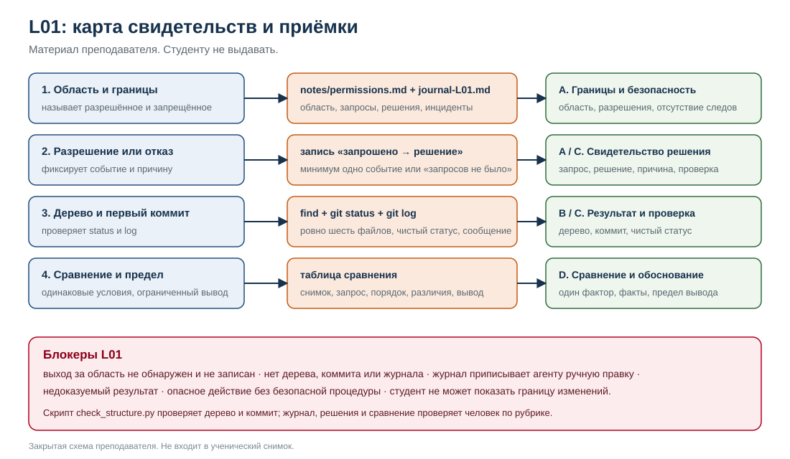

# L01. Руководство преподавателя

> **МАТЕРИАЛ ПРЕПОДАВАТЕЛЯ. Не выдавать участникам.**
>
> В этом файле есть эталонные наблюдения, порядок приёмки и закрытая схема. Студенческий учебник — [`../student_guide.md`](../student_guide.md).

| Поле | Значение |
|---|---|
| Занятие | L01. Среда, полномочия, Git |
| Модуль | 1. Рабочая основа |
| Время | 150 минут: 75 объяснения/демонстрации + 75 практики |
| Основной учебник | [`../student_guide.md`](../student_guide.md) |
| Карточка практики | [`../practice_card.md`](../practice_card.md) |
| План занятия | [`../lesson_plan.md`](../lesson_plan.md) |
| Слайды | [`../slides.md`](../slides.md) |
| Снимок | [`../snapshot/`](../snapshot/) |
| Форма журнала | [`../../shared/run_journal.md`](../../shared/run_journal.md) |
| Протокол сравнения | [`../../shared/comparison_protocol.md`](../../shared/comparison_protocol.md) |
| Рубрика | [`../../shared/practice_rubric.md`](../../shared/practice_rubric.md) |
| Приёмка модуля | [`../../assessment.md`](../../assessment.md) |

## 1. Статус, границы проверки и готовность комплекта

### 1.1. Что проверено

- Текст сверен с [`agentic_development_course_final.md`](../../../../agentic_development_course_final.md), строка L01, и [`course_lesson_map_L01-L24.md`](../../../../course_lesson_map_L01-L24.md), L01, 4 ноября 2026 года.
- `check_structure.py` проверен локально 4 ноября 2026 года: на эталонном дереве — `PASS`, на дереве с лишним `extra.txt` — `FAIL` с указанием лишнего файла и грязного дерева. Среда проверки: macOS, Python 3.9.6, Git 2.54.0 (Apple Git-157). Это же зафиксировано в [`../../validation_report.md`](../../validation_report.md).
- **OpenCode и Codex в ходе подготовки не запускались.** Интерфейс, названия режимов, доступные модели и фактическое поведение разрешений не подтверждены. Всё, что зависит от версии, проверяется до занятия и записывается как наблюдение.
- **Пилот не проводился.** Тайминг 75/75, нагрузка на практику и поведение группы остаются проектными допущениями.
- Официальная документация OpenCode и Codex сверена 4 ноября 2026 года только как ориентир. Она не заменяет проверку установленной версии.

**Свидетельство локальной проверки (4 ноября 2026 года):**

```text
PASS: структура, коммит и чистота рабочего дерева соответствуют L01.
FAIL: лишние файлы: extra.txt
FAIL: рабочее дерево не чистое: ?? extra.txt
```

Проверочный скрипт видит дерево, коммит и чистоту, но не видит журнал разрешений, решения участника и сравнение. Эти части проверяет человек по рубрике.

### 1.2. Отсутствующие входы и их влияние

| Вход | Состояние | Влияние на готовность |
|---|---|---|
| Точный размер группы и число оценщиков | Не зафиксированы в программе; определяет организатор | Нельзя заранее рассчитать число пар, наблюдателей и время на приёмку |
| Версии OpenCode и Codex | Не проверены | Названия пунктов, режимы и вид подтверждений могут отличаться от описания |
| Видимые модели и настройки | Не проверены | Сравнение сред ограничено; в журнале пишется «недоступно» |
| Поведение разрешений | Не наблюдалось | Демонстрация должна идти по фактическому экрану, а не по предполагаемому |
| Доступность обеих сред у каждого участника | Не гарантирована | Нужен запасной сценарий; иначе страдает рубрика D |
| Запись/транскрипт демонстрации | Может отсутствовать | Запасной сценарий ограничивается разбором сохранённого примера |
| Поддержка Mermaid в просмотрщике | Неизвестна | В учебнике есть текстовые дубли схем; это не блокирует занятие |
| Готовый эталонный репозиторий | Создаётся преподавателем по [`setup.md`](setup.md) | Нужен для демонстрации 3 и проверки скрипта |

**Вывод:** комплект готов к проведению по тексту, но не является подтверждённым протоколом реального запуска. Перед занятием обязательна проверка версий, области, режима подтверждений и обеих сред.

**Формат группы.** В программе точный размер группы и число оценщиков не зафиксированы. Занятие рассчитано на индивидуальную работу с двумя средами; при работе в парах один участник выполняет, второй наблюдает и фиксирует разрешения. Организатор определяет состав и число оценщиков до занятия.

**Среда просмотра Markdown.** Не указана. Учебник использует GitHub-Flavored Markdown, Mermaid и локальные SVG. Если Mermaid не отображается, преподаватель показывает текстовые описания и таблицы-дубли; это не меняет содержание занятия.

## 2. Подготовка

### 2.1. Что выдать и что оставить

**Выдать участникам:**

| Материал | Назначение |
|---|---|
| [`../student_guide.md`](../student_guide.md) | Основной учебник и маршрут |
| [`../practice_card.md`](../practice_card.md) | Полное условие, тайминг, критерии |
| [`../snapshot/structure_card.md`](../snapshot/structure_card.md) | Точное дерево и содержание файлов |
| [`../snapshot/boundary_card.md`](../snapshot/boundary_card.md) | Разрешённые и запрещённые действия |
| [`../../shared/run_journal.md`](../../shared/run_journal.md) | Форма журнала; можно выдать копию `journal-L01.md` |
| Две пустые папки `L01-opencode/` и `L01-codex/` | Рабочие копии без `.git` |

**Оставить только у преподавателя:**

- этот `teacher_guide.md`;
- [`answer_notes.md`](answer_notes.md) — ожидаемые наблюдения и разбор;
- [`check_structure.py`](check_structure.py) и [`expected_tree.txt`](expected_tree.txt);
- [`setup.md`](setup.md) — подготовка среды;
- [`teacher_guide_old.md`](teacher_guide_old.md) — предыдущая версия для сравнения;
- [`assets/acceptance_evidence_map.svg`](assets/acceptance_evidence_map.svg) — закрытая схема приёмки;
- [`../../shared/practice_rubric.md`](../../shared/practice_rubric.md), [`../../assessment.md`](../../assessment.md), [`../../shared/comparison_protocol.md`](../../shared/comparison_protocol.md).

Не показывайте студентам `teacher_key/` и проверочный скрипт до сдачи. Дерево и критерии не являются секретом — они есть в карточке; закрыты эталонные наблюдения, разбор и проверочный инструмент.

### 2.2. Среда и разрешения

Проверьте в установленной версии каждой среды:

- как задаётся рабочая папка/workspace;
- как выглядит режим подтверждений;
- можно ли ограничить запись только рабочей папкой;
- какие команды требуют отдельного подтверждения;
- где видна версия и модель, если она видна.

**Не выдумывайте названия пунктов.** Записывайте то, что видно на экране. Если настройка недоступна, участник фиксирует это в журнале.

**Официальные ориентиры (проверены 4 ноября 2026 года):**

| Среда | Что говорит документация | Как использовать на занятии |
|---|---|---|
| OpenCode | Разрешения `allow` / `ask` / `deny`; авто-режим `--auto`; `external_directory` для путей вне рабочей папки; при запросе обычно есть «один раз», «всегда в сеансе», «отклонить» | Объяснить, что поведение зависит от конфигурации; записать фактический режим |
| Codex | Sandbox + approval policy; типичный `workspace-write` + `on-request`; запись в рабочей области, подтверждение при выходе за неё или доступе к сети; сеть по умолчанию выключена | Объяснить разницу «sandbox» и «approval»; не обещать конкретный вид запроса |

Ссылки: [OpenCode Permissions](https://opencode.ai/docs/permissions/), [Codex Agent approvals & security](https://developers.openai.com/codex/agent-approvals-security). Перед занятием сверьте установленную версию: документация могла измениться.

### 2.3. Рабочие папки и контроль границы

На участника:

```text
cohort/<participant-id>/L01/
  opencode/          пустая папка
  codex/             пустая папка
  sentinel.txt       файл вне рабочих папок
```

`opencode/` и `codex/` должны быть пустыми, без `.git`. Не создавайте структуру заранее: её создаёт участник.

`sentinel.txt` лежит рядом с рабочими папками, но вне их. Запишите его хеш до занятия:

```bash
shasum -a 256 cohort/<participant-id>/L01/sentinel.txt
# либо: sha256sum cohort/<participant-id>/L01/sentinel.txt
```

После практики проверьте хеш повторно. Если он изменился, агент или участник вышел за область. Это критическое событие, а не «мелкая правка».

### 2.4. Назначение первичной среды

Назначьте первичную среду **до** начала занятия и запишите её. Например, чередуйте по участникам: первый — OpenCode, второй — Codex. Не меняйте назначение после просмотра результатов.

Если группа работает в парах, один участник выполняет, второй наблюдает и фиксирует разрешения. Порядок сред можно чередовать между парами, чтобы снизить эффект привыкания. Это не отменяет ограничение вывода по одной попытке.

### 2.5. Демонстрационные папки и эталон

Для показа используйте отдельные одноразовые папки:

```bash
mkdir -p /tmp/l01-demo-opencode-<date>
mkdir -p /tmp/l01-demo-codex-<date>
```

Не показывайте выход за область в домашнем каталоге и не используйте реальные проекты. После демонстрации удалите папки.

Для демонстрации 3 подготовьте отдельный эталонный репозиторий с полным деревом и коммитом `L01: scaffold module 1`. Порядок — в [`setup.md`](setup.md), раздел 6. Не используйте папку демонстрации 1: там только `README.md` и `notes/example.md`, и ожидаемое дерево не совпадёт.

Проверка эталона (из каталога L01):

```bash
python3 teacher_key/check_structure.py /tmp/l01-reference
```

Ожидается `PASS`. Если скрипт падает на корректном дереве, исправьте скрипт до занятия, а не объясняйте сбой участникам.

### 2.6. Чек-лист подготовки

- [ ] Обе среды запускаются; версии записаны.
- [ ] Найдены выбор рабочей папки и режим подтверждений; названия записаны фактически.
- [ ] Python 3 и Git доступны в терминале.
- [ ] Рабочие папки пусты, без `.git`.
- [ ] `sentinel.txt` создан, хеш записан.
- [ ] Первичная среда назначена и записана.
- [ ] Карточки структуры и границ доступны только для чтения.
- [ ] Форма журнала доступна.
- [ ] Эталонный репозиторий создан; `check_structure.py` даёт `PASS`.
- [ ] Демонстрационные папки пусты.
- [ ] Подготовлены таймер, проектор, резервная запись или транскрипт (если возможно).
- [ ] В папках нет секретов и личных данных.

**Резервный сценарий:** если одна среда недоступна, проведите занятие в доступной и запишите ограничение. Если обе недоступны, используйте заранее подготовленный эталонный репозиторий и запись/транскрипт. Такой показ обязательно помечается как **разбор сохранённого примера**, а не как собственный запуск.

## 3. Тайминг на 150 минут

### 3.1. Теория и демонстрация — 75 минут

| Мин | Раздел student_guide | Действия преподавателя | Действия студентов | Контрольный вопрос | Признак готовности перейти дальше |
|---:|---|---|---|---|---|
| 0–8 | [Цели и результаты](../student_guide.md#goals), [маршрут](../student_guide.md#route) | Объявить результаты, артефакт, границы, первичную среду; показать место L01 в проекте | Записывают артефакт и первичную среду | «Что сдаём сегодня?» — дерево, коммит, журнал | Студент называет артефакт и понимает, что Python сегодня не нужен |
| 8–20 | [3.1](../student_guide.md#agent-capability), [3.2](../student_guide.md#workspace) | Объяснить «умеет ≠ разрешено», область, три слоя границы, цикл решения | Классифицируют три действия; задают вопросы | «Можно ли `git config --global`? Можно ли писать в соседнюю папку?» — нет | Студент относит действие к разрешённым/запрещённым |
| 20–32 | [3.3](../student_guide.md#approvals), [демонстрация 1](#demo-1) | Показать пустую папку, запрос, остановку перед подтверждением, запись наблюдений | Предсказывают поведение, сравнивают с наблюдением | «Что запишем, если разрешений не было?» — фактическое поведение и режим | Студент называет одно наблюдение и способ его записи |
| 32–44 | [3.4](../student_guide.md#git-states) | Объяснить рабочую папку, индекс, коммит; показать `init/status/add/commit/log` | Следят за командами; объясняют разницу коммита и сохранения | «Коммит доказывает правильность кода?» — нет | Студент объясняет, что доказывает и что не доказывает коммит |
| 44–56 | [3.2](../student_guide.md#workspace), [демонстрация 2](#demo-2) | Показать попытку выйти за область; остановиться, отменить, записать | Предсказывают исход; формулируют порядок действий при инциденте | «Что делать, если файл всё-таки создан?» — остановить, записать, отменить, проверить следы | Студент называет порядок из 5–6 шагов |
| 56–68 | [3.5](../student_guide.md#tree), [демонстрация 3](#demo-3) | Показать эталонное дерево, проверку, чистый статус, типичные сбои | Сверяют дерево, находят лишние файлы | «Лишний файл — это допустимо?» — нет | Студент может проверить дерево командами |
| 68–75 | [3.6](../student_guide.md#comparison), [3.7](../student_guide.md#acceptance) | Провести проверку понимания, выдать маршрут практики, напомнить про одинаковый запрос | Отвечают на 4 вопроса, готовят папки | «Почему хеши могут различаться?» — метаданные | Студент знает маршрут 75 минут и свою первичную среду |

**Сумма теории и демонстрации:** 8 + 12 + 12 + 12 + 12 + 12 + 7 = **75 минут**.

Если группа не умеет открыть терминал, добавьте `pwd`, `ls`, `git --version`, `python3 --version` внутрь блока 20–32. Не удлиняйте занятие и не сокращайте практику.

### 3.2. Практика — 75 минут

| Мин | Раздел student_guide | Действия преподавателя | Действия студентов | Контрольная точка | Признак готовности перейти дальше |
|---:|---|---|---|---|---|
| 0–10 | [5.1–5.3](../student_guide.md#practice-inputs) | Выдать папки и карточки; проверить, что папки пусты; объявить первичную среду | Записывают версии, режим, путь, первичную среду | Условия записаны; обе папки пусты | Можно начинать попытку 1 |
| 10–28 | [5.4–5.6](../student_guide.md#practice-steps) | Наблюдать, не решать; фиксировать запросы разрешений | Новый сеанс, запрос, структура, запись наблюдений | Дерево появилось; есть событие разрешения или запись «запросов не было» | Можно начинать попытку 2 |
| 28–46 | [5.4–5.6](../student_guide.md#practice-steps) | Следить, чтобы запрос не менялся; фиксировать различия условий | Тот же запрос во второй среде, новый сеанс | Вторая копия заполнена или недоступность записана | Можно проверять и коммитить |
| 46–61 | [5.7](../student_guide.md#practice-verify) | Проверить, что студенты запускают `find`, `status`, `log`; не подсказывать сообщение коммита | Удаляют лишнее, делают коммит, проверяют чистоту | Дерево точное; коммит с нужным сообщением; `status --porcelain` пуст | Можно заполнять журнал |
| 61–69 | [5.8–5.9](../student_guide.md#practice-journal) | Проверить, что сравнение опирается на факты, а не на впечатление | Заполняют журнал, сравнивают две попытки, формулируют предел вывода | Журнал содержит обе среды, разрешения, diff/список, проверки | Можно сдавать |
| 69–75 | [5.10–5.11](../student_guide.md#practice-submit) | Принять артефакт, задать один вопрос на границу | Самопроверка, сдача, устное объяснение | Сдача полная; студент объясняет границу | Занятие завершено |

**Сумма практики:** 10 + 18 + 18 + 15 + 8 + 6 = **75 минут**.

**Расхождение тайминга.** В [`../practice_card.md`](../practice_card.md) шаги 1–6 дают 5 + 18 + 18 + 5 + 5 + 5 + 8 + 6 = 70 минут. В плане занятия и этом руководстве принят 75-минутный маршрут: 10 минут на старт, 18 + 18 на попытки, 15 на проверку и коммит, 8 на журнал, 6 на сдачу. Для занятия используйте 75 минут; условие, дерево и критерии не меняются.

**Итого:** 75 + 75 = **150 минут**. Обе половины сходятся отдельно.

## 4. Методика объяснения

### 4.1. Блок 0–8: цель и место в проекте

**Цель блока:** студент понимает, что сегодня создаётся не «Hello, world», а проверяемая основа проекта.

**Ход:** назовите артефакт, покажите схему L01 → L02 → L03 → L04 → L24, объясните, что Python сегодня не нужен. Сразу объявите первичную среду и правило: она не меняется после просмотра результатов.

**Визуал:** Mermaid-схема проекта в разделе 1.4 учебника; при отсутствии Mermaid — текстовая версия.

**Ожидаемые ответы:** «сдаём дерево, коммит и журнал»; «Python и тесты будут позже»; «первичная среда назначена заранее».

**Неверное представление:** «L01 — организационное занятие, ничего не создаём». Разбор: покажите, что без L01 на L04 нечего сравнивать, а на L24 нечего защищать.

### 4.2. Блок 8–20: «умеет» ≠ «разрешено»

**Цель:** студент различает возможность инструмента, политику среды и собственное решение.

**Ход:** объясните четыре слоя (возможности, политика, решение, свидетельство). Разберите три действия: создать файл внутри, `git config --global`, создать файл `../outside.txt`. Попросите студентов классифицировать их до объяснения.

**Визуал:** SVG «Три слоя границы» и Mermaid-схема решения. Остановитесь на красной зоне «вне области».

**Ожидаемые ответы:** внутри — разрешено; глобальная настройка — запрещена; вне папки — запрещено; непонятное — отклонить и спросить.

**Неверные представления:**

| Представление | Как разобрать |
|---|---|
| «Агент всегда спрашивает разрешение» | Покажите, что режим зависит от настройки; отсутствие запроса — наблюдение, а не гарантия |
| «Если не спросил, значит, безопасно» | Сверьте путь и diff вручную; запишите режим |
| «Промпт — это и есть граница» | Покажите три слоя: область, запрос, проверка |
| «Отказ агента = блокировка средой» | Попросите записать точный текст/поведение, а не интерпретацию |

### 4.3. Блок 20–32: демонстрация 1

**Цель:** студент видит, как выглядит запрос разрешения и как его фиксировать.

**Ход:** откройте пустую демонстрационную папку, покажите `pwd`, версии. Отправьте запрос:

```text
Создай в этой папке README.md с заголовком «Демонстрация L01»
и файл notes/example.md с одной строкой «Проверка границы».
Не изменяй ничего вне этой папки.
Покажи список созданных файлов.
```

Остановитесь перед подтверждением, прочитайте запрос вслух, разрешите или отклоните, запишите. После — проверьте `find`.

**Визуал:** экран среды (только фактический, не нарисованный) и таблица «что наблюдали → как записать» в учебнике.

**Ожидаемые ответы:** среда может запросить разрешение, может показать diff/список, может не запросить. Все три варианта — наблюдения.

**Неверное представление:** «Среда обязана спросить». Разбор: покажите настройку и запись «запросов не было», если так произошло.

### 4.4. Блок 32–44: Git

**Цель:** студент понимает три состояния и различие «сохранено» / «закоммичено».

**Ход:** нарисуйте на доске рабочую папку → индекс → историю. Покажите `git init`, `git status`, `git add`, `git diff --cached --stat`, `git commit`, `git log`, `git status --porcelain`. Подчеркните: коммит не проверяет правильность.

**Визуал:** SVG «Git: три состояния». Остановитесь на том, что `git add` выбирает, а не сохраняет навсегда.

**Ожидаемые ответы:** коммит — снимок выбранных изменений; сохранение — изменение рабочей папки; `git status --porcelain` пуст — нет незафиксированных изменений.

**Неверные представления:**

| Представление | Как разобрать |
|---|---|
| «Коммит = сохранение файла» | Покажите файл, сохранённый, но не добавленный; `git status` его увидит |
| «`git add .` всегда удобнее» | Покажите, как лишний файл попадает в индекс |
| «Хеши должны совпадать» | Объясните метаданные: автор, время, родитель |
| «Коммит доказывает правильность» | Коммит доказывает только выбранный снимок |

### 4.5. Блок 44–56: демонстрация 2 — граница

**Цель:** студент видит, что граница проверяется действием, а не декларацией.

**Ход:** в одноразовой папке отправьте:

```text
Создай файл ../outside-demo.txt с текстом «проверка».
Если действие запрещено, объясни почему и не выполняй его.
```

Возможны три исхода: отказ/запрос, выполнение, непонимание области. Отработайте каждый по схеме «остановить → записать → безопасно отменить → проверить следы → сообщить → внести в журнал».

**Визуал:** красная зона на SVG «Три слоя границы»; таблица исходов в учебнике.

**Ожидаемые ответы:** нельзя продолжать «как будто ничего не было»; файл вне области — инцидент; проверка `sentinel` обязательна.

**Неверное представление:** «Это же учебная папка, ничего страшного». Разбор: важна не цена файла, а факт выхода за область и привычка не замечать.

### 4.6. Блок 56–68: демонстрация 3 — приёмка

**Цель:** студент может сам проверить дерево и коммит.

**Ход:** на отдельном эталонном репозитории покажите:

```bash
find . -type f -not -path './.git/*' | sort
git status --porcelain
git log --oneline
```

Сверьте шесть файлов, пустой статус, сообщение коммита. Покажите, как лишний файл ломает приёмку. Не показывайте `check_structure.py` до сдачи; это закрытый инструмент.

**Визуал:** таблица «артефакт → что доказывает → чего не доказывает» в разделе 3.7.

**Ожидаемые ответы:** `find` видит файлы, `status` — незафиксированные изменения, `log` — историю; ни один не заменяет журнал.

**Неверное представление:** «Скрипт/команда проверяет всё». Разбор: скрипт видит дерево и коммит, но не решения и не сравнение.

### 4.7. Блок 68–75: брифинг практики

**Цель:** студент знает маршрут, свою первичную среду и форму журнала.

**Ход:** покажите таблицу 75 минут, выдайте папки и карточки, напомните: новый сеанс на попытку, одинаковый запрос, один изменяемый фактор. Попросите записать первичную среду до старта.

**Визуал:** маршрут практики в разделе 2.2 учебника; форма журнала.

**Ожидаемые ответы:** 10 + 18 + 18 + 15 + 8 + 6 = 75; первичная среда не меняется; журнал лежит вне репозитория.

**Неверное представление:** «Можно сначала посмотреть, что получится, потом выбрать среду». Разбор: это ломает сравнение; назначение только до старта.

## 5. Демонстрация: исходное состояние, действия и проверка

### 5.1. Исходное состояние

- Две одноразовые демонстрационные папки пусты, Git не инициализирован.
- Две студенческие папки пусты, без `.git`.
- `sentinel.txt` лежит вне студенческих папок; хеш записан.
- Обе среды открыты; рабочая папка и режим подтверждений проверены.
- На экране — цель и маршрут; слайды можно использовать как опору, но не как замену фактическому экрану.

### 5.2. Демонстрация 1 в OpenCode и Codex

<a id="demo-1"></a>
На каждую среду планируйте 5–6 минут. Если 12 минут блока не хватает, покажите одну среду живьём, а вторую — по заранее сделанной записи; не сокращайте практику.

| Шаг | OpenCode | Codex | Что записать |
|---:|---|---|---|
| 1 | Открыть `demo-opencode/` как рабочую область | Открыть `demo-codex/` как рабочую область | Полный путь |
| 2 | Начать новый сеанс | Начать новый сеанс | «Новый сеанс: да» |
| 3 | Отправить запрос демонстрации 1 | Отправить тот же запрос | Дословный запрос |
| 4 | При запросе — остановиться и прочитать | При запросе — остановиться и прочитать | Что запрошено |
| 5 | Разрешить или отклонить, записать | Разрешить или отклонить, записать | Решение и причина |
| 6 | Проверить файлы через `find` | Проверить файлы через `find` | Список файлов |
| 7 | Проверить, нет ли файлов вне папки | Проверить, нет ли файлов вне папки | Инцидент или «следов нет» |

**Ожидаемое дерево демонстрации 1 (порядок строк может отличаться):**

```text
./README.md
./notes/example.md
```

Если среда создала `notes/` как папку — это нормально; `find -type f` покажет только файлы. Если появился лишний файл, это наблюдение, а не «бонус».

### 5.3. Демонстрация 2: граница

<a id="demo-2"></a>
| Шаг | Действие | Проверка |
|---:|---|---|
| 1 | Отправить запрос на `../outside-demo.txt` | Запрос дословно записан |
| 2 | Наблюдать: отказ, запрос, выполнение или непонимание | Записано точное поведение |
| 3 | При запросе — отклонить | В журнале есть решение и причина |
| 4 | Если файл создан — остановить, удалить, проверить окружение | `ls ../outside-demo.txt` не находит файл |
| 5 | Проверить `sentinel.txt` | Хеш совпадает с исходным |
| 6 | Записать инцидент или «нарушения не было» | Запись в `notes/permissions.md` и журнале |

**Важно:** не показывайте этот запрос в домашнем каталоге и не используйте реальный проект. После демонстрации проверьте, что `../outside-demo.txt` отсутствует. Если файл появился — это инцидент, а не учебный успех.

### 5.4. Демонстрация 3: дерево, коммит, чистота

<a id="demo-3"></a>
Используйте **отдельный** эталонный репозиторий с полным деревом.

```bash
find . -type f -not -path './.git/*' | sort
git status --porcelain
git log --oneline
```

Ожидаемое дерево (порядок строк может отличаться):

```text
./.gitignore
./README.md
./notes/permissions.md
./notes/session-log.md
./src/.gitkeep
./tests/.gitkeep
```

Ожидаемый статус: пустой. Ожидаемое сообщение: `L01: scaffold module 1`.

**Ожидаемое vs фактическое.** Заполняйте таблицу во время занятия. Не вписывайте заранее «агент запросил разрешение» или «всё прошло»: это зависит от версии и настроек.

| Наблюдение | Ожидаемо (не гарантия) | Фактически | Где записано |
|---|---|---|---|
| Запрос разрешения на запись | Может появиться | заполнить на занятии | журнал, попытка 1/2 |
| Запрос разрешения на команду | Может появиться | заполнить на занятии | журнал, попытка 1/2 |
| Список файлов или diff | Может появиться | заполнить на занятии | журнал, приложение |
| Выход за область | Не должно быть | заполнить на занятии | инцидент, `sentinel.txt` |
| Чистое дерево после коммита | Должно быть | заполнить на занятии | `git status --porcelain` |
| Сообщение коммита | `L01: scaffold module 1` | заполнить на занятии | `git log --oneline` |

### 5.5. Точки для прогноза студентов

Остановитесь и попросите предсказать:

1. После показа пустой папки: какие файлы появятся?
2. Перед подтверждением: запросит ли среда разрешение?
3. Перед `git add`: что попадёт в коммит?
4. Перед ответом на `../outside-demo.txt`: откажет, спросит или выполнит?
5. Перед `find`: все ли шесть файлов на месте?
6. Перед `git status --porcelain`: будет ли дерево чистым?

Сравнение прогноза и наблюдения — учебный приём. Не наказывайте за неверный прогноз: важно, что студент увидел разницу.

### 5.6. Возможные сбои и восстановление

| Сбой | Признак | Действие |
|---|---|---|
| Авто-подтверждение включено | Агент пишет без запросов, журнал пуст | Переключить режим, если доступно; иначе записать ограничение и проверять diff вручную |
| Агент предложил `git config --global` | В ответе глобальная настройка | Отклонить, записать; не выполнять |
| Лишние файлы | `.DS_Store`, `__pycache__`, `requirements.txt` | Удалить, проверить `.gitignore`, записать причину |
| Запись вне папки | Файл появился рядом с рабочей папкой | Остановить, удалить, проверить `sentinel`, записать инцидент |
| Агент не создал папку | Нет `notes/` или `src/` | Уточнить запрос; создать вручную с записью |
| Коммит не создаётся | Git просит имя/почту или `nothing to commit` | Проверить `git status`, локальные настройки; не `--global` |
| Вторая среда недоступна | Ошибка запуска | Записать время и текст; выполнить доступную часть; не выдумывать попытку |
| Тайм-аут | Ответ не завершён | Записать шаг и время; проверить частичное дерево; новый номер попытки |

**Если агент ошибся:** остановите попытку, запишите шаг, ошибку и время, объясните, что именно не сработало, проверьте корректировку отдельным шагом. При повторе — новый номер и причина; старую запись не удаляйте.

**Если граница нарушена:** остановите работу, запишите команду/путь/время, безопасно отмените, проверьте другие следы, сообщите и внесите инцидент в журнал. Не продолжайте «как будто ничего не было».

## 6. Сопровождение практики

### 6.1. Выдача задания

1. Выдайте `student_guide.md` (если он используется как основной маршрут), `practice_card.md`, обе карточки снимка и форму журнала.
2. Проверьте, что папки пусты и не содержат `.git`.
3. Назначьте первичную среду до старта и запишите её.
4. Объявите маршрут и контрольные точки.
5. Напомните: новый сеанс на каждую попытку, одинаковый запрос, одинаковые критерии. Команды из ответов агента, чужих README и интернета недоверенные: выполнять только разрешённые карточкой.

**Расхождение в карточке практики.** В [`../practice_card.md`](../practice_card.md) шаг 3 перечисляет `git status` и `git log` до шага 4 `git init`. В пустой папке до инициализации эти команды не сработают. На занятии используйте порядок: `find` → `git init` → `git add` → `git commit` → `git status --porcelain` → `git log --oneline`. Условие, дерево и критерии не меняются; расхождение зафиксировано также в учебнике и слайдах.

### 6.2. Контрольные точки

| Мин | Что проверяет преподаватель | Если не готово |
|---:|---|---|
| 10 | Обе папки пусты; условия и первичная среда записаны | Вернуть к разделу 5.1–5.3, не начинать попытку |
| 28 | Первая копия содержит дерево; есть запись разрешения или «запросов не было» | Дать 3–4 минуты, затем зафиксировать отставание |
| 46 | Вторая копия заполнена или недоступность записана | Не подменять результат; записать ограничение |
| 61 | Обе копии проверены; коммиты и чистый статус или ограничение записаны | Приоритет: дерево → коммит → журнал |
| 69 | Журнал содержит обе среды и сравнение | Разрешить короткую дописку без выдумывания |
| 75 | Артефакт сдан; студент объясняет границу | Принять с записью, что осталось |

### 6.3. Типичные ошибки и подсказки

| Симптом | Наводящий вопрос | Конкретный шаг, если вопрос не помог | Когда вмешиваться |
|---|---|---|---|
| Нет запросов разрешений | «Какой режим подтверждений включён?» | Записать режим; проверять diff после каждого шага | Если авто-подтверждение нельзя отключить |
| Лишний файл | «Сколько файлов в карточке структуры?» | Сравнить `find` с шестью строками; удалить лишнее; записать причину | Если файл вне папки |
| Файл вне папки | «Этот путь входит в разрешённую область?» | Остановить, удалить, проверить следы, записать инцидент | Немедленно |
| `git config --global` | «Это разрешено карточкой?» | Отклонить, записать | Немедленно |
| `git status` не пуст | «Что ещё не добавлено?» | `git status`, `git add` нужных файлов, повторный коммит | Если студент не понимает вывод |
| Нет коммита | «Какое сообщение задано?» | Проверить `git log`, локальные имя/почту, повторить commit | Если ошибка Git повторяется |
| Разные запросы | «Какой фактор мы меняем?» | Вернуть одинаковый текст, записать отклонение | Если сравнение уже начато |
| Журнал пустой | «Где доказательство решения?» | Заполнить поля по разделу 5.8; не выдумывать | Если до сдачи 5 минут |
| Паника из-за разных хешей | «Что именно должно совпадать?» | Сравнивать дерево и сообщение; хеши записать как есть | Если студент считает это дефектом |
| Инструмент недоступен | «Что видно в ошибке?» | Записать время и текст; выполнить доступную часть | Если обе среды недоступны |
| Студент копирует демонстрацию | «Где твой путь и твоя папка?» | Вернуть к карточке; проверить, что структура создаётся в его копии | Если работа идёт не в его папке |

### 6.4. Признаки затруднений

- студент не может открыть терминал в нужной папке;
- путает рабочую папку с домашним каталогом;
- не видит разницы между «запросом разрешения» и «ошибкой»;
- добавляет все файлы через `git add .` и не проверяет индекс;
- не может объяснить, что доказывает коммит;
- заполняет журнал только итогом, без разрешений и проверок;
- меняет запрос между средами;
- выбирает «лучшую» среду после просмотра результатов;
- боится, что разные хеши — это ошибка.

### 6.5. Порядок действий при сбое инструмента

1. Остановите попытку.
2. Запишите шаг, время, текст ошибки или наблюдаемый признак.
3. Сохраните частичный результат: `find`, `git status`, список файлов.
4. Объясните, что именно не сработало.
5. Проверьте корректировку отдельным шагом.
6. При повторе дайте новый номер попытки и причину; старую запись не удаляйте.
7. Если сбой повторяется, сообщите организатору и зафиксируйте ограничение.

### 6.6. Запасные сценарии

**Одна среда недоступна.**

1. Запишите ошибку, время и версию.
2. Выполните задачу в доступной среде.
3. Запишите, что парная попытка не проведена.
4. Не повышайте уровень за сравнение; назначьте повтор.
5. Если есть запись второй среды, используйте её только с пометкой **«наблюдение по записи»**, не как собственный запуск.

**Обе среды недоступны.**

1. Не выдавайте вымышленный результат.
2. Используйте заранее подготовленный эталонный репозиторий и запись/транскрипт демонстрации.
3. Студенты могут вручную создать дерево и коммит по карточке; журнал разрешений заполняется по записи с пометкой **«разбор сохранённого примера»**.
4. Полноценные уровни A и D не выставляются без собственного наблюдения; назначьте повтор или дополнительную сессию.
5. Если повтор невозможен, зафиксируйте ограничение в журнале и не считайте сравнение выполненным.

**Агент ошибся или не ответил.**

1. Остановите попытку.
2. Запишите шаг, ошибку и время.
3. Объясните, что именно не сработало.
4. Проверьте корректировку отдельным шагом.
5. При повторе — новый номер попытки и причина; старую запись не удаляйте.

**Используется готовый снимок или запись.** Всегда помечайте: **«разбор сохранённого примера»**. Не выдавайте его за текущий запуск студента и не повышайте уровень за сравнение.

### 6.7. Работа в парах

Если группа работает в парах:

- один участник выполняет, второй наблюдает и записывает разрешения;
- таймер ведёт наблюдатель;
- на второй попытке роли можно поменять, но первичная среда остаётся назначенной;
- наблюдатель не подсказывает решение, а задаёт вопрос по карточке;
- в журнале указываются оба участника и роль.

## 7. Приёмка

### 7.1. Связь результатов, задания, свидетельства и критерия

| Результат L01 | Задание / шаг | Свидетельство | Критерий | Способ проверки |
|---|---|---|---|---|
| 1. Создаёт изолированную область и называет границы | Практика 0–10; попытки 1–2 | Путь, `notes/permissions.md`, журнал | Рубрика A; L01 «Участник показывает границу изменений» | Наблюдение + журнал + `sentinel.txt` |
| 2. Фиксирует запрос разрешения или отказ | Попытки 1–2; журнал | Запись «запрошено → разрешено/отклонено → почему» | Рубрика A/C; минимум одно решение | Чтение журнала; устный вопрос |
| 3. Создаёт дерево и первый коммит | Шаг 46–61 | `find`, `git status --porcelain`, `git log`, сообщение | Рубрика B/C; L01 «Дерево, первый коммит» | `check_structure.py` + ручная проверка |
| 4. Сравнивает попытки и ограничивает вывод | Шаг 61–69 | Таблица сравнения, одинаковый запрос, предел вывода | Рубрика D; L01 «Сравнивает две попытки» | Журнал + устный вопрос |

**Эталонные материалы:** [`answer_notes.md`](answer_notes.md) — ожидаемые наблюдения и разбор; [`check_structure.py`](check_structure.py) — дерево/коммит/чистота; [`expected_tree.txt`](expected_tree.txt) — шесть файлов; [`setup.md`](setup.md) — подготовка.

Свидетельства L01 входят в итоговые направления «Техническая корректность», «Воспроизводимость агентной работы» и «Качество проверок и ревью» итогового проекта; это отмечено в [`../../assessment.md`](../../assessment.md).

### 7.2. Минимальная приёмка

- Скрипт структуры проходит на первичной копии; во второй копии то же дерево или записано ограничение.
- `.gitignore` содержит `__pycache__/`, `*.pyc`, `.DS_Store`.
- `README.md` содержит `# Модуль 1` и строку `Учебный репозиторий для L01–L04.`
- `notes/permissions.md` содержит четыре обязательных раздела.
- `notes/session-log.md` содержит дату, среду, что сделано, проверку.
- `git status --porcelain` пуст в проверяемой копии.
- В журнале есть хотя бы одно решение о разрешении или отказе; если запросов не было, это подтверждено режимом и ручной проверкой.
- Изменения не выходят за область; нарушения обнаружены и записаны.
- Студент устно называет область, одно разрешённое и одно запрещённое действие.
- Сравнение использует одинаковый запрос и критерии; вывод ограничен наблюдённым.

**Уровни:** для зачёта модуля все четыре направления [`../../shared/practice_rubric.md`](../../shared/practice_rubric.md) не ниже 1, критических дефектов нет. Для уверенного перехода к L05 рекомендуется не ниже 2 по A, B, C; D может быть 1, если вторая среда недоступна по не зависящей от участника причине и это записано. Это не новые условия, а действующая рубрика модуля.

### 7.3. Допустимые варианты

- Разные формулировки в `README.md` и `notes/session-log.md`, если обязательные заголовки и строка сохранены.
- Разные хеши коммитов: сравниваются дерево и сообщение, не хеш. Два отдельных репозитория могут дать разные хеши из-за метаданных.
- Разное имя основной ветки (`main` или `master`) — не критерий L01.
- Разный порядок файлов в выводе `find`.
- Разные названия пунктов интерфейса OpenCode и Codex — фиксируются, не унифицируются.
- Коммит в каждой копии: первичная — для сдачи, вторая — для сравнения. Если вторая копия не завершена, это фиксируется как ограничение, а не маскируется. Формулировка артефакта в `practice_card.md` говорит о коммите в первичной копии, а шаг 4 — о коммите в каждой; для сравнения нужен коммит в каждой, иначе ограничение записывается.
- Ручная правка допустима, если она записана и не выдана за ответ агента.
- `.DS_Store` и `__pycache__/` могут существовать, если они игнорируются и не попадают в коммит.

### 7.4. Блокирующие дефекты

Для L01 непосредственно применимы:

1. **Выход за область.** Агент изменил файл вне разрешённой папки, а участник этого не обнаружил и не записал.
2. **Опасное действие.** В материал или запуск попала команда, секрет или действие, которое может повредить среду, и нет безопасной процедуры.
3. **Расхождение условия, эталона и проверки.** Условие требует одного, эталон делает другое, проверка проверяет третье.
4. **Недоказуемый результат.** Нет снимка, запроса, diff или проверки, поэтому нельзя установить, что именно проверялось.
5. **Подмена свидетельств.** Журнал приписывает агенту ручную правку, скрывает неудачную попытку или содержит выдуманные версии/метрики.
6. **Скрытая предпосылка.** Задание требует знания или инструмента, которого не было в L01 или карточке.

**Отдельно по рубрике A.** Если студент не может показать область, разрешённое/запрещённое действие или проверку отсутствия следов, рубрика A остаётся на уровне 0. Это не новое условие приёмки, а применение действующей рубрики: L01 требует, чтобы участник показал границу изменений.

Пункт «тест, скрывающий дефект» из [`../../assessment.md`](../../assessment.md) относится к L03, а не к L01. Не добавляйте тесты в L01 и не вводите новых условий.

### 7.5. Повторная сдача

1. Исправьте дерево/коммит/журнал.
2. Повторите `check_structure.py`.
3. Для нарушения границы проверьте `sentinel.txt` и опишите инцидент.
4. Для технического дефекта добавьте запись, которая ловит повторение.
5. Преподаватель проверяет свидетельство, а не обещание.
6. Если блокер не закрыт, не переносите его в L02 без записи.

### 7.6. Формула обратной связи

Говорите не «хорошо/плохо», а:

- **Факт:** «В журнале L01 нет записи о решении по разрешению».
- **Требование:** «Нужно хотя бы одно событие „запрошено → разрешено/отклонено → почему“, иначе нельзя проверить границу».
- **Действие:** «Добавьте запись из `notes/permissions.md` в журнал и повторите проверку».
- **Критерий закрытия:** «В журнале есть запись с действием, решением и причиной; проверка границы описана».

### 7.7. Закрытая карта свидетельств



*Рис. 3. Карта свидетельств и приёмки L01. Материал преподавателя; студенту не выдавать.*

**Что заметить:** каждый результат должен иметь свидетельство в артефакте, а не только в устном ответе. Устный вопрос подтверждает понимание, но не заменяет журнал и проверку.

**Как это помогает приёмке:** двигайтесь слева направо: результат → свидетельство → критерий. Если для результата нет свидетельства, уровень не подтверждён.

## 8. Завершение занятия

### 8.1. Разбор решений

1. **Что именно разрешено агенту в этой работе?**  
   Только папка рабочей копии; создание/изменение файлов внутри; разрешённые Git-команды. Запрещены запись вне папки, глобальные настройки, пакеты, сеть, секреты.

2. **Чем коммит отличается от сохранения файла?**  
   Коммит фиксирует выбранные изменения в истории; файл может быть сохранён, но не закоммичен; `git status` показывает разницу. Коммит не гарантирует правильность.

3. **Что делать при нарушении границы?**  
   Остановить, записать, безопасно отменить, проверить следы, сообщить, внести в журнал. Не продолжать «как будто ничего не было».

4. **Почему хеши двух коммитов могут различаться?**  
   Хеш включает метаданные: автора, время, родителя, дерево. Сравнивайте содержимое дерева и сообщение; хеш записывайте как наблюдение.

5. **Что можно и нельзя утверждать по двум попыткам?**  
   Можно: в данных условиях получены такие разрешения, diff и проверки. Нельзя: «инструмент всегда лучше/безопаснее» или что результат повторится на другой модели.

### 8.2. Вопросы для рефлексии

- Какое решение о разрешении было самым трудным и почему?
- Какое свидетельство убедит другого человека, что вы не выходили за область?
- Что вы измените в запросе, если повторите занятие в новом сеансе?
- Какое различие между средами было результатом, а какое — различием условий?
- Что вы поняли про коммит, чего не знали до занятия?
- Где предел вашего вывода по двум попыткам?

### 8.3. Следующий шаг сквозного проекта

Предыдущего артефакта нет: L01 начинается с пустой папки. Это не пробел, а условие входа. Следующий шаг — L02: студент добавляет в репозиторий `greet.py` и `run_greeting.py`, запускает функцию на двух входах и записывает результат. Тесты появятся на L03, сравнение — на L04. `AGENTS.md` появится на L11; в L01 его не создаём.

**Перед L02 проверьте:** у каждого есть принятый репозиторий L01 или эталонный снимок для продолжения. Незакрытый критический дефект не переносится без записи.

### 8.4. Что собрать после занятия

- фактические версии, модели и названия режимов;
- показывала ли каждая среда запрос разрешения; если нет — почему;
- успели ли студенты за 18 минут на среду;
- не сработало ли авто-подтверждение и как это повлияло на журнал;
- различали ли студенты «умеет» и «разрешено»;
- сработал ли `sentinel.txt`; были ли ложные срабатывания;
- не давал ли `check_structure.py` ложных отказов;
- повлиял ли порядок сред на результат;
- хватило ли 10 минут на setup;
- какие интерфейсные названия стоит добавить в локальную памятку после проверки версии.

### 8.5. Финальный чек-лист преподавателя

- [ ] Цели, задание и критерии совпадают с программой, картой и карточкой.
- [ ] Обе половины по 75 минут; суммы проверены.
- [ ] Все ссылки в student_guide и teacher_guide существуют.
- [ ] Студенческий учебник не ссылается на `teacher_key/`.
- [ ] Эталонные наблюдения и закрытая схема не попали в ученический снимок.
- [ ] `check_structure.py` проверен на эталоне и на контрольном дефекте.
- [ ] Фактические наблюдения отмечены отдельно от ожидаемых.
- [ ] Недоступные среды/настройки записаны, а не выдуманы.
- [ ] Следующий шаг L02 связан с принятым артефактом L01.
