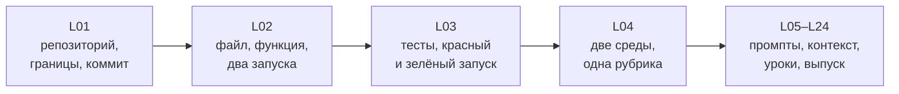

# L02. Минимальный Python

> **Основной учебник занятия.** Обязательная часть — разделы 1–6. Раздел 7 «Углубление» необязателен и не добавляет работы сверх 150 минут. Как читать руководство и почему «Углубление» не входит в сдачу — кратко в [L01](../L01/student_guide.md#как-читать-руководство).

## Паспорт занятия

| Поле | Значение |
|---|---|
| Курс | «Разработка с помощью AI-агентов: создаём курс Python с нуля в OpenCode и Codex» |
| Модуль | 1. Рабочая основа |
| Занятие | L02. Минимальный Python |
| Время | 150 минут: 75 минут объяснения и демонстрации + 75 минут практики |
| Формат группы | Точный размер группы и число оценщиков в утверждённой программе не зафиксированы. Занятие рассчитано на индивидуальную работу с двумя средами; в паре один наблюдает и записывает условия. |
| Входные знания | L01: рабочая папка, первый коммит, границы действий, чтение вывода терминала. Python не требуется. |
| Вход | Рабочие копии L01, файлы `greet.py` и `run_greeting.py` из `snapshot/`, форма журнала |
| Наблюдаемые результаты | 1) запускает файл и объясняет вход/выход; 2) реализует функцию для двух имён; 3) читает сообщение об ошибке; 4) записывает ожидаемый и фактический вывод |
| Артефакт | `greet.py` с функцией, два запуска, журнал сравнения |
| Способ проверки | `python3 run_greeting.py` даёт код 0 и два совпадения; diff меняет только `greet.py`; журнал содержит обе среды и объяснение |
| Следующий шаг | L03: перевести три поведения в тесты, увидеть красный запуск и исправить дефект |

**Статус проверки.** Текст сверен с программой, картой занятий, планом L02 и `practice_card.md` 4 ноября 2026 года. Python-примеры разделов 3–4 запускались локально 4 ноября 2026 года; команды и результаты — в [`validation_report.md`](../../textbook/validation_report.md). OpenCode и Codex в ходе подготовки не запускались: их интерфейс, модели, разрешения и время не считаются проверенными до пилота. Тайминг 75/75 остаётся проектным допущением до фактического прохождения.

## 1. Зачем этот приём в сквозном проекте

На L01 вы создали пустой, но проверяемый репозиторий: файлы, коммит, границы. В нём пока нет ни одной исполняемой строки. L02 добавляет первый работающий код — маленькую функцию, которую можно вызвать, получить строку и сравнить с ожиданием.

Это нужно не ради функции приветствия. Вы осваиваете базовый цикл, на котором держится вся дальнейшая работа с агентом:

```text
задать вход → получить результат → сравнить с ожидаемым → записать свидетельство
```

Позже этот цикл станет тестом (L03), проверкой примера в уроке (L16), автоматической командой (L22) и сравнением двух инструментов (L23). Если сейчас вы не отличаете «напечатало похоже» от «вернуло ровно то, что требовалось», дальше будет невозможно доказать ни один результат агента.



*Рис. 1. Место L02 в сквозной линии. Схема показывает, что L02 — первый исполняемый слой проекта, а не отдельное упражнение по синтаксису.*

**Текстовая версия:** L01 создаёт репозиторий → L02 добавляет функцию и два запуска → L03 превращает поведения в тесты → L04 сравнивает две среды → дальнейшие модули используют этот цикл проверки.

**Что заметить:** L02 не вводит тесты. Это не пропущенная тема, а последовательность: сначала вы вручную видите разницу между ожидаемым и фактическим, затем L03 формализует её в тесте. Тест без понимания поведения превращается в подгонку.

**Как это помогает следующему шагу:** файл `greet.py` и журнал двух запусков станут входом L03. Если вы не сохранили фактический вывод, на L03 будет нечего сравнивать с красным запуском.

## 2. Наблюдаемые результаты и маршрут 75 + 75

### 2.1. Что вы сможете к концу занятия

| Результат | Как вы его покажете | Что считается свидетельством |
|---|---|---|
| 1. Запускаете Python-файл и объясняете вход и выход | Запускаете `run_greeting.py` из корня копии | Команда, полный вывод, код возврата |
| 2. Реализуете функцию `greet` для двух заданных имён | Оба вызова дают требуемую строку | Фактический вывод против ожидаемого |
| 3. Читаете сообщение об ошибке | Называете тип ошибки и строку/имя, из-за которого запуск не удался | Traceback и ваше объяснение |
| 4. Записываете два запуска и объясняете совпадение или расхождение | Заполняете журнал по обеим средам | Ожидаемое, фактическое, код возврата, ручные правки |

**Главная мысль занятия:** `print` показывает текст человеку, а `return` отдаёт значение программе. Проверка сравнивает возвращённое значение, поэтому «на экране похоже» ещё не значит «функция работает правильно».

### 2.2. Первые 75 минут: объяснение и демонстрация

| Минуты | Что происходит | Что делать вам |
|---:|---|---|
| 0–8 | Цель, артефакт, связь с L01, правило «сначала запустить» | Записать, что сдаёте, и какая среда назначена первичной |
| 8–20 | Анатомия файла: функция, параметр, `return`, строка, f-строка | Сформулировать разницу между «напечатать» и «вернуть» |
| 20–32 | Демонстрация 1: `welcome(city)` на двух городах | Предсказать вывод до запуска |
| 32–44 | Демонстрация 2: ожидаемое/фактическое, код возврата | Объяснить, чем совпадение отличается от догадки |
| 44–56 | Демонстрация 3: `NameError`, отступ, `None`, кавычки | Прочитать traceback и назвать причину |
| 56–68 | Запрос агенту: один файл, границы, проверка результата | Сверить запрос с четырьмя полями |
| 68–75 | Брифинг практики: две копии, одинаковый запрос, журнал | Записать свой маршрут и первичную среду |

**Проверка маршрута:** 8 + 12 + 12 + 12 + 12 + 12 + 7 = 75 минут.

### 2.3. Вторые 75 минут: практика

| Минуты | Шаг | Промежуточная проверка |
|---:|---|---|
| 0–5 | Прочитать карточку, скопировать снимок в обе копии, записать условия | Оба файла на месте, `run_greeting.py` не изменён |
| 5–23 | Попытка 1: реализовать и запустить | Есть вывод или traceback; запрос дословно сохранён |
| 23–41 | Попытка 2: тот же запрос во второй среде | Вторая копия заполнена или недоступность записана |
| 41–61 | Проверка двух входов, устный третий вход, журнал | Оба вывода совпадают, код 0, третий вход объяснён |
| 61–69 | Сверка двух результатов | Записаны различия условий, а не только «кто быстрее» |
| 69–75 | Самопроверка и сдача | Чек-лист раздела 5.6 выполнен |

**Проверка маршрута:** 5 + 18 + 18 + 20 + 8 + 6 = 75 минут.

**Если вы не успеваете:** не сокращайте проверку до «агент сказал, что готово». Лучше сдать одну полную попытку с честной записью второй как недоступной, чем две неполные без вывода и кода возврата.

## 3. Теория от простого к сложному

### 3.1. Файл, интерпретатор и запуск

**Определение.** Python-файл — текстовый файл с инструкциями, обычно с расширением `.py`. Интерпретатор Python читает файл и выполняет инструкции сверху вниз. Команда `python3 имя_файла.py` запускает файл в текущей рабочей папке.

**Механизм.**

1. Терминал определяет текущую папку (`pwd`).
2. `python3` находит файл по указанному пути.
3. Интерпретатор выполняет строки сверху вниз.
4. Всё, что напечатано через `print`, попадает в стандартный вывод.
5. По завершении программа возвращает код: `0` — успех, ненулевой — ошибка или намеренный отказ.

**Пример.**

```python
print("Первая строка")
print("Вторая строка")
```

Запуск:

```bash
python3 hello.py
```

Ожидаемый вывод:

```text
Первая строка
Вторая строка
```

**Что объяснить себе:** файл не «отправляется в Python» целиком как магия. Интерпретатор выполняет его по шагам. Если ошибка возникает на третьей строке, первые две уже могли выполниться.

**Типичная ошибка.** Запустить `python3 run_greeting.py` из другой папки и получить `can't open file`. Это не ошибка кода, а неверная рабочая папка. Проверьте `pwd` и `ls`.

**Критерий выбора.** Для одного короткого примера достаточно одного файла. Разделять код на модули стоит, когда появляется повторное использование или отдельная проверка. В L02 разделение уже нужно: `greet.py` содержит функцию, `run_greeting.py` вызывает её и печатает результат. Так проверка не смешивается с реализацией.

**Ограничение.** Запуск файла сам по себе не доказывает правильность. Он доказывает только, что программа дошла до конца без исключения. Поэтому нужен ожидаемый результат и сравнение.

### 3.2. Функция, параметр, аргумент и возвращаемое значение

**Определение.** Функция — именованный блок кода, который получает входные значения и может вернуть результат. В Python функция начинается с `def`.

```python
def welcome(city):
    return f"Добро пожаловать в {city}!"
```

| Термин | Что означает | В примере |
|---|---|---|
| `def` | Ключевое слово начала определения функции | `def` |
| Имя функции | По нему функцию вызывают | `welcome` |
| Параметр | Имя входа внутри определения | `city` |
| Аргумент | Конкретное значение при вызове | `"Москва"` |
| `return` | Отдаёт значение тому, кто вызвал функцию | Возвращает строку |
| Вызов | Использование функции с аргументом | `welcome("Москва")` |

**Механизм.**

1. Python встречает `def` и запоминает функцию, но не выполняет её тело.
2. При вызове `welcome("Москва")` значение `"Москва"` связывается с параметром `city`.
3. Выполняется тело функции.
4. `return` завершает функцию и отдаёт строку вызывающему коду.
5. Вызывающий код может напечатать эту строку, сравнить её или передать дальше.

**Пример.**

```python
def welcome(city):
    return f"Добро пожаловать в {city}!"

result = welcome("Казань")
print(result)
```

Ожидаемый вывод:

```text
Добро пожаловать в Казань!
```

**Что объяснить себе:** `result` получает не текст на экране, а строковое значение. Именно поэтому его можно сравнить с ожидаемым.

**Типичная ошибка.** Перепутать параметр и аргумент. Параметр — `city` в определении; аргумент — `"Казань"` при вызове. На результат это обычно не влияет, но мешает объяснять код и читать ошибки.

**Критерий выбора.** Функция нужна, когда одно и то же действие вызывается с разными входами или когда результат нужно проверить отдельно от печати. Для одноразового вывода можно обойтись прямым `print`, но тогда проверять нечего.

**Ограничение.** Функция не обязана печатать. Более того, для проверки ей лучше **не** печатать, а возвращать значение. Печать — ответственность вызывающего кода.

### 3.3. `print` и `return`: главное различие занятия

| Вопрос | `print(...)` | `return ...` |
|---|---|---|
| Что делает | Выводит текст в стандартный вывод | Завершает функцию и отдаёт значение |
| Кто это видит | Человек в терминале | Код, который вызвал функцию |
| Можно ли сравнить | Только перехватив вывод | Да, обычным сравнением значения |
| Что будет, если нет `return` | Функция вернёт `None` | — |
| Типичное место | `run_greeting.py` | `greet.py` |

**Пример различия.**

```python
def greet_print(name):
    print(f"Привет, {name}!")

def greet_return(name):
    return f"Привет, {name}!"

print("Результат print-функции:", greet_print("Ada"))
print("Результат return-функции:", greet_return("Ada"))
```

Ожидаемый вывод:

```text
Привет, Ada!
Результат print-функции: None
Результат return-функции: Привет, Ada!
```

**Разбор.**

- `greet_print` печатает строку, но не возвращает её. Поэтому `print("Результат...", greet_print(...))` сначала видит `Привет, Ada!` от внутреннего `print`, а затем `None` — потому что функция ничего не вернула.
- `greet_return` ничего не печатает сама. Строка появляется только потому, что внешний `print` печатает возвращённое значение.

**Типичная ошибка.** Студент видит `Привет, Ada!` в терминале и считает, что функция работает. Но проверочный файл, который сравнивает возвращённое значение, получает `None`.

**Критерий выбора.** Если результат нужно проверить, передать или сохранить — используйте `return`. Если нужно только показать человеку — `print` в точке вывода, а не внутри вычислительной функции.

**Ограничение.** `return` немедленно завершает функцию. Код после `return` в том же блоке не выполнится. Это не ошибка, но может удивить.

### 3.4. Строки, кавычки и f-строки

**Определение.** Строка — последовательность символов в кавычках. F-строка — строка с префиксом `f`, в которую через `{...}` подставляются значения выражений.

```python
name = "Борис"
message = f"Привет, {name}!"
print(message)
```

Ожидаемый вывод:

```text
Привет, Борис!
```

**Механизм.** Python вычисляет выражение внутри фигурных скобок и подставляет его текстовое представление. Без `f` фигурные скобки останутся частью строки.

```python
name = "Борис"
print("Привет, {name}!")
```

Ожидаемый вывод:

```text
Привет, {name}!
```

**Типичная ошибка.** Забыть `f` или использовать типографские кавычки `“ ”`, скопированные из чата. Python ожидает прямые `"` или `'`. Типографская кавычка даёт `SyntaxError`.

**Критерий выбора.** F-строка удобна для короткой подстановки. Для сложного форматирования лучше отдельная функция или явное преобразование, но в L02 достаточно f-строки.

**Ограничение.** F-строка не проверяет смысл. Она может подставить `None`, число или другой объект. Ожидаемый тип и формат всё равно нужно проверять.

### 3.5. Ошибки и traceback

**Определение.** Traceback — отчёт Python о том, где и почему выполнение остановилось. Читать его нужно снизу вверх: последняя строка называет тип ошибки и сообщение, выше — место вызова.

| Ошибка | Как выглядит | Причина | Что проверить |
|---|---|---|---|
| `NameError` | `name 'Name' is not defined` | Имя написано с другим регистром или не создано | Совпадение имён, регистр |
| `IndentationError` | `expected an indented block` | Тело функции без отступа | Четыре пробела внутри `def` |
| `SyntaxError` | `invalid character '“'` | Типографские кавычки или пропущенное двоеточие | Прямые кавычки, `:` после `def` |
| `TypeError` | `can only concatenate str ...` | Сложение строки с числом | Преобразование типа |
| `None` в результате | `Фактически: None` | Нет `return` или стоит только `print` | Наличие `return` |
| `ModuleNotFoundError` | `No module named 'greet'` | Запуск не из корня или файла нет | `pwd`, `ls` |

**Пример чтения traceback.**

```text
Traceback (most recent call last):
  File "run_greeting.py", line 3, in <module>
    print(greet("Ada"))
  File "greet.py", line 2, in greet
    return f"Привет, {Name}!"
NameError: name 'Name' is not defined
```

**Разбор.**

1. Последняя строка: `NameError`, имя `Name` не определено.
2. Выше: ошибка в `greet.py`, строка 2.
3. Ещё выше: вызов из `run_greeting.py`, строка 3.
4. Причина: в f-строке использовано `Name` вместо параметра `name`.

**Типичная ошибка.** Смотреть только на первую строку traceback или переписывать проверочный файл, чтобы ошибка исчезла. Проверку менять нельзя: она задаёт требование.

**Критерий выбора.** Сначала читайте последнюю строку и место в вашем файле. Только потом меняйте код. Если ошибка в проверочном файле, а вы его не меняли, остановитесь и сообщите преподавателю.

**Ограничение.** Traceback показывает техническую причину, но не всегда — методическую. Например, `None` технически не ошибка, но результат не соответствует требованию.

### 3.6. Хорошая и слабая постановка задачи агенту

Слабый запрос:

```text
Сделай функцию greet, чтобы всё работало.
```

Почему он слабый:

- не сказано, какой файл менять;
- не сказано, что менять нельзя;
- не задан точный выход;
- не сказано, как проверить;
- «всё работало» нельзя наблюдать.

Сильный запрос:

```text
В этой рабочей копии есть greet.py с заготовкой и run_greeting.py с двумя проверками.
Реализуй только функцию greet в greet.py.
Она должна возвращать строку "Привет, <имя>!" для переданного имени.
Не меняй run_greeting.py, не добавляй файлы и зависимости.
Запусти python3 run_greeting.py и покажи полный вывод.
```

Почему он сильный:

- назван результат и точный формат;
- названы разрешённый и запрещённый файлы;
- названа команда проверки;
- запрещены лишние файлы и зависимости;
- ответ агента можно сверить с фактическим выводом.

**Что запомнить:** хороший запрос не «заставляет агента быть умным», а делает результат проверяемым. Если агент ошибся, вы можете указать, какой критерий нарушен, а не спорить о вкусах.

### 3.7. Критерий выбора и ограничения приёма

| Вопрос | Когда «да» | Когда «нет» |
|---|---|---|
| Нужна функция? | Результат используется повторно или проверяется отдельно | Одноразовая печать без проверки |
| Нужен `return`? | Результат сравнивают, передают или сохраняют | Нужно только показать текст человеку |
| Нужна f-строка? | Простая подстановка одного-двух значений | Сложный формат с десятком правил |
| Нужен отдельный runner? | Проверка должна быть отделена от реализации | Код состоит из одной строки и не проверяется |
| Нужен агент? | Задача ограничена, проверяема и экономит время | Вы ещё не понимаете, что должно получиться |

**Ограничение занятия.** Здесь ещё нет `unittest`, параметризованных проверок и автоматического запуска. Это не пробел: L03 вводит тесты после того, как вы увидели разницу между ожидаемым и фактическим вручную.

## 4. Разобранные примеры

### 4.1. Пример A: `welcome(city)` на двух входах

**Вход.** Два города: `"Москва"` и `"Казань"`. Требуется функция, которая возвращает строку приветствия.

**Файл `welcome.py`:**

```python
def welcome(city):
    return f"Добро пожаловать в {city}!"
```

**Файл `run_welcome.py`:**

```python
from welcome import welcome

print(welcome("Москва"))
print(welcome("Казань"))
```

**Действия.**

```bash
python3 run_welcome.py
echo "код возврата: $?"
```

**Ожидаемый выход.**

```text
Добро пожаловать в Москва!
Добро пожаловать в Казань!
код возврата: 0
```

**Пояснение каждого существенного шага.**

1. `from welcome import welcome` импортирует функцию из файла `welcome.py`. Имя модуля — без `.py`.
2. Первый вызов передаёт `"Москва"` в параметр `city`.
3. `return` отдаёт строку, `print` печатает её.
4. Второй вызов повторяет тот же механизм с другим аргументом.
5. Код возврата `0` означает, что интерпретатор не встретил необработанную ошибку. Это не доказывает правильность строк, поэтому вывод сравнивают отдельно.

**Что проверить.**

- Оба города подставлены.
- Нет лишних пробелов и знаков.
- Код возврата `0`.
- `welcome.py` не печатает сам по себе.

**Типичная ошибка.** Написать `print` внутри `welcome` и получить `None` при попытке сравнить результат. Для этой задачи нужен `return`.

### 4.2. Пример B: `shout(word)` и предсказание результата

**Вход.** Слово `"ada"`. Требуется вернуть слово в верхнем регистре с восклицательным знаком.

**Файл `shout.py`:**

```python
def shout(word):
    return word.upper() + "!"
```

**Файл `run_shout.py`:**

```python
from shout import shout

for word in ["ada", "кот"]:
    print(shout(word))
```

**Действия.**

```bash
python3 run_shout.py
echo "код возврата: $?"
```

**Ожидаемый выход.**

```text
ADA!
КОТ!
код возврата: 0
```

**Пояснение.**

1. `word.upper()` возвращает новую строку в верхнем регистре; исходная строка не меняется.
2. `+ "!"` создаёт новую строку.
3. `return` отдаёт результат, `print` в цикле печатает его.
4. Код возврата `0` подтверждает отсутствие исключения.

**Проверка на бумаге.** До запуска запишите ожидаемое для каждого слова. После запуска сравните посимвольно. Если ожидали `ADA!`, а получили `Ada!`, ошибка в `upper` или в том, что результат не возвращён.

**Типичная ошибка.** Использовать `print(word.upper() + "!")` без `return`, если результат нужно проверять. Тогда функция вернёт `None`.

### 4.3. Пример C: разбор ошибки без изменения проверки

**Вход.** Функция:

```python
def shout(word):
    return word.upper() + "!"
```

**Ошибочное изменение:**

```python
def shout(word):
    return word.upper() + !
```

**Действия.**

```bash
python3 run_shout.py
```

**Ожидаемый выход (сокращённо):**

```text
SyntaxError: invalid syntax
```

**Пояснение.**

1. Восклицательный знак без кавычек — не строка, а недопустимый синтаксис.
2. Python останавливается до выполнения.
3. Исправление: вернуть кавычки вокруг `"!"`.
4. Проверочный файл не меняется.

**Что запомнить:** ошибка может быть не в логике, а в синтаксисе. Traceback указывает место, но не всегда объясняет намерение.

### 4.4. Пример D: слабая и сильная проверка результата

**Слабая проверка.**

```bash
python3 run_greeting.py
```

Если смотреть только на факт «команда что-то напечатала», можно принять `None`, обрезанную строку или вывод от старого запуска.

**Сильная проверка.**

```bash
python3 run_greeting.py
echo "код возврата: $?"
```

Плюс сравнение каждой строки с ожидаемой и проверка diff:

```bash
git diff -- greet.py run_greeting.py
```

**Почему сильнее:** вы видите не только текст, но и завершение, а diff показывает, не изменена ли проверка. Это ещё не тест, но уже свидетельство.

## 5. Практика: маршрут и подсказки

> **Точное условие, входные файлы, ограничения и критерии приёмки — в [`practice_card.md`](practice_card.md).** Ниже маршрут и подсказки, а не замена карточке. Глава не добавляет обязательных требований.

### 5.1. Что открыть

| Материал | Зачем |
|---|---|
| [`practice_card.md`](practice_card.md) | Полное условие, шаги, критерии |
| `snapshot/greet.py` | Заготовка функции; её нужно реализовать |
| `snapshot/run_greeting.py` | Проверка двух входов; менять нельзя |
| [`../shared/run_journal.md`](../shared/run_journal.md) | Форма журнала |
| Рабочие копии L01 | Две копии для двух сред |

### 5.2. Стартовое состояние

- В корне каждой копии лежат `greet.py` и `run_greeting.py`.
- `run_greeting.py` совпадает со снимком.
- Рабочая копия находится внутри разрешённой папки.
- Первичная среда назначена до старта.
- Журнал лежит вне репозитория.

Проверка:

```bash
pwd
ls
git status --porcelain
```

Если `run_greeting.py` уже отличается от снимка, остановитесь и восстановите его. Иначе вы будете проверять не то условие.

### 5.3. Подсказки без раскрытия эталона

- **`NotImplementedError`** — это нормальный старт: заготовка ещё не реализована. Не меняйте проверку, реализуйте функцию.
- **`None` в фактическом выводе** — ищите отсутствующий `return` или `print` внутри функции.
- **`NameError`** — прочитайте последнюю строку traceback и сравните имя с параметром.
- **`IndentationError`** — тело функции должно быть с отступом.
- **`SyntaxError`** — проверьте прямые кавычки и двоеточие после `def`.
- **Вывод похож, но не совпадает** — сравните посимвольно, включая пробел после запятой и восклицательный знак.
- **Третий вход** — это проверка обобщения, а не новое обязательное задание. Если он не работает, функция, вероятно, зашита под два примера.

### 5.4. Что записывать во время попытки

- среду, версию и видимую модель/настройки или «недоступно»;
- режим разрешений и рабочую папку;
- дословный запрос;
- запросы разрешений и ваши решения;
- фактический вывод и код возврата;
- diff;
- ручные правки и их причину;
- время, если измеряли;
- что именно вы прочитали в traceback, если ошибка была.

Не записывайте «агент всё сделал», если часть работы вы правили руками. Ручная правка не запрещена, но должна быть видна.

### 5.5. Маршрут практики

| Минуты | Шаг | Наблюдаемый признак |
|---:|---|---|
| 0–5 | Условия и копии | Файлы на месте, снимок зафиксирован |
| 5–23 | Попытка 1 | Есть результат или traceback, запрос сохранён |
| 23–41 | Попытка 2 | Вторая среда запущена или недоступность записана |
| 41–61 | Проверка и журнал | Два совпадения, код 0, третий вход |
| 61–69 | Сравнение | Различия условий записаны |
| 69–75 | Самопроверка | Чек-лист ниже выполнен |

### 5.6. Самопроверка по наблюдаемым признакам

| Признак | Принято | Если нет — где искать |
|---|---|---|
| `python3 run_greeting.py` завершается с кодом 0 | Да | Раздел 3.5, traceback |
| Оба фактических вывода совпадают с ожидаемыми | Да | Сравнение посимвольно, `print`/`return` |
| `greet("Виктор")` возвращает `Привет, Виктор!` | Да | Проверка обобщения, не зашиты ли два имени |
| `git diff` меняет только `greet.py` | Да | Проверьте, не изменён ли runner |
| В журнале есть обе среды и оба результата | Да | Раздел 5.4 |
| Записан traceback, если ошибка была | Да | Последняя строка и место в вашем файле |
| Нет лишних файлов и зависимостей | Да | `git status --porcelain`, `find` |

**Если проверка не проходит:** не подгоняйте ожидаемый вывод под фактический. Сначала определите, какое требование нарушено: вход, возвращаемое значение, границы файлов или запуск.

## 6. Инструкции для OpenCode и Codex

Сравнение в L02 использует **один снимок**, **один текст запроса** и **одни критерии**. Меняется только среда. Порядок попыток фиксируется до старта.

### 6.1. OpenCode

1. Откройте рабочую копию как проект: запустите OpenCode из корня копии или укажите эту папку.
2. Убедитесь, что рабочая область — копия L02, а не домашний каталог.
3. Не включайте авто-подтверждение всех действий. Если среда спрашивает разрешение на запись или команду, сверьте путь и действие с карточкой.
4. Для чтения и планирования можно использовать Plan-агента; для правки — Build. Названия и поведение зависят от версии.
5. Если запускаете неинтерактивно, команда `opencode run` принимает запрос; флаг `--auto` автоматически подтверждает запросы, кроме явно запрещённых. Для учебной границы его лучше не использовать без необходимости.
6. В журнал запишите: версию, видимую модель, режим разрешений, запросы и решения.

Официальная документация: разрешения `allow` / `ask` / `deny`, `external_directory`, варианты ответа `once` / `always` / `reject`; правила проекта читаются из `AGENTS.md` (в L02 `AGENTS.md` ещё не создаётся — это L11).

### 6.2. Codex

1. Запустите Codex в рабочей копии или укажите её как рабочую папку.
2. Для этой задачи достаточно sandbox `workspace-write` с подтверждениями `on-request`: чтение, правка и команды внутри рабочей области; выход за неё и сеть требуют подтверждения. Сеть по умолчанию выключена.
3. Проверьте активные разрешения через `/permissions` или эквивалент установленной версии.
4. Для неинтерактивного запуска используйте `codex exec`; по умолчанию он работает в read-only sandbox, для правок нужен `--sandbox workspace-write`. Не используйте `danger-full-access` в учебной задаче.
5. В журнал запишите: версию, видимую модель, sandbox/approval, запросы и решения.

Официальная документация: sandbox и approval policy, `workspace-write` + `on-request`, сеть по умолчанию выключена; `AGENTS.md` читается до работы, но в L02 он ещё не вводится.

### 6.3. Что сравнивать и что нельзя утверждать

| Поле | Что записать |
|---|---|
| Снимок | Один и тот же набор файлов и коммит |
| Запрос | Дословно одинаковый текст |
| Среда | OpenCode / Codex |
| Версия и модель | Видимое или «недоступно» |
| Режим разрешений | Фактический |
| Результат | Вывод, код возврата, diff |
| Ручные правки | Что, где, почему |
| Время | Только если измеряли одинаково |
| Ограничение | Что нельзя утверждать по одной попытке |

**Нельзя утверждать:** «этот инструмент всегда точнее», «он лучше понимает Python», «он безопаснее». Можно утверждать только: «в данной версии, с данным снимком и запросом получен такой результат, подтверждённый такой проверкой».

**Различия, которые нужно фиксировать, а не скрывать:** модель, версия, режим разрешений, доступ к сети, названия пунктов интерфейса, время ответа, необходимость ручной правки.

## 7. Углубление (необязательно)

### 7.1. Почему `if __name__ == "__main__"` иногда нужен

В больших файлах код запускают и как программу, и как модуль. Конструкция:

```python
def main():
    print("Запущено как программа")

if __name__ == "__main__":
    main()
```

означает: вызвать `main()`, только если файл запущен напрямую, а не импортирован. В L02 это не требуется: `greet.py` содержит только определение функции, а `run_greeting.py` — точку запуска. Но вы встретите этот приём в чужих проектах.

### 7.2. Как Python ищет модуль

Когда вы пишете `from greet import greet`, Python ищет `greet.py` в текущей папке и в путях поиска модулей. Поэтому запуск из корня копии важен. `ModuleNotFoundError` часто означает не «файл сломан», а «Python смотрит не туда».

### 7.3. Аннотации типов

Можно указать ожидаемые типы:

```python
def greet(name: str) -> str:
    return f"Привет, {name}!"
```

Аннотации помогают читать код и инструментам проверки, но не заменяют проверку поведения. В L02 они не обязательны.

## 8. Контрольные вопросы

Ответьте письменно, не подглядывая в раздел. Затем сверьтесь с ориентиром.

1. **Чем `print` отличается от `return`?**  
   *Ориентир:* `print` выводит текст; `return` отдаёт значение вызывающему коду; проверка сравнивает возвращённое значение.

2. **Что такое параметр и аргумент?**  
   *Ориентир:* параметр — имя входа в определении; аргумент — конкретное значение при вызове.

3. **Почему функция без `return` может дать `None`?**  
   *Ориентир:* Python неявно возвращает `None`, если функция завершилась без `return`.

4. **Что означает код возврата `0`?**  
   *Ориентир:* программа завершилась без необработанной ошибки; это не доказывает правильность результата.

5. **Как читать traceback?**  
   *Ориентир:* последняя строка — тип и сообщение; выше — место в вашем файле и цепочка вызовов.

6. **Почему нельзя менять `run_greeting.py`, если проверка падает?**  
   *Ориентир:* проверка задаёт требование; её изменение — подгонка, а не исправление.

7. **Что записать, если вторая среда недоступна?**  
   *Ориентир:* факт недоступности, время, ошибку, выполненную часть; не выдумывать попытку.

8. **Что можно и что нельзя утверждать по двум попыткам?**  
   *Ориентир:* можно — наблюдённый результат в данных условиях; нельзя — общее превосходство инструмента.

## 9. Словарь

| Термин | Краткое определение |
|---|---|
| Интерпретатор | Программа, выполняющая Python-код |
| Файл `.py` | Текстовый файл с инструкциями Python |
| Функция | Именованный блок кода с входом и, возможно, выходом |
| Параметр | Имя входа в определении функции |
| Аргумент | Конкретное значение при вызове |
| `return` | Оператор, возвращающий значение и завершающий функцию |
| `None` | Специальное значение «ничего не возвращено» |
| F-строка | Строка с префиксом `f`, подставляющая значения в `{...}` |
| Traceback | Отчёт Python об ошибке и месте её возникновения |
| Код возврата | Число, которым программа сообщает об успехе (`0`) или ошибке |
| Diff | Разница между версиями файлов |
| Снимок | Зафиксированный набор входных файлов |

## 10. Переход к следующему занятию

Сохраните:

- `greet.py` в рабочем состоянии;
- неизменённый `run_greeting.py`;
- фактический вывод обоих запусков;
- журнал с обеими средами и кодом возврата;
- один прочитанный traceback, если ошибка была.

На L03 вы получите функцию с дефектом и три заданных поведения. Вам нужно будет перевести каждое поведение в тест, увидеть красный запуск и исправить только реализацию. Сегодняшний навык сравнения фактического вывода с ожидаемым станет основой теста.

**Что взять с собой:** понимание, что `print` и `return` — разные вещи, и привычку проверять diff, а не только текст на экране.

## 11. Источники и статус проверки

### 11.1. Документы курса

- [Утверждённая программа](../../../agentic_development_course_program.md)
- [Карта занятий L01–L24](../../../course_lesson_map_L01-L24.md)
- [План L02](lesson_plan.md)
- [Карточка практики L02](practice_card.md)
- [Протокол сравнения модуля 1](../shared/comparison_protocol.md)
- [Журнал модуля 1](../shared/run_journal.md)
- [Рубрика модуля 1](../shared/practice_rubric.md)

### 11.2. Официальная документация инструментов

Проверено 4 ноября 2026 года:

- OpenCode, разрешения: <https://opencode.ai/docs/permissions/>
- OpenCode, правила и `AGENTS.md`: <https://opencode.ai/docs/rules/>
- OpenCode, CLI: <https://opencode.ai/docs/cli/>
- Codex, sandbox и approvals: <https://developers.openai.com/codex/agent-approvals-security>
- Codex, `AGENTS.md`: <https://developers.openai.com/codex/agent-configuration/agents-md>
- Codex, неинтерактивный режим: <https://developers.openai.com/codex/non-interactive-mode>

### 11.3. Статус фактических проверок

| Проверка | Статус |
|---|---|
| Сверка текста с программой, картой, планом и карточкой | Выполнена 4 ноября 2026 года |
| Запуск Python-примеров `welcome`, `shout`, различия `print`/`return` | Выполнен локально 4 ноября 2026 года; результаты в `validation_report.md` |
| Проверка ссылок и структуры главы | Выполнена скриптом проверки учебника |
| OpenCode: интерфейс, модель, разрешения, время | Не проверялось |
| Codex: интерфейс, модель, sandbox, время | Не проверялось |
| CI | Не настраивался и не проверялся |

**Что это значит:** методическая согласованность и Python-примеры проверены; поведение конкретных установленных версий OpenCode и Codex должно быть подтверждено пилотом. Учебные ответы агента в тексте не выдаются за реальные запуски.
