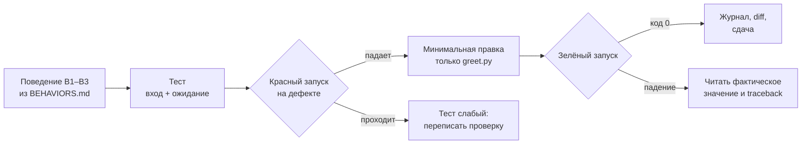

# L03. Тест и исправление

> **Основной учебник занятия.** Обязательная часть — разделы 1–6. Раздел 7 «Углубление» необязателен и не добавляет работы сверх 150 минут. Как читать руководство — в [L01](../L01/student_guide.md#как-читать-руководство).

## Паспорт занятия

| Поле | Значение |
|---|---|
| Курс | «Разработка с помощью AI-агентов: создаём курс Python с нуля в OpenCode и Codex» |
| Модуль | 1. Рабочая основа |
| Занятие | L03. Тест и исправление |
| Время | 150 минут: 75 минут объяснения и демонстрации + 75 минут практики |
| Формат группы | Точный размер группы и число оценщиков в программе не зафиксированы. Расчёт — на индивидуальную работу с двумя средами; в паре один наблюдает и записывает условия. |
| Входные знания | L01: рабочая копия, коммит, границы действий. L02: функция, запуск, ожидаемый вывод, `print` и `return`. |
| Вход | Две одинаковые копии снимка L03: `greet.py` с дефектом, `BEHAVIORS.md`, пустая папка `tests/`; форма журнала |
| Наблюдаемые результаты | 1) переводит три поведения в три теста; 2) показывает красный запуск; 3) исправляет только реализацию; 4) объясняет, какая проверка защищает от повторения дефекта |
| Артефакт | `tests/test_greet.py` с тремя тестами, исправленный `greet.py`, журнал «до/после», diff |
| Способ проверки | Красный запуск с ненулевым кодом до правки; зелёный запуск с кодом 0 после; изменены только `greet.py` и `tests/test_greet.py`; в журнале обе среды |
| Следующий шаг | L04: добавить необязательный параметр в двух средах и сравнить попытки по одной рубрике |

**Статус проверки.** Текст сверен с программой, картой занятий, планом L03 и `practice_card.md` 4 ноября 2026 года. Демонстрационные Python-фрагменты и тестовый снимок запускались локально 4 ноября 2026 года; команды и результаты записаны в [`validation_report.md`](../../textbook/validation_report.md). OpenCode и Codex в ходе подготовки не запускались: их интерфейс, модели, разрешения и время не считаются проверенными до пилота. Тайминг 75/75 остаётся проектным допущением до фактического прохождения.

## 1. Зачем этот приём в сквозном проекте

На L02 вы научились сравнивать фактический вывод с ожидаемым вручную. Это работает, пока случаев два и вы помните, что именно проверяли. В сквозном проекте случаев станет больше, а агент будет менять код быстрее, чем вы успеете всё перепроверить глазами. Нужен механизм, который повторяет сравнение без вашего внимания и падает, когда поведение нарушено.

Таким механизмом становится тест. Но тест — не «ещё одна команда для галочки». Тест фиксирует поведение, которое вы согласовали, и даёт два разных свидетельства:

```text
красный запуск  → тест способен заметить дефект
зелёный запуск  → после исправления поведение восстановлено
```

Без красного запуска нельзя отличить настоящую проверку от декорации. Тест, который проходит всегда, не доказывает ничего.



*Рис. 1. Цикл «поведение → тест → красный → правка → зелёный». Схема показывает, что зелёный запуск без предшествующего красного не является доказательством.*

**Текстовая версия:** берём поведение из карточки → пишем тест → убеждаемся, что на дефектном файле он падает → минимально правим реализацию → повторяем тесты → записываем оба вывода и diff.

**Что заметить:** красный запуск — не неудача, а обязательное свидетельство. Если тест сразу зелёный, проблема не в реализации, а в тесте или в том, что дефект уже исправлен.

**Как это помогает следующему шагу:** на L04 вы добавите новый параметр и должны будете сохранить три старых поведения. Без тестов L03 невозможно доказать, что старые вызовы не сломались.

## 2. Наблюдаемые результаты и маршрут 75 + 75

### 2.1. Что вы сможете к концу занятия

| Результат | Как вы его покажете | Что считается свидетельством |
|---|---|---|
| 1. Переводите поведения в тесты | В `tests/test_greet.py` ровно три теста, по одному на B1–B3 | Имена тестов и ожидаемые значения из `BEHAVIORS.md` |
| 2. Показываете красный запуск | Запускаете тесты до правки | Команда, вывод, имя упавшего теста, ненулевой код |
| 3. Исправляете только реализацию | Меняете `greet.py`, не ослабляя тесты | Diff и повторный запуск |
| 4. Объясняете защиту от повторения | Называете, какой тест поймал бы возврат дефекта | Связка «дефект → тест → ожидание» |

**Главная мысль занятия:** тест проверяет не «код вообще», а конкретное поведение на конкретном входе. Хороший тест умеет падать; тест, который не может упасть, не является проверкой.

### 2.2. Первые 75 минут: объяснение и демонстрация

| Минуты | Что происходит | Что делать вам |
|---:|---|---|
| 0–8 | Цель, артефакт, красный и зелёный запуск | Записать, что сдаёте и чем красный отличается от ошибки среды |
| 8–20 | Что проверяет тест: вход, ожидание, фактическое; отличие от простого запуска | Сформулировать, почему «команда что-то напечатала» не проверка |
| 20–32 | Анатомия `unittest`: класс, метод, `assertEqual`, discovery | Разобрать минимальный тестовый файл по строкам |
| 32–44 | Демонстрация 1: тесты на `shout`, красный запуск | Прочитать сообщение о падении |
| 44–56 | Демонстрация 2: минимальная правка, зелёный запуск, diff | Увидеть, что тесты не менялись |
| 56–68 | Демонстрация 3: always-pass тест и граница B2 | Объяснить, почему зелёный тест может быть бесполезным |
| 68–75 | Брифинг практики: три поведения, две среды, журнал | Записать маршрут и первичную среду |

**Проверка маршрута:** 8 + 12 + 12 + 12 + 12 + 12 + 7 = 75 минут.

### 2.3. Вторые 75 минут: практика

| Минуты | Шаг | Промежуточная проверка |
|---:|---|---|
| 0–5 | Прочитать `BEHAVIORS.md`, скопировать снимок в две копии, записать условия | Три поведения выписаны, базовый коммит записан |
| 5–22 | Попытка 1: три теста, красный запуск, исправление, зелёный | Есть красный и зелёный вывод, запрос сохранён |
| 22–39 | Попытка 2: тот же запрос во второй среде | Вторая копия заполнена или недоступность записана |
| 39–59 | Проверка, diff, baseline-проверка, журнал | Три теста, код 0, изменения только в разрешённых файлах |
| 59–69 | Сверка двух результатов | Записаны различия условий, а не только «кто быстрее» |
| 69–75 | Самопроверка и сдача | Чек-лист раздела 5.6 выполнен |

**Проверка маршрута:** 5 + 17 + 17 + 20 + 10 + 6 = 75 минут.

**Если вы не успеваете:** лучше сдать одну полную попытку с настоящим красным запуском и честной записью второй как недоступной, чем две попытки без красного вывода. Красный запуск нельзя восстановить по памяти: его нужно сохранить до правки.

## 3. Теория от простого к сложному

### 3.1. Запуск, проверка и тест

**Определение.** Тест — исполняемая проверка, которая задаёт вход, ожидаемый результат и правило сравнения, а при несовпадении завершается сообщением об ошибке.

**Механизм.**

1. Тестовый фреймворк находит методы, имена которых начинаются с `test_`.
2. Для каждого метода выполняет тело.
3. `assertEqual(фактическое, ожидаемое)` сравнивает два значения.
4. При совпадении тест помечается `ok`, при несовпадении — `FAIL`.
5. Если есть хотя бы один `FAIL` или `ERROR`, запуск завершается ненулевым кодом.

**Пример.**

```python
import unittest

from greet import greet


class GreetTest(unittest.TestCase):
    def test_plain_name(self):
        self.assertEqual(greet("Ada"), "Привет, Ada!")


if __name__ == "__main__":
    unittest.main()
```

**Что объяснить себе:** простой запуск отвечает на вопрос «что получилось». Тест отвечает на вопрос «совпало ли полученное с заранее заданным поведением». Первое может быть интересным, но не является проверкой.

**Типичная ошибка.** Считать зелёный вывод доказательством того, что проверено всё. Тест проверяет только те входы, которые в нём записаны.

**Критерий выбора.** Если поведение должно сохраняться при будущих изменениях, нужен тест. Если вы исследуете незнакомый код и ещё не знаете ожидаемого результата, сначала нужен запуск и наблюдение.

**Ограничение.** Тест не доказывает отсутствие всех дефектов. Он подтверждает только заявленные поведения на заявленных входах.

### 3.2. Анатомия `unittest`

Минимальный тестовый файл состоит из четырёх частей:

| Часть | Зачем нужна | Пример |
|---|---|---|
| Импорт `unittest` | Даёт класс `TestCase` и assertions | `import unittest` |
| Импорт проверяемого кода | Тест вызывает реальную функцию | `from greet import greet` |
| Класс-наследник `TestCase` | Группирует тесты | `class GreetTest(unittest.TestCase):` |
| Методы `test_*` | Содержат по одной проверке | `def test_plain_name(self):` |

Внутри метода `self.assertEqual(actual, expected)` сравнивает фактическое значение с ожидаемым. Порядок аргументов важен для читаемости сообщения: первым идёт то, что получили, вторым — то, что требовалось.

Запуск из корня копии:

```bash
python3 -m unittest discover -s tests -v
```

- `-m unittest` запускает стандартный тестовый модуль;
- `discover` ищет тесты;
- `-s tests` указывает папку;
- `-v` печатает имена тестов.

**Типичная ошибка.** Назвать метод `testgreet` или `check_greet`. `unittest` не найдёт его при discovery, и запуск скажет `Ran 0 tests`. Это не «всё прошло», а «ничего не проверено».

**Критерий выбора.** Для трёх коротких проверок достаточно одного класса и трёх методов. Дробить на несколько файлов стоит, когда тестов становятся десятки или они относятся к разным модулям.

**Ограничение.** `unittest` не проверяет стиль и не заменяет чтение diff. Тест может проходить, а изменение — быть лишним.

### 3.3. Красный запуск: как читать падение

**Определение.** Красный запуск — запуск тестов на исходном дефектном коде, при котором хотя бы один тест падает.

**Механизм.**

1. Тест вызывает функцию с входом из `BEHAVIORS.md`.
2. Функция возвращает значение, не совпадающее с ожидаемым.
3. `assertEqual` формирует `AssertionError`.
4. `unittest` печатает имя теста, фактическое и ожидаемое значения.
5. Итоговая строка содержит `FAILED` и число падений.

**Пример реального красного вывода для снимка L03:**

```text
test_inner_space (test_greet.GreetTest) ... ok
test_plain_name (test_greet.GreetTest) ... ok
test_surrounding_spaces (test_greet.GreetTest) ... FAIL

FAIL: test_surrounding_spaces (test_greet.GreetTest)
AssertionError: 'Привет,   Ada  !' != 'Привет, Ada!'

Ran 3 tests in 0.000s
FAILED (failures=1)
```

**Что объяснить себе:** B1 и B3 проходят, потому что дефект касается только пробелов по краям. Падает ровно тот тест, который описывает B2. Это хороший признак: тест связан с дефектом, а не с чем-то посторонним.

**Типичная ошибка.** Увидеть `FAILED` и сразу переписать ожидаемое значение под фактическое. Тогда тест станет зелёным, но требование будет нарушено. Ожидаемые значения берутся из `BEHAVIORS.md`, а не из вывода функции.

**Критерий выбора.** Красный запуск обязателен до первой правки реализации. Если вы уже исправили код, верните дефектную версию из коммита или снимка и повторите.

**Ограничение.** Красный запуск доказывает, что тест способен упасть на этом дефекте. Он не доказывает, что тест поймает любой другой дефект.

### 3.4. Минимальная правка и зелёный запуск

**Определение.** Минимальная правка — изменение, которое восстанавливает требуемое поведение и не добавляет новых требований, файлов или зависимостей.

Для снимка L03 достаточно удалить пробелы по краям имени:

```python
def greet(name):
    return f"Привет, {name.strip()}!"
```

`strip()` удаляет пробельные символы в начале и конце строки, но не трогает внутренние пробелы. Поэтому B3 сохраняется.

**Механизм.**

1. Правка меняет только тело `greet`.
2. Тесты не меняются.
3. Повторный запуск снова проверяет все три поведения.
4. Код возврата `0` и строка `OK` подтверждают совпадение.

**Типичная ошибка.** «Улучшить» функцию заодно: добавить обработку `None`, числа, списка, капитализацию. Это новые требования, которых нет в карточке. Они увеличивают diff и могут сломать согласованные поведения.

**Критерий выбора.** Правьте ровно то, что нужно для прохождения теста, и не больше. Если хочется добавить поведение — сначала согласуйте его как отдельное требование.

**Ограничение.** Минимальность — не самоцель. Если дефект вызван неверной архитектурой, маленькая заплатка может оказаться хуже честного небольшого рефакторинга. В L03 архитектура уже задана, поэтому достаточно одной строки.

### 3.5. Слабый тест: зелёный, но бесполезный

**Определение.** Слабый тест — тест, который не может упасть на дефекте, потому что не проверяет нужное поведение или проверяет слишком общее утверждение.

Пример:

```python
def test_nothing(self):
    self.assertTrue(True)
```

Он всегда проходит. Формально это тест, фактически — декорация.

Второй пример слабости — проверить только B1 и B3:

```python
def test_plain_name(self):
    self.assertEqual(greet("Ada"), "Привет, Ada!")

def test_inner_space(self):
    self.assertEqual(greet("Ada Lovelace"), "Привет, Ada Lovelace!")
```

На дефектном файле оба теста зелёные, хотя B2 нарушено. Дефект остаётся незамеченным.

**Критерий проверки качества:** мысленно верните дефект. Упадёт ли тест? Если нет — тест не защищает это поведение.

**Типичная ошибка.** Добавлять `assertTrue(True)` или проверять только факт «функция не бросила исключение». Это не проверка результата.

**Ограничение.** Не каждый тест обязан падать на конкретном дефекте. Но каждый тест обязан проверять наблюдаемое поведение и уметь падать хотя бы на одном реалистичном нарушении.

### 3.6. Хорошая и слабая постановка задачи агенту

Слабый запрос:

```text
Напиши тесты для greet и исправь ошибку.
```

Почему он слабый:

- не названы три поведения;
- не сказано, откуда брать ожидания;
- не запрещено менять `BEHAVIORS.md`;
- не требуется красный запуск;
- не сказано, какие файлы можно менять;
- «исправь ошибку» не говорит, какая проверка подтвердит исправление.

Сильный запрос:

```text
В этой рабочей копии есть greet.py с дефектом и BEHAVIORS.md с тремя поведениями.
Не меняй BEHAVIORS.md и не добавляй зависимости.
Сначала создай tests/test_greet.py на unittest: ровно три теста, по одному на B1, B2, B3.
Запусти python3 -m unittest discover -s tests -v и покажи полный вывод.
Затем исправь только greet.py минимально, чтобы все три теста прошли.
Снова запусти тесты и покажи полный вывод и git diff.
```

Почему он сильный:

- назван источник ожиданий;
- ограничено число тестов и их соответствие поведениям;
- требуется красный запуск до правки;
- ограничены файлы и зависимости;
- названа команда проверки;
- требуется diff, а не только словесный отчёт.

**Что запомнить:** просить «покажи вывод» полезнее, чем просить «подтверди, что всё работает». Вывод можно проверить, подтверждение — нет.

### 3.7. Критерий выбора и ограничения приёма

| Вопрос | Когда «да» | Когда «нет» |
|---|---|---|
| Нужен тест? | Поведение должно сохраняться при изменениях | Вы ещё исследуете незнакомый код |
| Сколько тестов? | По одному на согласованное поведение | Больше поведений, чем указано в карточке |
| Нужен красный запуск? | Всегда, если тест должен ловить дефект | Дефект уже исправлен и вы проверяете только регрессию |
| Нужна правка теста? | Тест не соответствует `BEHAVIORS.md` | Тест падает, потому что код неверен |
| Нужен агент? | Задача ограничена, проверяема, экономит время | Вы не понимаете, какое поведение проверяете |

**Ограничение занятия.** Здесь нет `pytest`, параметризации, покрытия и CI. Это не пробел: сначала вы должны увидеть, как один тест падает и почему. Автоматизация всего проекта — L22.

## 4. Разобранные примеры

### 4.1. Пример A: `shout` — красный и зелёный запуск

**Вход.** Функция `shout(text)` должна возвращать текст в верхнем регистре с восклицательным знаком. Для `"ada"` ожидается `"ADA!"`.

**Дефектная реализация:**

```python
def shout(text):
    return text + "!"
```

**Файл `tests/test_shout.py`:**

```python
import unittest

from shout import shout


class ShoutTest(unittest.TestCase):
    def test_plain_text(self):
        self.assertEqual(shout("ada"), "ADA!")


if __name__ == "__main__":
    unittest.main()
```

**Действия.**

```bash
python3 -m unittest discover -s tests -v
```

**Фактический выход (сокращённо):**

```text
FAIL: test_plain_text (test_shout.ShoutTest)
AssertionError: 'ada!' != 'ADA!'
FAILED (failures=1)
```

**Исправление:**

```python
def shout(text):
    return text.upper() + "!"
```

**Повторный запуск:** `OK`, код возврата `0`.

**Пояснение шагов.**

1. Тест задаёт вход `"ada"` и ожидание `"ADA!"`.
2. Дефектная функция возвращает `"ada!"`.
3. `assertEqual` сравнивает строки посимвольно и падает.
4. Правка добавляет `upper()`.
5. Повторный запуск подтверждает совпадение.

**Что проверить:** тест не менялся между запусками; diff содержит только `shout.py`; падение относится к регистру, а не к импорту.

### 4.2. Пример B: снимок L03 и поведение B2

**Вход.** `greet.py` из снимка и три поведения:

| № | Вход | Ожидание |
|---|---|---|
| B1 | `greet("Ada")` | `Привет, Ada!` |
| B2 | `greet("  Ada  ")` | `Привет, Ada!` |
| B3 | `greet("Ada Lovelace")` | `Привет, Ada Lovelace!` |

**Действия.** Создайте `tests/test_greet.py` с тремя методами и запустите discovery.

**Фактический красный вывод:** B1 и B3 — `ok`, B2 — `FAIL`; в сообщении `'Привет,   Ada  !' != 'Привет, Ada!'`; итог `FAILED (failures=1)`, код возврата `1`.

**После правки `name.strip()`:** все три `ok`, `Ran 3 tests`, `OK`, код возврата `0`.

**Пояснение.**

1. Дефект не влияет на имя без пробелов, поэтому B1 проходит.
2. Внутренний пробел сохраняется, поэтому B3 проходит.
3. Пробелы по краям не удаляются, поэтому B2 падает.
4. `strip()` удаляет только края и восстанавливает B2, не ломая B3.
5. Красный и зелёный вывод вместе показывают, что тест связан с дефектом.

**Типичная ошибка.** Написать один тест на все три случая в цикле и потерять имя упавшего поведения. Тогда сообщение будет менее понятным, а требование «ровно три теста» — нарушено.

### 4.3. Пример C: always-pass тест не ловит дефект

**Вход.** Тот же дефектный `greet.py`.

**Слабый тест:**

```python
import unittest


class WeakTest(unittest.TestCase):
    def test_nothing(self):
        self.assertTrue(True)
```

**Действия.**

```bash
python3 -m unittest discover -s tests -v
```

**Фактический выход:** `Ran 1 test`, `OK`, код возврата `0` — при том что B2 всё ещё нарушено.

**Пояснение.**

1. `assertTrue(True)` не обращается к `greet`.
2. Поэтому дефект не может повлиять на результат.
3. Зелёный запуск говорит только о том, что тест выполнился.
4. Такой тест не принимается как проверка поведения.

**Что запомнить:** перед добавлением теста спросите: «какое неправильное поведение заставит его упасть?» Если ответа нет, это не тест.

### 4.4. Пример D: ошибка импорта и что она значит

**Вход.** Тестовый файл лежит в `tests/`, запуск выполняется из другой папки.

**Действия.**

```bash
cd ..
python3 -m unittest discover -s L03/tests -v
```

**Фактический выход (сокращённо):**

```text
ModuleNotFoundError: No module named 'greet'
```

**Пояснение.**

1. `unittest` нашёл тестовый файл.
2. При импорте `greet` Python не нашёл модуль в путях поиска.
3. Причина — рабочая папка, а не синтаксис теста.
4. Решение: запускать из корня копии, где лежит `greet.py`.

**Типичная ошибка.** Начать переписывать тест или добавлять `sys.path` в учебном задании. Сначала проверьте `pwd` и `ls`.

## 5. Практика: маршрут и подсказки

> **Точное условие, входные файлы, ограничения и критерии приёмки — в [`practice_card.md`](practice_card.md).** Ниже маршрут и подсказки, а не замена карточке. Глава не добавляет обязательных требований.

### 5.1. Что открыть

| Материал | Зачем |
|---|---|
| [`practice_card.md`](practice_card.md) | Полное условие, шаги, критерии |
| `snapshot/BEHAVIORS.md` | Три обязательных поведения |
| `snapshot/greet.py` | Функция с дефектом |
| `snapshot/tests/` | Пустая папка для вашего файла |
| [`../shared/run_journal.md`](../shared/run_journal.md) | Форма журнала |
| Рабочие копии L02 | Две копии для двух сред |

### 5.2. Стартовое состояние

- В каждой копии лежат `greet.py`, `BEHAVIORS.md` и папка `tests/`.
- `greet.py` совпадает со снимком и содержит дефект.
- `BEHAVIORS.md` не изменён.
- Есть базовый коммит или вы создали его с сообщением `L03: baseline`.
- Первичная среда назначена до старта.

Проверка:

```bash
pwd
ls
git log --oneline -1
git status --porcelain
```

Если `BEHAVIORS.md` уже отличается от снимка, остановитесь и восстановите его. Иначе вы проверяете не то условие.

### 5.3. Подсказки без раскрытия эталона

- **`Ran 0 tests`** — методы не начинаются с `test_` или discovery смотрит не в ту папку.
- **`ModuleNotFoundError`** — запускайте из корня копии, где лежит `greet.py`.
- **Все тесты зелёные сразу** — вероятно, тест не проверяет B2 или проверяет слишком общее утверждение.
- **Падает только B2** — это ожидаемый красный запуск, переходите к правке.
- **После правки падает B3** — проверьте, не удаляет ли ваша правка внутренние пробелы.
- **`IndentationError`** — проверьте отступы в классе и методах.
- **Агент изменил тест после падения** — верните тест к требованиям и запишите отклонение.

### 5.4. Что записывать во время попытки

- среду, версию и видимую модель/настройки или «недоступно»;
- режим разрешений и рабочую папку;
- базовый коммит;
- дословный запрос;
- красный вывод: команду, имя упавшего теста, фактическое и ожидаемое значения, код возврата;
- зелёный вывод: команду, число тестов, код возврата;
- diff и ручные правки;
- что именно вы прочитали в сообщении о падении.

Не записывайте «тесты прошли», если не сохранили красный запуск. Именно он отличает проверку от подгонки.

### 5.5. Маршрут практики

| Минуты | Шаг | Наблюдаемый признак |
|---:|---|---|
| 0–5 | Условия и копии | Три поведения выписаны, коммит записан |
| 5–22 | Попытка 1 | Три теста, красный запуск, правка, зелёный |
| 22–39 | Попытка 2 | Вторая среда запущена или недоступность записана |
| 39–59 | Проверка и журнал | Код 0, diff, baseline-проверка |
| 59–69 | Сравнение | Различия условий записаны |
| 69–75 | Самопроверка | Чек-лист ниже выполнен |

### 5.6. Самопроверка по наблюдаемым признакам

| Признак | Принято | Если нет — где искать |
|---|---|---|
| В `tests/test_greet.py` ровно три теста | Да | Раздел 3.2, имена методов |
| На исходном `greet.py` хотя бы один тест падает | Да | Раздел 3.3, красный вывод |
| После правки все три теста проходят | Да | Раздел 3.4 |
| Код возврата после правки `0` | Да | Команда с `echo $?` |
| Изменены только `greet.py` и `tests/test_greet.py` | Да | `git diff`, `git status --porcelain` |
| `BEHAVIORS.md` не изменён | Да | `git diff -- BEHAVIORS.md` |
| В журнале есть красный и зелёный вывод | Да | Раздел 5.4 |
| Тест не является always-pass | Да | Раздел 3.5 |

**Если проверка не проходит:** не подгоняйте ожидание под фактический вывод. Сначала определите, какое поведение нарушено, и только потом правьте реализацию.

## 6. Инструкции для OpenCode и Codex

Сравнение в L03 использует **один снимок**, **один текст запроса** и **одни критерии**. Меняется только среда. Порядок попыток фиксируется до старта.

### 6.1. OpenCode

1. Откройте рабочую копию как проект: запустите OpenCode из корня копии или укажите эту папку.
2. Убедитесь, что рабочая область — копия L03, а не домашний каталог.
3. Не включайте авто-подтверждение всех действий. Если среда спрашивает разрешение на запись или команду, сверьте путь и действие с карточкой.
4. Для чтения и планирования можно использовать Plan-агента; для правки — Build. Названия и поведение зависят от версии.
5. Если запускаете неинтерактивно, `opencode run` принимает запрос; флаг `--auto` автоматически подтверждает запросы, кроме явно запрещённых. В учебной задаче с тестами лучше не использовать его без необходимости.
6. Запишите версию, видимую модель, режим разрешений, запросы и решения.

Официальная документация: разрешения `allow` / `ask` / `deny`, `external_directory`, ответы `once` / `always` / `reject`; правила проекта читаются из `AGENTS.md` (в L03 он ещё не создаётся — это L11).

### 6.2. Codex

1. Запустите Codex в рабочей копии или укажите её как рабочую папку.
2. Для этой задачи достаточно sandbox `workspace-write` с подтверждениями `on-request`: чтение, правка и команды внутри рабочей области; выход за неё и сеть требуют подтверждения. Сеть по умолчанию выключена.
3. Проверьте активные разрешения через `/permissions` или эквивалент установленной версии.
4. Для неинтерактивного запуска используйте `codex exec`; по умолчанию он работает в read-only sandbox, для правок нужен `--sandbox workspace-write`. Не используйте `danger-full-access` в учебной задаче.
5. Запишите версию, видимую модель, sandbox/approval, запросы и решения.

Официальная документация: sandbox и approval policy, `workspace-write` + `on-request`, сеть по умолчанию выключена; `AGENTS.md` читается до работы, но в L03 он ещё не вводится.

### 6.3. Что сравнивать и что нельзя утверждать

| Поле | Что записать |
|---|---|
| Снимок | Один и тот же набор файлов и коммит |
| Запрос | Дословно одинаковый текст |
| Среда | OpenCode / Codex |
| Версия и модель | Видимое или «недоступно» |
| Режим разрешений | Фактический |
| Красный запуск | Команда, вывод, имя теста, код |
| Зелёный запуск | Команда, вывод, код |
| Diff | Какие файлы изменены |
| Ручные правки | Что, где, почему |
| Ограничение | Что нельзя утверждать по одной попытке |

**Нельзя утверждать:** «этот инструмент всегда пишет лучшие тесты», «он надёжнее», «он безопаснее». Можно утверждать только: «в данной версии, с данным снимком и запросом получен такой результат, подтверждённый таким красным и зелёным запуском».

**Различия, которые нужно фиксировать, а не скрывать:** модель, версия, режим разрешений, доступ к сети, названия пунктов интерфейса, время ответа, необходимость ручной правки.

## 7. Углубление (необязательно)

### 7.1. Почему тесты должны быть независимы

Один тест не должен зависеть от того, что другой уже изменил глобальное состояние. В L03 функции чистые, поэтому проблемы не видно. В реальном проекте тест, который пишет файл и не удаляет его, может сделать следующий тест зелёным или красным по ложной причине.

Проверка: запустите тесты по отдельности и все вместе. Результат должен совпадать.

### 7.2. `assertEqual` и `assertTrue`

`assertEqual(actual, expected)` показывает оба значения и упрощает диагностику. `assertTrue(actual == expected)` даёт только `False is not true`. В учебных тестах используйте `assertEqual`, пока не появится причина для другого assertion.

### 7.3. Чем `unittest` отличается от `pytest`

`unittest` входит в стандартную библиотеку и не требует установки. `pytest` удобнее для больших наборов, но добавляет зависимость. В L03 зависимостей быть не должно, поэтому используется `unittest`. Выбор инструмента — не главное; главное — тест должен уметь падать.

### 7.4. Регрессия

Регрессия — возврат ранее исправленного дефекта. Тест B2 — регрессионный тест: он защищает именно от повторного появления пробелов. На L04 вы увидите, как старые тесты защищают прежние поведения при добавлении нового параметра.

## 8. Контрольные вопросы

Ответьте письменно, не подглядывая в раздел. Затем сверьтесь с ориентиром.

1. **Чем тест отличается от простого запуска?**  
   *Ориентир:* запуск показывает результат; тест сравнивает его с заранее заданным ожиданием и падает при несовпадении.

2. **Почему красный запуск обязателен?**  
   *Ориентир:* он доказывает, что тест способен заметить дефект; без него зелёный запуск может быть декорацией.

3. **Что означает `Ran 0 tests`?**  
   *Ориентир:* discovery не нашёл тестовых методов; это не успешная проверка.

4. **Почему нельзя менять ожидаемое значение под фактический вывод?**  
   *Ориентир:* ожидание задано поведением; подмена превращает проверку в подгонку.

5. **Что делает `strip()` и почему он не ломает B3?**  
   *Ориентир:* удаляет пробелы по краям; внутренний пробел между именем и фамилией сохраняется.

6. **Чем слабый тест отличается от ошибочного?**  
   *Ориентир:* слабый проходит и ничего не проверяет; ошибочный может падать по неверной причине. Оба не принимаются.

7. **Что записать, если вторая среда недоступна?**  
   *Ориентир:* факт недоступности, время, ошибку, выполненную часть; не выдумывать попытку.

8. **Что можно и что нельзя утверждать по двум попыткам?**  
   *Ориентир:* можно — наблюдённый результат в данных условиях; нельзя — общее превосходство инструмента.

## 9. Словарь

| Термин | Краткое определение |
|---|---|
| Тест | Исполняемая проверка входа, ожидания и результата |
| `unittest` | Стандартный тестовый фреймворк Python |
| `TestCase` | Класс, группирующий тестовые методы |
| Assertion | Утверждение, которое проверяет условие и падает при нарушении |
| Discovery | Автоматический поиск тестовых файлов и методов |
| Красный запуск | Запуск, при котором хотя бы один тест падает |
| Зелёный запуск | Запуск, при котором все тесты проходят |
| Регрессия | Повторное появление ранее исправленного дефекта |
| Baseline | Исходное состояние кода до исправления |
| Diff | Разница между версиями файлов |
| Always-pass тест | Тест, который не может упасть на дефекте |

## 10. Переход к следующему занятию

Сохраните:

- `greet.py` в исправленном состоянии;
- `tests/test_greet.py` с тремя тестами;
- красный и зелёный вывод;
- diff;
- журнал с обеими средами и базовым коммитом.

На L04 вы получите базовый репозиторий с тремя тестами и добавите необязательный параметр `greeting` в двух средах. Старые тесты должны остаться без изменений и продолжать проходить. Сегодняшний навык «сначала красный, потом зелёный» станет основой сравнения двух попыток.

**Что взять с собой:** привычку сохранять падение до правки и проверять, что тест вообще способен упасть.

## 11. Источники и статус проверки

### 11.1. Документы курса

- [Утверждённая программа](../../../agentic_development_course_program.md)
- [Карта занятий L01–L24](../../../course_lesson_map_L01-L24.md)
- [План L03](lesson_plan.md)
- [Карточка практики L03](practice_card.md)
- [Протокол сравнения модуля 1](../shared/comparison_protocol.md)
- [Журнал модуля 1](../shared/run_journal.md)
- [Рубрика модуля 1](../shared/practice_rubric.md)

### 11.2. Официальная документация инструментов

Проверено 4 ноября 2026 года:

- OpenCode, разрешения: <https://opencode.ai/docs/permissions/>
- OpenCode, правила и `AGENTS.md`: <https://opencode.ai/docs/rules/>
- OpenCode, CLI: <https://opencode.ai/docs/cli/>
- Codex, sandbox и approvals: <https://developers.openai.com/codex/agent-approvals-security>
- Codex, `AGENTS.md`: <https://developers.openai.com/codex/agent-configuration/agents-md>
- Codex, неинтерактивный режим: <https://developers.openai.com/codex/non-interactive-mode>

### 11.3. Статус фактических проверок

| Проверка | Статус |
|---|---|
| Сверка текста с программой, картой, планом и карточкой | Выполнена 4 ноября 2026 года |
| Красный и зелёный запуск на снимке L03 | Выполнены локально 4 ноября 2026 года; результаты в `validation_report.md` |
| Демонстрация `shout` и always-pass теста | Выполнена локально 4 ноября 2026 года |
| Проверка ссылок и структуры главы | Выполнена скриптом проверки учебника |
| OpenCode: интерфейс, модель, разрешения, время | Не проверялось |
| Codex: интерфейс, модель, sandbox, время | Не проверялось |
| CI | Не настраивался и не проверялся |

**Что это значит:** методическая согласованность и Python-примеры проверены; поведение конкретных установленных версий OpenCode и Codex должно быть подтверждено пилотом. Учебные ответы агента в тексте не выдаются за реальные запуски.
