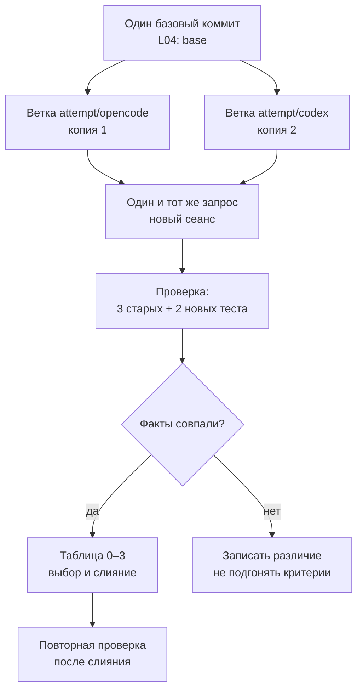

# L04. Первое сравнение

> **Основной учебник занятия.** Обязательная часть — разделы 1–6. Раздел 7 «Углубление» необязателен и не добавляет работы сверх 150 минут. Как читать руководство — в [L01](../L01/student_guide.md#как-читать-руководство).

## Паспорт занятия

| Поле | Значение |
|---|---|
| Курс | «Разработка с помощью AI-агентов: создаём курс Python с нуля в OpenCode и Codex» |
| Модуль | 1. Рабочая основа |
| Занятие | L04. Первое сравнение |
| Время | 150 минут: 75 минут объяснения и демонстрации + 75 минут практики |
| Формат группы | Точный размер группы и число оценщиков в программе не зафиксированы. Расчёт — на индивидуальную работу с двумя средами; в паре один наблюдает и записывает условия. |
| Входные знания | L01: Git, границы, коммит. L02: функция и запуск. L03: три теста, красный и зелёный запуск. |
| Вход | Базовый репозиторий `L04-base` с коммитом `L04: base`, `greet.py`, тремя тестами и `task_card.md`; форма журнала |
| Наблюдаемые результаты | 1) готовит две попытки от одного коммита; 2) добавляет параметр без поломки старых тестов; 3) сравнивает по одной рубрике; 4) отделяет ответ агента от ручных правок и формулирует предел вывода |
| Артефакт | Две ветки от одного коммита, пять тестов, таблица критериев, выбранная ветка, журнал |
| Способ проверки | `git rev-parse HEAD` совпадает в обеих копиях; три старых теста не изменены; пять тестов дают код 0; изменены только `greet.py` и `tests/test_greet.py`; выбор обоснован фактами |
| Следующий шаг | L05: превратить запрос в контракт с целью, входами, границами и критериями готовности |

**Статус проверки.** Текст сверен с программой, картой занятий, планом L04 и `practice_card.md` 4 ноября 2026 года. Команды `git worktree`, базовый запуск трёх тестов и решение с пятью тестами проверены локально 4 ноября 2026 года; результаты записаны в [`validation_report.md`](../../textbook/validation_report.md). OpenCode и Codex в ходе подготовки не запускались: их интерфейс, модели, разрешения и время не считаются проверенными до пилота. Тайминг 75/75 остаётся проектным допущением до фактического прохождения.

## 1. Зачем этот приём в сквозном проекте

На L03 вы научились доказывать, что код работает: красный запуск, минимальная правка, зелёный запуск. Но в курсе две среды — OpenCode и Codex. Рано или поздно возникнет вопрос: «Какая попытка лучше?» Наивный ответ — «та, что быстрее» или «та, что красивее объяснила». Оба ответа ничего не доказывают.

L04 вводит честное сравнение: одинаковый снимок, одинаковый запрос, одинаковые критерии, разные среды. Вы не выбираете инструмент «навсегда». Вы выбираете **конкретный результат** в конкретных условиях и записываете, чем этот выбор подтверждён.



*Рис. 1. Схема честного сравнения. Обе попытки выходят из одного коммита, получают один текст запроса и проверяются одними тестами; различается только среда.*

**Текстовая версия:** создаём базовый коммит → от него две ветки и две рабочие копии → в каждой новой сессии отправляем один запрос → проверяем старые и новые тесты → заполняем таблицу фактов → выбираем ветку → сливаем без `--force` → повторяем тесты.

**Что заметить:** сравнение начинается не с запуска агента, а с фиксации базы. Если ветки начались от разных коммитов, дальнейшие различия нельзя приписать среде.

**Как это помогает следующему шагу:** на L05 вы будете формулировать контракт задачи. L04 показывает, зачем нужны критерии: без них две попытки сравниваются по впечатлению.

## 2. Наблюдаемые результаты и маршрут 75 + 75

### 2.1. Что вы сможете к концу занятия

| Результат | Как вы его покажете | Что считается свидетельством |
|---|---|---|
| 1. Готовите две попытки от одного коммита | Создаёте две ветки и две рабочие копии | `git worktree list`, совпадающие `HEAD` |
| 2. Добавляете параметр без поломки старого | Реализуете `greeting` и два новых теста | Три старых теста не изменены, пять тестов зелёные |
| 3. Сравниваете по одной рубрике | Заполняете таблицу A–D | Оценки 0–3 и ссылки на факты |
| 4. Формулируете предел вывода | Записываете, что можно и нельзя утверждать | Фраза «в данных условиях...» с ограничением |

**Главная мысль занятия:** сравнение отвечает не на вопрос «какой инструмент лучше вообще», а на вопрос «какая попытка дала проверяемый результат при одинаковых условиях и чем это подтверждено».

### 2.2. Первые 75 минут: объяснение и демонстрация

| Минуты | Что происходит | Что делать вам |
|---:|---|---|
| 0–8 | Цель, артефакт, вопрос сравнения | Записать, что именно вы сможете утверждать после двух попыток |
| 8–20 | Честное сравнение: один снимок, запрос, критерии, новый сеанс | Выписать список удерживаемых условий |
| 20–32 | Демонстрация 1: базовый коммит, две ветки, две копии | Проверить `HEAD` в обеих копиях |
| 32–44 | Демонстрация 2: запись попытки и diff | Заполнить одну строку журнала |
| 44–56 | Оценка: старые тесты, новые тесты, границы, ручные правки | Отличить факт от впечатления |
| 56–68 | Рубрика 0–3, выбор, предел вывода | Сформулировать обоснование без «мне понравилось» |
| 68–75 | Брифинг практики: две среды, 75 минут, форма сдачи | Записать порядок попыток и первичную среду |

**Проверка маршрута:** 8 + 12 + 12 + 12 + 12 + 12 + 7 = 75 минут.

### 2.3. Вторые 75 минут: практика

| Минуты | Шаг | Промежуточная проверка |
|---:|---|---|
| 0–10 | Проверить базу, создать две копии, записать условия | `HEAD` совпадает, база записана |
| 10–30 | Попытка 1: запрос, проверка, diff, коммит | Пять тестов, diff, запись |
| 30–50 | Попытка 2: тот же запрос, проверка, коммит | Вторая копия заполнена или недоступность записана |
| 50–65 | Сравнение, рубрика, выбор, слияние | Таблица A–D, обоснование |
| 65–70 | Повторная проверка после выбора | Пять тестов, код 0 |
| 70–75 | Журнал и сдача | Чек-лист раздела 5.6 выполнен |

**Проверка маршрута:** 10 + 20 + 20 + 15 + 5 + 5 = 75 минут.

**Если вы не успеваете:** не сокращайте проверку старых тестов. Лучше одна полная попытка с честной записью второй как недоступной, чем две попытки без доказательства, что старые поведения сохранены.

## 3. Теория от простого к сложному

### 3.1. Что делает сравнение честным

**Определение.** Честное сравнение — сравнение двух попыток, в котором одинаковы вход, задача, критерии и способ проверки, а различается только изучаемый фактор (среда).

**Механизм.**

1. Зафиксируйте базовый коммит.
2. Создайте от него две независимые ветки.
3. Подготовьте две рабочие копии.
4. Отправьте дословно один запрос в новых сеансах.
5. Проверьте обе попытки одной командой и одними критериями.
6. Запишите различия условий, которые не удалось уравнять.

**Что удерживается одинаковым:**

| Условие | Почему важно | Как проверить |
|---|---|---|
| Снимок | Разные файлы дают разные задачи | `git rev-parse HEAD` |
| Текст запроса | Подсказка одной среде искажает сравнение | Дословная запись в журнале |
| Критерии | Без них выбор становится вкусовым | Таблица A–D |
| Команда проверки | Разные команды проверяют разное | Один `unittest discover` |
| Новый сеанс | Старый контекст переносит подсказки | Запись «новый сеанс» |
| Лимит времени | Разное время меняет условия | Одинаковый интервал |

**Типичная ошибка.** Запустить вторую среду в том же сеансе, где обсуждали первую. Контекст содержит ответ первой попытки, и вторая получает негласную подсказку.

**Критерий выбора.** Сравнивайте две попытки, только если можете показать одинаковую базу и одинаковый запрос. Если не можете — это не сравнение, а два отдельных наблюдения.

**Ограничение.** Даже при одинаковых условиях модель, версия, режим разрешений и доступ к сети могут различаться. Их нужно записать, а не делать вид, что среда — единственная переменная.

### 3.2. База, ветки и рабочие копии

**Определение.** `git worktree` позволяет иметь несколько рабочих папок, привязанных к одному репозиторию, каждая на своей ветке.

**Механизм.**

1. В базовой папке создаётся коммит `L04: base`.
2. `git worktree add ../L04-opencode -b attempt/opencode` создаёт папку и ветку.
3. `git worktree add ../L04-codex -b attempt/codex` создаёт вторую.
4. Обе ветки указывают на один и тот же коммит.
5. Основная ветка остаётся нетронутой до выбора.

**Проверенный пример:**

```bash
git init -b main
git add greet.py tests/test_greet.py task_card.md
git commit -m "L04: base"
git worktree add ../L04-opencode -b attempt/opencode
git worktree add ../L04-codex -b attempt/codex
git worktree list
git -C ../L04-opencode rev-parse HEAD
git -C ../L04-codex rev-parse HEAD
```

В локальной проверке обе копии показали один и тот же `HEAD` и отдельные ветки; базовые три теста прошли с кодом `0`.

**Типичная ошибка.** Создать вторую ветку после того, как в первой уже сделали коммит. Тогда базы различаются. Создавайте обе ветки до начала попыток.

**Критерий выбора.** `git worktree` удобен, когда нужно держать две копии одновременно. Если среда не поддерживает worktree, преподаватель готовит две копии заранее; это фиксируется в журнале.

**Ограничение.** `worktree` — не резервная копия. Удаление папки без `worktree remove` оставляет служебные записи. Не удаляйте чужие рабочие копии.

### 3.3. Новое требование без поломки старого

**Определение.** Обратная совместимость — сохранение прежних вызовов и поведений при добавлении нового параметра.

**Механизм.**

1. Старые вызовы `greet("Ada")` не передают второй аргумент.
2. Параметр `greeting` имеет значение по умолчанию `"Привет"`.
3. Поэтому старый вызов продолжает работать.
4. Новый вызов передаёт второе значение.
5. Старые тесты остаются без изменений и продолжают проходить.

**Пример:**

```python
def greet(name, greeting="Привет"):
    return f"{greeting}, {name.strip()}!"
```

**Типичная ошибка.** Сделать `greeting` обязательным параметром. Тогда старые вызовы падают с `TypeError`, а три старых теста краснеют.

**Критерий выбора.** Новый параметр должен быть необязательным, если карточка требует сохранить старые вызовы. Значение по умолчанию берётся из требования, а не придумывается.

**Ограничение.** Значение по умолчанию вычисляется один раз при определении функции. Для строки это безопасно; для изменяемых объектов это известная ловушка, но в L04 она не встречается.

### 3.4. Старые тесты как защита от регрессии

**Определение.** Регрессионный тест защищает ранее согласованное поведение от повторного нарушения.

В L04 три старых теста — это защита B1–B3. Их нельзя менять: если вы измените ожидание, вы потеряете доказательство, что старое поведение сохранилось.

**Механизм.**

1. До попытки три теста зелёные.
2. После добавления параметра они должны остаться зелёными.
3. Два новых теста проверяют новое поведение.
4. Итого пять тестов.
5. Если старый тест покраснел, реализация сломала совместимость.

**Типичная ошибка.** «Поправить» старый тест, чтобы он соответствовал новому выводу. Это маскирует регрессию. Если старый тест противоречит новому требованию, это конфликт требований, а не разрешение менять тест.

**Критерий выбора.** Старые тесты не меняются, если карточка прямо не разрешает. Новые требования добавляются новыми тестами.

**Ограничение.** Три теста не покрывают все возможные вызовы. Они защищают только согласованные поведения. Не приписывайте им больше, чем они проверяют.

### 3.5. Как оценивать попытку: факты до рубрики

**Определение.** Рубрика — набор направлений и уровней, по которым оценивается работа. В L04 используются направления A–D модульной рубрики.

Сначала соберите факты:

| Факт | Как проверить | Что означает |
|---|---|---|
| Старые тесты проходят | `python3 -m unittest discover -s tests -v` | Совместимость сохранена |
| Новые тесты проходят | Та же команда | Новое поведение реализовано |
| Изменены только разрешённые файлы | `git diff --name-only` | Границы соблюдены |
| Старые тесты не изменены | `git diff -- tests/test_greet.py` | Нет подгонки |
| Diff понятен | `git diff` | Правка объяснима |
| Ручные правки записаны | Журнал | Авторство не искажено |

Только после этого ставьте уровни 0–3. Уровень без факта — впечатление.

**Типичная ошибка.** Сначала решить, «какая среда нравится», а потом подобрать факты. Это обратный порядок, и он разрушает сравнение.

**Критерий выбора.** Если обе попытки равны по фактам, выбирайте ту, которую проще объяснить и повторить. Это допустимое основание, но оно должно быть записано отдельно от технических фактов.

**Ограничение.** Одна задача не даёт права на общий вывод о среде. Даже одинаковый результат двух попыток — наблюдение, а не рейтинг.

### 3.6. Хорошая и слабая постановка задачи агенту

Слабый запрос:

```text
Добавь приветствие и проверь, что всё работает.
```

Почему он слабый:

- не назван параметр и значение по умолчанию;
- не сказано, какие вызовы должны сохраниться;
- не названо число новых тестов;
- не запрещено менять старые тесты;
- не названа команда проверки;
- «всё работает» нельзя наблюдать.

Сильный запрос:

```text
В этой рабочей копии есть greet.py и tests/test_greet.py.
Добавь функции greet необязательный параметр greeting со значением по умолчанию "Привет".
Сохрани все текущие поведения:
- greet("Ada") -> "Привет, Ada!"
- greet("  Ada  ") -> "Привет, Ada!"
- greet("Ada Lovelace") -> "Привет, Ada Lovelace!"

Добавь в tests/test_greet.py ровно два новых теста:
- greet("Ada", "Здравствуйте") -> "Здравствуйте, Ada!"
- greet("  Ada  ", "Здравствуйте") -> "Здравствуйте, Ada!"

Не меняй существующие три теста. Меняй только greet.py и tests/test_greet.py.
Запусти python3 -m unittest discover -s tests -v и покажи полный вывод и git diff.
```

Почему он сильный:

- назван точный параметр и значение по умолчанию;
- перечислены сохраняемые поведения;
- задано ровно два новых теста;
- запрещено менять старые тесты;
- ограничены файлы;
- названа команда и требуются вывод и diff.

**Что запомнить:** одинаковый запрос — часть эксперимента. Если вы «уточнили» запрос только одной среде, сравнение потеряло силу.

### 3.7. Критерий выбора и ограничения приёма

| Вопрос | Когда «да» | Когда «нет» |
|---|---|---|
| Нужно сравнение? | Есть две среды и проверяемая задача | Вы сравниваете вкусы или общие впечатления |
| Нужны две ветки? | Обе попытки должны выйти из одной базы | Достаточно одной попытки для обучения |
| Нужен новый параметр? | Требование сохраняет старые вызовы | Можно изменить интерфейс без последствий |
| Нужна рубрика? | Решение должно быть объяснимым | Вы только собираете наблюдения |
| Нужно слияние? | Одна ветка выбрана по фактам | Ни одна не прошла проверку |

**Ограничение занятия.** Здесь ещё нет статистики, повторных прогонов, измерения стоимости и CI. Одна задача и две попытки дают только наблюдение. Полноценное сравнение инструментов — L23.

## 4. Разобранные примеры

### 4.1. Пример A: две ветки от одного коммита

**Вход.** Базовая папка с `greet.py`, `tests/test_greet.py`, `task_card.md`.

**Действия.**

```bash
git init -b main
git add greet.py tests/test_greet.py task_card.md
git commit -m "L04: base"
git worktree add ../L04-opencode -b attempt/opencode
git worktree add ../L04-codex -b attempt/codex
git worktree list
```

**Фактический выход (локальная проверка):**

```text
.../base         4dfb388 [main]
.../L04-codex    4dfb388 [attempt/codex]
.../L04-opencode 4dfb388 [attempt/opencode]
```

**Пояснение.**

1. Коммит создаёт общую базу.
2. Первый `worktree add` создаёт папку и ветку для OpenCode.
3. Второй — для Codex.
4. `worktree list` показывает один и тот же хеш у всех трёх.
5. Различаются только имена веток и пути.

**Что проверить:** `git -C ../L04-opencode rev-parse HEAD` и `git -C ../L04-codex rev-parse HEAD` совпадают. Если нет — ветки созданы не от той базы.

### 4.2. Пример B: добавление `greeting` и пять тестов

**Вход.** Три старых теста и требование добавить необязательный параметр.

**Реализация:**

```python
def greet(name, greeting="Привет"):
    return f"{greeting}, {name.strip()}!"
```

**Новые тесты:**

```python
def test_custom_greeting(self):
    self.assertEqual(greet("Ada", "Здравствуйте"), "Здравствуйте, Ada!")

def test_custom_greeting_strips_spaces(self):
    self.assertEqual(greet("  Ada  ", "Здравствуйте"), "Здравствуйте, Ada!")
```

**Действия.**

```bash
python3 -m unittest discover -s tests -v
```

**Фактический выход (локальная проверка):** пять тестов `ok`, `Ran 5 tests`, `OK`, код возврата `0`.

**Пояснение.**

1. `greeting` имеет значение по умолчанию, поэтому старые вызовы не падают.
2. `name.strip()` сохраняет поведение B2.
3. Новый тест проверяет пользовательское приветствие.
4. Второй новый тест проверяет сочетание нового приветствия и старых пробелов.
5. Три старых теста не изменялись.

**Типичная ошибка.** Написать `greeting` перед `name`. Тогда старый вызов `greet("Ada")` передаст `"Ada"` в `greeting`, а `name` останется без значения. Порядок параметров имеет значение.

### 4.3. Пример C: регрессия и красный старый тест

**Вход.** Реализация, которая удаляет пробелы, но делает `greeting` обязательным:

```python
def greet(greeting, name):
    return f"{greeting}, {name.strip()}!"
```

**Действия.**

```bash
python3 -m unittest discover -s tests -v
```

**Фактический выход (сокращённо):**

```text
TypeError: greet() missing 1 required positional argument: 'name'
ERROR: test_inner_space
ERROR: test_plain_name
ERROR: test_surrounding_spaces
```

**Пояснение.**

1. Старые тесты вызывают `greet("Ada")`.
2. Новая функция требует два аргумента.
3. Поэтому падают все три старых теста.
4. Это регрессия интерфейса, а не дефект тестов.
5. Исправление: вернуть `name` первым, а `greeting` сделать необязательным.

**Что запомнить:** красный старый тест — полезный сигнал. Он показывает, что новое требование нарушило старое.

### 4.4. Пример D: сравнение двух попыток по фактам

**Вход.** Две ветки, обе прошли тесты.

| Факт | OpenCode | Codex |
|---|---|---|
| Три старых теста | проходят | проходят |
| Два новых теста | проходят | проходят |
| Изменённые файлы | `greet.py`, `tests/test_greet.py` | `greet.py`, `tests/test_greet.py` |
| Старые тесты изменены | нет | нет |
| Diff | одна строка в функции + два теста | то же |
| Ручная правка | нет | добавлен `strip()` вручную |

**Выбор:** ветка OpenCode, потому что обе технические проверки равны, но в Codex потребовалась ручная правка, а diff больше.

**Предел вывода:** «В данной версии, с данным снимком и запросом обе попытки прошли проверки; в попытке Codex была ручная правка. По одной задаче нельзя утверждать, что OpenCode всегда точнее».

**Пояснение.**

1. Сначала сравниваются факты, а не впечатления.
2. Равенство по тестам не означает полного равенства: ручная правка — различие.
3. Выбор можно сделать по простоте повторения, если это записано.
4. Предел вывода обязателен: одна задача не рейтинг.

## 5. Практика: маршрут и подсказки

> **Точное условие, входные файлы, ограничения и критерии приёмки — в [`practice_card.md`](practice_card.md).** Ниже маршрут и подсказки, а не замена карточке. Глава не добавляет обязательных требований.

### 5.1. Что открыть

| Материал | Зачем |
|---|---|
| [`practice_card.md`](practice_card.md) | Полное условие, шаги, критерии |
| `snapshot/greet.py` | Базовая реализация после L03 |
| `snapshot/tests/test_greet.py` | Три старых теста |
| `snapshot/task_card.md` | Требование нового параметра |
| [`../shared/run_journal.md`](../shared/run_journal.md) | Форма журнала |
| [`../shared/practice_rubric.md`](../shared/practice_rubric.md) | Направления A–D |

### 5.2. Стартовое состояние

- `L04-base` содержит коммит `L04: base`.
- В нём лежат `greet.py`, `tests/test_greet.py`, `task_card.md`.
- Три старых теста зелёные до попыток.
- Созданы две рабочие копии или известно, что `worktree` недоступен.
- Порядок попыток и первичная среда записаны до старта.

Проверка:

```bash
pwd
git log --oneline -1
git status --porcelain
python3 -m unittest discover -s tests -v
git worktree list
```

Если база не зелёная, остановитесь. Не начинайте сравнение с дефектной базы.

### 5.3. Подсказки без раскрытия эталона

- **`HEAD` не совпадает** — ветки созданы не от одного коммита; пересоздайте до попыток.
- **`worktree already exists`** — используйте выданные копии; не удаляйте чужие worktree.
- **Старый тест покраснел** — вероятно, новый параметр обязательный или изменён порядок аргументов.
- **`TypeError` о missing argument** — проверьте сигнатуру и значение по умолчанию.
- **Новый тест проходит, старый нет** — новое поведение добавлено ценой совместимости.
- **Агент изменил старый тест** — верните его и запишите отклонение.
- **Обе попытки одинаковы** — это нормально; обоснуйте выбор проверками и удобством повторения.
- **`git diff` показывает лишние файлы** — верните границы из карточки.

### 5.4. Что записывать во время попытки

- среду, версию и видимую модель/настройки или «недоступно»;
- режим разрешений и рабочую папку;
- базовый коммит и имя ветки;
- порядок попыток и первичную среду;
- дословный запрос;
- вывод пяти тестов и код возврата;
- `git diff` и список изменённых файлов;
- ручные правки и их причину;
- таблицу A–D;
- выбранную ветку, команду слияния и повторную проверку;
- предел вывода.

Не записывайте «агент справился», если старые тесты пришлось править. Правка допустима только как записанное отклонение, а не как скрытая подгонка.

### 5.5. Маршрут практики

| Минуты | Шаг | Наблюдаемый признак |
|---:|---|---|
| 0–10 | База и копии | `HEAD` совпадает, база зелёная |
| 10–30 | Попытка 1 | Пять тестов, diff, коммит |
| 30–50 | Попытка 2 | Пять тестов, diff, коммит |
| 50–65 | Сравнение и выбор | Таблица A–D, обоснование |
| 65–70 | Повторная проверка | Пять тестов после слияния |
| 70–75 | Журнал | Чек-лист ниже выполнен |

### 5.6. Самопроверка по наблюдаемым признакам

| Признак | Принято | Если нет — где искать |
|---|---|---|
| Обе копии от одного коммита | Да | Раздел 3.2, `git rev-parse HEAD` |
| Три старых теста не изменены | Да | `git diff -- tests/test_greet.py` |
| Пять тестов проходят | Да | Раздел 3.3 |
| Код возврата после слияния `0` | Да | Команда с `echo $?` |
| Изменены только `greet.py` и `tests/test_greet.py` | Да | `git diff --name-only` |
| `task_card.md` не изменён | Да | `git diff -- task_card.md` |
| Таблица A–D заполнена фактами | Да | Раздел 3.5 |
| Записан предел вывода | Да | Раздел 3.7 |

**Если проверка не проходит:** не переписывайте критерии под результат. Сначала определите, какое условие нарушено: база, запрос, совместимость или границы файлов.

## 6. Инструкции для OpenCode и Codex

Сравнение в L04 использует **один снимок**, **один текст запроса** и **одни критерии**. Меняется только среда. Порядок попыток фиксируется до старта.

### 6.1. OpenCode

1. Откройте рабочую копию `L04-opencode` как проект: запустите OpenCode из её корня или укажите эту папку.
2. Убедитесь, что рабочая область — именно эта копия, а не `L04-base` и не домашний каталог.
3. Не включайте авто-подтверждение всех действий. Если среда спрашивает разрешение на запись или команду, сверьте путь и действие с карточкой.
4. Для чтения и планирования можно использовать Plan-агента; для правки — Build. Названия и поведение зависят от версии.
5. Если запускаете неинтерактивно, `opencode run` принимает запрос; флаг `--auto` автоматически подтверждает запросы, кроме явно запрещённых. В сравнении его лучше не использовать без необходимости.
6. Запишите версию, видимую модель, режим разрешений, запросы и решения.

Официальная документация: разрешения `allow` / `ask` / `deny`, `external_directory`, ответы `once` / `always` / `reject`; правила проекта читаются из `AGENTS.md` (в L04 он ещё не создаётся — это L11).

### 6.2. Codex

1. Запустите Codex в рабочей копии `L04-codex` или укажите её как рабочую папку.
2. Для этой задачи достаточно sandbox `workspace-write` с подтверждениями `on-request`: чтение, правка и команды внутри рабочей области; выход за неё и сеть требуют подтверждения. Сеть по умолчанию выключена.
3. Проверьте активные разрешения через `/permissions` или эквивалент установленной версии.
4. Для неинтерактивного запуска используйте `codex exec`; по умолчанию он работает в read-only sandbox, для правок нужен `--sandbox workspace-write`. Не используйте `danger-full-access`.
5. Запишите версию, видимую модель, sandbox/approval, запросы и решения.

Официальная документация: sandbox и approval policy, `workspace-write` + `on-request`, сеть по умолчанию выключена; `AGENTS.md` читается до работы, но в L04 он ещё не вводится.

### 6.3. Что сравнивать и что нельзя утверждать

| Поле | Что записать |
|---|---|
| Снимок | Один и тот же набор файлов и коммит |
| Запрос | Дословно одинаковый текст |
| Среда | OpenCode / Codex |
| Версия и модель | Видимое или «недоступно» |
| Режим разрешений | Фактический |
| Старые тесты | Проходят / изменены |
| Новые тесты | Проходят / нет |
| Diff | Файлы и содержательная правка |
| Ручные правки | Что, где, почему |
| Время | Только если измеряли одинаково |
| Ограничение | Что нельзя утверждать по одной задаче |

**Нельзя утверждать:** «этот инструмент всегда точнее», «он лучше понимает Python», «он безопаснее». Можно утверждать только: «в данной версии, с данным снимком и запросом получен такой результат, подтверждённый такими тестами и таким diff».

**Различия, которые нужно фиксировать, а не скрывать:** модель, версия, режим разрешений, доступ к сети, названия пунктов интерфейса, время ответа, необходимость ручной правки.

## 7. Углубление (необязательно)

### 7.1. Почему одной задачи недостаточно для рейтинга

Одна задача — один случай. Разные модели могут по-разному вести себя на разных типах работы: генерация тестов, рефакторинг, длинный контекст. Чтобы говорить о тенденции, нужны несколько задач, повторные прогоны и контроль условий. L04 этого не обещает.

### 7.2. Порядок попыток и эффект обучения

Если первая попытка всегда в OpenCode, вы лучше узнаёте эту среду и можете невольно помогать ей формулировками. В следующих сравнениях меняйте порядок или фиксируйте его как ограничение. В L04 достаточно записать порядок.

### 7.3. Слияние без `--force`

`git merge --ff-only` выполняет слияние только если история линейна. Это защита от неожиданного merge-коммита и потери состояния. Если fast-forward невозможен, остановитесь и разберитесь, а не применяйте `--force`.

### 7.4. Что делать при равенстве

Если обе ветки прошли все проверки и не имеют ручных правок, выбор по «простоте объяснения» допустим. Запишите его отдельно от технических критериев: «технически равно; выбрана ветка X, потому что diff короче и его проще повторить».

## 8. Контрольные вопросы

Ответьте письменно, не подглядывая в раздел. Затем сверьтесь с ориентиром.

1. **Что нужно удерживать одинаковым при сравнении?**  
   *Ориентир:* снимок, базовый коммит, запрос, критерии, команду проверки, лимит; меняется только среда.

2. **Почему обе ветки создаются до попыток?**  
   *Ориентир:* чтобы обе вышли из одного коммита; иначе различие результата нельзя связать со средой.

3. **Почему старые тесты нельзя менять?**  
   *Ориентир:* они защищают прежние поведения; изменение скрывает регрессию.

4. **Что означает `TypeError` о missing argument?**  
   *Ориентир:* новый параметр стал обязательным или изменён порядок аргументов; старые вызовы сломаны.

5. **Чем факт отличается от оценки?**  
   *Ориентир:* факт проверяем командой и diff; оценка — уровень по рубрике, основанный на фактах.

6. **Что делать, если обе попытки равны?**  
   *Ориентир:* записать равенство и выбрать по простоте повторения, отделив это от технических критериев.

7. **Что записать, если вторая среда недоступна?**  
   *Ориентир:* факт недоступности, время, ошибку, выполненную часть; не выдумывать попытку.

8. **Что можно и что нельзя утверждать по одной задаче?**  
   *Ориентир:* можно — наблюдённый результат в данных условиях; нельзя — общее превосходство инструмента.

## 9. Словарь

| Термин | Краткое определение |
|---|---|
| Базовый коммит | Общее исходное состояние для двух попыток |
| Ветка | Линия истории Git, связанная с рабочей копией |
| `git worktree` | Дополнительная рабочая папка для того же репозитория |
| `HEAD` | Коммит, на который указывает текущая ветка |
| Обратная совместимость | Сохранение старых вызовов при добавлении нового |
| Регрессия | Повторное нарушение ранее согласованного поведения |
| Рубрика | Набор направлений и уровней оценки |
| Fast-forward | Слияние без merge-коммита, когда история линейна |
| Предел вывода | Формулировка, что именно нельзя утверждать по данным |
| Diff | Разница между версиями файлов |

## 10. Переход к следующему занятию

Сохраните:

- `L04-base` с выбранной веткой после слияния;
- обе рабочие копии или запись об их удалении;
- пять тестов и вывод;
- таблицу A–D;
- журнал с одинаковым запросом и различиями условий.

На L05 вы перейдёте от готового запроса к его построению: цель, входы, границы и критерии готовности. L04 показывает, почему без этих четырёх полей сравнение распадается на впечатления.

**Что взять с собой:** привычку сначала фиксировать базу и критерии, а потом смотреть на результат.

## 11. Источники и статус проверки

### 11.1. Документы курса

- [Утверждённая программа](../../../agentic_development_course_program.md)
- [Карта занятий L01–L24](../../../course_lesson_map_L01-L24.md)
- [План L04](lesson_plan.md)
- [Карточка практики L04](practice_card.md)
- [Протокол сравнения модуля 1](../shared/comparison_protocol.md)
- [Журнал модуля 1](../shared/run_journal.md)
- [Рубрика модуля 1](../shared/practice_rubric.md)

### 11.2. Официальная документация инструментов

Проверено 4 ноября 2026 года:

- OpenCode, разрешения: <https://opencode.ai/docs/permissions/>
- OpenCode, правила и `AGENTS.md`: <https://opencode.ai/docs/rules/>
- OpenCode, CLI: <https://opencode.ai/docs/cli/>
- Codex, sandbox и approvals: <https://developers.openai.com/codex/agent-approvals-security>
- Codex, `AGENTS.md`: <https://developers.openai.com/codex/agent-configuration/agents-md>
- Codex, неинтерактивный режим: <https://developers.openai.com/codex/non-interactive-mode>

### 11.3. Статус фактических проверок

| Проверка | Статус |
|---|---|
| Сверка текста с программой, картой, планом и карточкой | Выполнена 4 ноября 2026 года |
| `git worktree`: две ветки от одного коммита | Выполнено локально 4 ноября 2026 года |
| Базовые три теста и решение с пятью тестами | Выполнены локально 4 ноября 2026 года; результаты в `validation_report.md` |
| Проверка ссылок и структуры главы | Выполнена скриптом проверки учебника |
| OpenCode: интерфейс, модель, разрешения, время | Не проверялось |
| Codex: интерфейс, модель, sandbox, время | Не проверялось |
| CI | Не настраивался и не проверялся |

**Что это значит:** методическая согласованность, Git-команды и Python-тесты проверены; поведение конкретных установленных версий OpenCode и Codex должно быть подтверждено пилотом. Учебные ответы агента в тексте не выдаются за реальные запуски.
