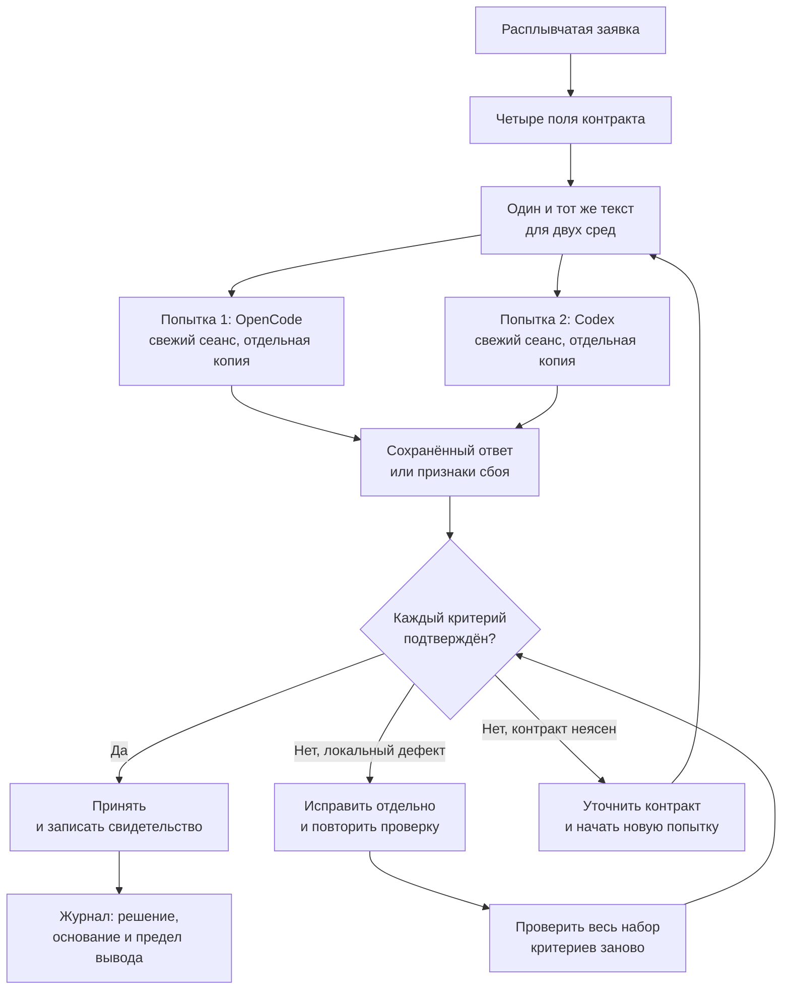
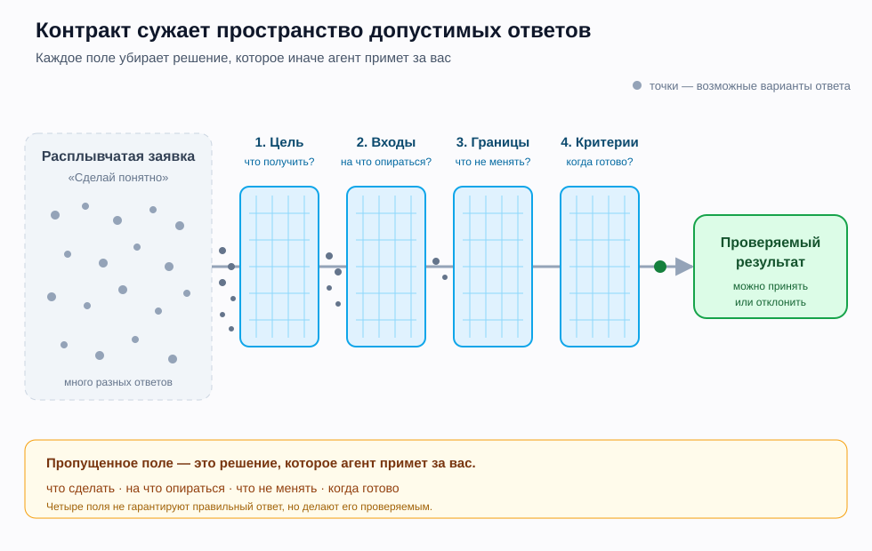

# L05. Контракт задачи

> **Основной учебник занятия.** Прочитайте обязательную часть до практики. Раздел «Углубление» отмечен как необязательный: он не добавляет работы сверх занятия и не нужен для сдачи.

**Статус проверки.** Текст сверен с утверждённой программой, картой занятий, планом L05 и карточкой практики 4 ноября 2026 года. Локально проверены только демонстрационный Python-фрагмент и проверка хешей; OpenCode и Codex в ходе подготовки не запускались. Поэтому все описания ответов сред являются учебными примерами, а не результатами реальных запусков. Формат 75/75 и тайминг практики остаются проектными допущениями до пилота.

<a id="toc"></a>
## Навигация

1. [Зачем этот навык](#why)
2. [Что научимся делать](#outcomes)
3. [Карта занятия](#map)
4. [Основные понятия](#concepts)
5. [Разобранная демонстрация](#demo)
6. [Схемы и иллюстрации](#visuals)
7. [Перед практикой](#before-practice)
8. [Самопроверка](#self-check)
9. [Углубление (необязательно)](#advanced)
10. [Словарь](#glossary)
11. [Источники и статус проверки](#sources)

<a id="why"></a>
## 1. Зачем этот навык

### 1.1. Где вы находитесь в курсе

На L04 вы сравнивали две среды — OpenCode и Codex — удерживая одинаковыми снимок, запрос и критерии. Но сам запрос выдавал преподаватель. Теперь вы делаете следующий шаг: **формулируете запрос так, чтобы его можно было проверить, и принимаете результат по свидетельствам**.

Это ключевой переход модуля 2. До L05 вы в основном проверяли код и diff. С L05 вы проверяете ещё и постановку задачи: достаточно ли в ней информации, чтобы другой человек — или агент — получил именно тот результат, который нужен.

В сквозном проекте этот навык нужен для **библиотеки промптов** — сохранённых текстов запросов с критериями и свидетельствами. На L05–L08 вы будете сохранять не «красивые формулировки», а версии запросов, критерии, результаты попыток и основания выбора. Позже эти материалы понадобятся для краткой спецификации L14, пилотного урока L16 и итогового руководства L24.

### 1.2. Что вы уже умеете

| Предпосылка | Где было | Что именно понадобится |
|---|---|---|
| Работать в отдельной копии и читать diff (сравнение изменений) | L01, L04 | Не смешивать исходный снимок (зафиксированное состояние файлов) с результатом попытки |
| Запускать короткий Python-фрагмент | L02 | Проверить ожидаемый вывод, если он входит в задачу |
| Отличать тест от ручной проверки | L03 | Понять, какое свидетельство чего стоит |
| Сравнивать две попытки по одним критериям | L04 | Сохранить одинаковые условия и записать различия |

Знать Python глубже L02–L03 не требуется. Контракт задачи — это навык постановки работы, а не урок по синтаксису.

### 1.3. Какой артефакт вы получите

После практики у вас должно быть:

- собственный запрос, в котором явно есть цель, входы, границы и критерии готовности;
- две записи попыток в OpenCode и Codex — с одинаковым текстом запроса, но в разных средах;
- решение по каждому ответу: принять, принять с локальной правкой, вернуть на новую попытку или отклонить;
- исходная и исправленная версии, если обнаружилось отклонение;
- журнал со ссылками на свидетельства и ограничением вывода.

Это не «идеальный промпт на все случаи». Это проверяемая постановка одной задачи.

**Что не входит в занятие:** полный урок Python, тесты и CI, сравнение инструментов по скорости и стоимости, работа с недоверенными инструкциями (это L12). Сегодня вы тренируете постановку одной задачи и проверку ответа по контракту.

### 1.4. Главная мысль

> **Контракт не делает агента умнее. Он делает результат проверяемым.**

Чем точнее вы называете результат, источники, запреты и признаки готовности, тем меньше решений агент принимает за вас молча. И тем легче вам доказать, что результат принят или отклонён по делу, а не «по ощущению».

<a id="outcomes"></a>
## 2. Что научимся делать

К концу занятия вы сможете:

| Наблюдаемый результат | Каким действием в практике это проверяется | Каким свидетельством подтверждается |
|---|---|---|
| 1. Составить запрос с целью, входами, границами и критериями готовности | Собрать запрос из двух файлов снимка и сохранить его текст | Сохранённый запрос и чек-лист четырёх полей |
| 2. Проверить ответ по каждому критерию, а не по общему впечатлению | Сверить ответ с критериями карточки и указать конкретное место | Таблица «критерий → место в ответе → свидетельство → статус» |
| 3. Исправить локальное отклонение и повторить проверку | Отдельно исправить обнаруженный дефект и заново проверить набор критериев | Исходный ответ, исправленная версия, причина правки и результат повторной проверки |
| 4. Сохранить сравнение двух сред честным | Провести две попытки с одним текстом запроса, в свежих сеансах и отдельных копиях | Две записи в журнале, одинаковый запрос, зафиксированные различия условий |

Это ориентир, а не новая рубрика. Уровень выполнения определяется по [рубрике модуля](../assessment.md) и критериям [карточки практики](practice_card.md).

<a id="map"></a>
## 3. Карта занятия

### 3.1. О времени

Утверждённые программа и карта занятий задают **75 минут объяснения и демонстрации + 75 минут практики**. Полная карта ниже занимает **140 минут**: 75 минут обязательного ядра и 65 минут необязательного расширения. В 150-минутном занятии используется ядро; расширение не заменяет практику и не требуется для сдачи. Так сохранён действующий формат 150 минут и одновременно показан запас глубины для группы, которой нужно больше разбора.

### 3.2. Блоки объяснения и демонстрации

| Минуты | Блок | Что происходит | Часть |
|---:|---|---|---|
| 0–8 | Вход в занятие | Зачем нужен контракт, какой артефакт сдаётся, где граница между «запросом» и «решением» | Ядро |
| 8–18 | Возврат к L04 | Что удерживалось одинаковым; почему теперь меняется не среда, а качество постановки | Ядро |
| 18–33 | Четыре поля | Цель, входы, границы, критерии: проблема → определение → пример → проверка | Ядро |
| 33–43 | Качество контракта | Тесты полей, конфликты, «понятно» против наблюдаемого признака | Ядро |
| 43–58 | Демонстрация 1 | Из «улучши приветствие» получить контракт с одним результатом, двумя именами и запретом менять входы | Ядро |
| 58–70 | Демонстрация 2 | Проверить учебный ответ по каждому критерию, отделить утверждение от свидетельства, оформить локальную правку | Ядро |
| 70–75 | Переход к практике | Что открыть, что сохранить, как не нарушить одинаковые условия | Ядро |
| 75–88 | Углубление: границы понятий | Контракт, спецификация, критерий приёмки и тест — чем отличаются | Расширение |
| 88–102 | Углубление: виды неясности | Ссылочная, смысловая, процедурная, приёмочная и граничная неясность | Расширение |
| 102–116 | Углубление: переусердствование | Когда контракт начинает писать решение за агента и почему это опасно | Расширение |
| 116–130 | Углубление: разбор конфликта | Мини-кейс с противоречивыми полями и порядок решения | Расширение |
| 130–140 | Итог и вопросы | Сводка, связь с L06–L08, ответы на вопросы | Расширение |
| **140** | **Итого** | **75 минут ядра + 65 минут расширения** | |

### 3.3. Переход к практике — 75 минут

| Минуты | Шаг | Что сохранить |
|---:|---|---|
| 10 | Разобрать входы и условия | Список файлов, режим чтения, порядок попыток |
| 15 | Собрать контракт | Текст запроса и чек-лист четырёх полей |
| 24 | Две попытки по 12 минут | Ответы или признаки сбоя, время, настройки, если видны |
| 16 | Проверка и исправление | Таблицу критериев, решение, исходную и исправленную версии |
| 10 | Журнал | Ссылки на свидетельства и предел вывода |

Подробное условие, критерии и форма сдачи — в [карточке практики](practice_card.md). Ниже мы не переписываем её, а объясняем, как устроен навык.

<a id="concepts"></a>
## 4. Основные понятия

<a id="concept-contract"></a>
### 4.1. Заявка, промпт и контракт: три разных объекта

#### Проблема

**Агент** — AI-исполнитель, который в данной среде может читать файлы, предлагать изменения и выполнять действия по запросу.

Фраза «сделай короткое упражнение, чтобы новичку было понятно» выглядит как задача, но оставляет агенту много решений: какая аудитория, какой объём, какой формат, какие термины допустимы, что считать готовым. Агент заполнит пробелы правдоподобными догадками. Иногда они совпадут с вашим замыслом, иногда нет — и вы узнаете об этом только после ответа.

#### Определение

- **Заявка** — исходное желание, часто неполное: «улучши приветствие», «сделай упражнение».
- **Промпт** — текст, который вы фактически отправили агенту.
- **Контракт задачи** — обязательное содержание промпта: что должно быть получено, на основании каких входов, что нельзя менять и по каким наблюдаемым признакам результат считается готовым.
- **Критерий готовности** (критерий приёмки) — проверяемый признак, по которому результат принимается или отклоняется.
- **Спецификация** — более широкий документ о задаче; она может включать риски, открытые вопросы и порядок работы. Контракт — это минимальное ядро одной задачи, а не вся спецификация.

Контракт не обязан быть длинным. Четыре поля — это минимум, а не бюрократическая форма. Для простой задачи хватит нескольких строк; для сложной понадобятся примеры и приоритеты, но это уже следующий уровень (L06–L08).

#### Механизм

1. Сформулируйте **результат**, а не активность: не «проанализируй», а «подготовь текст упражнения».
2. Перечислите **входы**: какие файлы или данные использовать, что из них взять, что не использовать.
3. Задайте **границы**: что можно менять, что запрещено, куда возвращать результат, что делать при конфликте.
4. Зафиксируйте **критерии**: как проверить каждый обязательный признак и что считается прохождением.
5. Проверьте поля на **согласованность** до отправки.
6. Отправьте **один и тот же текст** в обе среды и сохраните ответы до ручной правки.

#### Пример

| Заявка | Контракт (фрагмент) |
|---|---|
| «Улучши приветствие для новичка.» | «Подготовь текст упражнения для новичка, который уже видел `print`: одна строка приветствия, инструкция и ожидаемый вывод. Верни только текст. Используй `brief.md` и `notes.md`. Не добавляй f-строки. Критерии: два имени, одно присваивание, один `print`, инструкция предсказать вывод, ожидаемый вывод, файлы не изменены.» |

**Что изменилось:** появился наблюдаемый результат, источник, запрет и способ проверки. Задача стала не «лучше вообще», а проверяемой в конкретных условиях.

#### В проекте

В практике вы собираете контракт из двух файлов снимка. Важно: это **ваш** текст, а не копия демонстрационного. Демонстрация ниже использует другой сюжет и другие имена, чтобы вы тренировали перенос, а не повторяли чужую формулировку.

#### Типичная ошибка

| Ошибка | Как заметить | Что исправить |
|---|---|---|
| Длинный промпт без критериев | Много слов, но непонятно, когда принимать | Добавить 3–6 наблюдаемых критериев |
| Короткий промпт с надеждой на догадку | В ответе появились термины или файлы, которых вы не просили | Добавить входы и границы |
| Критерии придуманы после ответа | Чек-лист менялся по ходу проверки | Зафиксировать критерии до первой попытки |
| Контракт описывает процесс вместо результата | «Сначала подумай, потом объясни, потом проверь» | Оставить результат и проверку, процесс отдать агенту |

#### Проверка понимания

Может ли незнакомый человек по вашему контракту ответить на четыре вопроса: **что получить, на что опираться, что нельзя, когда готово?** Если хотя бы один ответ приходится угадывать, поле сформулировано слабо.

**Микроупражнение.** Возьмите фразу «Сделай пример получше» и добавьте к ней только два элемента: наблюдаемый результат и один критерий. Не пишите полный контракт — потренируйте разницу между желанием и проверкой.

<a id="concept-goal"></a>
### 4.2. Цель: результат, а не активность

#### Проблема

Цель «разберись и улучши» не задаёт точку остановки. Агент может написать объяснение, переписать текст, добавить примеры или всё сразу. Вы не сможете сказать, достигнута цель или нет, потому что у неё нет наблюдаемого результата.

#### Определение

**Цель** в контракте — это описание того, что должно получиться на выходе, для кого и в каком формате. Хорошая цель отвечает не на вопрос «что делать?», а на вопрос «что будет предъявлено?».

Формула, которая помогает:

```text
[Результат] + [для кого] + [в каком формате] + [что он должен позволить]
```

#### Механизм

1. Назовите **артефакт**: текст, файл, diff, таблица, список.
2. Назовите **аудиторию**: новичок, ученик после L02, преподаватель.
3. Назовите **формат**: «только текст», «Markdown-файл», «ответ без вступления».
4. Назовите **назначение**: что человек сможет сделать с результатом.
5. Уберите лишние цели. Если их две, разделите задачу или явно укажите приоритет.

#### Пример

**Вход:** заявка «Сделай упражнение по приветствию, чтобы новичку было понятно».

**Шаг 1. Результат:** текст упражнения, а не объяснение темы и не готовое решение.

**Шаг 2. Аудитория:** новичок, который уже видел `print` и одну строковую переменную.

**Шаг 3. Формат:** текст упражнения: одна строка приветствия, инструкция и ожидаемый вывод; без служебных пояснений.

**Шаг 4. Назначение:** ученик заменяет имя, предсказывает вывод и проверяет его запуском.

**Ожидаемая цель:**

```text
Подготовь текст упражнения для новичка, который уже видел print
и одну строковую переменную: одна строка приветствия, инструкция
и ожидаемый вывод. Ученик заменяет имя «Лена» на «Игорь»,
предсказывает вывод и проверяет запуском. Верни только текст упражнения.
```

**Проверка:** можно ли предъявить результат как один текст? Да. Можно ли проверить, что он для новичка? Да, по терминам и составу. Можно ли проверить, что он позволяет предсказать вывод? Да, если в нём есть инструкция и ожидаемый вывод.

#### В проекте

Цель вашей практики — не «написать хороший промпт», а получить **текст упражнения**, по которому новичок может предсказать вывод после замены значения. Формулируйте цель через этот результат. Слова «качественно», «понятно», «современно» не помогут принять работу.

#### Типичная ошибка

| Ошибка | Наблюдаемый признак | Исправление |
|---|---|---|
| Цель — активность | «Проанализируй», «подумай», «улучши» | Заменить на «подготовь текст…», «верни таблицу…» |
| Две равноправные цели | В ответе и объяснение, и упражнение, и проверка | Выбрать одну главную или задать порядок |
| Цель несовместима с форматом | Просите «только текст», но ждёте файл | Согласовать цель и границы |
| Цель без аудитории | Непонятно, можно ли использовать термины | Указать, что уже знает читатель |

#### Проверка понимания

Превратите «улучши пример» в цель так, чтобы её можно было предъявить одним артефактом. Назовите этот артефакт, аудиторию и формат. Если получается два артефакта, решите, какой из них главный.

<a id="concept-inputs"></a>
### 4.3. Входы: источник истины и его границы

#### Проблема

Агент не знает, какой файл считать актуальным, если вы просто сказали «посмотри в проекте». Он может взять старый черновик, чужую заметку или придумать недостающее требование. Чем больше доступного контекста, тем выше риск, что нужное утонет, а лишнее повлияет на ответ.

#### Определение

**Входы** — это перечень источников, на которые разрешено опираться, с указанием роли каждого источника и его статуса: актуальный, устаревший, только для чтения. Хороший перечень отвечает: что взять, откуда именно, что не использовать и что делать, если сведения нет.

#### Механизм

1. Перечислите **файлы или данные** по путям, а не «в проекте».
2. Для каждого укажите **роль**: аудитория, требования, пример, ограничение.
3. Укажите **статус**: актуальный, устаревший, только чтение.
4. Добавьте **запрет на другие источники**, если они могут помешать.
5. Задайте поведение при **нехватке**: остановиться и назвать пробел, а не придумывать.

#### Пример

| Файл | Роль | Статус | Что взять |
|---|---|---|---|
| `brief.md` | Аудитория, объём, два имени, формат | Актуальный, только чтение | Цель и границы |
| `learner_notes.md` | Что ученик уже знает, обязательные элементы | Актуальный, только чтение | Предпосылки и структуру |
| `old_draft.md` | Прежняя версия | Устаревший | Не использовать |
| `personal_notes.md` | Личные заметки | Посторонний | Не использовать |

**Ожидаемый результат:** в ответе каждое обязательное требование можно проследить до `brief.md` или `learner_notes.md`. Если требование не найдено, агент сообщает о пробеле, а не дополняет его по памяти.

#### В проекте

В снимке L05 есть два ученических файла: заявка и сведения об ученике. Их роль — быть **единственным основанием** для упражнения. Эталоны преподавателя, старые черновики и личные записи не входят в контекст попытки. Если вы использовали свои прежние материалы для подготовки запроса, они не должны становиться скрытым контекстом для агента: всё, на что он опирается, должно быть названо в контракте.

**Если агент задаёт уточняющий вопрос, это не обязательно сбой.** Это сигнал, что поле неполное. Ответьте, если ответ есть в источнике; если ответа нет — зафиксируйте пробел и не позволяйте агенту угадывать.

#### Типичная ошибка

| Ошибка | Наблюдаемый признак | Исправление |
|---|---|---|
| «Используй проект» без путей | Агент ссылается на файлы, которых вы не называли | Перечислить конкретные файлы и роли |
| Смешаны версии | В ответе есть требование из старого черновика | Указать актуальный источник и явно исключить старый |
| Входы шире задачи | Агент добавляет темы, которых нет в брифе | Ограничить источники и запретить добавления |
| Нет правила при пробеле | Агент придумал недостающее имя или вывод | Добавить: «если сведения нет, остановись и назови пробел» |

#### Проверка понимания

Возьмите три обязательных требования из своего контракта. Для каждого назовите файл, из которого оно взято. Если хотя бы одно требование не имеет источника, у вас есть скрытое допущение.

**Микроупражнение.** Из четырёх файлов — актуальный бриф, актуальные заметки, старый черновик и посторонняя заметка — выберите два и объясните, почему остальные два не нужны.

<a id="concept-boundaries"></a>
### 4.4. Границы: что можно, что нельзя и что делать при конфликте

#### Проблема

Даже с хорошей целью агент может изменить лишний файл, переписать существующий текст, добавить новое понятие или вернуть результат не в том формате. Границы нужны не для «контроля ради контроля», а чтобы результат оставался в заданной области и его можно было проверить.

#### Определение

**Границы** — это явные разрешения и запреты: где разрешено работать, какие действия допустимы, что должно остаться неизменным, в каком виде вернуть результат и как поступить при противоречии требований.

Границы бывают трёх видов:

- **область**: файлы, папки, данные;
- **действия**: читать, изменять, создавать, запускать;
- **формат ответа**: только текст, файл, таблица, без вступлений.

#### Механизм

1. Назовите **разрешённую область**: «только эти два файла».
2. Назовите **запреты**: «не изменяй файлы», «не добавляй f-строки».
3. Назовите **формат вывода**: «верни только текст упражнения».
4. Назовите **правило конфликта**: «если требования несовместимы, остановись и перечисли их».
5. Проверьте, что границы **исполнимы** и не противоречат цели.

#### Пример

```text
## Границы
- Не создавай и не изменяй файлы: снимок только для чтения.
- В ответе — только текст упражнения, без вступления и служебных пояснений.
- Не добавляй понятия сверх входа: никаких f-строк, функций, циклов.
- Если требования конфликтуют, остановись и перечисли конфликт.
```

**Ожидаемый результат:** агент возвращает текст упражнения, не трогает файлы и не вводит новых терминов. **Проверка:** сравнить хеши (короткие отпечатки содержимого) файлов до и после; прочитать ответ и найти в нём только разрешённые элементы.

#### В проекте

В практике снимок предназначен только для чтения. Даже если среда технически может писать, контракт запрещает изменения. Режим без изменений, если он есть в вашей среде, снижает риск, но не заменяет проверку: после попытки нужно убедиться, что файлы действительно не изменились. Если среда не позволяет сделать копию только для чтения, работайте в отдельной копии и проверяйте исходный снимок отдельно.

#### Типичная ошибка

| Ошибка | Наблюдаемый признак | Исправление |
|---|---|---|
| Только общий запрет «ничего не ломай» | Непонятно, что именно нельзя | Перечислить конкретные действия и файлы |
| Нет формата ответа | Агент добавляет вступление и пояснения | Написать «верни только…» |
| Конфликтующие границы | «Только текст» и «создай файл» одновременно | Выбрать один формат или задать приоритет |
| Граница не проверяется | Файл изменён, но никто не сравнил | Добавить проверку хешей или `git status` |

#### Проверка понимания

Назовите для своей задачи одно разрешённое действие, одно запрещённое и одно действие, которое требует уточнения. Если вы не можете отнести действие ни к одной категории, граница сформулирована неполно.

**Микроупражнение.** Классифицируйте: «прочитать `brief.md`», «изменить `brief.md`», «создать временный файл вне снимка», «добавить f-строку». Для каждого ответьте: разрешено, запрещено или нужно уточнить.

<a id="concept-criteria"></a>
### 4.5. Критерии готовности: наблюдаемый признак вместо «понятно»

#### Проблема

«Понятно» и «качественно» — не критерии, потому что разные люди понимают их по-разному. Агент может сказать «готово», но это утверждение, а не доказательство. Без критериев вы не сможете отличить приемлемый результат от правдоподобного.

#### Определение

**Критерий готовности** — это проверяемое условие, которое можно подтвердить или опровергнуть по артефакту. У критерия есть:

- **что проверяем** — признак;
- **как проверяем** — место в ответе, команда, сравнение;
- **что считаем прохождением** — конкретный результат.

Хороший критерий не зависит от того, кто проверяет. Два человека должны прийти к одному выводу, посмотрев на одно и то же свидетельство.

#### Механизм

1. Начните с **обязательных элементов** результата.
2. Для каждого сформулируйте **наблюдаемый признак**: есть/нет, количество, точное значение.
3. Укажите **способ проверки**: найти фрагмент, посчитать, запустить, сравнить хеш.
4. Добавьте **негативную проверку**: чего быть не должно (лишних файлов, новых терминов).
5. Разделите **обязательные** и **желательные** критерии, если задач много.
6. Зафиксируйте список **до** первой попытки и не меняйте его задним числом.

#### Пример

| № | Критерий | Как проверить | Признак прохождения |
|---:|---|---|---|
| 1 | Есть исходное имя «Лена» и новое «Игорь» | Найти оба имени в тексте | Оба присутствуют |
| 2 | Ровно одно присваивание строковой переменной | Посчитать строки с `=` в блоке кода | Одна |
| 3 | Ровно один вызов `print` | Посчитать `print(` | Один |
| 4 | Есть инструкция предсказать вывод до запуска | Прочитать текст | Инструкция есть и стоит до запуска |
| 5 | Ожидаемый вывод для обоих имён указан | Прочитать текст | Два точных вывода |
| 6 | Файлы снимка не изменены | Сравнить хеши до и после | Все `OK` |

**Ожидаемый результат:** по каждому пункту можно поставить «да», «нет» или «нет данных» и указать место. **Проверка:** если для критерия нельзя назвать место или команду, он сформулирован слишком общо.

#### В проекте

В карточке практики уже заданы критерии ответа. Ваша задача — не переписать их под себя, а **проверить каждый** и показать свидетельство. Если вы обнаружили, что критерий нельзя проверить по ответу, это важное наблюдение: зафиксируйте его, но не подменяйте критерий удобным.

#### Типичная ошибка

| Ошибка | Наблюдаемый признак | Исправление |
|---|---|---|
| Критерий «понятно» | Нет способа проверить | Заменить на «новичок может предсказать вывод» |
| Критерий «качественно» | Оценка зависит от настроения | Заменить на количество, наличие, точное значение |
| Нет негативной проверки | Лишний файл или термин остался незамеченным | Добавить «не должно быть…» |
| Критерии меняются после ответа | Чек-лист не совпадает с исходным | Вернуть исходный список и проверить заново |
| Критерий проверяет утверждение агента | «Агент написал, что проверил» | Проверить артефакт независимо |

#### Проверка понимания

Возьмите критерий «упражнение понятное» и замените его двумя наблюдаемыми: один про содержание, один про действие ученика. Затем проверьте, сможет ли другой человек по вашему описанию поставить «да» или «нет».

**Микроупражнение.** Для текста из 5 строк придумайте один критерий наличия, один критерий количества и один критерий отсутствия. Не используйте слова «качественно» и «понятно».

<a id="concept-consistency"></a>
### 4.6. Четыре поля как система: проверка на согласованность

#### Проблема

Каждое поле может быть хорошим по отдельности, но вместе они могут противоречить друг другу. Например, цель требует «только текст», а границы — «создай файл»; входы не содержат понятия, которое требует цель; критерии проверяют то, чего нет в задаче. Агент в таком случае выбирает что-то одно, часто молча.

#### Определение

**Согласованность контракта** означает, что все четыре поля могут быть выполнены одновременно, без скрытого приоритета. Если приоритет нужен, он должен быть назван явно.

#### Механизм

Проверьте пары:

| Пара | Вопрос | Пример конфликта |
|---|---|---|
| Цель ↔ границы | Можно ли получить результат, не нарушая запрет? | «Верни только текст» и «создай файл» |
| Входы ↔ цель | Есть ли во входе всё, что требует цель? | Цель требует f-строку, а вход её не вводит |
| Критерии ↔ цель | Проверяют ли критерии именно тот результат? | Цель — текст, критерий — «файл существует» |
| Границы ↔ критерии | Можно ли проверить границы? | «Не меняй файлы», но нет способа проверки |
| Входы ↔ границы | Не противоречит ли запрет обязательному источнику? | «Не читай файл», но он назван входом |

#### Пример

```text
## Цель
Верни только текст упражнения.

## Входы
Используй brief.md.

## Границы
Создай файл exercise.md с текстом упражнения.

## Критерии
Файл exercise.md существует.
```

**Что не так:** цель и границы требуют разных форматов. **Как исправить:** выбрать один формат. Если нужен файл, цель должна говорить о файле; если нужен только текст, границы не должны требовать создания файла. **Проверка:** после исправления все четыре поля можно выполнить одновременно.

#### В проекте

Перед отправкой контракта проверьте, что:
- снимок только для чтения и это не противоречит цели;
- требования к ответу можно выполнить, не добавляя новых понятий;
- критерии проверяют именно текст упражнения, а не файл или объяснение;
- у вас есть способ проверить отсутствие изменений.

#### Типичная ошибка

| Ошибка | Наблюдаемый признак | Исправление |
|---|---|---|
| Скрытый приоритет | Агент выбрал одно из двух требований | Назвать приоритет явно |
| Критерий не о том | Проверяет файл, а цель — текст | Переписать критерий под цель |
| Вход не содержит нужного | Агент придумал термин | Добавить источник или убрать требование |
| Границы не проверяемы | Нет хеша, diff или списка файлов | Добавить конкретную проверку |

#### Проверка понимания

Найдите конфликт в мини-контракте выше. Затем перепишите его так, чтобы конфликт исчез, не добавляя новых полей. Если для этого нужно изменить цель, значит, конфликт был существенным.

**Микроупражнение.** Придумайте одно противоречие между «верни только текст» и любым другим полем. Объясните, какое решение примет агент, если приоритет не задан.

<a id="concept-evidence"></a>
### 4.7. Как проверить ответ: утверждение, свидетельство, решение

#### Проблема

Ответ агента может выглядеть уверенно и при этом не содержать доказательств. «Готово», «я проверил», «всё соответствует» — это утверждения. Если вы принимаете их без проверки, вы принимаете не результат, а обещание.

#### Определение

- **Утверждение** — что агент говорит о своей работе.
- **Свидетельство** — то, что можно проверить независимо: фрагмент ответа, вывод команды, diff, хеш, точное значение.
- **Решение** — ваш вывод по критерию: принять, исправить, вернуть на новую попытку или отклонить.

#### Механизм

1. Возьмите критерий из контракта.
2. Найдите **точное место** в ответе или артефакте.
3. Проверьте его **независимо**: прочитайте, посчитайте, запустите, сравните.
4. Поставьте статус: «да», «нет» или «нет данных».
5. Запишите **решение** и основание.
6. Если статус «нет», определите тип дефекта: локальный, системный, нарушение области или неясность контракта.

#### Пример

| Утверждение | Свидетельство | Статус |
|---|---|---|
| «Упражнение готово» | Нет ссылки на критерии | Не подтверждено |
| «Одно присваивание» | В коде две строки с `=` | Нет |
| «Файлы не изменены» | Хеши до и после совпали | Да |
| «Ожидаемый вывод правильный» | В тексте указан только один вывод | Нет данных / нет |

**Решение:** «Не принято: два присваивания, нет ожидаемого вывода. Локальная правка и повторная проверка». Это решение опирается на свидетельства, а не на впечатление.

| Решение | Когда уместно | Что сохранить |
|---|---|---|
| Принять | Все обязательные критерии подтверждены | Таблицу критериев и ссылки на свидетельства |
| Принять с локальной правкой | Дефект локальный, область и формат не нарушены | Исходник, исправленную версию, причину и повторную проверку |
| Вернуть на новую попытку | Контракт неясен или дефект системный | Исходный ответ, формулировку неясности, новый текст запроса |
| Отклонить | Нарушена область, есть опасное действие или нет обязательного входа | Запись инцидента, доказательство нарушения, следующий безопасный шаг |

#### В проекте

В практике вы сохраняете **исходный ответ** и заполняете таблицу по критериям. Если ответ пришлось править, храните исходную и исправленную версии отдельно. В журнале укажите, что именно исправлено и почему. Не выдавайте ручную правку за ответ агента.

Шаблон записи (не фактические данные):

| Поле журнала | Пример заполнения |
|---|---|
| Среда и попытка | OpenCode, попытка 1 |
| Запрос | ссылка на сохранённый текст запроса |
| Исходный ответ | ссылка на файл ответа |
| Критерий 2 | в ответе две строки с `=` → статус «нет» |
| Решение | не принято, нужна локальная правка |
| Ручная правка | убрано лишнее присваивание, причина записана |
| Повторная проверка | все критерии проверены заново, статус «да» |

#### Типичная ошибка

| Ошибка | Наблюдаемый признак | Исправление |
|---|---|---|
| «Агент сказал, что проверил» | Нет фрагмента или команды | Запросить точное место или проверить самому |
| Оценка «по ощущению» | Нет таблицы критериев | Заполнить таблицу до решения |
| Скрытая ручная правка | Diff не совпадает с исходным ответом | Записать правку и причину |
| Критерий подменён удобным | Проверяется не то, что было в контракте | Вернуть исходный критерий |
| Нет статуса «нет данных» | Непроверенное считается выполненным | Разрешить себе «нет данных» и проверить |

#### Проверка понимания

Агент пишет: «Я проверил, всё работает». Что нужно, чтобы это стало свидетельством? Назовите минимум два варианта: точный фрагмент ответа и независимую проверку.

**Микроупражнение.** Для утверждения «в тексте ровно один `print`» придумайте способ проверки и признак прохождения. Затем сделайте то же для утверждения «файлы не изменены».

<a id="concept-environments"></a>
### 4.8. Две среды: что удерживать одинаковым

#### Проблема

Сравнение теряет смысл, если одна среда получила другой запрос, другой снимок или больше времени. Тогда различие в результате нельзя объяснить средой: возможно, дело в условиях. Кроме того, один запуск не даёт права на общий вывод о «лучшем» инструменте.

#### Определение

**Честное сравнение** — это две попытки, в которых одинаковы снимок, текст запроса, критерии, лимит времени и порядок, а различается только среда. Все остальные различия записываются как различия условий.

#### Механизм

| Что удерживать | Как проверить |
|---|---|
| Снимок и его идентификатор | Коммит или выданная копия; список файлов |
| Текст запроса | Дословно один и тот же в обеих средах |
| Критерии | Один список до первой попытки |
| Лимит времени | Одинаковый, например 12 минут на попытку |
| Свежий сеанс | Новый диалог без контекста предыдущей попытки |
| Отдельная копия | Не работать в одном рабочем каталоге |
| Порядок | Записан до старта |

**Что может различаться и должно быть записано:** интерфейс, режим разрешений, модель и настройки (если видны), время ответа, формат вывода, отказ или тайм-аут, доступ к файлам.

**Что подтверждено, а что нет.** По официальной документации на 4 ноября 2026 года OpenCode использует действия разрешений `allow`, `ask` и `deny`, а Codex — режимы разрешений и sandbox, которые могут зависеть от версии, окружения и настроек организации. Конкретные модели, скорость, формат ответа и поведение установленных версий этим не подтверждаются: их нужно наблюдать и записывать. Ссылки — в разделе 11.2.

#### Пример

Учебная таблица для заполнения на занятии (фактических данных здесь нет):

| Поле | OpenCode | Codex |
|---|---|---|
| Снимок и копия |  |  |
| Свежий сеанс |  |  |
| Модель и настройки, если видны |  |  |
| Время |  |  |
| Ответ или сбой |  |  |
| Изменения файлов |  |  |
| Проверки по критериям |  |  |

**Ожидаемый результат:** обе записи заполнены фактами; недоступные поля помечены «недоступно». **Проверка:** можно ли по журналу восстановить, что было одинаковым, а что различалось.

#### В проекте

Для L05 действует [протокол сравнения](../shared/comparison_protocol.md): один снимок, один запрос, свежий сеанс, отдельная копия. Запись ведётся в [форме журнала](../shared/run_journal.md). Если среда недоступна, используйте сохранённый пример преподавателя только с явной пометкой; это не засчитывается как проведённый запуск.

#### Типичная ошибка

| Ошибка | Наблюдаемый признак | Исправление |
|---|---|---|
| Разные тексты запроса | В журнале две разные формулировки | Использовать один сохранённый текст |
| Один сеанс на две попытки | Контекст первой попытки влияет на вторую | Начать новый сеанс |
| Одна рабочая копия | Вторая попытка видит изменения первой | Сделать отдельные копии |
| Разное время | Одна попытка длилась 12 минут, другая 30 | Записать отклонение или повторить |
| Вывод «кто лучше» по одному запуску | Нет данных о модели и условиях | Ограничить вывод наблюдением |

#### Проверка понимания

Назовите три вещи, которые нужно удержать одинаковыми, и одну, которую нужно записать как различие. Если вы называете «модель» среди одинаковых, проверьте, действительно ли она одинаковая и видна ли она вам.

**Микроупражнение.** Посмотрите на две записи журнала. Найдите в них условие, которое различается, но не названо как различие. Что нужно добавить, чтобы вывод стал честнее?

<a id="demo"></a>
## 5. Разобранная демонстрация

### 5.1. Что демонстрируем

Демонстрация показывает полный цикл:

```text
расплывчатая заявка → контракт → учебный ответ → проверка → локальная правка → повторная проверка → вывод
```

Это **не** оцениваемая практика. Демонстрационный снимок `demo_greeting/` отличается от `snapshot/` по сюжету, именам и формулировкам. Совпадает только тренируемый приём: превратить заявку в проверяемый контракт.

| Шаг | Человек | Агент |
|---:|---|---|
| 1. Постановка | Читает бриф и заметки, формулирует четыре поля, проверяет конфликты | Не участвует |
| 2. Попытка | Отправляет контракт, сохраняет исходный ответ | Читает указанные входы и возвращает текст |
| 3. Приёмка | Проверяет критерии, считает элементы, сравнивает хеши | Не участвует: «готово» агента не является приёмкой |
| 4. Исправление | Правит локально или уточняет контракт и начинает новую попытку | Получает новую попытку, если человек решил её сделать |

### 5.2. Вход демонстрации

`demo_greeting/brief.md`:

```text
# Бриф: приветственная открытка

Аудитория: новичок, который уже видел print и одну строковую переменную.
Нужен текст упражнения: одна строка приветствия, инструкция и ожидаемый вывод.
Ученик заменяет имя «Лена» на «Игорь», предсказывает вывод и проверяет запуском.
Вернуть только текст упражнения.
```

`demo_greeting/learner_notes.md`:

```text
# Условия

Ученик уже видел присваивание строки и print.
Используйте одну строковую переменную и один вызов print.
Дайте два имени для проверки: «Лена» и «Игорь».
Файлы этого снимка — только для чтения.
```

**Ограничения демонстрации:** только два входных файла; только текст упражнения; файлы не меняются; новые понятия не добавляются. Это учебные условия, а не фактические настройки вашей среды.

### 5.3. Плохая заявка

```text
Улучши приветствие для новичка, чтобы было понятно.
```

Почему этого недостаточно:

- неясно, что именно должно получиться: объяснение, упражнение, код или проверка;
- неясно, какой объём и формат;
- неясно, какие имена использовать;
- неясно, можно ли добавлять новые понятия;
- неясно, когда результат готов.

Агент может ответить правдоподобно, но вы не сможете доказать, что получили нужное.

### 5.4. Контракт

```text
## Цель
Подготовь текст упражнения для новичка, который уже видел print
и одну строковую переменную: одна строка приветствия, инструкция
с предсказанием вывода и ожидаемый вывод. Ученик заменяет имя «Лена» на «Игорь»,
предсказывает вывод и проверяет запуском. Верни только текст упражнения.

## Входы
- brief.md — аудитория, формат, два имени и требование к тексту. Только чтение.
- learner_notes.md — что ученик уже знает и какие элементы обязательны. Только чтение.
Другие файлы не используй. Если обязательного сведения нет во входе,
не придумывай его.

## Границы
- Не создавай и не изменяй файлы: снимок только для чтения.
- В ответе — только текст упражнения, без вступления и служебных пояснений.
- Не добавляй понятия сверх входа: никаких f-строк, функций, циклов.
- Если требования конфликтуют, остановись и перечисли конфликт.

## Критерии готовности
1. В упражнении есть исходное имя «Лена» и новое имя «Игорь».
2. В коде ровно одно присваивание строковой переменной.
3. В коде ровно один вызов print.
4. Есть инструкция сначала предсказать вывод, потом запустить программу.
5. Ожидаемый вывод для обоих имён указан однозначно.
6. Файлы снимка не изменены.
```

**Проверка контракта до отправки:**

| Поле | Вопрос | Ответ |
|---|---|---|
| Цель | Что получится? | Текст упражнения: одна строка приветствия, инструкция, ожидаемый вывод |
| Входы | На что опираться? | `brief.md`, `learner_notes.md` |
| Границы | Что нельзя? | Менять файлы, добавлять понятия, выходить за формат |
| Критерии | Когда готово? | Шесть проверяемых пунктов |
| Согласованность | Нет ли конфликта? | «Только текст» и «не менять файлы» совместимы |

### 5.5. Учебный ответ агента

> **Учебный пример, не результат реального запуска OpenCode или Codex.** Ответ составлен для разбора; он не подтверждает поведение конкретной версии инструмента.

```text
# Приветственная открытка

В Python можно сохранить приветствие в переменной.

name = "Лена"
greeting = f"Привет, {name}!"
print(greeting)

Замените имя на «Игорь» и запустите программу.
```

Ответ выглядит аккуратно: есть код, одно приветствие, понятное действие. Именно поэтому его полезно разбирать: **правдоподобность не равна выполнению контракта**.

### 5.6. Проверка по критериям

| № | Критерий | Где смотреть | Наблюдение | Статус |
|---:|---|---|---|---|
| 1 | Два имени: «Лена» и «Игорь» | Код и инструкция | «Лена» в коде, «Игорь» в инструкции | Да |
| 2 | Ровно одно присваивание | Строки кода | `name = ...` и `greeting = ...` — два | Нет |
| 3 | Ровно один `print` | Строки кода | Один `print(greeting)` | Да |
| 4 | Инструкция предсказать вывод | Текст | Инструкции нет | Нет |
| 5 | Ожидаемый вывод для обоих имён | Текст | Вывод не указан | Нет |
| 6 | Файлы не изменены | Хеши до/после | Ещё не проверено | Нет данных |
| — | Нет понятий сверх входа | Код | Использована f-строка (подстановка значения в строку), которой нет во входе | Нет |

**Решение:** не принимать. Это не «плохой ответ вообще», а ответ, который не выполняет конкретный контракт. Дефекты локальные: их можно исправить, не меняя снимок.

**Важно:** статус «нет данных» честнее, чем «да». Если вы не проверили файлы, вы не знаете, изменились ли они.

### 5.7. Локальное исправление

Исправление делается **отдельно** от исходного ответа. Сначала сохраните исходник, затем создайте исправленную версию.

Исправленный фрагмент:

```python
phrase = "Привет, Лена"
print(phrase)
```

Исправленный текст упражнения:

```text
1. Прочитайте строку. Запишите, что выведет программа.
2. Замените «Лена» на «Игорь». Снова запишите ожидаемый вывод.
3. Запустите программу и сравните.

Ожидаемый вывод:
Привет, Лена
Привет, Игорь
```

**Что изменено:**

- два присваивания заменены одним;
- f-строка убрана;
- добавлена инструкция предсказать вывод;
- добавлен точный ожидаемый вывод для двух имён;
- снимок не изменялся.

### 5.8. Повторная проверка

| № | Критерий | Наблюдение | Статус |
|---:|---|---|---|
| 1 | Два имени | «Лена» и «Игорь» есть | Да |
| 2 | Одно присваивание | `phrase = ...` — одно | Да |
| 3 | Один `print` | `print(phrase)` — один | Да |
| 4 | Предсказание до запуска | Инструкция есть | Да |
| 5 | Ожидаемый вывод | Два точных вывода | Да |
| 6 | Файлы не изменены | Хеши совпали | Да |
| — | Нет лишних понятий | Только присваивание и `print` | Да |

**Локальная проверка демонстрационного фрагмента, 4 ноября 2026.** Команды выполнялись в отдельной папке `demo_greeting/`, не в снимке. В ней лежали `brief.md` и `learner_notes.md` из раздела 5.2 и два файла с показанным выше кодом. Выполняйте это в отдельной временной папке, а не в `snapshot/` и не в корне репозитория. Минимальная подготовка (из родительской папки):

```bash
mkdir -p demo_greeting
cd demo_greeting
# создайте здесь brief.md и learner_notes.md из раздела 5.2
printf '%s\n' 'phrase = "Привет, Лена"' 'print(phrase)' > greeting.py
printf '%s\n' 'phrase = "Привет, Игорь"' 'print(phrase)' > greeting_replaced.py
shasum -a 256 brief.md learner_notes.md > before.sha256
```

На Linux вместо `shasum -a 256` обычно доступен `sha256sum`. Далее команды выполняются внутри `demo_greeting/`. Команда и фактический вывод:

```bash
python3 greeting.py
```

```text
Привет, Лена
```

```bash
python3 greeting_replaced.py
```

```text
Привет, Игорь
```

```bash
shasum -a 256 -c before.sha256
```

```text
brief.md: OK
learner_notes.md: OK
```

Версия Python в этой проверке — 3.9.6. Это проверка только демонстрационного фрагмента и хешей; OpenCode и Codex не запускались.

### 5.9. Вывод демонстрации

1. Контракт выявил четыре отклонения, которые не видны при быстром взгляде: два присваивания, f-строку, отсутствие предсказания и отсутствие ожидаемого вывода.
2. Локальная правка допустима, но она должна быть записана отдельно. Нельзя выдавать исправленный текст за исходный ответ агента.
3. Приёмка — это решение по свидетельствам. «Выглядит хорошо» не заменяет таблицу критериев.
4. Если бы мы приняли ответ сразу, дефект ушёл бы в учебный материал: новичок не смог бы предсказать вывод и столкнулся бы с незнакомой f-строкой.

### 5.10. Если проверка выявила дефект

| Ситуация | Признак | Действие |
|---|---|---|
| Локальный текстовый дефект | Нет одного элемента, но область и формат соблюдены | Исправить в отдельной версии, записать причину, повторить все критерии |
| Нарушение области | Изменён файл снимка или появился лишний файл | Остановиться, восстановить снимок, записать инцидент, повторить с более строгой границей |
| Неясность контракта | Агент понял требование иначе, чем вы | Не спорить с ответом; уточнить контракт и начать новую попытку |
| Конфликт требований | Два поля несовместимы | Остановить попытку, выбрать приоритет или переформулировать |
| Утверждение без свидетельства | «Готово», но нет фрагмента или проверки | Поставить «не подтверждено», запросить точное место или проверить самому |
| Сбой среды | Тайм-аут, отказ, недоступность | Сохранить запись, отметить «недоступно», использовать сохранённый пример только с пометкой |

**Правило:** сначала сохраните исходное свидетельство, потом исправляйте. Если исправление меняет смысл задачи, это уже не локальная правка, а новая попытка.

### 5.11. Сравнение сред без выдуманных результатов

В демонстрации для сравнения предусмотрена одна и та же задача и один и тот же текст контракта в обеих средах. Критерии тоже одинаковые: те же шесть пунктов из раздела 5.4, без изменений между средами. Фактические ответы в этом учебнике не приводятся: в ходе подготовки запуски OpenCode и Codex не выполнялись. На занятии вы заполняете таблицу по своим наблюдениям.

| № | Критерий | Одинаковая проверка в обеих средах |
|---:|---|---|
| 1 | Два имени | Найти «Лена» и «Игорь» в тексте |
| 2 | Одно присваивание | Посчитать строки с `=` в блоке кода |
| 3 | Один `print` | Посчитать вызовы `print(` |
| 4 | Предсказание до запуска | Прочитать инструкцию |
| 5 | Ожидаемый вывод | Сверить оба значения |
| 6 | Файлы не изменены | Сравнить хеши до и после |

| Условие | OpenCode | Codex |
|---|---|---|
| Снимок и отдельная копия | Заполнить | Заполнить |
| Свежий сеанс | Заполнить | Заполнить |
| Дословный запрос | Один и тот же текст | Один и тот же текст |
| Модель и настройки, если видны | Заполнить или «недоступно» | Заполнить или «недоступно» |
| Время | Заполнить | Заполнить |
| Ответ или сбой | Заполнить | Заполнить |
| Изменения файлов | Проверить | Проверить |
| Решение по критериям | Заполнить | Заполнить |

**Что можно утверждать по одной серии:** «в данных условиях получен такой ответ, такие проверки, такие различия». **Что нельзя утверждать:** «этот инструмент лучше вообще» или «этот промпт всегда работает».

<a id="visuals"></a>
## 6. Схемы и иллюстрации

### 6.1. Схема процесса



*Рис. 1. Путь от заявки до решения о приёмке. Схема показывает, что проверка возвращает нас либо к исправлению, либо к уточнению контракта, а не сразу к «принято».*

**Как читать:** движение идёт сверху вниз. После ответа есть три выхода: принять, исправить локально или уточнить контракт. Любой возврат заканчивается повторной проверкой всего набора критериев, а не только исправленного пункта.

**Вывод для практики:** не принимайте решение по одному признаку. Если вы исправили один дефект, проверьте остальные критерии заново: правка могла задеть другой элемент.

**Текстовая альтернатива:**

1. Заявка превращается в контракт из четырёх полей.
2. Один и тот же текст отправляется в две среды.
3. Ответы сохраняются до ручной правки.
4. Каждый критерий проверяется отдельно.
5. Если всё подтверждено — принять и записать свидетельство.
6. Если локальный дефект — исправить и проверить заново.
7. Если контракт неясен — уточнить и начать новую попытку.
8. Решение и предел вывода фиксируются в журнале.

### 6.2. Иллюстрация: как контракт сужает пространство ответов



*Рис. 2. Четыре поля контракта как фильтры. Слева много возможных ответов, справа — результат, который можно принять или отклонить по свидетельству. Это учебная схема, а не снимок интерфейса OpenCode или Codex.*

**Как читать:** серые точки слева — возможные варианты, которые агент может выбрать при расплывчатой заявке. Каждый фильтр убирает часть неопределённости. Зелёная точка справа — результат, для которого есть проверяемые признаки. Нижняя полоса напоминает: пропущенное поле не исчезает, а становится решением агента по умолчанию.

**Вывод для практики:** если вы не хотите, чтобы агент решал за вас, назовите соответствующее поле явно. Не обязательно писать длинный текст: важно, чтобы решение было видно и проверяемо.

**Текстовая альтернатива:**

| Этап | Что происходит | Что остаётся неопределённым, если этап пропущен |
|---|---|---|
| Заявка | Много возможных ответов | Всё: аудитория, формат, объём, проверка |
| Цель | Появляется наблюдаемый результат | Что именно считать результатом |
| Входы | Появляется источник истины | На какие файлы и версии опираться |
| Границы | Появляется область и запреты | Что можно менять и в каком формате возвращать |
| Критерии | Появляется способ приёмки | Когда результат готов |
| Результат | Можно принять или отклонить по свидетельству | — |

<a id="before-practice"></a>
## 7. Перед практикой

### 7.1. Что должно быть готово

| Что нужно | Зачем | Где взять |
|---|---|---|
| Две чистые копии снимка | Отдельная попытка в каждой среде | Выдаёт преподаватель; файлы из [`snapshot/`](snapshot/) |
| Файл заявки | Исходное расплывчатое условие | [`snapshot/request.md`](snapshot/request.md) |
| Файл сведений об ученике | Предпосылки и ограничения | [`snapshot/learner_notes.md`](snapshot/learner_notes.md) |
| Карточка практики | Точное задание, время, критерии, сдача | [`practice_card.md`](practice_card.md) |
| Протокол сравнения | Одинаковые условия двух попыток | [`../shared/comparison_protocol.md`](../shared/comparison_protocol.md) |
| Форма журнала | Запись попыток и вывода | [`../shared/run_journal.md`](../shared/run_journal.md) |
| Рубрика модуля | Уровни выполнения | [`../assessment.md`](../assessment.md) |

Python, Git и тесты нужны только в объёме L01–L03. Для самой задачи L05 достаточно редактора текста и двух сред; запуск Python может понадобиться, если вы захотите проверить ожидаемый вывод.

### 7.2. На что обратить внимание в карточке

1. **Входы.** Используйте только файлы снимка, указанные в карточке. Не добавляйте эталоны преподавателя и посторонние заметки.
2. **Формат ответа.** В задаче нужен только текст упражнения. Это граница, а не пожелание.
3. **Одинаковые условия.** Один и тот же запрос дословно, свежий сеанс, отдельная копия, одинаковый лимит.
4. **Сохранение исходников.** Не исправляйте ответ на месте. Сначала сохраните то, что вернула среда.
5. **Проверка области.** После попытки убедитесь, что снимок не изменён. Слова в промпте не заменяют проверку.
6. **Решение по каждому ответу.** «Нормально» — не решение. Нужно основание: какой критерий подтверждён или нет.

### 7.3. Какое свидетельство сохранить

- текст вашего запроса — в двух версиях, если вы его уточняли;
- чек-лист четырёх полей;
- две записи попыток: среда, время, модель и настройки (если видны), ответ или сбой;
- таблицу проверки по критериям с точными местами;
- решение по каждому ответу;
- исходную и исправленную версии, если была правка;
- журнал со ссылками и ограничением вывода.

**Чек-лист четырёх полей** (заполните до отправки):

| Поле | Проверочный вопрос | Отметка |
|---|---|---|
| Цель | Что именно получится и для кого? |  |
| Входы | Какие файлы использовать и что из них взять? |  |
| Границы | Что нельзя менять и в каком формате вернуть? |  |
| Критерии | Как проверить каждый обязательный признак? |  |
| Согласованность | Могут ли все поля выполняться одновременно? |  |

### 7.4. По какому критерию сверить результат

Перед сдачей проверьте:

- запрос содержит все четыре части контракта;
- ответ содержит требуемые элементы, указанные в карточке;
- ожидаемый вывод определим;
- снимок не изменён;
- по каждому ответу есть решение, основанное на свидетельстве;
- в журнале разделены факты попыток и ваша гипотеза.

Если пункт не выполнен, не маскируйте его. Запишите, что именно не подтверждено и какой следующий проверяемый шаг нужен. Это лучше, чем «всё получилось» без доказательства.

<a id="self-check"></a>
## 8. Самопроверка

1. **Распознать.** В каком запросе есть все четыре поля контракта?
   - A: «Сделай упражнение по переменным, чтобы новичку было понятно».
   - B: «Подготовь текст упражнения на 5–7 строк о погоде для новичка, который знает `print`. Используй только `brief.md` и `notes.md`. Верни только текст, не меняй файлы. Критерии: одна переменная, один `print`, инструкция предсказать вывод, ожидаемый вывод».
2. **Объяснить.** Почему «ответ выглядит правильно» не является свидетельством выполнения контракта?
3. **Применить.** Превратите «улучши пример» в цель и один критерий готовности. Назовите артефакт, аудиторию и способ проверки.
4. **Диагностировать.** Агент пишет «готово», но не показывает ожидаемый вывод. Ваши действия? Назовите минимум два.
5. **Перенести.** Как контракт L05 связан с ограничениями и примерами L06, декомпозицией L07 и оценкой промптов L08?

### Ориентиры для самопроверки

| Вопрос | Что должно быть в ответе |
|---|---|
| 1 | B: есть результат, входы, границы и критерии; A оставляет почти все решения агенту |
| 2 | Нужны точное место в ответе и независимая проверка; «выглядит правильно» — впечатление, а не свидетельство |
| 3 | Цель — наблюдаемый артефакт для названной аудитории; критерий — проверяемый признак, а не «понятно» |
| 4 | Поставить «не подтверждено», запросить точное место или проверить самому; при дефекте — исправить и повторить проверку |
| 5 | L06 добавляет ограничения и образцы, L07 делит задачу на шаги, L08 сравнивает версии промпта по рубрике |

**Связь с предыдущим и следующим.** L04 дал вам протокол честного сравнения. L05 добавляет контракт, без которого сравнивать нечего. L06 покажет, как ограничения и примеры влияют на один фрагмент; L07 разделит задачу на проверяемые шаги; L08 научит оценивать версии запросов по заранее заданной рубрике. В сквозном проекте всё это собирается в библиотеку промптов, а затем — в спецификацию и пилотный урок.

<a id="advanced"></a>
## 9. Углубление (необязательно)

Этот раздел не нужен для сдачи и не входит в обязательные 75 минут. Он полезен, если вы хотите точнее различать понятия или готовите собственный шаблон контракта.

### 9.1. Контракт, спецификация и критерий приёмки

| Понятие | На какой вопрос отвечает | Пример |
|---|---|---|
| Контракт задачи | Что должно быть получено, на чём основано, что нельзя, когда готово | Четыре поля L05 |
| Спецификация | Как устроена задача целиком, какие риски и открытые вопросы | Документ L14 на одну страницу |
| Критерий приёмки | По какому признаку принимается конкретный результат | «Ровно один `print`» |
| Тест | Автоматическая проверка, которая может подтвердить критерий | Тест L03 или L22 |

Контракт может быть частью спецификации, а критерий — частью контракта. Тест — это свидетельство, а не сам критерий: критерий говорит, что проверять; тест — как.

### 9.2. Пять видов неясности

| Вид | Вопрос, который остаётся | Пример | Как закрыть |
|---|---|---|---|
| Ссылочная | О каком файле или версии речь? | «Возьми бриф» | Указать путь и статус |
| Смысловая | Что значит «коротко» или «понятно»? | «Сделай коротко» | Задать объём или число |
| Процедурная | Что делать при нехватке данных? | «Если имени нет…» | Правило: остановиться и назвать пробел |
| Приёмочная | Когда считать готовым? | «Сделай хорошо» | Наблюдаемые критерии |
| Граничная | Что нельзя менять? | «Не трогай лишнее» | Список запретов и область |

### 9.3. Переусердствование: контракт, который пишет решение

Контракт может стать настолько подробным, что вы начнёте диктовать каждую строку. Тогда вы теряете одно из преимуществ агента — возможность предложить решение — и одновременно рискуете встроить в промпт собственную ошибку. Полезное правило:

> Описывайте **результат, ограничения и проверку**, а не каждую строку решения. Если без строки нельзя проверить результат, добавьте её в критерий, а не в жёсткий сценарий.

Для учебного текста это означает: можно требовать «одно присваивание, один `print`, два имени, предсказание, ожидаемый вывод», но не обязательно диктовать точную фразу приветствия. Формулировку может предложить агент; вы проверите её по критериям.

### 9.4. Аудит решений

Полезное упражнение: пройдите по контракту и отметьте, какие решения вы оставили агенту. Например:

| Решение | Кто принимает | Почему это допустимо |
|---|---|---|
| Точная фраза приветствия | Агент | Смысл проверяется по критериям |
| Количество строк | Вы | Влияет на объём и проверяемость |
| Использование f-строки | Вы | Новый термин для новичка |
| Формат ответа | Вы | Влияет на приёмку |
| Имена для замены | Вы | Нужны для проверки двух значений |

Если решение важно, а вы его не назвали, это «долг контракта»: агент закроет его по умолчанию. Чем раньше вы заметите долг, тем дешевле исправление.

<a id="glossary"></a>
## 10. Словарь

- **Агент** — AI-исполнитель, который в среде может читать файлы, предлагать изменения и выполнять действия по запросу.
- **Заявка** — исходное, часто неполное описание желаемого результата.
- **Промпт** — текст, фактически отправленный агенту.
- **Контракт задачи** — обязательное содержание промпта: цель, входы, границы, критерии готовности.
- **Критерий готовности** — проверяемый признак, по которому результат принимается или отклоняется.
- **Свидетельство** — то, что можно проверить независимо: фрагмент, вывод команды, diff, хеш.
- **Снимок** — зафиксированное исходное состояние файлов, от которого начинается попытка.
- **Свежий сеанс** — новый диалог без контекста предыдущей попытки.
- **Режим только для чтения** — условие, при котором файлы снимка не должны изменяться.
- **Diff** — сравнение изменений между версиями файлов.
- **Локальная правка** — небольшое исправление ответа отдельно от исходника, с записью причины и повторной проверкой.
- **Приёмка** — решение принять результат по свидетельствам, а не по общему впечатлению.

<a id="sources"></a>
## 11. Источники и статус проверки

### 11.1. Внутренние источники

- [Утверждённая программа](../../../agentic_development_course_final.md#lessons) — формат 75/75, результаты L05.
- [Карта занятий L01–L24](../../../course_lesson_map_L01-L24.md) — место L05 в модуле 2.
- [Карточка практики](practice_card.md) — условие, время, критерии, сдача.
- [Протокол сравнения](../shared/comparison_protocol.md) — одинаковые условия двух попыток.
- [Форма журнала](../shared/run_journal.md) — поля записи и вывода.
- [Рубрика модуля 2](../assessment.md) — уровни выполнения.

### 11.2. Официальная документация

Сведения ниже проверены по официальной документации 4 ноября 2026 года. Это описание продуктов, а не гарантия поведения установленной у вас версии. Названия режимов, моделей и разрешений могут отличаться; на занятии фиксируется наблюдение, а не название из документации.

| Источник | Что подтверждается | Ссылка |
|---|---|---|
| OpenCode, Intro | В документации описан Plan mode, который отключает возможность вносить изменения и предлагает подход; переключение описано через Tab. Проверьте фактическое поведение своей версии. | [opencode.ai/docs](https://opencode.ai/docs/) |
| OpenCode, Permissions | Действия разрешений описаны как `allow`, `ask`, `deny`; для путей вне рабочей папки используется `external_directory`. | [opencode.ai/docs/permissions](https://opencode.ai/docs/permissions/) |
| Codex, Prompting | Для полезного промпта рекомендуются цель, контекст, формат вывода и границы; для кода — указать, как проверить изменение. | [developers.openai.com/codex/prompting](https://developers.openai.com/codex/prompting) |
| Codex, Permissions | Описаны режимы разрешений и sandbox; режимы могут зависеть от версии, окружения и настроек организации. | [developers.openai.com/codex/permission-modes](https://developers.openai.com/codex/permission-modes) |

**Как это использовать.** Документация помогает назвать общие понятия, но не заменяет проверку. Если в вашей среде нет Plan mode или название другое, запишите фактическое наблюдение и действуйте по карточке. Не приписывайте инструменту функцию, которую вы не видели.

### 11.3. Что проверено локально

| Проверка | Команда | Фактический результат |
|---|---|---|
| Демонстрационный вывод до замены | `python3 greeting.py` | `Привет, Лена` |
| Демонстрационный вывод после замены | `python3 greeting_replaced.py` | `Привет, Игорь` |
| Хеши файлов демонстрации | `shasum -a 256 -c before.sha256` | `brief.md: OK`, `learner_notes.md: OK` |
| Версия Python | `python3 --version` | `Python 3.9.6` |

Это проверка демонстрационного фрагмента, а не запуск OpenCode, Codex или CI.

### 11.4. Что не проверено и остаётся открытым

- OpenCode и Codex в ходе подготовки не запускались; их ответы, время, модели и поведение разрешений не подтверждены.
- Точный размер группы, число копий и доступность обеих сред определяет организатор до занятия.
- Интерфейс, названия режимов и моделей могут отличаться от документации; преподаватель сверяет их перед занятием.
- Тайминг 75/75 и длительность двух попыток по 12 минут остаются проектным допущением до пилота.
- Полная карта на 140 минут включает необязательное расширение; в утверждённом 150-минутном занятии используется ядро на 75 минут.
