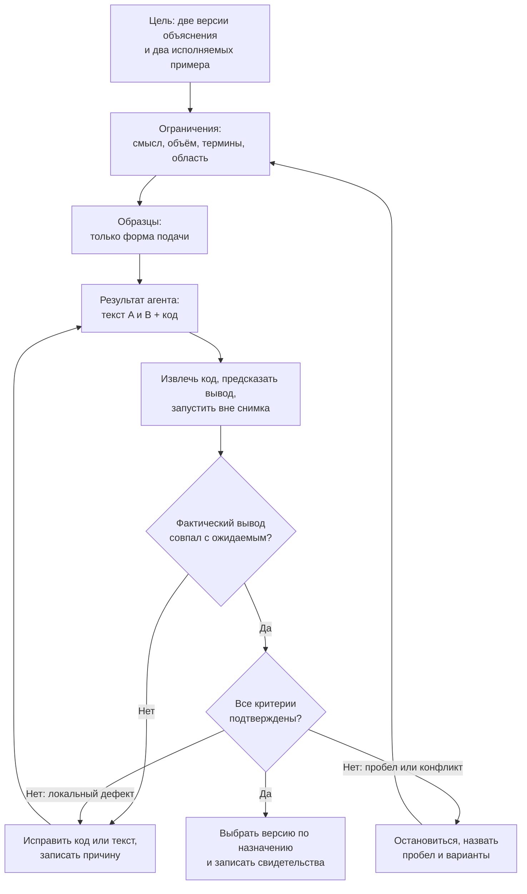

# L06. Ограничения и примеры

> **Основной учебник занятия.** Прочитайте обязательную часть до практики. Раздел «Углубление» отмечен как необязательный: он не добавляет работы сверх занятия и не нужен для сдачи.

**Статус проверки.** Текст сверен с картой занятий, планом L06, карточкой практики и исходными файлами 4–5 ноября 2026 года. OpenCode и Codex в ходе подготовки не запускались: все описания их ответов ниже — учебные иллюстрации, а не записи реальных запусков. Локально проверены только Python-примеры, подсчёт слов, хеши входных файлов и схема Mermaid (язык описания схем); точные команды и результаты перечислены в разделе 10. Тайминг в источниках расходится; обязательный маршрут ниже собран как 75 + 75 минут с явным объяснением решения.

<a id="passport"></a>
## Паспорт занятия

### Слова, которые понадобятся сразу

| Слово | Что оно значит в этом занятии |
|---|---|
| Контракт задачи | Минимальный набор сведений для проверяемой задачи: цель, входы, границы и критерии готовности |
| Ограничение | Обязательное условие в запросе; если его нарушить, результат не принимается |
| Образец подачи | Пример формы: порядок шагов и тон. Он не является источником фактов |
| Исполняемый пример | Минимальный код, который можно извлечь в файл, запустить и сравнить вывод с ожидаемым |
| Снимок | Зафиксированное исходное состояние файлов, от которого начинается попытка |
| Свежий сеанс | Новый диалог без контекста предыдущей попытки |
| Свидетельство | Проверяемый след: вывод команды, фрагмент файла, diff (сравнение изменений) или хеш (короткий отпечаток содержимого файла) |
| Критерий приёмки | Наблюдаемый признак, по которому результат принимается или отклоняется |

### Основные сведения

| Поле | Значение |
|---|---|
| Курс | «Разработка с помощью агентов на примере создания курса Python в OpenCode и Codex» |
| Модуль | 2. Prompt Engineering |
| Занятие | L06. Ограничения и примеры |
| Место в модуле | Второе из четырёх занятий модуля: после L05 «Контракт задачи», перед L07 «Декомпозиция» |
| Время | 150 минут: 75 минут объяснения и демонстрации + 75 минут практики. Обоснование выбора — в таблице ниже |
| Формат группы | В утверждённой программе точный размер группы не зафиксирован. Занятие рассчитано на индивидуальную работу с двумя средами; в паре один участник работает, другой фиксирует условия и проверки |
| Входные знания | Контракт из L05; запуск короткого Python-файла из L02; различение ожидаемого и фактического вывода из L03; сравнение двух попыток по одним критериям из L04. Глубокое знание Python не требуется |
| Результаты обучения | 1) Различить ограничение, образец подачи и исполняемый пример. 2) Переработать один учебный фрагмент в две версии, сохранив смысл. 3) Добавить проверяемые примеры без неоговорённых терминов. 4) Принять или отклонить версию по свидетельствам |
| Артефакт (проверяемый результат работы) | Один запрос; две версии текста A и B; файлы извлечённых примеров; ожидаемый и фактический вывод; таблица проверок; выбор версии; записи в журнале по двум средам |
| Способ проверки | Запустить примеры на Python 3 и сравнить вывод; проверить три факта черновика, распознаваемость обоих образцов, объяснение терминов и неизменность снимка; заполнить таблицу критериев и журнал |
| Следующий шаг | L07: разделить задачу на 3–5 шагов, у каждого — выход и проверка |

### Связь с L05 и L07

На L05 вы собрали **контракт задачи** — минимальный набор сведений, без которого результат нельзя проверить:

| Поле контракта | Вопрос | Пример L06 |
|---|---|---|
| Цель | Что должно получиться? | Две версии объяснения переменной и два исполняемых примера |
| Входы | На что можно опираться? | `snapshot/draft.md` с фактами и `snapshot/samples.md` с образцами подачи |
| Границы | Что нельзя нарушать? | Не менять снимок, не переносить чужие имена и значения, не выходить за объём |
| Критерии готовности | Как проверить результат? | Три факта сохранены, оба образца распознаются, код запускается, вывод совпадает |

L06 добавляет к контракту три разных инструмента: **ограничения**, **образцы подачи** и **исполняемые примеры**. L07 не отменяет их: она разложит большую задачу на шаги, и у каждого шага будут свой выход, своя проверка и свои ограничения.

> **Зависимость от L05.** Файла `course_materials/module_2/L05/student_guide.md` в репозитории нет: материал L05 существует как содержательный черновик `theory.md`. Поэтому выше кратко повторены четыре поля контракта. Если вы не читали L05, этого повторения достаточно, чтобы выполнить L06, но не заменяет полную отработку контракта.

### Тайминг по источникам

Источники не согласованы между собой. Ниже — что именно в них написано и какое решение принято.

| Источник | Что сказано | Следствие |
|---|---|---|
| `course_lesson_map_L01-L24.md`, строка L06 | 140 / 75 | 140 минут объяснения + 75 практики; в сумме 215 минут, что не совпадает с рамкой занятия |
| `course_lesson_map_L01-L24.md`, вводный абзац | Каждое занятие — 150 минут: 75 + 75 | Общая рамка курса |
| `course_materials/module_2/L06/lesson_plan.md` | Заголовок «Объяснение и демонстрация — 140 минут», но таблица блоков суммируется в 75 | Внутри одного файла два разных числа |
| `course_materials/module_2/L06/practice_card.md` | Практика — 75 минут | Практическая часть подтверждена |
| `course_materials/textbook/production_plan.md`, § 4.1, дефект T-01 | Обязательная часть — 75 + 75; «140» считается редакционным дефектом, а не новым проектным решением | Производное правило для учебников |

**Решение.** Обязательный маршрут этого руководства — **75 минут объяснения и демонстрации + 75 минут практики**. Число 140 не используется как длительность занятия. Это не меняет результаты, задание, артефакт или критерии L06: исправляется только расхождение в цифрах. Если преподаватель подтвердит, что 140 было намеренным решением, придётся пересматривать рамку 150 минут и баланс всего курса; до такого подтверждения действует 75 + 75.

<a id="how-to-read"></a>
## Как читать руководство

| Часть | Что делать | Обязательно? |
|---|---|---|
| Паспорт, разделы 1–2 | Понять место занятия, результаты и маршрут | Да, в пределах 75 минут объяснения |
| Разделы 3–4 | Разобрать теорию ограничений и примеров | Да |
| Раздел 5 | Прочитать два учебных сценария и сравнить их | Да |
| Раздел 6 | Прочитать схему и текстовое пояснение к ней | Да |
| Раздел 7 | Понять условия сравнения двух сред | Да, до практики |
| Раздел 8 | Подготовиться к практике по карточке | Да, в пределах 75 минут практики |
| Раздел 9 | Ответить на вопросы и проверить себя | Да, кратко |
| Раздел 8.6 «Углубление» | Читать после сдачи или при затруднении | Нет |

Точное условие оцениваемой практики находится в [`practice_card.md`](practice_card.md). Это руководство объясняет понятия и даёт подсказки, но не переписывает задание и не ослабляет критерии.

<a id="goals"></a>
## 1. Цели и результаты

<a id="goals-outcomes"></a>
### 1.1. Что вы сможете к концу занятия

**Результат занятия по карте:** показано влияние примеров и ограничений на один учебный фрагмент; его смысл сохранён, добавлены два исполняемых примера, неоговорённых терминов нет.

| Результат | Как вы его покажете |
|---|---|
| 1. Отличить ограничение от образца и исполняемого примера | Разложите вход на четыре списка: что нельзя менять, что является только формой, что нужно запустить, как проверять |
| 2. Переработать один фрагмент в две версии, сохранив смысл | В версиях A и B останутся одни и те же имя, значение и вывод; каждая версия будет узнаваема по своему образцу |
| 3. Добавить два проверяемых примера (по одному на версию) без неоговорённых терминов | Извлечёте код в отдельные файлы, запустите на Python 3, сравните фактический вывод с ожидаемым, объясните каждый новый термин при первом упоминании |
| 4. Принять версию по свидетельствам | Заполните таблицу «критерий → место → свидетельство → статус», выберете версию по назначению и запишете основание |

Главная мысль занятия:

> **Образец задаёт форму. Ограничение задаёт рамку. Запуск даёт свидетельство.**

<a id="goals-prereq"></a>
### 1.2. Предпосылки

| Предпосылка | Где было | Что понадобится сегодня |
|---|---|---|
| Собирать контракт из четырёх полей | L05 | Понять, куда в контракте добавляются ограничения и образцы |
| Запускать короткий Python-фрагмент | L02 | Извлечь код в отдельный файл и выполнить его |
| Отличать ожидаемый вывод от фактического | L03 | Не подменять наблюдение желаемым |
| Работать в отдельной копии и читать изменения | L01, L04 | Не смешивать снимок с результатом попытки |
| Сравнивать две попытки по одним критериям | L04 | Проверить две версии и две среды одинаково |

Для занятия достаточно четырёх понятий Python:

| Понятие | Что нужно понимать |
|---|---|
| Переменная | Имя, под которым сохранено значение |
| Значение | Конкретные данные, например текст `кот` |
| Строка | Текст в кавычках, например `"кот"` |
| `print` | Команда, которая выводит значение на экран |

Это не урок Python. Python-фрагмент здесь — учебный материал, на котором вы осваиваете ограничения и примеры при работе с агентом.

<a id="goals-not"></a>
### 1.3. Что в занятие не входит

Сегодня **не** нужно:

- писать полный урок Python или объяснять все типы данных;
- писать автоматические тесты и настраивать CI (непрерывную интеграцию);
- оценивать запросы (промпты — тексты запросов к агенту) по рубрике (таблице уровней оценки) — это L08;
- делить большую задачу на шаги — это L07;
- разбирать недоверенные инструкции в файлах — это L12;
- делать вывод «OpenCode лучше Codex» по одной попытке.

<a id="goals-project"></a>
### 1.4. Зачем этот приём в сквозном проекте

Учебный текст без запускаемого примера нельзя принять: ученик не сможет проверить себя. Образец без ограничений легко превращается в копирование чужого содержания. Ограничение без примера может остаться лозунгом «сделай понятно».

В сквозном проекте этот навык понадобится:

- на L16 — при сборке пилотного урока, где нужен исполняемый пример;
- на L20 — при проверке трёх уроков и поиске разрывов между ними;
- на L21 — при независимом ревью, где нужно доказательство, а не общее впечатление.

<a id="route"></a>
## 2. Маршрут занятия

<a id="route-theory"></a>
### 2.1. Первые 75 минут: объяснение и демонстрация

| Минуты | Что происходит | Что делать вам |
|---:|---|---|
| 0–10 | Вход в занятие: зачем нужны ограничения и примеры, какой артефакт сдаётся | Записать, что вы сдаёте и чем будете проверять |
| 10–30 | Различие между обязательным ограничением и образцом подачи; поиск незнакомого термина | Разложить пример на «смысл / форма / проверка» |
| 30–55 | Демонстрация на `animal = "кот"`: предсказать вывод, выполнить пример, сравнить наблюдение | Записать предсказание до запуска и фактический вывод после |
| 55–75 | Разбор ошибки «образец стиля стал новым содержанием»; решение о приёмке | Найти в учебном ответе чужое имя или значение и объяснить, почему это дефект |

**Проверка маршрута:** 10 + 20 + 25 + 20 = 75 минут.

<a id="route-practice"></a>
### 2.2. Вторые 75 минут: практика

| Минуты | Шаг | Промежуточная проверка |
|---:|---|---|
| 0–10 | Прочитать карточку, разобрать `draft.md` и `samples.md` | Выписаны три факта, два образца и ограничения |
| 10–22 | Собрать один запрос для обеих сред | В запросе есть цель, входы, ограничения и критерии; образцы помечены «только форма» |
| 22–46 | Две попытки по 12 минут в свежих сеансах и отдельных копиях | Сохранены исходные ответы или признаки сбоя, время и условия |
| 46–65 | Проверить текст и код | Таблица критериев заполнена; примеры запущены; вывод сравнён; снимок не изменён |
| 65–75 | Заполнить журнал и выбрать версию | Указаны свидетельства, основание выбора и предел вывода |

**Проверка маршрута:** 10 + 12 + 24 + 19 + 10 = 75 минут.

<a id="route-ready"></a>
### 2.3. Что должно быть готово к концу занятия

- [ ] Один сохранённый текст запроса, одинаковый для обеих сред.
- [ ] Две версии текста: A — по первому образцу, B — по второму.
- [ ] В каждой версии распознаётся свой образец: где объяснение, где действие, где предсказание, где проверка.
- [ ] Три факта черновика сохранены: имя, присваивание строки, вывод заданного значения.
- [ ] Каждый новый термин объяснён при первом упоминании.
- [ ] Из каждой версии извлечён исполняемый пример; код проверен до запуска.
- [ ] Есть ожидаемый и фактический вывод, а также статус «да / нет / нет данных».
- [ ] Таблица проверок ссылается на конкретные места в тексте или на вывод команды.
- [ ] Снимок не изменён; это подтверждено сравнением файлов или хешей.
- [ ] В журнале записаны обе среды, условия, ответы или сбои и ограничение вывода.

<a id="route-optional"></a>
### 2.4. Что относится только к необязательному углублению

Необязательное углубление — раздел 8.6. Там разобраны три вида примеров, типичные риски чрезмерного количества примеров и мини-протокол измерения. Оно не входит в обязательные 75 минут, не добавляет работы и не нужно для сдачи.

<a id="constraints"></a>
## 3. Теория: ограничения

<a id="constraints-problem"></a>
### 3.1. Какую проблему решает ограничение

Фраза «перепиши объяснение для новичка, чтобы было понятно» не говорит агенту, что именно нельзя менять. Он может сократить текст, добавить красивую метафору, вставить второй пример с другим значением или незаметно изменить вывод. Формально ответ будет «понятным», но проверить его по исходному смыслу не получится.

**Ограничение** — это обязательное условие в запросе, нарушение которого означает, что результат не принимается. Ограничение сужает пространство допустимых ответов и делает приёмку возможной.

Примеры ограничений:

- «Сохрани имя `animal`, значение `"кот"` и вывод `кот`».
- «Текст каждой версии — не больше 120 слов без учёта кода».
- «Не изменяй файлы снимка».
- «Каждый новый термин объясни при первом упоминании».

<a id="constraints-vs"></a>
### 3.2. Чем ограничение отличается от цели, входов и критерия

Эти четыре вещи часто смешивают, потому что они могут звучать похоже. Различие — в роли.

| Элемент | На какой вопрос отвечает | Пример L06 | Что будет, если его пропустить |
|---|---|---|---|
| Цель | Что должно получиться? | Две версии объяснения и два исполняемых примера | Агент сделает один текст или один пример |
| Входы | На что можно опираться? | `draft.md` — факты; `samples.md` — только форма | Агент добавит факты от себя или использует посторонний файл |
| Ограничение | Что нельзя нарушать? | Сохранить три факта; не менять снимок; ≤ 120 слов | Ответ может быть правдоподобным, но непригодным |
| Критерий приёмки | Как проверить результат? | Найти точное имя, запустить код, сравнить вывод, посчитать слова | Вы не сможете объяснить, почему приняли или отклонили версию |

**Важно:** одна и та же формулировка может быть ограничением и критерием. «Не больше 120 слов» в запросе — ограничение, потому что оно ставит рамку до работы. «Подсчитать слова по названному методу и получить ≤ 120» в таблице проверки — критерий, потому что он применяется после работы. Различие не в словах, а в моменте использования.

Поле контракта «границы» — общая рамка задачи. **Ограничение** — конкретное проверяемое условие внутри этой рамки. Например, граница звучит «не выходи за пределы снимка», а ограничение — «не изменяй `snapshot/draft.md` и `snapshot/samples.md`».

<a id="constraints-kinds"></a>
### 3.3. Виды ограничений, уместные в L06

| Вид | Что задаёт | Пример формулировки | Как проверить |
|---|---|---|---|
| Область изменений | Где агенту разрешено работать и что он может менять | «Верни только текст; файлы снимка не изменяй» | Сравнить список файлов или хеши до и после |
| Сохранение смысла | Какие факты обязаны остаться | «Сохрани имя `animal`, присваивание строки `"кот"` и вывод `кот`» | Найти точное имя и значение; запустить код |
| Формат результата | Сколько версий, какая структура, какой объём | «Две версии A и B; в каждой ровно один пример; ≤ 120 слов на версию без кода» | Прочитать структуру; посчитать слова по одному методу |
| Аудитория и уровень | Для кого текст и что читатель уже знает | «Новичок, который знает `print`, но не изучал переменные; каждый новый термин поясни при первом упоминании» | Прочитать текст глазами новичка; выписать термины |
| Способ доказательства | Чем подтверждается результат | «Запусти код на Python 3 и приведи фактический вывод» | Сохранить команду и вывод |

<a id="constraints-measurable"></a>
### 3.4. Измеримое ограничение: единица, метод, порог

«Коротко» и «понятно» — не ограничения, пока у них нет способа проверки. Измеримое ограничение состоит из трёх частей:

| Часть | Вопрос | Пример |
|---|---|---|
| Единица | Что считаем? | Слово, исполняемый пример, термин, файл |
| Метод | Как считаем? | Удалить блоки кода, посчитать последовательности непробельных символов |
| Порог | Что считается прохождением? | ≤ 120 на каждую версию; ровно 1 пример на версию; 0 необъяснённых терминов |

Без любой из трёх частей ограничение остаётся пожеланием. Если метод меняется после первого подсчёта, пересчитайте обе версии: иначе сравнение перестанет быть честным.

<a id="constraints-bad"></a>
### 3.5. Чрезмерные, расплывчатые и противоречивые ограничения

| Плохое ограничение | Почему оно ухудшает результат | Рабочая версия |
|---|---|---|
| «Сделай понятно» | Нет наблюдаемого признака; каждый понимает «понятно» по-своему | «Объясни новичку, который знает `print`; каждый новый термин поясни при первом упоминании» |
| «Коротко» | Нет единицы, метода и порога | «Не больше 120 слов на версию без учёта кода; метод подсчёта назван заранее» |
| «Не используй новые термины» | Противоречит цели: «переменная» и «присваивание» для новичка новые | «Поясни каждый новый термин при первом упоминании; не добавляй терминов, без которых можно обойтись» |
| «Сохрани смысл, но перепиши всё другими словами» | Неясно, что считается смыслом, а что формулировкой | «Сохрани имя, значение и вывод; формулировки могут меняться» |
| «Не меняй файлы, но создай файл с примером» | Два требования несовместимы | «Верни только текст; пример запускай в отдельной временной папке» |
| «Сохрани структуру образца с `city = "Москва"`» | Вместе с формой в ответ попадает чужое содержание | «Образец задаёт только порядок шагов; имена и значения бери из черновика» |
| «Уложись в 40 слов и объясни четыре термина» | Объём может не оставить места для обязательных пояснений | Увеличить лимит или сократить число терминов; решение записать до работы |

Чрезмерное ограничение — не всегда хорошее. Если условий слишком много и они конкурируют за место в коротком тексте, агент начнёт выбирать, какое нарушить. Лучше меньше ограничений, но каждое проверяемое.

<a id="constraints-improved"></a>
### 3.6. Пример плохого ограничения и улучшенная версия

**Плохой запрос (учебная иллюстрация):**

```text
Перепиши объяснение переменной для новичка. Сделай понятно и коротко.
Добавь пример. Используй два образца.
```

Почему он не работает:

- не названы факты, которые нельзя менять;
- не сказано, что образцы задают только форму;
- нет формата: сколько версий, сколько примеров в каждой;
- нет ограничения по терминам;
- нет критерия, по которому принять результат;
- «понятно и коротко» нельзя проверить.

**Улучшенный запрос (учебная иллюстрация):**

```text
## Цель
Подготовь две версии объяснения переменной для новичка: A — по образцу 1,
B — по образцу 2. В каждой версии — один исполняемый пример.

## Входы
- brief.md — факты: имя animal, значение "кот", вывод "кот". Только чтение.
- samples.md — только форма подачи. Имена и значения из него не переносить.
  Только чтение.

## Ограничения
- Сохрани три факта: animal, "кот", вывод "кот".
- В каждой версии ровно одно присваивание и один print.
- Текст каждой версии — не больше 120 слов без учёта кода.
- Каждый новый термин поясни при первом упоминании.
- Не изменяй файлы; верни только две версии текста.

## Критерии готовности
1. В каждой версии есть animal = "кот" и print(animal).
2. Ожидаемый вывод — ровно кот.
3. Версия A: сначала объяснение, потом действие.
4. Версия B: сначала предсказание, потом проверка.
5. Нет необъяснённых терминов.
6. В каждой версии не больше 120 слов без кода.
7. Файлы снимка не изменены.

## Если данных не хватает
Остановись, назови пробел и варианты. Не придумывай значения.
```

**Разбор.** Каждая строка улучшенного запроса имеет проверку:

| Строка запроса | Что она предотвращает | Чем проверяется |
|---|---|---|
| «Сохрани три факта» | Подмену имени или значения | Точное совпадение в тексте и коде |
| «В каждой версии — один исполняемый пример; одно присваивание и один print» | Лишние значения и перегрузку | Подсчёт запускаемых блоков |
| «≤ 120 слов без кода» | Бесконечное объяснение | Подсчёт по названному методу |
| «Каждый новый термин поясни» | Непонятный текст | Список терминов и мест первого упоминания |
| «Верни только текст» | Лишние файлы и изменения снимка | Список файлов или хеши |
| «Остановись, назови пробел» | Молчаливую выдумку | Сообщение агента или запись в журнале |

<a id="constraints-errors"></a>
### 3.7. Типичные ошибки и проверка понимания

| Ошибка | Как заметить | Что исправить |
|---|---|---|
| Ограничение считают пожеланием | В запросе «по возможности», «примерно», «не слишком длинно» | Заменить на единицу, метод и порог |
| Ограничений слишком много | Агент нарушает одно из конкурирующих условий | Оставить обязательное, остальное вынести в необязательное улучшение |
| Ограничение противоречит цели | Нельзя одновременно «не использовать новые термины» и объяснить переменную | Переформулировать: пояснять новые термины, а не запрещать их |
| Критерий придумывают после ответа | Чек-лист меняется под понравившийся текст | Зафиксировать критерии до первой попытки |
| Ограничение путают с примером | В запросе написано «сделай как в образце», но не сказано, что образец — только форма | Разделить «нельзя менять» и «взять форму» |

**Мини-упражнение.** Превратите «сделай коротко и понятно» в два измеримых ограничения. Для каждого назовите единицу, метод и порог. Не пишите весь запрос.

<a id="examples-theory"></a>
## 4. Теория: примеры

<a id="examples-why"></a>
### 4.1. Зачем давать агенту пример

Словами трудно описать порядок материала: «сначала объясни, потом дай действие» можно понять по-разному. Пример ожидаемого стиля, структуры или уровня объяснения показывает нужную форму быстрее, чем длинное описание.

Образец полезен, когда:

- форму легче узнать, чем описать;
- нужно задать уровень объяснения для новичка;
- нужно показать порядок шагов: объяснение → действие или предсказание → проверка;
- нужно задать тон и объём.

**Образец подачи** — это модель формы: порядок шагов, тон, способ начать и закончить. Содержание образца не является источником фактов.

<a id="examples-limits"></a>
### 4.2. Как пример направляет ответ и чего он не гарантирует

| Пример даёт | Пример не гарантирует |
|---|---|
| Понятную структуру ответа | Правильность фактов |
| Ориентир по уровню и тону | Что агент не скопирует чужие имена и значения |
| Образец формата для двух версий | Что код запустится |
| Представление о том, как выглядит «готово» | Что все критерии выполнены |

Пример — это якорь (ориентир), а не доказательство. Он может помочь агенту выбрать форму и одновременно ухудшить результат, если вместе с формой он перенесёт содержание.

<a id="examples-vs-solution"></a>
### 4.3. Чем пример отличается от готового решения

| Объект | Что это | Что можно взять | Что нельзя брать |
|---|---|---|---|
| Образец подачи | Скелет текста: порядок шагов и тон | Порядок, тон, способ начать | Имена, значения, факты, готовые формулировки целиком |
| Исполняемый пример | Минимальный код, который можно запустить | Код и ожидаемый вывод как проверку | Полный урок или решение задания |
| Ожидаемый вывод | Точная строка, которую должен увидеть ученик | Критерий сравнения | Право подгонять факт под ожидание |
| Готовое решение | Полный ответ, который можно сдать | Ничего, если задание оценивается | Нельзя выдавать за свой результат |

Разница практическая: образец формы помогает **написать** текст, исполняемый пример помогает **проверить** код, готовое решение **заменяет** вашу работу. В L06 нужны первые два, а не третье.

<a id="examples-conflict"></a>
### 4.4. Что делать, если пример противоречит текстовому требованию

Правило простое:

1. **Текстовое требование и источник фактов важнее образца.** Если образец показывает `city = "Москва"`, а черновик задаёт `animal = "кот"`, факты берутся из черновика.
2. **Образец задаёт только форму.** Если он приносит чужое содержание, это дефект, а не «творческая вариация».
3. **Исполняемый пример должен согласоваться с фактами.** Если код выводит не то значение, которое задано, исправляется код или ожидаемый вывод, но не наблюдение.
4. **Если совместить нельзя — остановитесь.** Назовите конфликт, требование и отсутствующее данное. Не позволяйте агенту молча выбирать.

| Конфликт | Пример | Решение |
|---|---|---|
| Содержание против формы | В образце `city = "Москва"`, в черновике `animal = "кот"` | Образец — только форма; факты — из черновика |
| Объём против полноты | 40 слов и четыре новых термина | Увеличить лимит или сократить второстепенные термины; решение записать |
| Один источник против двух примеров | В черновике одно значение, а просят два разных | Один пример на версию или добавить вход |
| Формат против области | «Верни только текст» и «создай файл» | Выбрать один формат или разрешить файл в отдельной папке |
| «Не меняй файлы» против запуска | Запуск может создать служебные файлы | Запускать вне снимка, использовать `python3 -B`, проверить хеши |

<a id="examples-check"></a>
### 4.5. Как проверить, что пример помог, а не просто сделал ответ похожим

Похожесть — плохой критерий. **Термин** — слово или выражение, которое читатель может не знать; при первом упоминании его нужно пояснить. **Скелет** — порядок шагов без имён и значений. Проверяйте пять признаков:

| Проверка | Вопрос | Признак успеха |
|---|---|---|
| Структура | Узнаётся ли нужный образец? | В A объяснение стоит до действия; в B предсказание — до запуска |
| Факты | Все ли имена и значения взяты из черновика? | Нет чужих имён и значений из образца |
| Запуск | Код действительно выполняется? | Фактический вывод совпадает с ожидаемым |
| Термины | Понятны ли новые слова? | Каждый новый термин объяснён при первом упоминании |
| Ограничения | Соблюдены ли объём и формат? | Подсчёт и структура подтверждают выполнение |

Полезный мысленный тест: **перенесите скелет на другие факты**. Если структура сохраняется, а факты берутся из нового черновика, пример формы сработал. Если вместе со скелетом тянется `Москва`, пример стал источником содержания.

Сравнение «с примером и без примера» требует двух попыток в одинаковых условиях. Одна попытка не доказывает, что пример вообще улучшает результат; она показывает только, что получилось в данных условиях.

<a id="cases"></a>
## 5. Разобранные примеры

Оба сценария ниже — **учебные иллюстрации**, а не реальные запуски OpenCode или Codex и не решения оцениваемой практики. В практике используется снимок с другими именами и значениями; здесь взяты `word = "дом"` и `animal = "кот"`, чтобы вы учились на отдельном материале и не подменяли свою работу чужим ответом.

<a id="case-vague"></a>
### 5.1. Сценарий 1: неясные и недостаточные ограничения

**Что получает агент:**

| Вход | Содержание |
|---|---|
| Черновик | «Переменная хранит значение. `word = "дом"`. `print(word)` выводит `дом`» |
| Образцы | 1) сначала объяснение, затем действие; 2) сначала предсказание, затем проверка. В образце 1 есть `city = "Москва"` |
| Запрос | «Перепиши для новичка по двум образцам, сохрани смысл, добавь пример. Сделай понятно и коротко» |

**Что ожидается:** две версии A и B, в каждой один запускаемый пример, факты `word`, `"дом"`, вывод `дом` сохранены.

**Учебный ответ агента с дефектами (синтетический, не реальный запуск):**

```text
## Версия A

Переменная — это имя для значения.

city = "Москва"
print(city)

Замените город и запустите.

## Версия B

Предскажите, что выведет программа.

city = "Москва"
print(city)

Ожидаемый вывод: Москва. Запустите и сравните.
```

**Сравнение с требованиями:**

| Требование | Наблюдение | Статус |
|---|---|---|
| Сохранено имя `word` | В коде `city` | Нет |
| Сохранено значение `"дом"` | В коде `"Москва"` | Нет |
| Вывод `дом` | Код выводит `Москва` | Нет |
| Версия A по образцу 1 | Порядок «объяснение → действие» есть, но содержание чужое | Форма да, смысл нет |
| Версия B по образцу 2 | Порядок «предсказание → проверка» есть, но содержание чужое | Форма да, смысл нет |
| Новые термины объяснены | Слово «значение» использовано без пояснения | Нет |
| Два разных примера | Один и тот же код повторён в обеих версиях | Нет |
| Объём | В запросе нет лимита | Нет данных |
| Снимок не изменён | Не проверялось | Нет данных |

**Какие ошибки допустил агент:**

- перенёс `city` и `Москва` из образца в обе версии;
- сделал версии почти одинаковыми;
- использовал «значение» без объяснения;
- не показал, что код запускался;
- не остановился, хотя факты черновика и образца конфликтуют.

**Почему запрос это допустил:** в нём не было точных фактов, границы «образец — только форма», лимита объёма, правила для терминов и критерия запуска. Агент заполнил пробелы правдоподобными решениями.

**Что изменить в запросе:**

- перечислить точные факты: `word`, `"дом"`, вывод `дом`;
- написать, что `city` и `Москва` — чужое содержание образца и переносить его нельзя;
- потребовать ровно один пример на версию;
- задать лимит и метод подсчёта;
- потребовать объяснять каждый новый термин;
- добавить критерий «код запускается на Python 3, вывод совпадает»;
- разрешить остановку с сообщением о пробеле.

<a id="case-concrete"></a>
### 5.2. Сценарий 2: конкретные ограничения и подходящий пример

**Что получает агент:**

| Вход | Содержание |
|---|---|
| Бриф | `animal = "кот"`, `print(animal)`, вывод `кот`; аудитория — новичок, знающий `print`; ≤ 120 слов на версию без кода; термины пояснять |
| Образцы | 1) объяснение → действие; 2) предсказание → проверка. В образце 1 есть `city = "Москва"` как чужое содержание |
| Запрос | Две версии A и B; один пример на версию; три факта сохранить; образцы — только форма; при конфликте остановиться |

**Запрос (учебная иллюстрация):**

```text
## Цель
Подготовь две версии объяснения переменной для новичка: A — по образцу 1,
B — по образцу 2. В каждой версии — один исполняемый пример.
Верни только две версии текста с подписями A и B.

## Входы
- brief.md — факты: имя animal, значение "кот", вывод "кот". Только чтение.
- samples.md — только форма подачи. Содержание образцов не переносить.
  Только чтение.

## Ограничения
- Сохрани три факта: animal, "кот", вывод "кот".
- Не меняй значение и не добавляй другие переменные.
- В каждой версии ровно одно присваивание и один print.
- Текст каждой версии — не больше 120 слов без учёта кода.
- Каждый новый термин поясни при первом упоминании.
- Не создавай и не изменяй файлы.

## Критерии готовности
1. В каждой версии есть animal = "кот" и print(animal).
2. Ожидаемый вывод — ровно кот.
3. Версия A: сначала объяснение, потом действие.
4. Версия B: сначала предсказание, потом проверка.
5. Нет необъяснённых терминов.
6. В каждой версии не больше 120 слов без кода.
7. Файлы снимка не изменены.

## Если требования конфликтуют
Остановись, перечисли конфликт и назови пробел. Не придумывай значения.
```

**Учебный ответ после выполнения запроса (синтетический, не реальный запуск):**

**Версия A.**

Переменная — это имя, под которым сохранено значение. Значение — это конкретные данные, например текст «кот». В Python текст в кавычках называют строкой. Присваивание знаком = связывает имя со значением.

```python
animal = "кот"
print(animal)
```

Запустите программу. Она выведет значение, сохранённое в `animal`.

**Версия B.**

Переменная — это имя, под которым сохранено значение. Значение — это конкретные данные, например текст «кот». В Python текст в кавычках называют строкой. Присваивание знаком = связывает имя со значением.

Предскажите, что выведет программа.

```python
animal = "кот"
print(animal)
```

Ожидаемый вывод: кот. Запустите программу и сравните вывод с предсказанием.

**Извлечённые примеры:**

```python
# example_a.py
animal = "кот"
print(animal)
```

```python
# example_b.py
animal = "кот"
print(animal)
```

```python
# example_bad.py — намеренно плохой пример с чужим содержанием
city = "Москва"
print(city)
```

**Проверка кода до запуска:** одно присваивание, один `print`, нет импортов, записи файлов, сетевых вызовов, `input` (запроса ввода), `eval` и `exec` (выполнения текста как кода). Запускать безопасно в отдельной папке.

**Фактический запуск 4 ноября 2026:**

```bash
python3 --version
python3 -B example_a.py
python3 -B example_b.py
python3 -B example_bad.py
```

```text
Python 3.9.6
кот
кот
Москва
```

`example_bad.py` — намеренно плохой пример с `city = "Москва"`. Он показывает, что происходит при копировании содержания образца: код запускается, но выводит не тот факт, который задан в брифе.

**Сравнение вывода:**

| Файл | Ожидаемый вывод для задачи | Фактический вывод | Статус |
|---|---|---|---|
| `example_a.py` | `кот` | `кот` | Да |
| `example_b.py` | `кот` | `кот` | Да |
| `example_bad.py` | `кот` для задачи; `Москва` для этого кода | `Москва` | Нет: не соответствует задаче |

**Подсчёт слов 4 ноября 2026.** Версии были сохранены в файлы `version_a.md` и `version_b.md`:

```bash
python3 -B count_words.py version_a.md version_b.md
```

```text
version_a.md: 38
version_b.md: 44
```

Метод: удалить блоки кода в тройных обратных кавычках и посчитать последовательности непробельных символов. Обе версии укладываются в 120 слов.

**Проверка снимка 4 ноября 2026.** Сначала записываются хеши входа, затем запускаются примеры, затем хеши проверяются снова:

```bash
shasum -a 256 input/brief.md input/samples.md > before.sha256
# ... запуск примеров ...
shasum -a 256 -c before.sha256
```

```text
input/brief.md: OK
input/samples.md: OK
```

**Итоговая таблица проверок:**

| № | Критерий | Версия A | Версия B | Свидетельство |
|---:|---|---|---|---|
| 1 | Сохранено имя `animal` | Да | Да | Код |
| 2 | Сохранено значение `"кот"` | Да | Да | Код |
| 3 | Вывод равен `кот` | Да | Да | Запуск |
| 4 | Версия соответствует своему образцу | Да: объяснение → действие | Да: предсказание → проверка | Текст |
| 5 | Новые термины объяснены | Да | Да | Таблица терминов: переменная, значение, строка, присваивание |
| 6 | Не больше 120 слов без кода | Да: 38 | Да: 44 | Подсчёт |
| 7 | Снимок не изменён | Да | Да | Хеши `input/` |
| 8 | Код можно запустить | Да | Да | `python3 -B` |

**Решение примера.** Обе версии проходят обязательные критерии. Для первого знакомства с переменной лучше A: сначала объяснение, потом действие, меньше нагрузки. B полезна для закрепления: ученик сначала предсказывает вывод, потом проверяет. Это решение учебного примера, а не обязательный ответ практики.

**Какие ошибки здесь ещё возможны:**

| Ошибка | Признак | Что делать |
|---|---|---|
| Копирование `city` и `Москва` | В ответе чужие имя и значение | Уточнить «образец — только форма», убрать чужое, проверить источник |
| Обе версии одинаковы | A и B отличаются только заголовком | Перестроить одну версию по её скелету |
| Необъяснённый термин | Например, «литерал» (значение, записанное прямо в коде) без пояснения | Заменить знакомым словом или объяснить; лишний термин убрать |
| Код не запускается | Ошибка Python или лишний `input` | Не запускать незнакомый код; упростить до показанного присваивания и вывода |
| Снимок изменён | Появились новые файлы или `__pycache__` | Остановиться, восстановить снимок, записать инцидент |

**Если ошибка всё же появилась, меняйте сначала запрос, а не подгоняйте текст.** Добавьте явную строку «не переноси `city` и `Москва`», повторите три факта из брифа, задайте один пример на версию и проверьте все критерии заново. Если данные противоречат друг другу, остановитесь и назовите пробел.

<a id="case-compare"></a>
### 5.3. Что изменилось между сценариями

| Элемент | Сценарий 1 | Сценарий 2 |
|---|---|---|
| Факты | Не названы; агент взял чужие | Названы точно: `animal`, `"кот"`, вывод `кот` |
| Граница образца | «Используй образцы» | «Образцы — только форма; содержание не переносить» |
| Формат | Не задан | Две версии, один пример в каждой |
| Объём | Не задан | ≤ 120 слов на версию без кода |
| Термины | Без правила | Каждый новый термин поясняется |
| Проверка | Нет критериев | Семь критериев в запросе и таблица статусов |
| Конфликт | Замаскирован | Разрешено остановиться и назвать пробел |
| Результат | Правдоподобный, но непригодный | Проверяемый и принимаемый по свидетельствам |

<a id="scheme"></a>
## 6. Схема



*Рис. 1. Путь «цель → ограничения → образец → результат агента → проверка по критериям → решение». Схема показывает порядок работы и точки возврата, а не результат конкретного запуска.*

**Пояснение по блокам:**

- **Цель.** Сначала вы называете, что должно получиться: две версии и два исполняемых примера. Без этого агент может вернуть один текст или один пример.
- **Ограничения.** Затем задаёте рамку: какие факты сохранить, какой объём, какие термины объяснить, что нельзя менять. Это превращает «понятно» в проверяемое условие.
- **Образцы.** После этого показываете форму: порядок шагов и тон. Образец не является источником фактов; его содержание не переносится.
- **Результат агента.** Вы получаете текст и код, но ещё не принимаете их. Это только материал для проверки.
- **Проверка.** Извлекаете код, предсказываете вывод, запускаете вне снимка и сравниваете фактический вывод с ожидаемым. Это даёт свидетельство.
- **Критерии.** Проверяете не только вывод, но и три факта, распознаваемость образцов, термины, объём и неизменность снимка.
- **Решение.** Выбираете версию по назначению и свидетельствам и записываете основание в журнал.
- **Возвраты.** При локальном дефекте возвращаетесь к исправлению. При пробеле или конфликте — к ограничениям и входу: возможно, проблема не в тексте, а в постановке.

**Что схема показывает:** последовательность ролей и то, что проверка может вернуть работу назад.

**Чего схема не доказывает:** что агент даст хороший ответ, что пример запустится в вашей среде, что критерии выполнены или что один промпт всегда работает. Это процедура, а не свидетельство результата.

<a id="comparison"></a>
## 7. Сравнение OpenCode и Codex

<a id="comparison-same"></a>
### 7.1. Что удерживается одинаковым

Для сравнения используется тот же снимок, что и в практике: [`snapshot/draft.md`](snapshot/draft.md) и [`snapshot/samples.md`](snapshot/samples.md). Python-фрагмент — тот, что записан в `snapshot/draft.md`; в обе среды передаётся один и тот же файл, а не пересказ. Учебные сценарии с `animal` и `word` из раздела 5 не заменяют практику: они нужны только для освоения приёма.

| Что одинаково | Как это обеспечить |
|---|---|
| Снимок | Один и тот же набор файлов и одна и та же выданная копия; записать метку снимка |
| Запрос | Один сохранённый текст, переданный дословно в обе среды |
| Критерии | Один список из карточки, зафиксированный до первой попытки |
| Лимит времени | Одинаковый, например 12 минут на попытку |
| Свежесть сеанса | Новый сеанс без контекста предыдущей попытки |
| Отдельная копия | Каждая попытка начинается в своей копии снимка |
| Порядок | Записан до старта: какая среда и какая версия идут первыми |

<a id="comparison-protocol"></a>
### 7.2. Порядок по протоколу

1. До старта запишите метку снимка, порядок, одинаковый лимит попыток и разрешения.
2. Для каждой попытки используйте свежий сеанс и отдельную копию исходного снимка.
3. Передайте один и тот же запрос дословно в обе среды.
4. Сохраните исходный ответ, ошибку или тайм-аут (истекшее время ожидания) до ручной правки.
5. Зафиксируйте модель и настройки, если они видны, фактическое время, изменения файлов и способ проверки.
6. Примените одни и те же критерии ко всем попыткам.
7. При сбое сохраните запись, покажите диагностику и проверяемую корректировку; не выдавайте недоступную среду за проведённый запуск.

Полный текст: [`../shared/comparison_protocol.md`](../shared/comparison_protocol.md).

<a id="comparison-journal"></a>
### 7.3. Какие параметры записать в журнал

Используйте [`../shared/run_journal.md`](../shared/run_journal.md). В журнал входят:

| Поле | Что записать |
|---|---|
| Занятие, дата, участник | L06, фактическая дата, ваше имя или метка участника |
| Снимок и файлы | Идентификатор снимка и список переданных файлов |
| Предварительный порядок и лимит | Какая среда первая, сколько минут на попытку |
| Критерии карточки | Список критериев до первой попытки |
| Что одинаково и что меняется | Снимок, запрос, критерии, время; меняется только среда |
| Идентификатор, среда, вариант, порядок | Например, «попытка 1, OpenCode, A, первая» |
| Модель, настройки, разрешения | Фактически видимые значения или «недоступно» |
| Снимок, файлы, свежий сеанс | Подтверждение, что сеанс новый, а копия отдельная |
| Дословный запрос | Текст или ссылка на сохранённый файл |
| Время, ответ, ошибка или тайм-аут | Фактическое наблюдение, а не пересказ |
| Diff (сравнение изменений) или способ подтверждения отсутствия изменений | Команда, список файлов, хеши |
| Проверки и исход по каждому критерию | «Да», «нет» или «нет данных» со ссылкой на свидетельство |
| Ручные правки, причина и повторная проверка | Что исправлено вручную и почему |
| Отклонения условий и недоступные данные | Что отличалось от плана |

<a id="comparison-table"></a>
### 7.4. Таблица для заполнения на занятии

| Условие | OpenCode | Codex |
|---|---|---|
| Снимок и отдельная копия | Заполнить | Заполнить |
| Свежий сеанс | Заполнить | Заполнить |
| Порядок попыток | Заполнить | Заполнить |
| Дословный запрос | Один и тот же текст | Один и тот же текст |
| Модель и настройки, если видны | Заполнить или «недоступно» | Заполнить или «недоступно» |
| Время | Заполнить | Заполнить |
| Исходный ответ, ошибка или тайм-аут | Заполнить | Заполнить |
| Изменения файлов | Проверить | Проверить |
| Проверки по критериям | Заполнить | Заполнить |
| Ручные правки и причина | Заполнить | Заполнить |
| Ограничение вывода | Заполнить | Заполнить |

<a id="comparison-status"></a>
### 7.5. Статус сравнения

**Реальные запуски OpenCode и Codex в ходе подготовки этого руководства не выполнялись.** Поэтому здесь нет утверждений о том, какая среда быстрее, точнее или удобнее, и нет выдуманных названий кнопок, моделей или разрешений. Заполненная таблица появится только после ваших попыток.

По официальной документации на 4 ноября 2026 года:

- OpenCode рекомендует давать достаточно контекста и примеров; в документации описан режим планирования (Plan mode), который отключает изменения и предлагает подход ([opencode.ai/docs](https://opencode.ai/docs/)).
- Codex рекомендует указывать цель, контекст, формат вывода и границы, сохранять важные ограничения и описывать способ проверки изменения ([developers.openai.com/codex/prompting](https://developers.openai.com/codex/prompting)).

Это рекомендации документации, а не гарантия поведения установленной версии. Интерфейс, доступные модели, вид запроса разрешения и формат ответа могут отличаться. Записывайте фактическое наблюдение, а не название из документации.

<a id="comparison-request"></a>
### 7.6. Каркас запроса для обеих сред

Точный текст запроса вы составляете сами по карточке. Чтобы запрос был одинаковым и проверяемым, заполните четыре поля:

| Поле | Что вписать | Проверка перед отправкой |
|---|---|---|
| Цель | Две версии текста и два исполняемых примера | Понятно, что именно вернуть |
| Входы | Только файлы снимка; что каждый источник задаёт | Образцы помечены «только форма» |
| Ограничения | Три факта, формат, объём, термины, область | Каждое ограничение можно проверить |
| Критерии | Список из карточки | Критерии зафиксированы до попытки |

Не добавляйте в запрос готовый ответ, чужие примеры и личные заметки: они станут скрытым контекстом и разрушат сравнение.

<a id="practice"></a>
## 8. Подготовка к практике

<a id="practice-card"></a>
### 8.1. Где точное условие

Точное задание, время, критерии и состав сдачи находятся в [`practice_card.md`](practice_card.md). Ниже — только подготовка и подсказки; карточка остаётся источником обязательных требований.

Перед началом откройте:

- [`snapshot/draft.md`](snapshot/draft.md) — черновик с фактами;
- [`snapshot/samples.md`](snapshot/samples.md) — два образца подачи;
- [`../shared/comparison_protocol.md`](../shared/comparison_protocol.md) — условия сравнения;
- [`../shared/run_journal.md`](../shared/run_journal.md) — форма журнала;
- [`../assessment.md`](../assessment.md) — рубрика модуля: таблица уровней оценки.

<a id="practice-concepts"></a>
### 8.2. Понятия, необходимые для задания

| Понятие | Что нужно понимать |
|---|---|
| Снимок | Зафиксированное исходное состояние файлов, от которого начинается попытка |
| Отдельная копия | Своя папка для каждой попытки, чтобы результаты не смешивались |
| Свежий сеанс | Новый диалог без контекста предыдущей попытки |
| Версия A / B | Два текста по двум разным образцам подачи, а не два варианта одного и того же |
| Исполняемый пример | Минимальный код, который можно извлечь в файл, запустить и сравнить вывод |
| Ожидаемый вывод | Точная строка, которую вы предсказали до запуска |
| Фактический вывод | То, что реально напечатала программа |
| Свидетельство | Команда, вывод, фрагмент файла, diff (сравнение изменений) или хеш (короткий отпечаток содержимого файла), которые можно проверить независимо |
| Приёмка | Решение принять результат по критериям и свидетельствам, а не по впечатлению |

<a id="practice-route"></a>
### 8.3. Маршрут практики на 75 минут

| Минуты | Что делать | Что сохранить |
|---:|---|---|
| 0–10 | Прочитать карточку, разобрать черновик и образцы | Список трёх фактов, двух образцов и ограничений |
| 10–22 | Собрать один запрос для обеих сред | Текст запроса и таблицу «утверждение → роль» |
| 22–46 | Две попытки по 12 минут | Ответы или признаки сбоя, время, настройки, если видны |
| 46–65 | Проверить текст и код | Таблицу критериев, вывод запусков, решение |
| 65–75 | Заполнить журнал | Ссылки на свидетельства и предел вывода |

<a id="practice-hints"></a>
### 8.4. Подсказки

1. **Разложите вход на четыре списка:** что нельзя менять; что является только формой; что нужно запустить; как проверять. Это можно сделать до запроса, на бумаге.
2. **Проверьте образцы на чужое содержание.** Если в образце есть имя или значение, которых нет в черновике, пометьте их как «не переносить».
3. **Берите факты только из черновика.** В практике это свои имена и значения; не подставляйте примеры из этого руководства.
4. **Составьте таблицу терминов:** термин → пояснение → где впервые. Если термин не нужен для примера, уберите его.
5. **Назовите метод подсчёта слов до подсчёта.** Например: удалить блоки кода, посчитать последовательности непробельных символов, лимит — на каждую версию отдельно.
6. **Проверьте код до запуска.** В нём должно быть только показанное присваивание и вывод. Если есть импорт, запись файла, сеть, `input` (запрос ввода), `eval` или `exec` (выполнение текста как кода), не запускайте — сначала объясните и упростите.
7. **Запускайте вне снимка.** Используйте отдельную временную папку и `python3 -B`, чтобы не создавать служебные файлы в снимке.
8. **Сравнивайте точную строку.** Регистр, пробелы, кавычки и перевод строки важны. «Похоже, совпало» — не статус.
9. **Ставьте «нет данных», если не проверяли.** Это честнее, чем «да» без свидетельства.
10. **Разделяйте факты и гипотезы в журнале.** «Ответ был такой» — факт; «наверное, модель не поняла» — гипотеза.

<a id="practice-selfcheck"></a>
### 8.5. Критерии самопроверки перед сдачей

- [ ] В запросе разделены цель, входы, ограничения и критерии.
- [ ] Образцы помечены как форма; их содержание не перенесено.
- [ ] Три факта черновика сохранены.
- [ ] В каждой версии распознаётся свой образец.
- [ ] Каждый новый термин объяснён при первом упоминании.
- [ ] В каждой версии есть исполняемый пример.
- [ ] Код проверен до запуска и не делает ничего сверх показанного.
- [ ] Фактический вывод сравнён с ожидаемым; статус записан.
- [ ] Снимок не изменён; проверка сохранена.
- [ ] Таблица критериев содержит конкретные места и свидетельства.
- [ ] Выбор версии обоснован назначением и свидетельствами.
- [ ] В журнале есть обе среды, условия, ответы или сбои и предел вывода.

<a id="advanced"></a>
### 8.6. Углубление (необязательно)

Этот раздел не входит в обязательные 75 минут, не добавляет работы и не нужен для сдачи.

**Три вида примеров:**

| Вид | Что показывает | Когда полезен | Риск |
|---|---|---|---|
| Положительный | Как должно быть | Когда форму трудно описать словами | Копирование содержания |
| Отрицательный | Как не должно быть | Когда ошибка типична и её нужно узнать | Слишком сильный якорь на ошибке |
| Пограничный | Где проходит граница | Когда важен крайний случай | Усложнение для новичка |

Для L06 достаточно положительных примеров и одного разбора ошибки. Отрицательные примеры понадобятся позже, когда нужно показать, что проверка действительно ловит дефект.

**Почему пример может ухудшить результат:**

- утечка содержания: агент переносит имена и значения из примера;
- ложная закономерность: случайная деталь кажется обязательной;
- переобучение на форму: текст похож на образец, но хуже объясняет;
- лишний контекст: слишком много примеров отвлекает от главного требования.

**Мини-протокол измерения.** Если сравниваете две версии, запишите до проверки: что считаете (единица), как считаете (метод), какой порог и где храните свидетельство.

<a id="check"></a>
## 9. Проверка понимания

<a id="check-outcomes"></a>
### 9.1. Самопроверка по результатам занятия

| Результат | Наблюдаемый признак | Где посмотреть |
|---|---|---|
| Различены ограничение, образец и пример | В вашей таблице у каждого утверждения одна роль | Записи к практике |
| Смысл сохранён в двух версиях | Одинаковые имя, значение и вывод | Версии A и B |
| Примеры проверяемы | Есть код, команда, ожидаемый и фактический вывод | Файлы примеров и журнал |
| Есть решение о приёмке | Таблица критериев и основание выбора | Таблица проверок и журнал |

<a id="check-questions"></a>
### 9.2. Контрольные вопросы

1. **Чем ограничение отличается от критерия приёмки?**  
   *Критерий ответа: ограничение ставит рамку до работы; критерий применяется после работы и опирается на свидетельство. Одна и та же фраза может выполнять обе роли в разные моменты.*

2. **Почему образец подачи не является источником фактов?**  
   *Критерий ответа: образец задаёт порядок, тон и уровень; имена и значения берутся из черновика. Иначе вместе с формой переносится чужое содержание.*

3. **Что нужно проверить, если ответ похож на образец?**  
   *Критерий ответа: структуру, факты, запуск, термины и ограничения. Похожесть сама по себе не доказывает выполнение.*

4. **Что делать, если пример противоречит текстовому требованию?**  
   *Критерий ответа: отдать приоритет требованию и источнику фактов, убрать чужое содержание, исправить код или ожидаемый вывод; при несовместимости остановиться и назвать конфликт.*

5. **Какие три элемента делают ограничение измеримым?**  
   *Критерий ответа: единица, метод, порог. Например: слово, удалить код и посчитать последовательности непробельных символов, ≤ 120.*

6. **Почему фраза агента «пример выводит кот» не является свидетельством?**  
   *Критерий ответа: это утверждение, а не наблюдение. Нужны команда, фактический вывод и сравнение с ожидаемым.*

7. **Что записать в журнал, если среда недоступна?**  
   *Критерий ответа: «недоступно», признаки сбоя, что удалось и что не удалось проверить; не засчитывать это как проведённый запуск.*

8. **Как связаны ограничения L06 и шаги L07?**  
   *Критерий ответа: ограничения задают рамку шага, а критерий приёмки — его проверку; L07 делит задачу на 3–5 шагов с выходом и проверкой каждого.*

<a id="glossary"></a>
### 9.3. Словарь

| Термин | Значение |
|---|---|
| Ограничение | Обязательное условие в запросе; его нарушение означает отказ |
| Цель | То, что должно получиться в результате |
| Вход | Данные или файлы, на которые разрешено опираться |
| Критерий приёмки | Наблюдаемый признак, по которому результат принимается или отклоняется |
| Образец подачи | Модель формы, порядка и тона; не источник фактов |
| Исполняемый пример | Минимальный код, который можно запустить и сравнить вывод с ожидаемым |
| Свидетельство | Проверяемый след: вывод команды, фрагмент файла, diff (сравнение изменений), хеш (короткий отпечаток содержимого файла) |
| Снимок | Зафиксированное исходное состояние файлов |
| Свежий сеанс | Новый диалог без контекста предыдущей попытки |
| Ожидаемый вывод | Точная строка, зафиксированная до запуска |
| Фактический вывод | То, что реально напечатала программа |
| Пробел | Отсутствие обязательного сведения во входе |
| Конфликт требований | Два условия, которые нельзя выполнить одновременно |
| Приёмка | Решение принять результат по критериям и свидетельствам |
| Локальная правка | Небольшое исправление отдельно от исходника, с записью причины и повторной проверкой |

<a id="next"></a>
### 9.4. Переход к следующему занятию

L06 дал вам три инструмента: ограничение, образец формы и исполняемый пример. L07 «Декомпозиция» разложит большую задачу на 3–5 шагов. Каждый шаг получит:

- свой вход;
- свой выход;
- свою проверку;
- свои ограничения, чтобы шаг не расползался.

Связь простая: то, что вы сегодня проверяли у одной версии текста, на L07 нужно будет проверить у каждого шага. Если шаг нельзя проверить отдельно, граница шага выбрана неудачно.

Следующая практика: [`../L07/practice_card.md`](../L07/practice_card.md).

<a id="sources"></a>
## 10. Источники и статус проверки

<a id="sources-internal"></a>
### 10.1. Использованные файлы проекта

| Файл | Что взято |
|---|---|
| [`AGENTS.md`](../../../AGENTS.md) | Правила проекта, границы ученических и преподавательских материалов, требование отделять факты от допущений |
| [`course_lesson_map_L01-L24.md`](../../../course_lesson_map_L01-L24.md) | Результат L06, предпосылки, задание, артефакт, критерий и строка тайминга |
| [`lesson_plan.md`](lesson_plan.md) | Акценты объяснения, демонстрация `animal = "кот"`, состав практики и приёмки |
| [`practice_card.md`](practice_card.md) | Точное условие практики, время, критерии и состав сдачи |
| [`snapshot/draft.md`](snapshot/draft.md) | Исходный черновик с тремя фактами |
| [`snapshot/samples.md`](snapshot/samples.md) | Два образца подачи и ограничение объёма |
| [`../shared/comparison_protocol.md`](../shared/comparison_protocol.md) | Условия сравнения двух сред |
| [`../shared/run_journal.md`](../shared/run_journal.md) | Поля журнала |
| [`../assessment.md`](../assessment.md) | Рубрика модуля 2, уровни L06 |
| [`../../textbook/production_plan.md`](../../textbook/production_plan.md) | Иерархия источников и решение по дефекту тайминга T-01 |
| [`../../../final_project_specification.md`](../../../final_project_specification.md) | Требования к урокам, примерам и свидетельствам, относящиеся к результатам L06 |
| [`../../module_1/L01/student_guide.md`](../../module_1/L01/student_guide.md) | Образец объяснения сложного материала новичку и структуры главы |
| `course_materials/module_2/L06/theory.md` | Содержательный черновик L06; использован как вход, а не как готовое руководство |

<a id="sources-gaps"></a>
### 10.2. Отсутствующие источники и расхождения

| Что обнаружено | Как учтено |
|---|---|
| `course_materials/module_2/L05/student_guide.md` отсутствует | В разделе «Паспорт» кратко повторены четыре поля контракта; зависимость от L05 отмечена явно |
| `course_materials/module_2/shared/practice_rubric.md` отсутствует; в папке есть `assessment.md`, `comparison_protocol.md` и `run_journal.md` | Для уровней использована рубрика [`../assessment.md`](../assessment.md); отсутствие отдельного `practice_rubric.md` зафиксировано, а не замаскировано |
| Карта даёт 140 / 75, план — заголовок 140 при таблице 75, карточка — 75 практики, вводный абзац карты и производственный план — 75 + 75 | Обязательный маршрут собран как 75 + 75 по правилу T-01; расхождение описано в паспорте и здесь |
| Формулировка «два исполняемых примера» допускает чтение «по одному на версию» и «два в каждой версии» | В руководстве принято чтение «по одному на версию»: две версии — два примера. Это согласуется с картой и не ослабляет карточку; точное условие остаётся в карточке |

<a id="sources-official"></a>
### 10.3. Официальная документация

Сведения проверены 4 ноября 2026 года. Они описывают продуктовые рекомендации, а не гарантируют поведение установленной версии.

| Источник | Что подтверждается | Ссылка |
|---|---|---|
| OpenCode, Intro | Документация рекомендует давать достаточно контекста и примеров; описан режим планирования (Plan mode), который отключает изменения и предлагает подход | [opencode.ai/docs](https://opencode.ai/docs/) |
| Codex, Prompting | Для полезного промпта рекомендуются цель, контекст, формат вывода и границы; для кода — сохранять ограничения и указывать способ проверки; недостающее лучше отметить, чем выдумывать | [developers.openai.com/codex/prompting](https://developers.openai.com/codex/prompting) |

<a id="sources-run"></a>
### 10.4. Что реально запускалось

Проверки выполнялись локально 4–5 ноября 2026 года в отдельной временной папке вне снимка.

| Проверка | Команда | Фактический результат |
|---|---|---|
| Версия Python | `python3 --version` | `Python 3.9.6` |
| Пример версии A | `python3 -B example_a.py` | `кот` |
| Пример версии B | `python3 -B example_b.py` | `кот` |
| Плохой пример с чужим содержанием | `python3 -B example_bad.py` | `Москва` |
| Подсчёт слов | `python3 -B count_words.py version_a.md version_b.md` | `version_a.md: 38`, `version_b.md: 44` |
| Хеши входа | `shasum -a 256 -c before.sha256` | `input/brief.md: OK`, `input/samples.md: OK` |
| Схема Mermaid | `mmdc -i diagram.mmd -o diagram.svg` | Код выхода 0; файл схемы SVG (векторного изображения) создан |
| Структура и ссылки руководства | `python3 -B course_materials/textbook/check_textbook.py` | `Проблем: 0`; L06 прошёл полную структурную проверку |

**Результат структурной проверки (5 ноября 2026):** скрипт нашёл 5 руководств, включая L06, и сообщил `Проблем: 0`. Он также вывел, что руководств L05 и L07–L24 пока нет; это состояние репозитория, а не дефект данного файла. Скрипт проверяет наличие обязательных разделов, локальные ссылки и отсутствие упоминаний закрытых материалов; он не проверяет методическое качество и не запускает примеры.

<a id="sources-not-checked"></a>
### 10.5. Что не проверялось

- OpenCode и Codex в ходе подготовки не запускались; их ответы, время, модели, разрешения и различия интерфейсов не подтверждены.
- Точный размер группы, число копий и доступность обеих сред определяет организатор до занятия.
- Названия режимов, моделей и пунктов интерфейса могут отличаться от документации; на занятии записывается фактическое наблюдение.
- Отображение Mermaid (языка описания схем) в вашем просмотрщике Markdown (текстового формата с разметкой) не проверялось; если схема не отображается, используйте текстовое пояснение после неё.
- Длительность двух попыток по 12 минут и весь маршрут 75 + 75 остаются проектным допущением до пилота.
- Практические попытки участников, их ответы и оценки в ходе подготовки этого файла не выполнялись.

**Итог.** Руководство объясняет, как ограничения и примеры влияют на один учебный фрагмент, и показывает проверяемый путь от цели до решения. Оно не заменяет карточку практики и не содержит закрытых преподавательских материалов.
