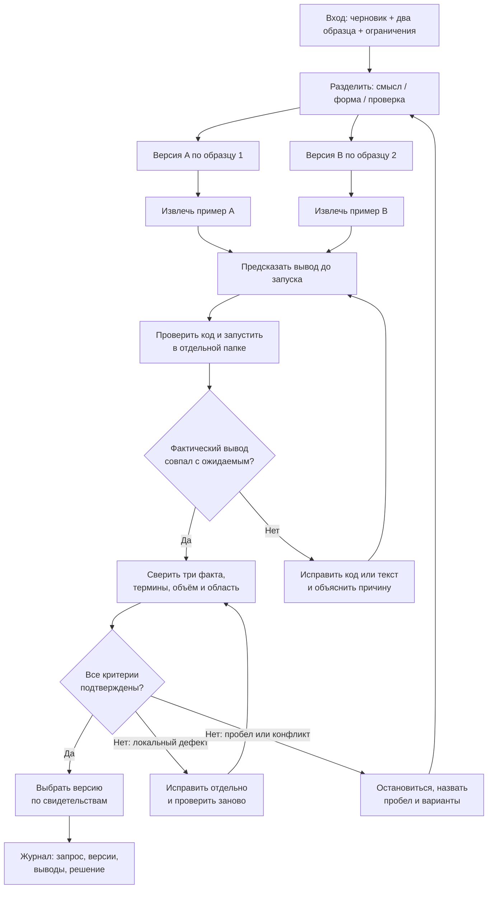
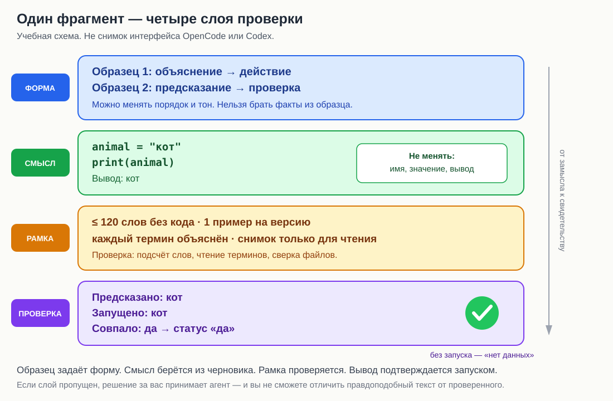

# L06. Ограничения и примеры

> **Основной учебник занятия.** Прочитайте обязательную часть до практики. Раздел «Углубление» отмечен как необязательный: он не добавляет работы сверх занятия и не нужен для сдачи.

**Статус проверки.** Текст сверен с утверждённой программой, картой занятий, планом L06 и карточкой практики 4 ноября 2026 года. Локально проверены только демонстрационные Python-фрагменты, подсчёт слов, хеши файлов, схема Mermaid и SVG-иллюстрация. OpenCode и Codex в ходе подготовки не запускались. Поэтому все описания ответов сред являются учебными примерами, а не результатами реальных запусков. Формат 140 минут объяснения и 75 минут практики остаётся проектным допущением до пилота.

<a id="toc"></a>
## Навигация

1. [Зачем этот навык](#why)
2. [Что научимся делать](#outcomes)
3. [Карта занятия](#map)
4. [Основные понятия](#concepts)
5. [Разобранная демонстрация](#demo)
6. [Схемы и иллюстрации](#visuals)
7. [Перед практикой](#before-practice)
8. [Самопроверка](#self-check)
9. [Углубление (необязательно)](#advanced)
10. [Словарь](#glossary)
11. [Источники и статус проверки](#sources)

<a id="why"></a>
## 1. Зачем этот навык

### 1.1. Где вы находитесь в курсе

На L05 вы собрали **контракт задачи** — минимальный набор сведений, без которого результат нельзя проверить: цель, входы, границы и критерии готовности (наблюдаемые признаки, по которым результат принимается). Контракт отвечает на вопрос «что должно получиться и когда это принимается».

Теперь появляется следующий вопрос: **как именно объяснить агенту форму результата и чем доказать, что пример работает?** На L06 вы учитесь двум вещам, которые часто путают:

- **образец подачи** показывает, *как* расположить материал: сначала объяснение, потом действие; или сначала предсказание, потом проверка;
- **ограничение** задаёт *что нельзя нарушать*: сохранить три факта, уложиться в 120 слов, не вводить необъяснённые термины, не менять снимок (зафиксированное исходное состояние файлов).

И третья вещь, без которой первые две остаются обещанием: **исполняемый пример**. Это код, который можно извлечь, запустить и сравнить фактический вывод с ожидаемым. Пример даёт **свидетельство** — проверяемый след: фактический вывод команды, фрагмент файла, diff (сравнение изменений) или хеш (короткий отпечаток содержимого файла), — а не только впечатление.

В сквозном проекте этот навык нужен постоянно. Учебный текст без запускаемого примера нельзя принять: ученик не сможет проверить себя. Образец без ограничений легко превращается в копирование чужого содержания. Ограничение без примера может остаться лозунгом «сделай понятно». На L16 вы будете собирать пилотный урок, на L20 — устранять разрывы между уроками, на L21 — проводить независимое ревью. Везде понадобится умение отделять форму от содержания и подтверждать вывод запуском.

### 1.2. Что вы уже умеете

| Предпосылка | Где было | Что именно понадобится |
|---|---|---|
| Собирать контракт из четырёх полей | L05 | Понять, куда в контракте добавляются образцы и ограничения |
| Запускать короткий Python-фрагмент | L02 | Извлечь код в отдельный файл и сравнить вывод |
| Отличать ожидаемый результат от фактического | L03 | Не подменять наблюдение желаемым |
| Работать в отдельной копии и читать diff | L01, L04 | Не смешивать снимок с результатом попытки |
| Сравнивать две попытки по одним критериям | L04 | Проверить две версии текста и две среды одинаково |

Знать Python глубже L02–L03 не требуется. Для этого занятия достаточно четырёх понятий:

| Понятие | Что нужно понимать | Где вводилось |
|---|---|---|
| Переменная | Имя, под которым сохранено значение | L02–L06: встречается в примерах, объясняется в L06 |
| Строка | Текст в кавычках, например `"кот"` | L02–L06 |
| Присваивание | Запись `имя = значение` связывает имя со значением | L02–L06 |
| `print` | Выводит значение на экран | L02 |

Если вы объясняете эти понятия новичку, вы не обязаны читать лекцию по Python. Достаточно короткого определения, одного примера и действия ученика. Граница занятия — **не курс Python, а проверяемый учебный фрагмент**.

### 1.3. Какой артефакт вы получите

**Артефакт** — проверяемый результат работы: файл, текст, таблица или журнал. После практики у вас должно быть:

- один запрос, в котором явно разделены обязательные ограничения и образцы подачи;
- две версии текста: A — по первому образцу, B — по второму;
- извлечённые исполняемые примеры — не менее одного на версию;
- фактический вывод запусков, отделённый от ожидаемого;
- таблица проверки: критерий → место в версии → свидетельство → статус;
- решение, какую версию выбрать и почему;
- записи в журнале по обеим средам с одинаковыми условиями и отмеченными различиями.

Это не «идеальный текст на все случаи». Это проверяемый фрагмент, который можно принять или отклонить по свидетельствам.

**Что не входит в занятие:** полный урок Python, автоматические тесты и CI (непрерывная интеграция), оценка промптов (текстов запросов) по рубрике (это L08), декомпозиция большой задачи (L07), работа с недоверенными инструкциями (L12).

### 1.4. Главная мысль

> **Образец задаёт форму. Ограничение задаёт рамку. Запуск даёт свидетельство.**

Если вы не разделили эти три роли, агент заполнит пробелы правдоподобными решениями. Иногда они совпадут с вашим замыслом, иногда нет — и вы узнаете об этом только после ответа. Разделение ролей делает результат проверяемым до отправки запроса.

<a id="outcomes"></a>
## 2. Что научимся делать

К концу занятия вы сможете:

| Наблюдаемый результат | Каким действием в практике это проверяется | Каким свидетельством подтверждается |
|---|---|---|
| 1. Отличить обязательное ограничение от образца подачи и исполняемого примера | Разобрать `draft.md` и `samples.md`, выписать три списка: что нельзя менять, что является только формой, что нужно запустить | Таблица «утверждение → роль → источник → проверка» |
| 2. Переработать фрагмент по двум образцам, сохранив смысл | Собрать один запрос и получить две версии текста | Две версии A и B, в каждой распознаётся свой образец |
| 3. Проверить пример запуском, а не по описанию | Извлечь код, предсказать вывод, запустить в отдельной папке, сравнить | Файлы примеров, команда, ожидаемый и фактический вывод |
| 4. Принять версию по критериям и сообщить о пробеле | Заполнить таблицу проверок, выбрать версию, записать конфликт или отсутствующие данные | Таблица критериев, решение, запись в журнале |

Это ориентир, а не новая рубрика. Уровень выполнения определяется по [рубрике модуля](../assessment.md) и критериям [карточки практики](practice_card.md).

<a id="map"></a>
## 3. Карта занятия

### 3.1. О времени

Карта занятий задаёт **140 минут объяснения и демонстрации + 75 минут практики**. В этом учебнике 140 минут собраны как обязательное ядро: каждый блок работает на проверяемый результат L06. Необязательное «Углубление» вынесено отдельно и в 140 минут не входит.

**Примечание о времени.** В таблице утверждённой программы для L06 указано 75/75, а в карте занятий — 140/75. Для этого учебника выбрано 140 минут обязательной теории, как требует карта и формат текущего занятия; расхождение и его последствия отмечены в разделе 11.4.

В плане занятия указаны ключевые акценты: вернуться к четырём частям контракта, различить ограничение и образец, найти незнакомый термин, провести демонстрацию на `animal = "кот"` с предсказанием вывода, разобрать ошибку «образец стиля стал новым содержанием» и оформить решение о приёмке. Эти акценты сохранены и развёрнуты ниже.

### 3.2. Блоки объяснения и демонстрации

| Минуты | Блок | Что происходит | Зачем |
|---:|---|---|---|
| 0–10 | Вход в занятие | Зачем нужны ограничения и примеры; какой артефакт сдаётся; где граница между «красиво» и «проверяемо» | Настроить на результат, а не на пересказ темы |
| 10–25 | Возврат к L05 | Четыре поля контракта; место ограничений, образцов и критериев; что уже было в L05, а что добавляется сегодня | Показать преемственность, не повторять весь L05 |
| 25–45 | Ограничения | Обязательное и желательное; измеримые ограничения; три факта; объём; область; таблица проверки | Научиться превращать «понятно» в наблюдаемый признак |
| 45–60 | Образцы подачи | Форма против содержания; два образца; как перенести структуру, не копируя чужие значения | Предотвратить главную ошибку занятия |
| 60–80 | Исполняемый пример | Предсказание → проверка кода → запуск → сравнение; безопасность запуска; свидетельство | Научиться доказывать вывод, а не верить тексту |
| 80–100 | Демонстрация 1 | `animal = "кот"`: вход, запрос, учебный плохой ответ, поиск дефекта | Показать ошибку копирования образца |
| 100–120 | Демонстрация 2 | Исправление, повторный запуск, проверка всех критериев, выбор версии | Показать полный цикл приёмки |
| 120–135 | Конфликты и пробелы | Где требования несовместимы; как сообщить о пробеле; что делать при вопросе агента | Не дать агенту молча угадывать |
| 135–140 | Переход к практике | Что открыть, что сохранить, какие свидетельства нужны | Связать теорию с карточкой |
| **140** | **Итого** | **Обязательное ядро** | |

### 3.3. Переход к практике — 75 минут

| Минуты | Шаг | Что сохранить |
|---:|---|---|
| 10 | Разобрать `draft.md` и `samples.md` | Список трёх фактов, двух образцов и ограничений |
| 12 | Собрать один запрос | Текст запроса и таблицу «роль утверждения» |
| 24 | Две попытки по 12 минут | Ответы или признаки сбоя, время, настройки, если видны |
| 19 | Проверить текст и код | Таблицу критериев, выводы запусков, решение |
| 10 | Заполнить журнал | Ссылки на свидетельства и предел вывода |

Подробное условие, критерии и форма сдачи — в [карточке практики](practice_card.md). Ниже мы не переписываем её, а объясняем, как устроен навык.

<a id="concepts"></a>
## 4. Основные понятия

<a id="concept-three-tools"></a>
### 4.1. Ограничение, образец и исполняемый пример: три разных инструмента

#### Проблема

Фраза «перепиши объяснение для новичка, чтобы было понятно» смешивает три разных заказа. Неясно, что обязательно сохранить, какую форму взять и чем доказать, что пример работает. Агент может написать красивый текст, который не сохраняет исходный смысл, или скопировать структуру образца вместе с чужими именами и значениями.

#### Определение

- **Ограничение** — обязательное условие, нарушение которого означает отказ. Пример: «сохрани имя `animal`, значение `"кот"` и вывод `кот`».
- **Образец подачи** — пример формы: порядок шагов, тон, способ начать и закончить. Содержание образца не является источником фактов. Пример: «сначала объяснение, затем действие ученика».
- **Исполняемый пример** — минимальный код, который можно извлечь в файл, запустить и сравнить вывод с ожидаемым. Пример: `animal = "кот"` и `print(animal)`.
- **Критерий готовности** — наблюдаемый признак, по которому вы принимаете или отклоняете результат. Пример: «фактический вывод равен `кот`».

Это не четыре названия одного и того же. Ограничение говорит **что нельзя менять**, образец — **какую форму взять**, пример — **что запустить**, критерий — **как принять**.

#### Механизм

1. Прочитайте вход и выпишите каждое требование отдельной строкой.
2. Поставьте каждой строке роль: «нельзя менять», «только форма», «нужно запустить», «способ проверки».
3. Если строка выполняет две роли, разделите её. Например, «пример должен быть коротким» — это ограничение на объём, а не образец.
4. Проверьте, что у каждого обязательного факта есть источник, а у каждого образца — пометка «содержание не переносить».
5. Только после этого собирайте запрос.

**Граница применимости:** если задача совсем простая и форма очевидна, три списка могут быть короткими. Но даже тогда полезно назвать, что является примером, а что — требованием.

#### Пример

**Исходные данные:** демонстрационный бриф с переменной `animal` и два образца подачи.

| Утверждение | Роль | Источник | Как проверить |
|---|---|---|---|
| Сохранить имя `animal` | Ограничение | `brief.md` | Найти точное имя в коде |
| Сохранить значение `"кот"` | Ограничение | `brief.md` | Найти точную строку |
| Сохранить вывод `кот` | Ограничение | `brief.md` | Запустить и сравнить |
| Сначала объяснение, потом действие | Образец | `samples.md`, образец 1 | Прочитать порядок |
| Сначала предсказание, потом проверка | Образец | `samples.md`, образец 2 | Прочитать порядок |
| `animal = "кот"` и `print(animal)` | Исполняемый пример | `brief.md` | Запустить |
| Вывод ровно `кот` | Критерий | `brief.md` | Сравнить фактический вывод |

**Ожидаемый результат:** каждое утверждение попало в одну роль. **Проверка:** если утверждение нельзя проверить или оно попало в две роли, разделите его.

#### В проекте

В практике вы получаете `draft.md` с содержанием и `samples.md` с двумя образцами. Ваша первая задача — не писать текст, а разложить вход по ролям. Удобная форма записи:

```text
## Нельзя менять (содержание)
- ...

## Только форма (образцы)
- ...

## Нужно запустить (примеры)
- ...

## Как проверить (критерии)
- ...
```

Этот список становится основой запроса и таблицы приёмки. Он же помогает заметить конфликт: например, образец требует двух разных значений, а вход задаёт только одно.

#### Типичная ошибка

| Ошибка | Как заметить | Что исправить |
|---|---|---|
| Образец считают источником содержания | В ответе появились имена и значения из образца | Пометить образец «только форма» и перечислить факты из черновика |
| Ограничение считают пожеланием | Текст «по возможности» вместо точного условия | Заменить на проверяемый признак |
| Пример считают доказательством | В тексте написано «вывод будет кот», но запуска не было | Извлечь код и запустить |
| Критерий придумывают после ответа | Чек-лист меняется по ходу проверки | Зафиксировать критерии до первой попытки |

#### Проверка понимания

Разложите четыре утверждения по ролям: «не больше 120 слов», «сначала предсказание», «`print(animal)`», «вывод совпадает с ожидаемым». Если два утверждения кажутся одним и тем же, объясните, чем они различаются.

**Микроупражнение.** Возьмите фразу «пример должен быть понятным» и превратите её в одно ограничение и один критерий. Не пишите весь запрос.

<a id="concept-samples"></a>
### 4.2. Образец подачи: форма, а не содержание

#### Проблема

Слова «сделай понятно» не описывают порядок материала. Один автор начнёт с определения, другой — с примера, третий — с вопроса. Образец подачи решает эту проблему: он показывает структуру, которую легче узнать, чем описать словами. Но у образца есть ловушка: вместе со структурой легко скопировать чужие имена, значения и факты.

#### Определение

**Образец подачи** — это модель последовательности, тона и формата, а не источник данных. Из образца берут **скелет**: какие шаги идут в каком порядке, что видит ученик сначала, что потом. Содержание берут из черновика и брифа.

Примеры двух скелетов:

| Образец | Скелет | Что делает ученик |
|---|---|---|
| 1. Объяснение → действие | Короткое объяснение → код → команда запуска | Сначала читает, потом действует |
| 2. Предсказание → проверка | Вопрос «что выведет?» → код → ожидаемый вывод → запуск и сравнение | Сначала прогнозирует, потом проверяет |

#### Механизм

1. Прочитайте образец и выпишите только **шаги**, без имён и значений.
2. Проверьте, что шаги не несут содержания: «объясните одним предложением», «дайте код», «попросите предсказать».
3. Подставьте в скелет факты из черновика.
4. Пометьте версию: «A по образцу 1», «B по образцу 2».
5. Проверьте, что смысл не изменился: те же имена, значения и вывод.
6. Проверьте, что образец **распознаётся**: читатель может сказать, какой скелет использован.

**Граница применимости:** образец помогает, когда форма важна и её трудно описать. Если форма уже задана точными ограничениями, лишний образец может добавить шум.

#### Пример

**Исходные данные:** `animal = "кот"`, `print(animal)`, вывод `кот`. Нужны две версии.

| Шаг | Образец 1 | Версия A | Образец 2 | Версия B |
|---:|---|---|---|---|
| 1 | Короткое объяснение | «Переменная — это имя, под которым сохранено значение…» | Вопрос | «Предскажите, что выведет программа» |
| 2 | Код | `animal = "кот"`; `print(animal)` | Код | `animal = "кот"`; `print(animal)` |
| 3 | Действие | «Запустите и сравните» | Ожидаемый вывод | «Ожидаемый вывод: кот» |
| 4 | — | — | Проверка | «Запустите и сравните с предсказанием» |

**Ожидаемый результат:** обе версии сохраняют `animal`, `"кот"` и вывод `кот`, но по-разному ведут ученика. **Проверка:** в версии A сначала идёт объяснение, в версии B — предсказание; в обеих есть код и действие.

#### В проекте

В запросе полезно явно разделить источники:

```text
## Входы
- draft.md — содержание: три факта и границы. Только чтение.
- samples.md — только форма подачи. Содержание образцов не переносить.
```

И добавить проверку:

```text
## Критерии
- Версия A распознаётся как образец 1: объяснение стоит до действия.
- Версия B распознаётся как образец 2: предсказание стоит до запуска.
- В обеих версиях сохранены три факта из draft.md.
```

Если агент вернул текст, в котором появились имена или значения из образца, это не «творческая вариация», а нарушение источника.

#### Типичная ошибка

| Ошибка | Наблюдаемый признак | Исправление |
|---|---|---|
| Копирование содержания образца | В ответе есть чужие имена, значения или город из примера | Убрать, вернуть факты из черновика, усилить границу «только форма» |
| Копирование тона без структуры | Текст «похож», но порядок шагов не тот | Выписать скелет и проверить по шагам |
| Обе версии одинаковы | A и B отличаются только заголовком | Перестроить одну версию по её скелету |
| Образец не распознаётся | Непонятно, где объяснение, а где действие | Добавить явный первый шаг и проверку |

#### Проверка понимания

Что из образца можно перенести в новый текст: порядок шагов, имена, значения, тон, вывод? Назовите три переносимых элемента и два непереносимых.

**Микроупражнение.** Возьмите предложение «Запустите программу и сравните вывод» и переставьте его так, чтобы получился образец 2, а не образец 1. Факты не меняйте.

<a id="concept-executable"></a>
### 4.3. Исполняемый пример: предсказание → проверка → запуск → сравнение

#### Проблема

Текст может утверждать, что программа выведет `кот`, но это утверждение, а не свидетельство. Кроме того, запускать незнакомый код опасно: он может изменить файлы, обратиться к сети или запросить ввод. Нужен короткий и безопасный способ проверить именно тот фрагмент, который показан ученику.

#### Определение

**Исполняемый пример** — минимальный фрагмент кода, который можно извлечь в отдельный файл, запустить на Python 3 и получить заранее записанный вывод. У него есть три части:

- **код** — только то, что показано в тексте;
- **ожидаемый вывод** — точная строка, которую ученик должен увидеть;
- **способ проверки** — команда запуска и сравнение.

**Свидетельство** — это фактический вывод команды, а не обещание «я проверил».

#### Механизм

1. **Извлеките код** из текста в отдельный файл вне снимка.
2. **Проверьте код до запуска:** нет ли импортов, записи файлов, сетевых вызовов, `input`, `eval`, `exec`, удаления файлов, работы с секретами. Если есть что-то сверх показанного присваивания и вывода, не запускайте — сначала объясните и исправьте.
3. **Запишите предсказание** до запуска. Это защищает от подгонки: вы фиксируете, что ожидали увидеть.
4. **Запустите** в отдельной папке, например `python3 -B example.py`. Флаг `-B` не создаёт служебные файлы Python (`__pycache__`).
5. **Сравните** фактический вывод с ожидаемым посимвольно: важны регистр, пробелы, кавычки и перевод строки.
6. **Запишите статус:** «да», «нет» или «нет данных». Если вывод не совпал, исправляйте код или ожидаемый вывод, но не фактическое наблюдение.
7. **Проверьте снимок:** файлы входа не должны измениться.

**Граница применимости:** запуск подтверждает поведение в вашей среде и на вашей версии Python. Он не доказывает, что пример понятен новичку и что он соответствует образцу. Это отдельные критерии.

#### Пример

**Исходные данные:** файл `example_a.py` (все файлы демонстрации — в разделе 5):

```python
animal = "кот"
print(animal)
```

**Шаги:**

1. Проверка кода: одно присваивание, один `print`, нет импортов и записи файлов.
2. Предсказание: `кот`.
3. Запуск: `python3 -B example_a.py`.
4. Фактический вывод: `кот`.
5. Сравнение: совпало.

| Что проверяем | Ожидаемый вывод | Фактический вывод (4 ноября 2026) | Статус |
|---|---|---|---|
| `example_a.py` | `кот` | `кот` | Да |
| `example_b.py` | `кот` | `кот` | Да |
| `example_bad.py` с чужим содержанием | `Москва` для этого кода; `кот` для задачи | `Москва` | Нет: не соответствует задаче |

**Проверка:** статус «да» стоит только там, где фактический вывод совпал с ожидаемым **для задачи**, а не только с тем, что написал агент.

#### В проекте

В карточке практики есть отдельное требование: предварительно убедиться, что код выполняет только показанное присваивание и вывод. Это не формальность. Извлечённый код запускается в отдельном временном файле, а не в `snapshot/`. После запуска проверьте, что снимок не изменён, например сравните хеши:

```bash
shasum -a 256 input/brief.md input/samples.md > before.sha256
# ... запуск примеров ...
shasum -a 256 -c before.sha256
```

Ожидаемый вывод:

```text
input/brief.md: OK
input/samples.md: OK
```

Если вы работаете на Linux, вместо `shasum -a 256` обычно доступен `sha256sum`. Смысл тот же: зафиксировать отпечаток до и после.

#### Типичная ошибка

| Ошибка | Наблюдаемый признак | Исправление |
|---|---|---|
| «Я и так знаю, что выведет» | Нет команды и фактического вывода | Запустить и сохранить вывод |
| Запуск в папке снимка | В снимке появились новые файлы или `__pycache__` | Запускать в отдельной папке, использовать `-B` |
| Код содержит лишнее | Импорт, запись файла, `input` | Не запускать; объяснить и упростить |
| Подгонка ожидания под факт | Ожидаемый вывод изменили после запуска без причины | Зафиксировать предсказание до запуска; объяснить расхождение |
| Сравнение «на глаз» | «Похоже, совпало» | Сравнить точную строку, включая регистр и пробелы |

#### Проверка понимания

Почему нельзя считать доказательством фразу агента «пример выводит `кот`»? Назовите два независимых свидетельства, которые можно сохранить.

**Микроупражнение.** Предскажите вывод фрагмента `word = "дом"` и `print(word)`. Затем назовите одну проверку, которую нужно сделать до запуска.

<a id="concept-measurable"></a>
### 4.4. Измеримое ограничение: объём, число, точное значение

#### Проблема

«Коротко», «пара примеров», «понятно» звучат как требования, но не дают способа проверить выполнение. Два человека посмотрят на один текст и придут к разным выводам. Агент тоже не знает, где остановиться.

#### Определение

**Измеримое ограничение** — условие, у которого есть:

- **единица** — что считаем: слова, примеры, присваивания, термины, файлы;
- **метод** — как считаем: убираем ли код, включаем ли заголовки, где ищем;
- **порог** — что считается прохождением: «≤ 120», «ровно 1», «3 из 3», «0 необъяснённых».

Без любого из трёх элементов ограничение остаётся пожеланием.

#### Механизм

1. Назовите единицу: «слово», «исполняемый пример», «точная строка».
2. Назовите метод: «удалить блоки кода, посчитать последовательности непробельных символов».
3. Назовите порог: «не больше 120 на каждую версию».
4. Примените **один и тот же метод** к обеим версиям.
5. Запишите метод рядом с результатом. Если метод изменился после первого подсчёта, пересчитайте обе версии.

**Граница применимости:** измерение всегда немного условно. Например, считать ли заголовок словом, а дефис — разделителем. Важна не абсолютная истина, а воспроизводимость: другой человек должен повторить ваш метод и получить тот же результат.

#### Пример

**Исходные данные:** две версии текста, ограничение «до 120 слов без учёта кода».

| Ограничение | Единица | Метод | Порог | Где проверить |
|---|---|---|---:|---|
| Объём | слово | Удалить блоки кода в тройных обратных кавычках, посчитать непробельные токены | ≤ 120 | Каждая версия отдельно |
| Число примеров | исполняемый блок | Посчитать блоки кода, которые можно запустить | 1 на версию | Каждая версия |
| Три факта | точная строка | Найти имя, значение и вывод | 3 из 3 | Текст и код |
| Термины | термин | Сверить с таблицей терминов | 0 необъяснённых | Текст |
| Снимок | файл | Сравнить хеши до и после | 0 изменений | Входные файлы |

**Фактическая проверка демонстрации 4 ноября 2026:**

```bash
python3 -B count_words.py version_a.md version_b.md
```

```text
version_a.md: 46
version_b.md: 52
```

**Ожидаемый результат:** обе версии укладываются в 120 слов. **Проверка:** метод один и тот же; в подсчёт входят заголовки, но не код. Если преподаватель считает иначе, метод нужно назвать до проверки, а не подгонять после.

#### В проекте

В `samples.md` ограничение «текст — до 120 слов без учёта кода» относится к **каждой версии**, а не к обеим вместе. Если вы посчитаете 120 слов на пару, каждая версия получится вдвое короче, и обязательные объяснения могут исчезнуть. Запишите это чтение в запросе:

```text
- Текст каждой версии — до 120 слов без учёта кода.
```

Формулировку карты «добавлены два исполняемых примера» удобнее читать как **по одному примеру на версию**: две версии — два примера. Если вы делаете больше, проверьте, не добавляете ли новые значения и не нарушаете ли лимит. Это чтение не меняет критерии карточки; оно лишь снимает неопределённость формулировки.

#### Типичная ошибка

| Ошибка | Наблюдаемый признак | Исправление |
|---|---|---|
| Считать оба текста вместе | 100 слов, но в каждой версии не хватает объяснения | Считать каждую версию отдельно |
| Считать код словами | Объём завышен, хотя текст короткий | Удалить блоки кода перед подсчётом |
| Менять метод после результата | Число изменилось, но версии не пересчитаны | Зафиксировать метод и пересчитать обе версии |
| «Один пример» без определения | Непонятно, считать ли фрагмент в тексте или файл | Определить единицу: исполняемый блок или файл |

#### Проверка понимания

Превратите «сделай коротко и понятно» в три измеримых ограничения. Для каждого назовите единицу, метод и порог.

**Микроупражнение.** Определите, что считать «одним примером» в вашей сдаче: блок кода в тексте, отдельный файл или запуск. Запишите определение одной строкой.

<a id="concept-terms"></a>
### 4.5. Термины: доступность без упрощения до неправды

#### Проблема

Черновик использует слова «переменная», «значение», «строка», «присваивание». Для автора они очевидны, для новичка — нет. Если запретить все новые термины, объяснение станет невозможно. Если объяснять каждый термин полно, текст выйдет за лимит. Нужен баланс: минимальный набор терминов, каждый объяснён при первом упоминании.

#### Определение

**Доступность термина** означает, что при первом упоминании читатель может понять слово из контекста или из короткого пояснения. Это не полный глоссарий и не замена курсу Python. Достаточно одной фразы:

- **переменная** — имя, под которым сохранено значение;
- **значение** — конкретные данные, например текст `кот`;
- **строка** — текст в кавычках;
- **присваивание** — запись `=` связывает имя со значением.

**Неоговорённый термин** — слово, которое читатель встречает без пояснения и без предварительного знакомства. Именно его ищут при проверке.

#### Механизм

1. Выпишите все термины, которые встречаются в тексте.
2. Отметьте, какие уже известны аудитории (например, `print` из L02).
3. Для каждого нового термина напишите пояснение в одну фразу.
4. Поставьте пояснение **при первом упоминании**, а не в конце.
5. Проверьте, нет ли кругового определения: «переменная — это то, что хранит значение», «значение — это то, что хранит переменная».
6. Сократите необязательные термины. Чем меньше новых слов, тем легче текст.

**Граница применимости:** объяснение не обязано быть академически полным. Оно должно быть достаточным, чтобы новичок понял пример и выполнил действие. Углубление можно оставить на следующий урок.

#### Пример

**Исходные данные:** демонстрационный текст о `animal`.

| Термин | Первое упоминание | Пояснение | Статус |
|---|---|---|---|
| Переменная | «Переменная — это имя…» | Имя, под которым сохранено значение | Объяснён |
| Значение | «Значение — это конкретные данные…» | Данные, например текст `кот` | Объяснён |
| Строка | «Текст в кавычках называют строкой» | Текст в кавычках | Объяснён |
| Присваивание | «Присваивание знаком = связывает…» | Связывает имя со значением | Объяснён |
| `print` | «print(animal)» | Уже известен из L02 | Не требует |

**Ожидаемый результат:** у каждого нового термина есть пояснение при первом упоминании. **Проверка:** прочитайте текст и остановитесь на каждом слове, которое новичок мог не знать. Если пояснения нет, добавьте его или замените слово.

#### В проекте

В практике черновик использует слова, которые для новичка могут быть новыми. Не копируйте их без разбора и не заменяйте всю терминологию бытовыми словами, если это искажает смысл. Ведите короткую таблицу «термин → пояснение → где впервые». Она же помогает проверить, не появился ли в ответе лишний термин вроде «литерал» или «идентификатор» без объяснения.

Если термин нужен, но не помещается в лимит, сократите второстепенные детали, а не обязательные пояснения. Если термин не нужен для примера, уберите его.

#### Типичная ошибка

| Ошибка | Наблюдаемый признак | Исправление |
|---|---|---|
| Термин без пояснения | «Идентификатор» или «литерал» в тексте для новичка | Заменить на знакомое слово или объяснить |
| Круговое определение | «Переменная — это переменная» | Дать пример: имя и сохранённое значение |
| Слишком много терминов | Пять новых слов в трёх строках | Оставить минимум, остальное вынести в следующий урок |
| Пояснение съедает лимит | Текст длиннее 120 слов | Сократить необязательные фразы, сохранить три факта |

#### Проверка понимания

Прочитайте первый абзац своей версии и назовите все термины, которые новичок мог не знать. Для каждого ответьте: известен, объяснён или требует исправления.

**Микроупражнение.** Объясните слово «строка» одним предложением, не используя слово «переменная». Затем проверьте, не стало ли определение круговым.

<a id="concept-gaps"></a>
### 4.6. Конфликт требований и пробел: остановиться и назвать

#### Проблема

Требования могут не совместиться: лимит объёма не оставляет места для объяснений, образец тянет чужое содержание, два примера требуют двух значений, а вход даёт одно. Или данных просто нет: не указано второе значение, не сказано, какой термин считать известным. Если агент не остановится, он выберет что-то правдоподобное и скроет решение от вас.

#### Определение

- **Конфликт требований** — два условия нельзя выполнить одновременно без нарушения хотя бы одного.
- **Пробел** — обязательное сведение отсутствует во входе.
- **Сообщение о пробеле** — короткая запись: какое требование не выполняется, какого данного не хватает, на что это влияет, какие есть варианты, какой нужен ответ.

И конфликт, и пробел требуют **остановки**, а не молчаливой догадки. Если продолжить нельзя, это не провал, а корректный результат проверки.

#### Механизм

1. Обнаружьте: требование нельзя выполнить или данных нет.
2. Остановитесь и не добавляйте факты от себя.
3. Назовите требование и отсутствующее данное.
4. Объясните влияние: что именно нельзя проверить.
5. Предложите 2 варианта, если они есть.
6. Запросите решение или зафиксируйте допущение, если время ограничено.
7. Запишите пробел в журнал.

**Формула:**

```text
Не могу выполнить «...», потому что во входе нет «...».
Это влияет на «...».
Варианты: (A) «...»; (B) «...».
Какой вариант выбрать? До ответа я не добавляю «...».
```

**Граница применимости:** если пробел не влияет на обязательный критерий, можно продолжить с явно помеченным допущением. Если влияет — остановка обязательна: иначе вы примете результат, который нельзя проверить.

#### Пример

**Учебный пример, не результат реального запуска.** Предположим, требование звучит так: «Сделай два примера с разными значениями». Во входе есть только одно значение — `"кот"`.

```text
Не могу выполнить «два примера с разными значениями»: в brief.md задано
только одно значение — "кот", второго значения нет.
Это влияет на второй пример и на проверку вывода.
Варианты: (A) два примера с одним значением и разной подачей;
(B) вы задаёте второе значение.
До ответа я не добавляю значение сам.
```

**Что это даёт:** вы не получаете выдуманное значение, которое потом придётся ловить. Вы получаете явное решение: изменить требование или добавить вход.

#### В проекте

В запросе полезно заранее разрешить остановку:

```text
- Если требования конфликтуют или данных не хватает, остановись,
  перечисли конфликт и назови пробел. Не придумывай значения.
```

Если агент задаёт уточняющий вопрос, это не обязательно сбой. Это сигнал, что поле контракта неполное. Ответьте, если ответ есть в источнике; если ответа нет — запишите пробел и не позволяйте агенту угадывать.

Типичные конфликты L06:

| Конфликт | Пример | Как обнаружить | Решение |
|---|---|---|---|
| Содержание против формы | В образце `city = "Москва"`, а в брифе `animal = "кот"` | В ответе появилось чужое значение | Образец — только форма; факты — из брифа |
| Объём против полноты | 120 слов и пять новых терминов | Подсчёт и список терминов | Сократить необязательное, оставить минимум |
| Один источник против двух примеров | Одно значение, а просят два разных | Сверка с входом | Один пример на версию или добавить вход |
| Формат против области | «Только текст» и «создай файл» | Несовместимые требования | Выбрать один формат или задать приоритет |
| «Не меняй файлы» против запуска | Запуск может создать файлы | Проверка папки после запуска | Запускать вне снимка, `-B`, проверить хеши |

#### Типичная ошибка

| Ошибка | Наблюдаемый признак | Исправление |
|---|---|---|
| Агент выдумал недостающее значение | В ответе имя или число, которого нет во входе | Отклонить, добавить правило «остановись и назови пробел» |
| Конфликт замаскирован | Текст выглядит нормально, но одно требование нарушено | Сверить каждое требование отдельно |
| Пробел не записан | В журнале нет причины, почему взят вариант | Записать пробел, варианты и решение |
| Человек отвечает догадкой | Ответа нет в источнике, но вы его придумали | Пометить как допущение или запросить данные |

#### Проверка понимания

У вас один черновик с одним значением, а задание просит два разных примера. Это конфликт или пробел? Что вы напишете агенту?

**Микроупражнение.** Составьте сообщение о пробеле из двух предложений: чего не хватает и на что это влияет. Не предлагайте решение, если его нет во входе.

<a id="concept-acceptance"></a>
### 4.7. Приёмка двух версий по одним критериям

#### Проблема

Две версии легко сравнить «по ощущению»: одна кажется живее, другая — короче. Но выбор должен опираться на критерии, иначе вы не сможете объяснить, почему приняли именно эту версию. Кроме того, при проверке легко изменить критерии под понравившийся текст.

#### Определение

**Приёмка двух версий** — это таблица, в которой одни и те же критерии применяются к A и B, а по каждому пункту стоит статус и свидетельство. Решение — это итог таблицы, а не общее впечатление.

Статусы:

- **да** — признак подтверждён конкретным местом или выводом;
- **нет** — признак не выполнен;
- **нет данных** — вы ещё не проверили; это честнее, чем «да».

#### Механизм

1. Зафиксируйте критерии **до** первой попытки.
2. Для каждого критерия укажите, где смотреть: текст, код, вывод команды, хеш.
3. Заполните таблицу для A и B отдельно.
4. Поставьте статус и ссылку на свидетельство.
5. Если оба варианта проходят, выберите по **назначению**, а не по вкусу: для первого знакомства один вариант, для проверки понимания другой.
6. Если один вариант не проходит, исправьте его и проверьте **все** критерии заново.
7. Запишите решение и основание.

**Граница применимости:** «оба прошли» не значит «оба одинаково хороши». Это значит, что различия лежат в области назначения, а не в обязательных критериях.

#### Пример

**Демонстрация:** версии A и B о `animal`.

| № | Критерий | Версия A | Версия B | Свидетельство |
|---:|---|---|---|---|
| 1 | Сохранено имя `animal` | Да | Да | Код |
| 2 | Сохранено значение `"кот"` | Да | Да | Код |
| 3 | Вывод равен `кот` | Да | Да | Запуск |
| 4 | Версия соответствует своему образцу | Да: объяснение → действие | Да: предсказание → проверка | Текст |
| 5 | Новые термины объяснены | Да | Да | Таблица терминов |
| 6 | Не больше 120 слов без кода | Да: 46 | Да: 52 | Подсчёт |
| 7 | Снимок не изменён | Да | Да | Хеши |

**Решение примера:** для первого знакомства выбираем A: она снижает нагрузку и не требует предсказания до объяснения. B полезна как следующий шаг, когда нужно проверить понимание. Это **решение демонстрации**, а не обязательный ответ практики: в вашем случае назначение может быть другим.

#### В проекте

В карточке практики заданы критерии: три факта черновика, оба образца, объяснённые термины, запуск на Python 3, совпадение вывода, неизменный снимок. Ваша таблица должна ссылаться на конкретные места, а не пересказывать критерии. Выбор версии тоже должен иметь основание.

Если вы выбрали версию, которая не проходит критерий, это не выбор, а долг. Запишите его и исправьте.

#### Типичная ошибка

| Ошибка | Наблюдаемый признак | Исправление |
|---|---|---|
| Разные критерии для A и B | В таблице разные строки | Вернуть один список |
| Оценка «нравится» | Нет ссылки на место или вывод | Заменить на статус и свидетельство |
| Проверка только исправленного пункта | После правки остальные не перепроверены | Проверить весь набор |
| Выбор без основания | «A красивее» | Назвать назначение и критерий выбора |

#### Проверка понимания

Если A проходит все обязательные критерии, а B — нет, можно ли выбрать B, потому что он «интереснее»? Объясните, что должно измениться, чтобы выбор стал корректным.

**Микроупражнение.** Для двух критериев — «вывод совпадает» и «образец распознаётся» — придумайте по одному свидетельству, которое можно сохранить.

<a id="concept-environments"></a>
### 4.8. Две среды: одинаковые условия, разные наблюдения

#### Проблема

Сравнение теряет смысл, если одна среда получила другой запрос, другой снимок или больше времени. Тогда различие в результате нельзя объяснить средой: возможно, дело в условиях. Один запуск также не даёт права на общий вывод «этот инструмент лучше».

#### Определение

**Честное сравнение** — две попытки, в которых одинаковы снимок, текст запроса, критерии, лимит времени, свежесть сеанса и порядок, а различается только среда. Все остальные различия записываются как различия условий.

#### Механизм

| Что удерживать | Как проверить |
|---|---|
| Снимок и его идентификатор | Коммит или выданная копия; список файлов |
| Текст запроса | Дословно один и тот же в обеих средах |
| Критерии | Один список до первой попытки |
| Лимит времени | Одинаковый, например 12 минут на попытку |
| Свежий сеанс | Новый диалог без контекста предыдущей попытки |
| Отдельная копия | Не работать в одном рабочем каталоге |
| Порядок | Записан до старта |

**Что может различаться и должно быть записано:** интерфейс, режим разрешений, модель и настройки (если видны), время ответа, формат вывода, отказ или тайм-аут, доступ к файлам.

**Граница применимости:** сравнение двух сред не устанавливает превосходство продукта. Оно фиксирует наблюдение в данных условиях: снимок, запрос, критерии, время и настройки.

**Что подтверждено, а что нет.** По официальной документации на 4 ноября 2026 года OpenCode рекомендует давать достаточно контекста и примеров ([opencode.ai/docs](https://opencode.ai/docs/)), а Codex — сохранять важные ограничения и указывать способ проверки изменения ([developers.openai.com/codex/prompting](https://developers.openai.com/codex/prompting)). Это рекомендации документации, а не гарантия поведения установленной версии. Конкретные модели, скорость и формат ответа нужно наблюдать и записывать.

#### Пример

Учебная таблица для заполнения на занятии (фактических данных здесь нет):

| Поле | OpenCode | Codex |
|---|---|---|
| Снимок и отдельная копия | Заполнить | Заполнить |
| Свежий сеанс | Заполнить | Заполнить |
| Дословный запрос | Один и тот же текст | Один и тот же текст |
| Модель и настройки, если видны | Заполнить или «недоступно» | Заполнить или «недоступно» |
| Время | Заполнить | Заполнить |
| Ответ или сбой | Заполнить | Заполнить |
| Изменения файлов | Проверить | Проверить |
| Проверки по критериям | Заполнить | Заполнить |

**Ожидаемый результат:** обе записи заполнены фактами; недоступные поля помечены «недоступно». **Проверка:** можно ли по журналу восстановить, что было одинаковым, а что различалось.

#### В проекте

Для L06 действует [протокол сравнения](../shared/comparison_protocol.md): один снимок, один запрос, свежий сеанс, отдельная копия. Запись ведётся в [форме журнала](../shared/run_journal.md). Если среда недоступна, используйте сохранённый пример преподавателя только с явной пометкой; это не засчитывается как проведённый запуск.

#### Типичная ошибка

| Ошибка | Наблюдаемый признак | Исправление |
|---|---|---|
| Разные тексты запроса | В журнале две разные формулировки | Использовать один сохранённый текст |
| Один сеанс на две попытки | Контекст первой попытки влияет на вторую | Начать новый сеанс |
| Одна рабочая копия | Вторая попытка видит изменения первой | Сделать отдельные копии |
| Разное время | Одна попытка длилась 12 минут, другая 30 | Записать отклонение или повторить |
| Вывод «кто лучше» по одному запуску | Нет данных о модели и условиях | Ограничить вывод наблюдением |

#### Проверка понимания

Назовите три вещи, которые нужно удержать одинаковыми, и одну, которую нужно записать как различие. Если вы называете «модель» среди одинаковых, проверьте, действительно ли она одинаковая и видна ли она вам.

**Микроупражнение.** Посмотрите на две записи журнала. Найдите условие, которое различается, но не названо как различие. Что нужно добавить, чтобы вывод стал честнее?

<a id="demo"></a>
## 5. Разобранная демонстрация

### 5.1. Что демонстрируем

Демонстрация показывает полный цикл:

```text
вход → разделение смысла и формы → запрос → учебный ответ →
поиск дефекта → исправление → запуск → проверка → выбор версии → вывод
```

Это **не** оцениваемая практика. Демонстрационный снимок `demo_animal/` отличается от `snapshot/` по сюжету, имени и значению. Совпадает только тренируемый приём: переработать фрагмент по двум образцам, сохранив смысл и проверив пример запуском. Файлы демонстрации приведены ниже в тексте; это учебная реконструкция, а не папка внутри `snapshot/`.

```text
demo_animal/
├── input/
│   ├── brief.md
│   └── samples.md
├── prompt.md
├── response_bad.md
├── version_a.md
├── version_b.md
├── example_bad.py
├── example_a.py
├── example_b.py
└── count_words.py
```

| Шаг | Человек | Агент |
|---:|---|---|
| 1. Постановка | Читает бриф и образцы, разделяет содержание и форму, формулирует запрос | Не участвует |
| 2. Попытка | Отправляет запрос, сохраняет исходный ответ | Читает указанные входы и возвращает две версии |
| 3. Проверка | Сверяет факты, образцы, термины, объём, запускает код | Не участвует: «готово» агента не является приёмкой |
| 4. Исправление | Правит текст или запрос, повторяет проверку | Получает новую попытку, если человек решил её сделать |
| 5. Решение | Выбирает версию по назначению и свидетельствам | Не участвует |

### 5.2. Вход демонстрации

`demo_animal/input/brief.md`:

```text
# Демонстрационный бриф: одно животное

Аудитория: новичок, который уже видел print, но не изучал переменные.
Нужен текст объяснения на русском: одна строковая переменная animal со значением "кот", один вызов print(animal).
Сохраните три факта: имя animal, присваивание строки "кот", вывод "кот".
Текст — до 120 слов без учёта кода.
Не используйте термины без пояснения при первом упоминании.
Файлы этого снимка — только для чтения.
```

`demo_animal/input/samples.md`:

```text
# Два образца подачи (демонстрация)

## Образец 1. Сначала объяснение, затем действие

Одно короткое объяснение, потом одно действие ученика.
Форма из другого урока (содержание не переносить):

city = "Москва"
print(city)

Ученик заменяет город и запускает.

## Образец 2. Сначала предсказание, затем проверка

Попросите ученика записать ожидаемый вывод до запуска, затем дайте команду запуска и способ сверить.
```

**Важно:** образец 1 намеренно содержит чужое содержание `city = "Москва"`. Это нужно, чтобы ошибка копирования была видна. В вашем снимке образцы задают только подачу; имена и значения берутся из черновика.

### 5.3. Разделение содержания и формы

| Утверждение | Роль | Источник | Проверка |
|---|---|---|---|
| Имя `animal` | Ограничение | `brief.md` | Точное совпадение |
| Значение `"кот"` | Ограничение | `brief.md` | Точное совпадение |
| Вывод `кот` | Ограничение | `brief.md` | Запуск |
| Объяснение → действие | Образец 1 | `samples.md` | Порядок шагов |
| Предсказание → проверка | Образец 2 | `samples.md` | Порядок шагов |
| `city = "Москва"` | Чужое содержание | `samples.md` | Не переносить |
| ≤ 120 слов | Ограничение | `brief.md` | Подсчёт |
| Файлы только для чтения | Ограничение | `brief.md` | Хеши |

**Вывод:** `city` и `Москва` не являются фактами задачи. Они принадлежат образцу формы и должны исчезнуть при переносе.

### 5.4. Запрос

```text
## Цель

Подготовь две версии объяснения переменной для новичка: версию A по образцу 1
и версию B по образцу 2. В каждой версии — один исполняемый пример.
Верни только две версии текста с подписями A и B.

## Входы

- brief.md — аудитория, факты, объём и запреты. Только чтение.
- samples.md — только форма подачи. Содержание образцов не переносить. Только чтение.
Другие файлы не используй.

## Границы

- Сохрани три факта: имя animal, присваивание строки "кот", вывод "кот".
- Не меняй значение и не добавляй другие переменные.
- В каждой версии ровно один пример с одним присваиванием и одним print.
- Текст каждой версии — до 120 слов без учёта кода.
- Каждый термин объясни при первом упоминании.
- Не создавай и не изменяй файлы.
- Если требования конфликтуют или данных не хватает, остановись и назови пробел.
  Не придумывай.

## Критерии готовности

1. В каждой версии есть animal = "кот" и print(animal).
2. Ожидаемый вывод — ровно "кот".
3. Версия A: сначала объяснение, потом действие.
4. Версия B: сначала предсказание, потом проверка.
5. Нет необъяснённых терминов.
6. В каждой версии не больше 120 слов без кода.
7. Файлы снимка не изменены.
```

**Проверка запроса до отправки:**

| Поле | Вопрос | Ответ |
|---|---|---|
| Цель | Что получится? | Две версии текста, по одному примеру в каждой |
| Входы | На что опираться? | `brief.md`, `samples.md`; образцы — только форма |
| Границы | Что нельзя? | Менять значение, добавлять переменные, копировать содержание образца, менять файлы |
| Критерии | Когда готово? | Семь проверяемых пунктов |
| Согласованность | Нет ли конфликта? | «Только текст» и «не менять файлы» совместимы; лимит относится к каждой версии |

### 5.5. Учебный ответ агента с дефектом

> **Учебный пример, не результат реального запуска OpenCode или Codex.** Ответ составлен для разбора; он не подтверждает поведение конкретной версии инструмента.

```text
## Версия A

Переменная — это имя для значения. В Python строку записывают в кавычках.

city = "Москва"
print(city)

Замените город и запустите программу.

## Версия B

Предскажите, что выведет программа.

city = "Москва"
print(city)

Ожидаемый вывод: Москва. Запустите и сравните.
```

Ответ выглядит аккуратно: есть две версии, код, действие. Именно поэтому его полезно разбирать: **правдоподобность не равна выполнению запроса**.

### 5.6. Проверка и диагноз

| № | Критерий | Где смотреть | Наблюдение | Статус |
|---:|---|---|---|---|
| 1 | Имя `animal` | Код | В коде `city` | Нет |
| 2 | Значение `"кот"` | Код | В коде `"Москва"` | Нет |
| 3 | Вывод `кот` | Запуск | Для этого кода ожидается `Москва` | Нет |
| 4 | Версия A по образцу 1 | Текст | Объяснение → действие есть | Да, но содержание чужое |
| 5 | Версия B по образцу 2 | Текст | Предсказание → проверка есть | Да, но содержание чужое |
| 6 | Термины объяснены | Текст | «Значение» не объяснено; «присваивание» не названо | Нет |
| 7 | ≤ 120 слов | Подсчёт | 40 слов | Да |
| 8 | Снимок не изменён | Хеши | Хеши `input/` совпали | Да |

**Диагноз:** образец подачи сработал как источник содержания. Агент перенёс `city` и `Москва` вместе со структурой. Это не случайная опечатка, а **системная ошибка постановки**: граница «содержание образцов не переносить» была в запросе, но недостаточно конкретной. Нужно назвать чужое значение явно и повторить проверку.

**Что делать:** не править код «на глаз», а сначала исправить запрос или текст:

- указать, что `city` и `Москва` — чужие значения из образца;
- повторить три факта из брифа;
- проверить, что новый ответ не содержит других имён и значений;
- запустить извлечённый код и сравнить вывод.

### 5.7. Исправление и повторная проверка

**Исправленный запрос — добавленный фрагмент:**

```text
## Уточнение

В samples.md есть city = "Москва". Это только форма из другого урока.
Не переноси city, Москву или любое другое значение из samples.md.
Все имена и значения бери только из brief.md.
```

**Учебный ответ после уточнения (не результат реального запуска):**

```text
## Версия A

Переменная — это имя, под которым сохранено значение. Значение — это
конкретные данные, например текст «кот». В Python текст в кавычках называют
строкой. Присваивание знаком = связывает имя со значением.

animal = "кот"
print(animal)

Запустите программу. Она выведет значение, сохранённое в animal.

## Версия B

Переменная — это имя, под которым сохранено значение. Значение — это
конкретные данные, например текст «кот». В Python текст в кавычках называют
строкой. Присваивание знаком = связывает имя со значением.

Предскажите, что выведет программа.

animal = "кот"
print(animal)

Ожидаемый вывод: кот. Запустите программу и сравните вывод с предсказанием.
```

**Извлечённые примеры:**

```python
# example_a.py
animal = "кот"
print(animal)
```

```python
# example_b.py
animal = "кот"
print(animal)
```

**Проверка кода до запуска:** одно присваивание, один `print`, нет импортов, записи файлов, сети, `input`, `eval`, `exec`. Запускать безопасно в отдельной папке.

**Фактический запуск 4 ноября 2026:**

```bash
python3 --version
python3 -B example_bad.py
python3 -B example_a.py
python3 -B example_b.py
```

```text
Python 3.9.6
Москва
кот
кот
```

**Ожидаемый вывод:** `кот` в обеих версиях; для `example_bad.py` ожидается `Москва`, но задача требует `кот`. **Фактический:** `Москва`, `кот`, `кот`. **Статус:** версии A и B — да; плохой пример — нет, он не соответствует задаче.

**Подсчёт слов:**

```bash
python3 -B count_words.py version_a.md version_b.md
```

```text
version_a.md: 46
version_b.md: 52
```

**Проверка снимка:**

```bash
shasum -a 256 -c before.sha256
```

```text
input/brief.md: OK
input/samples.md: OK
```

### 5.8. Повторная таблица и выбор версии

| № | Критерий | Версия A | Версия B | Свидетельство |
|---:|---|---|---|---|
| 1 | Имя `animal` | Да | Да | Код |
| 2 | Значение `"кот"` | Да | Да | Код |
| 3 | Вывод `кот` | Да | Да | Запуск |
| 4 | Соответствие своему образцу | Да: объяснение → действие | Да: предсказание → проверка | Текст |
| 5 | Термины объяснены | Да | Да | Таблица терминов |
| 6 | ≤ 120 слов | Да: 46 | Да: 52 | Подсчёт |
| 7 | Снимок не изменён | Да | Да | Хеши |

**Выбор версии.** Обе версии проходят обязательные критерии. Дальше решает назначение:

| Основание | Версия A | Версия B |
|---|---|---|
| Первое знакомство с переменной | Лучше: сначала объяснение, затем действие | Требует предсказания до объяснения |
| Проверка понимания | Слабее: ученик может просто прочитать | Лучше: ученик сначала прогнозирует |
| Нагрузка на новичка | Ниже | Выше |
| Риск угадывания | Ниже | Выше, если тема совсем новая |

**Решение демонстрации:** для аудитории «новичок, который ещё не изучал переменные» выбираем A как первый шаг; B оставляем для закрепления. Основание — не «A красивее», а соответствие назначению и отсутствие лишней нагрузки. Это решение примера, а не обязательный ответ практики.

### 5.9. Если проверка выявила дефект

| Ситуация | Признак | Действие |
|---|---|---|
| Локальный текстовый дефект | Нет одного элемента, но область и формат соблюдены | Исправить в отдельной версии, записать причину, проверить все критерии заново |
| Копирование содержания образца | В ответе чужие имена или значения | Уточнить границу «только форма», убрать чужое, проверить источник |
| Несовпадение вывода | Фактический вывод отличается от ожидаемого | Не подгонять ожидание; исправить код или объяснить расхождение |
| Необъяснённый термин | Новичок не поймёт слово | Добавить короткое пояснение, сократить необязательное |
| Образец не распознаётся | Непонятно, где объяснение, а где действие | Перестроить по скелету, проверить первый и последний шаг |
| Снимок изменён | Появились новые файлы или diff | Остановиться, восстановить снимок, записать инцидент |
| Сбой среды | Тайм-аут, отказ, недоступность | Сохранить запись, отметить «недоступно», не выдавать за запуск |

**Правило:** сначала сохраните исходное свидетельство, потом исправляйте. Если исправление меняет смысл задачи, это уже не локальная правка, а новая попытка.

### 5.10. Сравнение сред без выдуманных результатов

В демонстрации для сравнения предусмотрены один и тот же исходный снимок, одна и та же задача и один и тот же текст запроса в обеих средах. Критерии тоже одинаковые: те же семь пунктов из раздела 5.4, без изменений между средами. Фактические ответы в этом учебнике не приводятся: в ходе подготовки запуски OpenCode и Codex не выполнялись. На занятии вы заполняете таблицу по своим наблюдениям.

| № | Критерий | Одинаковая проверка в обеих средах |
|---:|---|---|
| 1 | Имя `animal` | Найти точное имя в коде |
| 2 | Значение `"кот"` | Найти точную строку |
| 3 | Вывод `кот` | Запустить и сравнить |
| 4 | Образец A / B | Прочитать порядок шагов |
| 5 | Термины | Сверить с таблицей терминов |
| 6 | Объём | Посчитать по одному методу |
| 7 | Снимок | Сравнить хеши до и после |

| Условие | OpenCode | Codex |
|---|---|---|
| Снимок и отдельная копия | Заполнить | Заполнить |
| Свежий сеанс | Заполнить | Заполнить |
| Порядок попыток | Заполнить | Заполнить |
| Дословный запрос | Один и тот же текст | Один и тот же текст |
| Модель и настройки, если видны | Заполнить или «недоступно» | Заполнить или «недоступно» |
| Время | Заполнить | Заполнить |
| Ответ или сбой | Заполнить | Заполнить |
| Изменения файлов | Проверить | Проверить |
| Ручные правки и причина | Заполнить | Заполнить |
| Решение по критериям | Заполнить | Заполнить |

**Что можно утверждать по одной серии:** «в данных условиях получен такой ответ, такие проверки, такие различия». **Что нельзя утверждать:** «этот инструмент лучше вообще» или «этот промпт всегда работает».

### 5.11. Вывод демонстрации

1. Разделение содержания и формы позволило увидеть дефект до приёмки: `city` и `Москва` пришли из образца, а не из брифа.
2. Проверка примера запуском дала свидетельство: `example_a.py` и `example_b.py` выводят `кот`, а `example_bad.py` — `Москва`.
3. Обе исправленные версии проходят обязательные критерии; выбор между ними — вопрос назначения, а не «качества вообще».
4. Если бы мы приняли первый ответ сразу, в учебный материал попало бы чужое значение, а новичок не смог бы проверить пример по заданию.

<a id="visuals"></a>
## 6. Схемы и иллюстрации

### 6.1. Схема процесса



*Рис. 1. Путь от входа до решения о приёмке. Схема показывает, что проверка возвращает нас либо к исправлению, либо к уточнению постановки, а не сразу к «принято».*

**Как читать:** движение идёт сверху вниз. После запуска есть два выхода: вывод совпал или нет. Если не совпал, возвращаемся к предсказанию и исправлению. Если совпал, проверяем остальные критерии. Пробел или конфликт возвращает к разделению входа, а не к бесконечной правке текста.

**Вывод для практики:** не принимайте решение по одному признаку. Если вы исправили один дефект, проверьте остальные критерии заново: правка могла задеть другой элемент.

**Текстовая альтернатива:**

1. Вход разделяется на смысл, форму и проверку.
2. Из него получаются две версии по двум образцам.
3. Из каждой версии извлекается пример.
4. Вывод предсказывается до запуска.
5. Код проверяется и запускается в отдельной папке.
6. Если вывод не совпал — исправление и повторное предсказание.
7. Если совпал — проверка фактов, терминов, объёма и области.
8. Если все критерии подтверждены — выбор версии и запись в журнал.
9. Если есть локальный дефект — исправление и повторная проверка.
10. Если есть пробел или конфликт — остановка, формулировка и возврат к входу.

### 6.2. Иллюстрация: четыре слоя одного фрагмента



*Рис. 2. Форма, смысл, рамка и проверка. Схема показывает, что менять можно форму, но не смысл и не ограничения; доказательство появляется только после запуска. Это учебная схема, а не снимок интерфейса OpenCode или Codex.*

**Как читать:** сверху вниз расположены четыре слоя. Голубой слой — форма: два образца задают порядок шагов. Зелёный — смысл: имя, значение и вывод, которые нельзя менять. Жёлтый — рамка: объём, термины и область. Фиолетовый — проверка: предсказание, запуск и сравнение. Справа стрелка показывает переход от замысла к свидетельству.

**Вывод для практики:** если пропустить слой, решение за вас примет агент. Без формы текст может быть хаотичным; без смысла — красивым, но неверным; без рамки — длинным и с лишними терминами; без проверки — правдоподобным, но недоказанным.

**Текстовая альтернатива:**

| Слой | Что задаёт | Что можно менять | Как проверить |
|---|---|---|---|
| Форма | Порядок шагов и тон | Порядок и тон в пределах образца | Прочитать структуру |
| Смысл | Имя, значение, вывод | Ничего из перечисленного | Точное совпадение |
| Рамка | Объём, термины, область | Только необязательные детали | Подсчёт, чтение, хеши |
| Проверка | Предсказание и фактический вывод | Ничего в факте вывода | Запуск и сравнение |

<a id="before-practice"></a>
## 7. Перед практикой

### 7.1. Что должно быть готово

| Что нужно | Зачем | Где взять |
|---|---|---|
| Две чистые копии снимка | Отдельная попытка в каждой среде | Выдаёт преподаватель; файлы из [`snapshot/`](snapshot/) |
| Черновик объяснения | Исходное содержание и три факта | [`snapshot/draft.md`](snapshot/draft.md) |
| Два образца подачи | Форма версий A и B | [`snapshot/samples.md`](snapshot/samples.md) |
| Карточка практики | Точное задание, время, критерии, сдача | [`practice_card.md`](practice_card.md) |
| Протокол сравнения | Одинаковые условия двух попыток | [`../shared/comparison_protocol.md`](../shared/comparison_protocol.md) |
| Форма журнала | Запись попыток и вывода | [`../shared/run_journal.md`](../shared/run_journal.md) |
| Рубрика модуля | Уровни выполнения | [`../assessment.md`](../assessment.md) |

Python, Git и тесты нужны только в объёме L01–L03. Для самой задачи L06 достаточно редактора текста, терминала и Python 3. Запускать код нужно в отдельной папке, не в снимке.

### 7.2. На что обратить внимание в карточке

1. **Входы.** Используйте только файлы снимка, указанные в карточке. Не добавляйте эталоны преподавателя и посторонние заметки.
2. **Образцы — только форма.** Имена и значения берите из черновика. Если в ответе появились чужие значения, это дефект.
3. **Три факта.** Сохраните обращение по имени, присваивание строки и вывод заданного значения. Точные значения смотрите в черновике, а не в демонстрации.
4. **Термины.** Каждый новый термин объясните при первом упоминании. Не добавляйте термины, без которых можно обойтись.
5. **Объём.** В `samples.md` лимит 120 слов относится к каждой версии отдельно и не включает код. Запишите метод подсчёта.
6. **Запуск.** Извлеките код в отдельный файл, проверьте, что он делает только показанное присваивание и вывод, запустите на Python 3 и сравните фактический вывод с ожидаемым.
7. **Снимок.** После попытки убедитесь, что файлы не изменены. Слова в промпте не заменяют проверку.
8. **Одинаковые условия.** Один и тот же запрос дословно, свежий сеанс, отдельная копия, одинаковый лимит. Различия запишите.

### 7.3. Какое свидетельство сохранить

- текст вашего запроса и, если он уточнялся, обе версии;
- таблицу «утверждение → роль → источник → проверка»;
- две версии текста A и B;
- файлы извлечённых примеров;
- ожидаемый и фактический вывод каждого запуска;
- таблицу критериев с точными местами и статусами;
- решение о выборе версии и основание;
- две записи в журнале: среда, время, модель и настройки (если видны), ответ или сбой, изменения файлов;
- ограничение вывода: что подтверждено, а что осталось гипотезой.

**Редакторский чек-лист перед сдачей:**

| Проверка | Отметка |
|---|---|
| В запросе разделены ограничения и образцы |  |
| В каждой версии распознаётся свой образец |  |
| Три факта сохранены |  |
| Новые термины объяснены |  |
| Код запущен, вывод сравнён |  |
| Снимок не изменён |  |
| По каждому критерию есть статус и свидетельство |  |
| Выбор версии обоснован |  |
| В журнале разделены факты и гипотезы |  |

### 7.4. По какому критерию сверить результат

Перед сдачей проверьте:

- запрос содержит цель, входы, границы и критерии, а также явное указание, что образцы задают только форму;
- обе версии сохраняют три факта черновика;
- версия A распознаётся как первый образец, версия B — как второй;
- новые термины объяснены;
- код запускается на Python 3, фактический вывод совпадает с заявленным;
- снимок не изменён;
- по каждому критерию есть ссылка на конкретное место или вывод;
- выбор версии опирается на назначение и свидетельства, а не на «нравится».

Если пункт не выполнен, не маскируйте его. Запишите, что именно не подтверждено и какой следующий проверяемый шаг нужен. Это лучше, чем «всё получилось» без доказательства.

<a id="self-check"></a>
## 8. Самопроверка

1. **Распознать.** Где здесь ограничение, где образец, а где исполняемый пример?
   - A: «Сохрани имя `animal`, значение `"кот"` и вывод `кот`».
   - B: «Сначала объяснение, затем действие ученика».
   - C: `animal = "кот"` и `print(animal)`.
2. **Объяснить.** Почему нельзя переносить `city = "Москва"` из образца в новую версию, даже если структура образца подходит?
3. **Применить.** Превратите «сделай коротко и понятно» в два измеримых ограничения. Назовите единицу, метод и порог.
4. **Диагностировать.** Агент вернул текст, в котором написано «вывод: кот», но после запуска получается `Москва`. Ваши первые два действия?
5. **Перенести.** Как навык L06 понадобится на L07, L16 и L20?

### Ориентиры для самопроверки

| Вопрос | Что должно быть в ответе |
|---|---|
| 1 | A — ограничение, B — образец формы, C — исполняемый пример; у каждого своя роль и свой способ проверки |
| 2 | Образец задаёт форму, а не источник фактов; `city` и `Москва` — чужое содержание, его нужно заменить фактами из черновика |
| 3 | Например: «не больше 120 слов на версию; метод — удалить код и посчитать непробельные токены»; «один исполняемый пример на версию; метод — посчитать запускаемые блоки» |
| 4 | Сохранить фактический вывод, проверить код и ожидание, не подгонять наблюдение; затем исправить код или текст и повторить запуск |
| 5 | L07 разделит задачу на шаги с проверкой каждого; L16 потребует исполняемый пример в пилотном уроке; L20 будет искать разрывы между уроками и проверять примеры запуском |

**Связь с предыдущим и следующим.** L05 дал контракт из четырёх полей. L06 добавляет к нему ограничения, образцы и исполняемые примеры. L07 разделит задачу на 3–5 шагов с выходом и проверкой каждого. L08 научит сравнивать версии запросов по заранее заданной рубрике. В сквозном проекте эти навыки собираются в библиотеку промптов, а затем — в спецификацию и пилотный урок.

<a id="advanced"></a>
## 9. Углубление (необязательно)

Этот раздел не нужен для сдачи и не входит в обязательные 140 минут. Он полезен, если вы хотите точнее различать виды примеров или готовите собственный шаблон.

### 9.1. Три вида примеров

| Вид | Что показывает | Когда полезен | Риск |
|---|---|---|---|
| Положительный | Как должно быть | Когда форма или результат трудно описать словами | Копирование содержания |
| Отрицательный | Как не должно быть | Когда ошибка типична и её нужно узнать | Слишком сильный якорь на ошибку |
| Пограничный | Где проходит граница | Когда важно проверить крайний случай | Усложнение для новичка |

Для L06 достаточно положительных примеров и одного разбора ошибки. Отрицательные примеры полезны на L21–L22, когда нужно показать, что проверка действительно ловит дефект.

### 9.2. Почему пример может ухудшить результат

- **Утечка содержания:** агент переносит имена и значения из примера.
- **Ложная закономерность:** агент копирует случайную деталь (например, город) и считает её обязательной.
- **Переобучение на форму:** текст становится похож на образец, но хуже объясняет.
- **Лишний контекст:** слишком много примеров отвлекает от главного требования.

Мера профилактики одна: **явно разделить роль примера и роль источника**, а после ответа проверить факты независимо.

### 9.3. Мини-протокол измерения

Если вы сравниваете две версии, запишите до проверки:

1. что считаете (единица);
2. как считаете (метод);
3. какой порог;
4. где храните свидетельство.

Например: «слово; удалить код, посчитать непробельные токены; ≤120; вывод команды в журнале». Такой протокол делает сравнение воспроизводимым и защищает от подгонки после результата.

<a id="glossary"></a>
## 10. Словарь

- **Ограничение** — обязательное условие, нарушение которого означает отказ.
- **Образец подачи** — модель формы, порядка и тона; не источник фактов.
- **Исполняемый пример** — минимальный код, который можно запустить и сравнить вывод с ожидаемым.
- **Критерий готовности** — наблюдаемый признак, по которому результат принимается или отклоняется.
- **Свидетельство** — то, что можно проверить независимо: фрагмент, вывод команды, diff, хеш.
- **Снимок** — зафиксированное исходное состояние файлов, от которого начинается попытка.
- **Пробел** — отсутствие обязательного сведения во входе.
- **Конфликт требований** — два условия, которые нельзя выполнить одновременно.
- **Локальная правка** — небольшое исправление отдельно от исходника, с записью причины и повторной проверкой.
- **Приёмка** — решение принять результат по свидетельствам, а не по общему впечатлению.
- **Две среды** — OpenCode и Codex в одинаковых условиях задачи; сравнение ограничено наблюдением, а не общим рейтингом.
- **Термин** — слово, которое читатель может не знать; при первом упоминании требует пояснения или известен из предыдущих занятий.

<a id="sources"></a>
## 11. Источники и статус проверки

### 11.1. Внутренние источники

- [Утверждённая программа](../../../agentic_development_course_final.md#lessons) — формат 75/75 в таблице программы (в карте — 140/75), результаты L06.
- [Карта занятий L01–L24](../../../course_lesson_map_L01-L24.md) — место L06 в модуле 2.
- [План занятия](lesson_plan.md) — ключевые акценты и демонстрация `animal = "кот"`.
- [Карточка практики](practice_card.md) — условие, время, критерии, сдача.
- [Протокол сравнения](../shared/comparison_protocol.md) — одинаковые условия двух попыток.
- [Форма журнала](../shared/run_journal.md) — поля записи и вывода.
- [Рубрика модуля 2](../assessment.md) — уровни выполнения.
- [Теория L05](../L05/theory.md) — контракт задачи.
- [Практика L07](../L07/practice_card.md) — следующий шаг: декомпозиция.

### 11.2. Официальная документация

Сведения ниже проверены по официальной документации 4 ноября 2026 года. Это описание продуктовых рекомендаций, а не гарантия поведения установленной у вас версии. Названия режимов, моделей и разрешений могут отличаться; на занятии фиксируется наблюдение, а не название из документации.

| Источник | Что подтверждается | Ссылка |
|---|---|---|
| OpenCode, Intro | Документация рекомендует давать OpenCode достаточно контекста и примеров; описан Plan mode, который отключает изменения и предлагает подход. Проверьте фактическое поведение своей версии. | [opencode.ai/docs](https://opencode.ai/docs/) |
| Codex, Prompting | Для полезного промпта рекомендуются цель, контекст, формат вывода и границы; для кода — сохранить важные ограничения и указать, как проверить изменение. Отдельно рекомендуется не выдумывать недостающее, а отмечать пробел. | [developers.openai.com/codex/prompting](https://developers.openai.com/codex/prompting) |

**Как это использовать.** Документация помогает назвать общие понятия, но не заменяет проверку. Если в вашей среде нет описанного режима или название другое, запишите фактическое наблюдение и действуйте по карточке. Не приписывайте инструменту функцию, которую вы не видели.

### 11.3. Что проверено локально

| Проверка | Команда | Фактический результат |
|---|---|---|
| Версия Python | `python3 --version` | `Python 3.9.6` |
| Плохой пример с чужим содержанием | `python3 -B example_bad.py` | `Москва` |
| Пример версии A | `python3 -B example_a.py` | `кот` |
| Пример версии B | `python3 -B example_b.py` | `кот` |
| Подсчёт слов | `python3 -B count_words.py response_bad.md version_a.md version_b.md` | `response_bad.md: 40`, `version_a.md: 46`, `version_b.md: 52` |
| Хеши входа | `shasum -a 256 -c before.sha256` | `input/brief.md: OK`, `input/samples.md: OK` |
| Схема Mermaid | `mmdc -i diagram.mmd -o diagram.svg` | Схема построена без ошибок |
| SVG-иллюстрация | `xmllint --noout assets/constraints_vs_samples.svg` | XML корректен |

Это проверка демонстрационного фрагмента, схемы и иллюстрации, а не запуск OpenCode, Codex или CI. Демонстрационные файлы находились во временной папке вне снимка; `snapshot/` не изменялся.

### 11.4. Что не проверено и остаётся открытым

- OpenCode и Codex в ходе подготовки не запускались; их ответы, время, модели и поведение разрешений не подтверждены.
- Точный размер группы, число копий и доступность обеих сред определяет организатор до занятия.
- Интерфейс, названия режимов и моделей могут отличаться от документации; преподаватель сверяет их перед занятием.
- Тайминг 140/75 и длительность двух попыток по 12 минут остаются проектным допущением до пилота.
- Тайминг расходится в документах: в `course_lesson_map_L01-L24.md` для L06 указано 140/75, в `agentic_development_course_final.md` (строка L06) — 75/75, а в `lesson_plan.md` заголовок «140 минут», но таблица блоков суммирует 75. В этой теории 140 минут собраны как обязательное ядро, а «Углубление» вынесено отдельно. Это методическое решение в пользу карты и текущего задания; перед пилотом нужно утвердить единый тайминг.
- Формулировка «два исполняемых примера» допускает чтение «по одному на версию» и «два в каждой версии». В теории выбрано первое чтение как совместимое с требованием брать имена и значения из черновика; перед занятием преподавателю стоит подтвердить это чтение группой.
