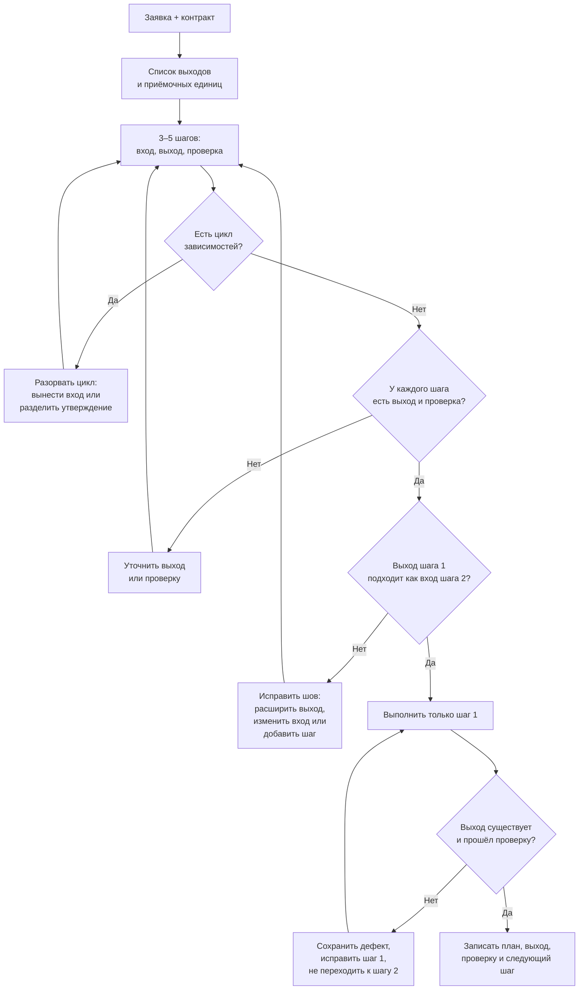
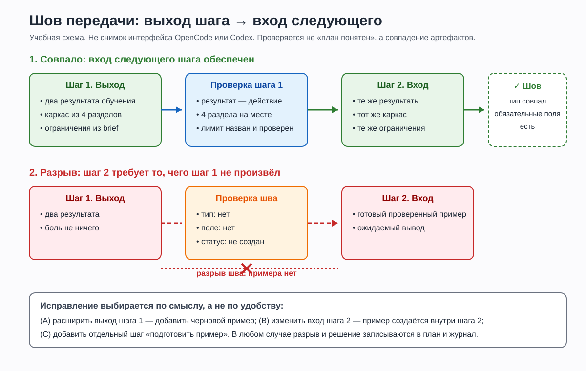

# L07. Декомпозиция

> **Основной учебник занятия.** Прочитайте обязательную часть до практики. Раздел «Углубление» отмечен как необязательный: он не добавляет работы сверх занятия и не нужен для сдачи.

**Статус проверки.** Текст сверен с утверждённой программой, картой занятий, планом L07 и карточкой практики 4 ноября 2026 года. Локально проверены только демонстрационные Python-фрагменты, схема Mermaid, SVG-иллюстрация и локальные ссылки. OpenCode и Codex в ходе подготовки не запускались. Поэтому все описания ответов сред являются учебными примерами, а не результатами реальных запусков. Формат 140 минут объяснения и 75 минут практики остаётся проектным допущением до пилота; расхождение в документах отмечено в разделе 11.4.

<a id="toc"></a>
## Навигация

1. [Зачем этот навык](#why)
2. [Что научимся делать](#outcomes)
3. [Карта занятия](#map)
4. [Основные понятия](#concepts)
5. [Разобранная демонстрация](#demo)
6. [Схемы и иллюстрации](#visuals)
7. [Перед практикой](#before-practice)
8. [Самопроверка](#self-check)
9. [Углубление (необязательно)](#advanced)
10. [Словарь](#glossary)
11. [Источники и статус проверки](#sources)

<a id="why"></a>
## 1. Зачем этот навык

### 1.1. Где вы находитесь в курсе

На L05 вы собрали **контракт задачи** — минимальный набор сведений, без которого результат нельзя проверить: цель, входы, границы и критерии готовности. На L06 вы добавили к контракту **ограничения**, **образцы подачи** и **исполняемый пример**, который подтверждает вывод запуском, а не обещанием.

Теперь представьте, что контракт составлен правильно, но результат слишком велик для одной приёмки. В заявке L07 нужен комплект из двух коротких заданий и способ самопроверки для каждого. Если попросить агента «сделай комплект» и принять ответ целиком, вы сможете сказать только «нравится» или «не нравится». Один удачный текст спрячет отсутствие самопроверки, а хорошее первое задание — ошибку во втором.

**Декомпозиция** решает именно эту проблему: большую задачу разбивают на 3–5 шагов так, чтобы у каждого был вход, выход, проверка и зависимости, а результат каждого шага можно было принять отдельно. Это навык не «управления проектом вообще», а **управления контекстом и приёмкой** в работе с агентом: вы решаете, что агент делает сейчас, что проверяет человек и что передаётся дальше.

В сквозном проекте этот навык понадобится на L14, где вы соберёте краткую спецификацию пилотного урока, на L16, где черновик урока нужно будет разложить на объяснение, пример, упражнение и проверку, на L17, где карта Python-курса делится на модули и уроки, и на L21, где независимое ревью ищет разрывы между частями. Везде вопрос один: **где граница принимаемой части и чем доказано, что она готова**.

### 1.2. Что вы уже умеете

| Предпосылка | Где было | Что именно понадобится |
|---|---|---|
| Собирать контракт из четырёх полей | L05 | Понять, что декомпозируется не «вообще задача», а контракт с критериями |
| Отличать ограничение от образца и примера | L06 | Не превращать шаг в копию образца и не считать «красиво» проверкой |
| Запускать короткий Python-фрагмент | L02 | Проверить пример, если он входит в выход шага |
| Отличать ожидаемый результат от фактического | L03 | Записывать наблюдение, а не желаемое |
| Работать в отдельной копии и читать diff | L01, L04 | Не смешивать снимок с результатом попытки |
| Сравнивать две попытки по одним критериям | L04 | Применить одни критерии к планам и первым выходам в двух средах |

Знать Python глубже L02–L03 не требуется. Декомпозиция — это навык постановки работы; Python нужен только там, где выход шага содержит код или пример.

### 1.3. Какой артефакт вы получите

**Артефакт** — проверяемый результат работы: файл, текст, таблица или журнал. После практики у вас должно быть:

- один сохранённый запрос, в котором агент сначала строит план, а затем выполняет только первый шаг;
- два плана — по одному из OpenCode и Codex, полученные из одного снимка и одного текста запроса;
- первые выходы обеих попыток или явная отметка сбоя;
- таблица зависимостей и проверка швов «выход шага → вход следующего»;
- решение о том, какой план и какой первый выход приняты, с основанием;
- записи в журнале с одинаковыми условиями и отмеченными различиями.

Это не «полный комплект упражнений». Это **план и проверенный первый шаг**, по которым видно, что задачу можно продолжить без устного пересказа.

**Что не входит в занятие:** полный урок Python, автоматические тесты и CI, оценка промптов по рубрике (это L08), работа с недоверенными инструкциями (L12). Сегодня вы тренируете границу шага и передачу результата.

### 1.4. Главная мысль

> **План — это не список дел, а договор о передаче проверяемых артефактов.**

Список «изучить, написать, проверить, оформить» выглядит как план, но не отвечает на главный вопрос: что именно получится на выходе и как это принять. Декомпозиция работает, когда каждый шаг заканчивается артефактом, который можно показать, проверить и передать следующему шагу.

<a id="outcomes"></a>
## 2. Что научимся делать

К концу занятия вы сможете:

| Наблюдаемый результат | Каким действием в практике это проверяется | Каким свидетельством подтверждается |
|---|---|---|
| 1. Разложить заявку на 3–5 шагов с входом, выходом, проверкой и зависимостями | Разобрать `brief.md`, выписать ожидаемые выходы и собрать план в таблицу | Таблица шагов и проверка зависимостей |
| 2. Найти цикл, разрыв шва и непроверяемую формулировку | Пройти по плану, проверить «выход → вход» и «критерий → метод → свидетельство» | Список дефектов с местом в плане и исправленная формулировка |
| 3. Выполнить только первый шаг в обеих средах | Отправить один и тот же запрос в OpenCode и Codex, в свежих сеансах и отдельных копиях | Сохранённый запрос, два плана, два первых выхода или отметки сбоя |
| 4. Принять первый выход по критериям и проверить, что он годится для следующего шага | Сверить выход с планом, заполнить таблицу шва и записать решение в журнал | Таблица «выход → проверка → вход следующего шага», решение и журнал |

Это ориентир, а не новая рубрика. Уровень выполнения определяется по [рубрике модуля](../assessment.md) и критериям [карточки практики](practice_card.md).

<a id="map"></a>
## 3. Карта занятия

### 3.1. О времени

Карта занятий задаёт **140 минут объяснения и демонстрации + 75 минут практики**. В этом учебнике 140 минут собраны как обязательное ядро: каждый блок работает на проверяемый результат L07. Необязательное «Углубление» вынесено отдельно и в 140 минут не входит.

**Примечание о времени.** В `course_lesson_map_L01-L24.md` для L07 указано 140/75, в `agentic_development_course_final.md` — 75/75, а в `lesson_plan.md` заголовок «140 минут», но таблица блоков суммирует 75. Для этого учебника выбрано 140 минут обязательной теории, как требует карта и формат текущего занятия; расхождение и его последствия отмечены в разделе 11.4.

В плане занятия указаны ключевые акценты: вернуться к контракту и показать, что результат слишком велик для одной приёмки; объяснить зависимости, независимые шаги, выход и критерий; прочитать короткий план и найти цикл; провести демонстрацию на другом входе — карточке по приветствиям; обсудить несоответствие первого выхода входу следующего шага и исправить формулировку критерия. Эти акценты сохранены и развёрнуты ниже.

### 3.2. Блоки объяснения и демонстрации

| Минуты | Блок | Что происходит | Зачем |
|---:|---|---|---|
| 0–8 | Вход в занятие | Зачем делить задачу; какой артефакт сдаётся; где граница между «списком дел» и планом | Настроить на проверяемый результат |
| 8–18 | Приёмочная единица | От контракта к выходам; что можно принять отдельно, а что нельзя | Понять, что именно делим |
| 18–32 | Анатомия шага | Вход, действие, выход, проверка, свидетельство, зависимость; наблюдаемая формулировка | Научиться писать шаг, а не активность |
| 32–44 | Зависимости и циклы | Граф, порядок, независимые шаги, цикл; разбор короткого плана с циклом | Увидеть невозможный порядок до выполнения |
| 44–56 | Шов передачи | «Выход шага → вход следующего»; тип, поля, статус; разрыв шва | Не начинать шаг на данных, которых нет |
| 56–66 | Граница шага и новый ввод | Слишком большой и слишком мелкий шаг; 3–5 шагов; когда нужен новый ввод | Найти разумную границу и не дать агенту угадывать |
| 66–75 | Только первый шаг | Первый шаг, стоп-правило, нарушение области | Не принять весь результат вместо проверки плана |
| 75–90 | Матрица следов | Требование → шаг → выход → проверка → свидетельство; пропуски и сироты | Проверить покрытие заявки |
| 90–98 | Две среды | Одинаковые условия, разные планы; что записывать | Сохранить сравнение честным |
| 98–118 | Демонстрация 1 | Бриф карточки по приветствиям; учебный план с разрывом и скрытым циклом; диагностика | Показать дефект до выполнения |
| 118–138 | Демонстрация 2 | Исправление плана, выполнение только шага 1, проверка выхода и шва | Показать полный цикл приёмки |
| 138–140 | Переход к практике | Что открыть, что сохранить, какие свидетельства нужны | Связать теорию с карточкой |
| **140** | **Итого** | **Обязательное ядро** | |

### 3.3. Переход к практике — 75 минут

| Минуты | Шаг | Что сохранить |
|---:|---|---|
| 10 | Разобрать `brief.md` | Список ожидаемых выходов и ограничений |
| 12 | Подготовить запрос | Текст запроса с планом, стоп-правилом и критериями |
| 24 | Две попытки по 12 минут | Планы, первые выходы или признаки сбоя, время, настройки, если видны |
| 19 | Проверить план и первый выход | Таблицу зависимостей, швов и проверок; решение |
| 10 | Заполнить журнал | Ссылки на свидетельства и предел вывода |

Подробное условие, критерии и форма сдачи — в [карточке практики](practice_card.md). Ниже мы не переписываем её, а объясняем, как устроен навык.

<a id="concepts"></a>
## 4. Основные понятия

<a id="concept-unit"></a>
### 4.1. От контракта к приёмочной единице

#### Проблема

Контракт описывает результат целиком: «нужен комплект из двух заданий и способ самопроверки». Такой результат нельзя принять по одному признаку. Если в первом задании нет самопроверки, а второе написано хорошо, общая оценка «вроде нормально» скроет дефект. Агенту тоже трудно работать: он не знает, где остановиться и какую часть отдавать первой.

#### Определение

- **Декомпозиция** — разбиение задачи на шаги, каждый из которых имеет вход, действие, выход, проверку и зависимости, а его результат можно принять отдельно.
- **Приёмочная единица** — минимальный результат, который можно независимо принять или отклонить по наблюдаемому признаку.
- **План** — упорядоченный набор шагов с зависимостями, а не перечень активностей.
- **Выход** — предъявляемый артефакт: файл, раздел, таблица, diff, запись решения. «Понял», «изучил», «улучшил» выходом не являются.

Приёмочная единица определяется **проверкой**, а не файлом. Один файл может содержать несколько единиц (объяснение, пример, задание), и тогда его нельзя принять целиком, пока не проверена каждая часть.

#### Механизм

1. Прочитайте заявку и выпишите **ожидаемые выходы**: что должно появиться в результате.
2. Для каждого выхода спросите: «Можно ли это принять отдельно?» Если нет — разделите.
3. Назовите для каждой единицы **способ проверки**: что смотреть, какой порог, где свидетельство.
4. Сгруппируйте единицы в 3–5 шагов так, чтобы шаг производил законченную единицу или небольшой набор единиц.
5. Упорядочьте шаги по зависимостям (подробнее в 4.3).
6. Отметьте, какие данные нужны для каждого шага и есть ли они во входе.

**Граница применимости:** не каждую мелочь нужно делать отдельным шагом. Если две единицы всегда проверяются вместе и не имеют самостоятельной ценности, их можно объединить. Декомпозиция нужна там, где есть риск спрятать дефект в большом результате.

#### Пример

**Исходные данные:** заявка «нужен мини-справочник о `print`: объяснение, один пример, задание и самопроверка».

| Выход | Приёмочная единица | Как проверить |
|---|---|---|
| Объяснение | 2–3 предложения, объясняющие, что делает `print` | Прочитать: есть определение и один пример |
| Пример | Код и ожидаемый вывод | Запустить и сравнить вывод |
| Задание | Инструкция с одним действием ученика | Найти действие и ожидаемый результат |
| Самопроверка | Вопрос и способ сверить ответ | Ответ выводится из текста, а не угадывается |

**Ожидаемый результат:** четыре единицы, у каждой есть проверка. **Проверка:** если для единицы нельзя назвать, что смотреть и где свидетельство, она ещё не готова к приёмке.

#### В проекте

В практике заявка содержит несколько ожидаемых выходов. Ваша первая задача — не писать задания, а выписать, **что именно** должно появиться и **как** каждое принимается. Удобная заготовка:

```text
## Ожидаемые выходы
- ...

## Приёмочная единица и проверка
| Выход | Что считается готовым | Где свидетельство |
|---|---|---|
```

Этот список станет основой плана и матрицы следов. Он же помогает заметить, что «комплект» — это не один результат, а несколько.

#### Типичная ошибка

| Ошибка | Как заметить | Что исправить |
|---|---|---|
| Считать файл приёмочной единицей | В файле три части, а проверка одна: «файл есть» | Проверять каждую часть отдельно |
| Делить по активности | В плане «изучить», «подумать», «улучшить» без артефакта | Заменить на выход: таблица, текст, diff |
| Принимать комплект целиком | Нельзя сказать, какая часть не прошла | Разбить на единицы и проверять по отдельности |
| Делать единицы слишком мелкими | 10 шагов на форматирование заголовков | Объединить шаги без самостоятельной проверки |

#### Проверка понимания

Файл `card.md` содержит объяснение, пример и задание. Можно ли считать его одной приёмочной единицей? Объясните, что изменится, если пример не запускается, а объяснение хорошее.

**Микроупражнение.** Возьмите заявку «сделай два упражнения и способ самопроверки» и выпишите не менее четырёх ожидаемых выходов. Для каждого назовите одно свидетельство, которое можно сохранить.

<a id="concept-step"></a>
### 4.2. Анатомия шага и наблюдаемая проверка

#### Проблема

Формулировка «написать черновик» описывает активность, а не результат. Когда черновик считается готовым? Когда в нём есть все разделы? Когда он укладывается в лимит? Когда пример запускается? Без ответа агент и человек по-разному понимают «готово», а проверка превращается в общее впечатление.

#### Определение

**Шаг** — ограниченная единица работы, у которой есть:

- **вход** — артефакты и данные, нужные до начала; они должны существовать или быть явно помечены как допущение;
- **действие** — что именно преобразуется; его может выполнять человек или агент;
- **выход** — предъявляемый артефакт;
- **проверка** — метод, порог и свидетельство;
- **зависимость** — шаг, без принятого выхода которого нельзя начинать.

**Наблюдаемая проверка** — проверка, которую другой человек может повторить: он знает, что смотреть, по какому порогу и где лежит свидетельство. «Качественно», «понятно», «хорошо» наблюдаемыми не являются.

#### Механизм

1. Сначала назовите **выход**: что появится на столе.
2. Затем назовите **проверку**: как отличить готовый выход от неготового.
3. Потом **вход**: что нужно, чтобы начать.
4. В конце опишите **действие**: что делать с входом.
5. Проверьте, что выход — существительное (файл, таблица, раздел), а проверка содержит метод и порог.
6. Запишите шаг в таблицу; не начинайте выполнение, пока проверка не сформулирована.

**Граница применимости:** проверка не обязана быть автоматической. Чтение по чек-листу — тоже проверка, если чек-лист наблюдаем и воспроизводим. Но «я посмотрел» без критерия проверкой не является.

#### Пример

**Плохой шаг:**

```text
2. Написать черновик.
Выход: черновик готов.
Проверка: качество текста.
```

**Рабочий шаг:**

```text
2. Написать черновик карточки.
Вход: результаты и каркас из шага 1; brief.md.
Выход: draft.md с четырьмя разделами и одним код-блоком.
Проверка: все четыре раздела на месте; ровно один код-блок;
текст не больше 180 слов без кода (метод: убрать код, посчитать слова);
новые термины объяснены. Свидетельство: файл и вывод подсчёта.
Зависит от: шаг 1.
```

| Что проверяем | Плохая формулировка | Рабочая формулировка |
|---|---|---|
| Выход | «черновик готов» | `draft.md` с четырьмя разделами |
| Проверка | «качество» | 4 раздела, 1 код-блок, ≤180 слов |
| Свидетельство | «я посмотрел» | файл и вывод команды подсчёта |

**Ожидаемый результат:** шаг можно выполнить и проверить, не спрашивая автора, что он имел в виду. **Проверка:** попросите другого человека повторить проверку по вашей записи; если он задаёт вопрос «а что считать разделом?», формулировка неполная.

#### В проекте

В запросе к агенту задайте формат шага. Это не бюрократия: таблица заставляет агента назвать выход и проверку до выполнения.

```text
## Формат шага
| ID | Шаг | Вход | Действие | Выход | Проверка | Зависит от |
```

В практике первый шаг может быть связан с фиксацией ожидаемых результатов и границ. Его выход — не «понимание заявки», а таблица с тем, что будет приниматься и по какому признаку. Такой выход можно показать и передать следующему шагу.

#### Типичная ошибка

| Ошибка | Наблюдаемый признак | Исправление |
|---|---|---|
| Выход — активность | «проанализировать», «изучить», «улучшить» | Заменить на артефакт: таблица, текст, diff |
| Проверка без метода | «проверить качество» | Назвать, что смотреть, чем измерять, где свидетельство |
| Вход — «контекст» | Непонятно, какие файлы нужны | Перечислить конкретные артефакты и источники |
| Проверка после результата | Критерий придуман под уже готовый ответ | Зафиксировать проверку до выполнения |
| Слишком много проверок в одном шаге | Неясно, какая проверка главная | Разделить шаг или указать обязательные и дополнительные проверки |

#### Проверка понимания

Какой из выходов наблюдаем: «понял заявку», «таблица результатов», «улучшил текст»? Для наблюдаемого выхода назовите одну проверку с методом и порогом.

**Микроупражнение.** Перепишите «улучшить объяснение» в шаг с выходом и проверкой. Не пишите сам текст — только шаг.

<a id="concept-deps"></a>
### 4.3. Зависимости, порядок и циклы

#### Проблема

Шаги можно перечислить в удобном порядке, но если шаг B использует выход шага A, начать с B нельзя: придётся или возвращаться, или придумывать данные. Ещё хуже **цикл**: A ждёт B, B ждёт A. План выглядит правдоподобно, но выполнить его невозможно.

#### Определение

- **Граф зависимостей** — шаги как узлы; направленная стрелка A → B означает «B использует принятый выход A».
- **Цикл** — путь по стрелкам, который возвращается в исходный шаг.
- **Независимые шаги** — шаги без стрелки между ними; их можно менять местами, если они используют общий вход.
- **Топологический порядок** — порядок, в котором все зависимости идут раньше зависимых шагов.

Зависимость — это не «мне так удобнее», а **фактическое требование к входу**. Если шаг B не читает выход A, стрелки нет, даже если шаг A стоит первым в списке.

#### Механизм

1. Для каждого шага выпишите: «вход: артефакт X из шага N».
2. Нарисуйте стрелки от N к текущему шагу.
3. Пройдите по стрелкам и найдите возврат в уже посещённый шаг — это цикл.
4. Начните с шагов, у которых нет неудовлетворённых зависимостей.
5. Отметьте независимые шаги: их порядок можно менять; зависимые — нельзя.
6. Запишите выбранный порядок и основание; альтернативный порядок допустим, если зависимости соблюдены.

**Граница применимости:** граф не обязан быть красивым. Для 3–5 шагов достаточно таблицы «зависит от». Если шагов больше, таблица всё равно полезнее рисунка: её можно проверить.

#### Пример

**Короткий план с циклом:**

| Шаг | Вход | Выход |
|---|---|---|
| A. Собрать примеры | Утверждённые критерии | Список примеров |
| B. Проверить примеры | Список примеров | Отчёт проверки |
| C. Утвердить критерии | Отчёт проверки | Утверждённые критерии |

Стрелки: C → A → B → C. Критерии нужны до сборки примеров, но утверждаются после проверки. Это цикл.

**Как разорвать:**

| Шаг | Вход | Выход |
|---|---|---|
| A. Взять черновые критерии из brief | brief | Черновые критерии |
| B. Собрать примеры | Черновые критерии | Список примеров |
| C. Проверить примеры | Список примеров, черновые критерии | Отчёт проверки |
| D. Уточнить критерии | Отчёт проверки | Решение об уточнении |

Теперь нет возврата: черновые критерии берутся из входа, а уточнение — отдельный шаг после проверки. Если уточнение меняет критерии, это **новая итерация**, а не цикл внутри одного плана.

**Ожидаемый результат:** порядок выполним. **Проверка:** пройдите по стрелкам; ни одна не возвращает назад.

#### В проекте

В запросе полезно прямо разрешить остановку при цикле:

```text
- Перечисли зависимости в виде «шаг → шаг».
- Если возникает цикл, не выполняй план: назови шаги цикла и предложи,
  как его разорвать (вынести вход, разделить утверждение и черновик).
```

В практике вы можете получить план, где шаг «проверить» одновременно является входом шага «написать». Это не обязательно ошибка агента: возможно, вы сами неверно сформулировали вход. Исправляйте формулировку, а не маскируйте цикл дополнительным «согласованием».

#### Типичная ошибка

| Ошибка | Наблюдаемый признак | Исправление |
|---|---|---|
| Скрытая зависимость | Шаг 2 использует пример, которого ещё нет | Добавить производство примера в шаг 1 или отдельный шаг |
| Цикл через согласование | «Утвердить» требует результата шага, который ждёт утверждения | Разделить черновик и утверждение; взять вход из brief |
| Порядок по удобству | Шаги идут так, как проще рассказывать | Упорядочить по входам, а не по привычке |
| Лишняя последовательность | Независимые шаги выстроены в цепочку без причины | Разрешить менять местами; записать, что не зависит |

#### Проверка понимания

В плане A → B → C → A. Можно ли его выполнить? Назовите шаг, с которого начнётся разрыв цикла, и объясните, какой вход вы вынесете из brief.

**Микроупражнение.** Возьмите три шага из своего будущего плана и выпишите для каждого «зависит от». Если получилась стрелка назад, предложите одно исправление.

<a id="concept-handoff"></a>
### 4.4. Шов передачи: выход одного = вход следующего

#### Проблема

Даже правильный порядок не гарантирует, что выход шага A подходит шагу B. A может выдать «два результата обучения», а B ждать «готовый проверенный пример». Формально шаги стоят по порядку, фактически B не может начать. Это **разрыв шва** — самая частая ошибка декомпозиции.

#### Определение

- **Шов передачи** — граница, на которой выход одного шага становится входом следующего.
- **Контракт шва** — что именно передаётся: тип артефакта, обязательные поля, формат, статус проверки.
- **Разрыв шва** — выход A не содержит того, что требует вход B, или содержит в другом виде/статусе.

Шов проверяется не вопросом «план понятен?», а сравнением двух списков: **что A произвёл** и **что B требует**.

#### Механизм

1. Для каждой стрелки A → B выпишите вход B как чек-лист: тип, поля, формат, статус.
2. Выпишите выход A теми же словами.
3. Сравните: каждый пункт входа B должен иметь источник в выходе A или в общем входе (например, `brief.md`).
4. Если пункта нет — выберите: расширить выход A, изменить вход B или добавить отдельный шаг.
5. Проверьте, что проверка A действительно подтверждает нужные B поля, а не только «файл существует».
6. Запишите решение о шве в план и журнал.

**Граница применимости:** не каждый вход B обязан приходить из A. B может читать `brief.md` напрямую. Важно, чтобы источник был назван и не был выдуман.

#### Пример

**Выход A:** «два результата обучения».
**Вход B:** «готовый проверенный пример с ожидаемым выводом».

| Пункт входа B | Есть в выходе A? | Статус |
|---|---|---|
| Готовый пример | Нет | Разрыв |
| Ожидаемый вывод | Нет | Разрыв |
| Два результата | Да | Есть |

**Что делать:**

- **(A)** расширить выход шага 1: добавить черновой пример и ожидаемый вывод;
- **(B)** изменить вход шага 2: пример создаётся внутри шага 2, а проверяется шагом 3;
- **(C)** добавить отдельный шаг «подготовить пример» между 1 и 2.

В демонстрации выбран вариант B: он не раздувает первый шаг и сохраняет отдельную проверку примера. Это решение примера, а не обязательный ответ практики.

**Ожидаемый результат:** каждый пункт входа B имеет названный источник. **Проверка:** если убрать устное пояснение, сможет ли следующий исполнитель начать работу только по артефактам?

#### В проекте

В практике критерий приёмки прямо требует, чтобы первый выход **действительно использовался дальше**. Заполните таблицу:

```text
| Вход следующего шага | Где он в первом выходе | Статус |
|---|---|---|
```

Если вы пишете «понятно из плана», это не свидетельство. Нужна ссылка на конкретный раздел, файл или строку.

#### Типичная ошибка

| Ошибка | Наблюдаемый признак | Исправление |
|---|---|---|
| Считать «план» достаточным входом | Следующий шаг просит данные, которых нет | Выписать вход и сравнить с выходом |
| Путать тип артефакта | A даёт список, B ждёт таблицу с колонками | Привести к одному формату или добавить преобразование |
| Использовать непроверенный выход | B начинает работу до проверки A | Сначала принять A, затем передавать |
| Проверка «файл существует» | Файл есть, но нужных полей нет | Проверять содержимое и обязательные поля |
| Разрыв маскируют устным пояснением | «Там всё понятно» | Записать источник в план; проверить без пересказа |

#### Проверка понимания

Шаг 1 выдаёт «список требований», шаг 2 ждёт «таблицу требований с приоритетами». Это разрыв? Назовите два способа исправить.

**Микроупражнение.** Возьмите два соседних шага своего плана и выпишите вход второго. Подчеркните пункты, которых нет в выходе первого.

<a id="concept-boundary"></a>
### 4.5. Граница шага: 3–5 шагов и когда нужен новый ввод

#### Проблема

Слишком большой шаг невозможно принять по частям: дефект в примере спрятан за хорошим объяснением. Слишком мелкий шаг создаёт много согласований и не даёт полезного выхода: «создать папку», «открыть файл», «поставить заголовок». Нужна граница, на которой выход имеет самостоятельную ценность.

Кроме того, в ходе работы может выясниться, что для шага нужно решение, которого нет во входе: какое имя взять для примера, какой формат считать обязательным, можно ли менять шаблон. Если агент не остановится, он придумает ответ и скроет пробел.

#### Определение

- **Граница шага** — точка, где выход можно принять независимо и передать дальше.
- **Слишком большой шаг** — шаг с несколькими выходами или проверками, которые принимаются по-разному.
- **Слишком мелкий шаг** — шаг без самостоятельного выхода или проверки.
- **Новый ввод** — данные или решение, которых нет в brief или в принятом выходе предыдущего шага.
- **Стоп-правило** — не выполнять следующий шаг и не придумывать недостающие данные, пока текущий шаг не принят или пробел не назван.

#### Механизм

1. Проверьте шаг вопросом: «Какой один выход и какая одна главная проверка?»
2. Если проверок две и они независимы — разделите шаг.
3. Если выхода нет или он не имеет ценности — объедините шаг с соседним.
4. Для задач курса ориентируйтесь на 3–5 шагов; больше — только с объяснением, зачем.
5. Для каждого шага отметьте: «нужен новый ввод?». Если да — источник, владелец, срок.
6. Если новый ввод обнаружился во время выполнения, остановитесь, запишите пробел и варианты; не расширяйте область молча.

**Граница применимости:** 3–5 шагов — проектное допущение курса, а не универсальный закон. Для очень маленькой задачи достаточно двух шагов; для большой может понадобиться больше, но тогда её лучше разбить на подзадачи.

#### Пример

| Тип | Формулировка | Почему плохо/хорошо |
|---|---|---|
| Слишком большой | «Сделать карточку: объяснение, пример, задание, самопроверка» | Нельзя принять части; дефект примера спрятан |
| Слишком мелкий | «Создать папку», «открыть файл», «написать заголовок» | Нет содержательной проверки; много координации |
| Рабочая граница | «Зафиксировать результаты и каркас карточки» | Есть выход (таблица), проверка (разделы и ограничения), следующий шаг может начать |
| Рабочая граница | «Проверить пример и самопроверку» | Есть вход (черновик), выход (отчёт), проверка (запуск и ответ) |

**Пример нового ввода.** Шаг 2 требует имя для примера, но в brief сказано только «используйте имя ученика». Это не дефект плана, а **пробел во входе**. Сообщение:

```text
Не могу выполнить шаг 2: в brief.md не задано имя для примера.
Это влияет на код и ожидаемый вывод.
Варианты: (A) вы задаёте имя; (B) я использую нейтральное «Аня»
как явно помеченное допущение.
До ответа я не добавляю имя сам.
```

**Ожидаемый результат:** граница найдена, пробел назван. **Проверка:** можно ли принять выход шага, не глядя на следующие шаги? Если да, граница работает.

#### В проекте

В плане полезно иметь колонку «новый ввод». Она показывает, где закончится автоматическая работа и понадобится решение человека. Это не признак слабого плана; это признак честного плана.

```text
| Шаг | Выход | Проверка | Зависит от | Новый ввод |
```

Если новый ввод нужен, но его нет, не позволяйте агенту «взять правдоподобное значение». Запишите пробел и варианты; это позволит продолжить без скрытой ошибки.

#### Типичная ошибка

| Ошибка | Наблюдаемый признак | Исправление |
|---|---|---|
| Делить по файлам, а не по приёмке | Один файл — один шаг, но внутри три непроверенные части | Делить по проверяемым выходам |
| Дробить форматирование | Много шагов без содержательной проверки | Объединить в шаг упаковки |
| Игнорировать новый ввод | Агент взял имя/формат «из головы» | Остановиться, назвать пробел и варианты |
| Добавлять требования по ходу | План не меняется, а работа растёт | Обновить план или записать изменение области |
| Считать 3–5 обязательными всегда | Искусственное укрупнение или дробление | Объяснить, почему для задачи нужно иное число |

#### Проверка понимания

Шаг 2 требует имя, которого нет в brief. Это дефект плана или новый ввод? Что вы напишете агенту: «придумай имя» или «остановись и назови пробел»? Почему?

**Микроупражнение.** Возьмите свой план и отметьте шаги, где нужен новый ввод. Для одного из них сформулируйте сообщение о пробеле в двух предложениях.

<a id="concept-first"></a>
### 4.6. Выполнить только первый шаг

#### Проблема

Агент часто стремится выполнить всю задачу: вы просите план и первый шаг, а получаете готовый комплект. Это выглядит полезно, но ломает проверку: вы не увидели, как план проверялся, и не приняли первый выход до того, как на нём построили остальные. Если первый шаг ошибочен, ошибка разошлась по всему результату.

#### Определение

- **Первый шаг** — шаг, который производит первый многократно используемый артефакт и снижает неопределённость; не обязательно самый лёгкий.
- **Стоп-правило** — явное указание агенту остановиться после шага 1 и не выполнять шаги 2–N.
- **Нарушение области** — агент сделал больше, чем разрешено запросом.
- **Первый выход** — фактический артефакт шага 1, а не обещание «план готов».

#### Механизм

1. Выберите первый шаг, выход которого нужен следующим шагам. Если можно начать с шага, который никому не нужен, это плохой первый шаг.
2. В запросе разделите «сначала план» и «затем только шаг 1».
3. Задайте формат выхода и место: текст в ответе или файл вне снимка.
4. После ответа отделите план от выполнения: проверяйте только шаг 1.
5. Если агент выполнил лишнее, сохраните ответ, отметьте нарушение области и не считайте шаги 2–N принятыми.
6. Если шаг 1 не прошёл проверку, исправьте его и повторите; не переходите к шагу 2.

**Граница применимости:** если шаг 1 — это только план, а не артефакт, он не считается выполнением. План — вход в работу, а не её результат.

#### Пример

**Фрагмент запроса:**

```text
Сначала верни план из 3–5 шагов.
Затем выполни только шаг 1 и остановись.
Не выполняй шаги 2–N, даже если у тебя есть готовый ответ.
Верни план и результат шага 1 отдельными разделами.
```

**Учебный ответ агента (не результат реального запуска):**

```text
## План
1. Зафиксировать результаты и каркас.
2. Написать черновик.
3. Проверить пример.
4. Упаковать.

## Шаг 1
| Что | Содержание |
|---|---|
| Результат 1 | Ученик объясняет, что делает print |
| Результат 2 | Ученик предсказывает вывод и сверяет с запуском |
| Каркас | 1. Объяснение. 2. Пример. 3. Задание. 4. Самопроверка |
| Ограничения | ≤180 слов; один пример; снимок не менять |
```

**Проверка:**

| Вопрос | Наблюдение | Статус |
|---|---|---|
| Выход шага 1 существует? | Есть таблица, а не обещание | Да |
| Соответствует плану? | Два результата, каркас, ограничения | Да |
| Шаги 2–4 не выполнены? | Нет черновика и файла карточки | Да |
| Выход достаточен для шага 2? | Шаг 2 просит эти данные | Да |

**Ожидаемый результат:** принят только шаг 1. **Проверка:** если в ответе появился готовый черновик, это нарушение области, а не дополнительная ценность.

#### В проекте

В практике один и тот же запрос отправляется в обе среды. Если одна среда выполнила только шаг 1, а другая — весь комплект, это различие наблюдений, а не доказательство превосходства. Запишите его в журнал и проверяйте по одним критериям.

#### Типичная ошибка

| Ошибка | Наблюдаемый признак | Исправление |
|---|---|---|
| Принять полный результат | В ответе есть шаги 2–N | Сохранить, отметить нарушение, не считать их принятыми |
| Считать план выполнением | Выход шага 1 — только список шагов | Потребовать артефакт шага 1 |
| Проверять финальный результат вместо первого шага | Ошибка плана видна только в конце | Проверить шаг 1 до продолжения |
| Ослабить стоп-правило | «Сделай хотя бы первый шаг, а дальше как получится» | Явно запретить шаги 2–N |
| Не сохранить исходный ответ | После правки нельзя доказать, что было | Сохранить ответ до ручной коррекции |

#### Проверка понимания

Агент вернул готовый комплект, хотя вы просили только шаг 1. Что вы сохраните, что примете и что запишете в журнал?

**Микроупражнение.** Сформулируйте стоп-правило одним предложением так, чтобы его нельзя было прочитать как «сделай всё, если легко».

<a id="concept-matrix"></a>
### 4.7. Матрица следов: покрытие заявки

#### Проблема

План может выглядеть логично, но не покрывать обязательное требование. Например, в заявке есть «способ самопроверки», а в плане — только объяснение, пример и задание. Или наоборот: в плане есть шаг, который ничего не даёт заявке. Без матрицы это замечают только на финальной проверке.

#### Определение

- **Матрица следов** (трассируемость) — таблица «требование → шаг → выход → проверка → свидетельство».
- **Покрытие** — у каждого обязательного требования есть хотя бы одна строка.
- **Сирота** — шаг или выход, не связанный ни с одним требованием; возможно, лишняя работа.
- **Дублирование** — два шага производят один и тот же выход; нужно объединить или различить.

#### Механизм

1. Пронумеруйте обязательные требования из brief.
2. Для каждого найдите шаг, выход и проверку.
3. Поставьте статус: «покрыто», «не покрыто», «неясно».
4. Проверьте, нет ли шагов-сирот; если есть — объясните или уберите.
5. Проверьте дублирование выходов.
6. Убедитесь, что у каждой проверки есть свидетельство.
7. Повторите матрицу после первого шага: план мог измениться.

**Граница применимости:** матрица не заменяет проверку качества. Она отвечает только на вопрос «ничего не забыли и не добавили лишнего». Качество текста, примера и упражнения проверяется отдельно.

#### Пример

**Заявка:** объяснение, один пример, одно задание, способ самопроверки.

**План без самопроверки:**

| Требование | Шаг | Выход | Проверка | Статус |
|---|---|---|---|---|
| Объяснение | 1 | Раздел текста | 2–3 предложения | Покрыто |
| Пример | 2 | Код и вывод | Запуск | Покрыто |
| Задание | 3 | Инструкция | Есть действие | Покрыто |
| Самопроверка | — | — | — | **Не покрыто** |

**Что делать:** добавить шаг 4 «собрать самопроверку» с выходом «вопрос и способ сверки» и проверкой «ответ выводится из текста». Либо, если самопроверка не обязательна, изменить заявку и записать это решение. Молча игнорировать требование нельзя.

**Ожидаемый результат:** все обязательные требования имеют строку. **Проверка:** посчитайте требования и строки со статусом «покрыто»; числа должны совпасть.

#### В проекте

В практике матрица помогает проверить, что первый выход не «закрывает» все требования, а **обеспечивает следующий шаг**. Это разные вещи. В матрице плана у требования может стоять шаг 2, а в проверке первого выхода — только те поля, которые нужны шагу 2.

#### Типичная ошибка

| Ошибка | Наблюдаемый признак | Исправление |
|---|---|---|
| Матрица заполнена после выполнения | Критерии подогнаны под готовый результат | Заполнить до первой попытки |
| Покрытие только по названию | «Объяснение» есть, но без проверки | Указать выход и проверку |
| Шаги-сироты | Шаг не связан ни с одним требованием | Убрать или объяснить |
| Дублирование | Два шага пишут один и тот же текст | Объединить или различить назначение |
| Матрица без свидетельств | Статус «покрыто», но негде проверить | Добавить ссылку на файл/строку/вывод |

#### Проверка понимания

В матрице у требования «самопроверка» нет строки. Что вы сделаете: добавите шаг или измените заявку? От чего зависит решение?

**Микроупражнение.** Возьмите три требования из `brief.md` и заполните для них матрицу. Найдите хотя бы одно требование, которое в вашем плане пока не покрыто.

<a id="concept-env"></a>
### 4.8. Две среды: одинаковые условия, разные планы

#### Проблема

Планы OpenCode и Codex могут отличаться порядком шагов, формулировками и даже числом шагов. Если вы отправите разные запросы или начнёте вторую попытку в том же сеансе, различие нельзя объяснить средой: возможно, дело в условиях. Один запуск также не даёт права на общий вывод «этот инструмент лучше».

#### Определение

**Честное сравнение** — две попытки, в которых одинаковы снимок, текст запроса, критерии, лимит времени, свежесть сеанса и порядок, а различается только среда. Все остальные различия записываются как различия условий.

#### Механизм

| Что удерживать | Как проверить |
|---|---|
| Снимок и его идентификатор | Коммит или выданная копия; список файлов |
| Текст запроса | Дословно один и тот же в обеих средах |
| Критерии | Один список до первой попытки |
| Лимит времени | Одинаковый, например 12 минут на попытку |
| Свежий сеанс | Новый диалог без контекста предыдущей попытки |
| Отдельная копия | Не работать в одном рабочем каталоге |
| Порядок | Записан до старта |

**Что может различаться и должно быть записано:** интерфейс, режим разрешений, модель и настройки (если видны), время ответа, формат вывода, отказ или тайм-аут, доступ к файлам, число шагов и порядок в плане.

**Граница применимости:** сравнение двух планов не устанавливает превосходство продукта. Оно фиксирует наблюдение в данных условиях.

#### Пример

Учебная таблица для заполнения на занятии (фактических данных здесь нет):

| Критерий | Одинаковая проверка | OpenCode | Codex |
|---|---|---|---|
| 3–5 шагов | Посчитать шаги | Заполнить | Заполнить |
| У каждого шага есть вход/выход/проверка | Пройти по таблице | Заполнить | Заполнить |
| Нет циклов | Пройти по зависимостям | Заполнить | Заполнить |
| Первый выход существует | Предъявить артефакт | Заполнить | Заполнить |
| Первый выход соответствует плану | Сравнить с таблицей | Заполнить | Заполнить |
| Выход достаточен для шага 2 | Проверить шов | Заполнить | Заполнить |
| Шаги 2–N не выполнены | Проверить отсутствие артефактов | Заполнить | Заполнить |
| Снимок не изменён | diff или хеши | Заполнить | Заполнить |

**Ожидаемый результат:** обе записи заполнены фактами; недоступные поля помечены «недоступно». **Проверка:** можно ли по журналу восстановить, что было одинаковым, а что различалось.

#### В проекте

Для L07 действует [протокол сравнения](../shared/comparison_protocol.md): один снимок, один запрос, свежий сеанс, отдельная копия. Запись ведётся в [форме журнала](../shared/run_journal.md). Если среда недоступна, используйте сохранённый пример преподавателя только с явной пометкой; это не засчитывается как проведённый запуск.

#### Типичная ошибка

| Ошибка | Наблюдаемый признак | Исправление |
|---|---|---|
| Разные тексты запроса | В журнале две разные формулировки | Использовать один сохранённый текст |
| Один сеанс на две попытки | Контекст первой попытки влияет на вторую | Начать новый сеанс |
| Одна рабочая копия | Вторая попытка видит изменения первой | Сделать отдельные копии |
| Разное время | Одна попытка 12 минут, другая 30 | Записать отклонение или повторить |
| Вывод «кто лучше» по одному запуску | Нет данных о модели и условиях | Ограничить вывод наблюдением |
| Разный порядок считают ошибкой | Планы отличаются порядком, но зависимости соблюдены | Проверить критерии, а не совпадение текста |

#### Проверка понимания

Два плана отличаются порядком независимых шагов. Один из них неверен? Что нужно проверить, чтобы ответить?

**Микроупражнение.** Назовите три условия, которые вы удержите одинаковыми, и одно различие, которое запишете. Если вы называете «модель» среди одинаковых, проверьте, видна ли она вам.

<a id="demo"></a>
## 5. Разобранная демонстрация

### 5.1. Что демонстрируем

Демонстрация показывает полный цикл:

```text
заявка → ожидаемые выходы → план → проверка плана →
исправление → выполнение только шага 1 → проверка выхода →
проверка шва → решение → журнал
```

Это **не** оцениваемая практика. Демонстрационный снимок — карточка по приветствиям; в практике будет комплект упражнений о строковых переменных. Совпадает только тренируемый приём: разложить заявку на шаги, проверить швы и выполнить первый шаг. Демонстрационные файлы приведены ниже в тексте; это учебная реконструкция, а не папка внутри `snapshot/`.

```text
demo_order/
├── input/
│   └── brief.md
├── prompt.md
├── response_plan_bad.md
├── plan_fixed.md
├── first_step.md
├── verification.md
├── demo_order.py
└── demo_order_reversed.py
```

| Шаг | Человек | Агент |
|---:|---|---|
| 1. Постановка | Читает бриф, выписывает выходы и ограничения, собирает запрос | Не участвует |
| 2. План | Проверяет план на циклы, разрывы и проверяемость | Предлагает 3–5 шагов |
| 3. Первый шаг | Разрешает выполнить только шаг 1 | Выполняет шаг 1 и останавливается |
| 4. Проверка | Сверяет выход с планом, проверяет шов и свидетельства | Не участвует: «готово» агента не является приёмкой |
| 5. Решение | Принимает, возвращает на исправление или фиксирует пробел | Получает новую попытку, если человек решил её сделать |

### 5.2. Вход демонстрации

`demo_order/input/brief.md`:

```text
# Демонстрационный бриф: карточка «Приветствие»

Аудитория: новичок, который знает print, но ещё не разбирал
порядок команд.

Нужна одна карточка:
- объяснение в 2–3 предложениях, почему строки появляются
  в заданном порядке;
- один исполняемый пример с двумя вызовами print;
- одно задание: предсказать порядок двух строк;
- способ самопроверки.

Объём — до 180 слов без учёта кода. Один пример.
Файлы снимка не менять.
Сегодня сдаём только план и результат первого шага.
```

**Ограничения:** один пример, ≤180 слов без кода, снимок только для чтения, сегодня только план и шаг 1. **Свободные решения:** точные формулировки и имена внутри карточки; их нужно либо взять из брифа, либо отметить как новый ввод.

### 5.3. Запрос

```text
## Цель

Разложи заявку на 3–5 шагов. Для каждого шага укажи вход, действие,
выход, проверку и зависимости. Затем выполни только шаг 1 и остановись.
Верни план и результат шага 1 отдельными разделами.

## Входы

- brief.md — заявка и ограничения. Только чтение.
Другие файлы не используй.

## Формат шага

| ID | Шаг | Вход | Действие | Выход | Проверка | Зависит от | Новый ввод |

## Границы

- 3–5 шагов, без циклов.
- Выход — артефакт, который можно предъявить, а не «понимание».
- Проверка — метод, порог и свидетельство.
- Выполни только шаг 1. Не выполняй шаги 2–N.
- Не изменяй brief.md. Результат шага 1 верни текстом.
- Если для шага 1 не хватает данных, остановись и назови пробел.

## Критерии готовности

1. В плане 3–5 шагов.
2. У каждого шага есть вход, выход, проверка и зависимость.
3. Нет циклов.
4. Выход шага 1 существует и совпадает с планом.
5. Выход шага 1 достаточен как вход шага 2.
6. Шаги 2–N не выполнены.
7. brief.md не изменён.
```

**Проверка запроса до отправки:**

| Поле | Вопрос | Ответ |
|---|---|---|
| Цель | Что получится? | План и только первый шаг |
| Входы | На что опираться? | `brief.md`, только чтение |
| Границы | Что нельзя? | Выполнять шаги 2–N, менять снимок, придумывать данные |
| Критерии | Когда готово? | Семь проверяемых пунктов |
| Согласованность | Нет ли конфликта? | «План + шаг 1» и «не менять файлы» совместимы, если выход шага 1 — текст |

### 5.4. Учебный ответ агента с дефектом

> **Учебный пример, не результат реального запуска OpenCode или Codex.** План составлен для разбора; он не подтверждает поведение конкретной версии инструмента.

```text
| ID | Шаг | Вход | Действие | Выход | Проверка | Зависит от | Новый ввод |
| 1 | Определить результаты | brief.md | Выписать результаты | два результата | результаты названы | — | не указан |
| 2 | Написать черновик | готовый проверенный пример | Написать текст | draft.md | черновик готов | 1 | не указан |
| 3 | Проверить пример | draft.md | Запустить код | отчёт | вывод совпал | 2 | не указан |
| 4 | Упаковать | проверенный черновик | Собрать файл | card.md | файл существует | 3 | не указан |
```

Ответ выглядит аккуратно: четыре шага, зависимости, выходы. Именно поэтому его полезно разбирать: **правдоподобный план не равен выполнимому плану**.

### 5.5. Проверка плана и диагноз

| № | Что проверяем | Наблюдение | Статус |
|---:|---|---|---|
| 1 | 3–5 шагов | Четыре шага | Да |
| 2 | У каждого шага есть вход/выход/проверка | Поля заполнены | Да, но проверки слабые |
| 3 | Нет циклов | Шаг 1 → 2 → 3 → 4 | Формально да |
| 4 | Шов «выход 1 → вход 2» | Шаг 1 даёт два результата; шаг 2 требует готовый проверенный пример | **Нет** |
| 5 | Проверка шага 1 наблюдаема | «Результаты названы» — без метода и порога | **Нет** |
| 6 | Проверка шага 2 наблюдаема | «Черновик готов» — без полей и лимита | **Нет** |
| 7 | Проверка шага 4 наблюдаема | «Файл существует» не проверяет содержание | **Нет** |
| 8 | Новый ввод отмечен | Колонка есть, но везде «не указан» | **Нет** |

**Диагноз 1: разрыв шва.** Выход шага 1 не содержит «готовый проверенный пример», который требует вход шага 2.

**Диагноз 2: скрытый цикл.** Если читать вход шага 2 буквально, шаг 2 ждёт результат шага 3 («проверенный пример»), а шаг 3 ждёт результат шага 2 (`draft.md`). Получается 2 → 3 → 2. Формально список выглядит линейным, фактически план невыполним.

**Диагноз 3: проверки не наблюдаемы.** «Результаты названы», «черновик готов» и «файл существует» не говорят, что смотреть и где свидетельство. Такой план нельзя принять по критериям.

**Что делать:** не выполнять шаг 2, пока не исправлен план. Исправление должно разорвать скрытый цикл и сделать проверки наблюдаемыми.

### 5.6. Исправление плана

**Что меняем на доске:**

| Было | Стало | Причина |
|---|---|---|
| Шаг 2: вход «готовый проверенный пример» | Шаг 2: вход «выход шага 1 + brief» | Пример создаётся в шаге 2, а проверяется в шаге 3 |
| Шаг 1: проверка «результаты названы» | Каждый результат — наблюдаемое действие; каркас из 4 разделов; ограничения совпадают с brief | Проверка должна иметь метод и порог |
| Шаг 2: проверка «черновик готов» | 4 раздела; 1 код-блок; ≤180 слов; термины объяснены | «Готов» не наблюдаемо |
| Шаг 4: проверка «файл существует» | 4 раздела; ссылка на проверку; снимок не изменён | Существование файла не доказывает содержание |

**Исправленный план:**

| ID | Шаг | Вход | Действие | Выход | Проверка | Зависит от | Новый ввод |
|---:|---|---|---|---|---|---|---|
| 1 | Зафиксировать результаты и каркас | `brief.md` | Выписать результаты и каркас | Таблица: 2 результата, 4 раздела, ограничения | Каждый результат — наблюдаемое действие; 4 раздела; ограничения совпадают с brief | — | Нет |
| 2 | Написать черновик | Выход 1 + `brief.md` | Написать текст и пример | `draft.md`: объяснение, 1 код-блок, задание, самопроверка | 4 раздела; 1 код-блок; ≤180 слов; термины объяснены | 1 | Нет |
| 3 | Проверить пример и самопроверку | `draft.md` | Запустить пример, сверить ответ | `verification.md`: команда, ожидаемый и фактический вывод, статус; ответ на вопрос | Вывод совпал; вопрос отвечается по тексту | 2 | Нет |
| 4 | Упаковать | `draft.md` + `verification.md` | Собрать файл и manifest | `card.md` + короткий manifest | 4 раздела; ссылка на проверку; снимок не изменён | 3 | Нет |

**Проверка шва после исправления:**

| Вход шага 2 | Есть в выходе шага 1? | Где |
|---|---|---|
| Два результата | Да | Таблица, п. 1–2 |
| Каркас из 4 разделов | Да | Таблица, п. 1–4 |
| Ограничения | Да | Таблица, ограничения |
| `brief.md` | Да | Исходный файл, только чтение |

**Ожидаемый результат:** цикл разорван, у шага 2 есть выполнимый вход. **Проверка:** пройти по стрелкам 1 → 2 → 3 → 4; ни одна не возвращает назад.

### 5.7. Выполнение только первого шага

> **Учебный пример, не результат реального запуска OpenCode или Codex.**

```text
## Шаг 1. Результаты и каркас

Результаты обучения:
1. Ученик объясняет, что каждый print выводит свою строку и порядок строк
   совпадает с порядком команд.
2. Ученик предсказывает, какая строка появится первой и второй, и сверяет
   предсказание с запуском.

Каркас карточки:
1. Объяснение — 2–3 предложения о порядке выполнения.
2. Один пример — два вызова print и ожидаемый вывод.
3. Задание — предсказать порядок двух строк.
4. Самопроверка — вопрос и способ сверить ответ.

Ограничения:
- до 180 слов без кода;
- один исполняемый пример;
- brief.md не изменять.
```

**Проверка первого выхода:**

| Что проверить | Наблюдение | Статус |
|---|---|---|
| Два результата | Пункты 1–2 | Да |
| Каждый результат — действие ученика | «объясняет», «предсказывает», «сверяет» | Да |
| Каркас из четырёх разделов | Пункты 1–4 | Да |
| Ограничения | Три пункта | Да |
| Выход достаточен для шага 2 | Шаг 2 просит результаты, каркас и ограничения; все есть | Да |
| Шаг 2 не выполнен | Нет `draft.md` и `card.md` | Да |
| `brief.md` не изменён | Нужно проверить diff или хеш | **Нет данных** |

**Проверка шва:**

| Вход шага 2 | Источник | Статус |
|---|---|---|
| Два результата | Выход шага 1, п. 1–2 | Да |
| Каркас четырёх разделов | Выход шага 1, п. 1–4 | Да |
| Ограничения | Выход шага 1 | Да |
| `brief.md` | Исходный файл | Да |

**Решение демонстрации:** шаг 1 принят; шаг 2 не начат. Это решение примера, а не обязательный ответ практики.

**Проверка примера запуском.** Демонстрационный код:

```python
print("Привет!")
print("Как дела?")
```

Ожидаемый вывод:

```text
Привет!
Как дела?
```

Второй фрагмент — те же команды в обратном порядке:

```python
print("Как дела?")
print("Привет!")
```

Ожидаемый вывод:

```text
Как дела?
Привет!
```

Фактический запуск 4 ноября 2026 года дал именно эти строки; команда и версия Python указаны в разделе 11.3. Это проверка демонстрационного фрагмента, а не запуск OpenCode или Codex.

### 5.8. Если проверка выявила дефект

| Ситуация | Признак | Действие |
|---|---|---|
| В первом выходе только один результат | Второй результат отсутствует | Вернуться к шагу 1; не начинать шаг 2 |
| Нет каркаса разделов | Шаг 2 не знает, что писать | Добавить каркас в выход шага 1 или изменить вход шага 2 |
| Агент выполнил шаги 2–4 | Появились `draft.md` или `card.md` | Сохранить ответ, отметить нарушение области, не принимать лишнее |
| Первый выход — обещание | «План готов», но таблицы нет | Считать шаг невыполненным; потребовать артефакт |
| В плане 6 шагов | Больше 3–5 | Объединить шаги или обосновать исключение |
| Найден цикл | Стрелки возвращают назад | Остановиться, разорвать цикл, переписать план |
| Снимок изменён | Появились новые файлы или diff | Восстановить снимок, записать инцидент, повторить |
| Среда недоступна | Тайм-аут или отказ | Сохранить запись, отметить «недоступно», не выдавать за запуск |

**Правило:** сначала сохраните исходное свидетельство, потом исправляйте. Если исправление меняет смысл задачи, это не локальная правка, а новая попытка.

### 5.9. Сравнение сред без выдуманных результатов

В демонстрации для сравнения предусмотрены один и тот же снимок, одна и та же заявка и один и тот же текст запроса в обеих средах. Критерии тоже одинаковые. Фактические ответы в этом учебнике не приводятся: в ходе подготовки запуски OpenCode и Codex не выполнялись. На занятии вы заполняете таблицу по своим наблюдениям.

| № | Критерий | Одинаковая проверка в обеих средах |
|---:|---|---|
| 1 | 3–5 шагов | Посчитать шаги |
| 2 | У каждого шага есть вход, действие, выход, проверка, зависимость | Пройти по таблице |
| 3 | Нет циклов | Пройти по стрелкам |
| 4 | Первый выход существует | Предъявить артефакт |
| 5 | Первый выход соответствует плану | Сравнить тип и поля |
| 6 | Выход достаточен для шага 2 | Заполнить таблицу шва |
| 7 | Шаги 2–N не выполнены | Проверить отсутствие артефактов |
| 8 | Снимок не изменён | Сравнить diff или хеши |

| Условие | OpenCode | Codex |
|---|---|---|
| Снимок и отдельная копия | Заполнить | Заполнить |
| Свежий сеанс | Заполнить | Заполнить |
| Порядок попыток | Заполнить | Заполнить |
| Дословный запрос | Один и тот же текст | Один и тот же текст |
| Модель и настройки, если видны | Заполнить или «недоступно» | Заполнить или «недоступно» |
| Время | Заполнить | Заполнить |
| Ответ или сбой | Заполнить | Заполнить |
| Изменения файлов | Проверить | Проверить |
| Ручные правки и причина | Заполнить | Заполнить |
| Решение по критериям | Заполнить | Заполнить |

**Что можно утверждать по одной серии:** «в данных условиях получены такие планы, такие первые выходы и такие различия». **Что нельзя утверждать:** «этот инструмент лучше вообще» или «этот промпт всегда работает».

### 5.10. Вывод демонстрации

1. Заявка была разложена на выходы, а не на активности: результаты, каркас, черновик, проверка, упаковка.
2. Первый план выглядел линейным, но содержал разрыв шва и скрытый цикл: шаг 2 ждал проверенный пример, который производил шаг 3.
3. Исправление изменило вход шага 2 и формулировки проверок; после этого первый шаг стал выполнимым и проверяемым.
4. Первый выход принят, шаг 2 не начат. Это и есть результат L07: не весь комплект, а проверяемая граница и готовность продолжить.

<a id="visuals"></a>
## 6. Схемы и иллюстрации

### 6.1. Схема процесса



*Рис. 1. Путь от заявки до проверенного первого шага. Схема показывает, что проверка плана возвращает нас к переформулировке, а не сразу к выполнению.*

**Как читать:** движение идёт сверху вниз. Сначала заявка превращается в список выходов, затем в шаги. Три проверки могут вернуть план на доработку: цикл, отсутствие выхода/проверки и разрыв шва. Только после них выполняется шаг 1. Если первый выход не прошёл проверку, возвращаемся к шагу 1, а не идём дальше.

**Вывод для практики:** не начинайте выполнение, пока не пройдены три проверки плана. Если проверка выявила дефект, исправляйте план или первый шаг, а не маскируйте его следующим шагом.

**Текстовая альтернатива:**

1. Взять заявку и контракт.
2. Выписать ожидаемые выходы и приёмочные единицы.
3. Собрать 3–5 шагов с входом, выходом и проверкой.
4. Проверить зависимости на цикл.
5. Если цикл есть — разорвать его и вернуться к плану.
6. Проверить, что у каждого шага есть выход и проверка.
7. Если нет — уточнить формулировку и вернуться к плану.
8. Проверить шов «выход шага 1 → вход шага 2».
9. Если шов не сходится — расширить выход, изменить вход или добавить шаг.
10. Выполнить только шаг 1.
11. Проверить, что выход существует и прошёл проверку.
12. Если нет — сохранить дефект, исправить шаг 1 и повторить.
13. Если да — записать план, выход, проверку и следующий шаг.

### 6.2. Иллюстрация: шов передачи



*Рис. 2. Шов передачи и разрыв. Схема показывает, что проверять нужно не «понятность плана», а совпадение типа, полей и статуса артефактов. Это учебная схема, а не снимок интерфейса OpenCode или Codex.*

**Как читать:** верхний ряд — удачный шов: выход шага 1 содержит два результата, каркас и ограничения; проверка подтверждает их; шаг 2 получает те же данные. Нижний ряд — разрыв: шаг 1 даёт только два результата, а шаг 2 требует готовый проверенный пример. Оранжевый блок показывает проверку шва: типа нет, поля нет, статус «не создан». Внизу — три допустимых исправления.

**Вывод для практики:** если следующий шаг требует артефакт, которого нет в выходе предыдущего, не начинайте следующий шаг. Выберите одно из трёх исправлений и запишите его в план.

**Текстовая альтернатива:**

| Элемент схемы | Что показывает | Что это значит для плана |
|---|---|---|
| Верхний ряд | Выход шага 1 = вход шага 2 | Шов выдерживает проверку |
| Синий блок | Проверка шага 1: действие, разделы, лимит | Проверка подтверждает нужные поля |
| Нижний ряд | Шаг 2 требует пример, шаг 1 его не даёт | Разрыв шва; возможен скрытый цикл |
| Оранжевый блок | Тип, поле, статус | Проверяй артефакт, а не «понятность» |
| Нижняя рамка | Три исправления | Выбери по смыслу и запиши решение |

<a id="before-practice"></a>
## 7. Перед практикой

### 7.1. Что должно быть готово

| Что нужно | Зачем | Где взять |
|---|---|---|
| Две чистые копии снимка | Отдельная попытка в каждой среде | Выдаёт преподаватель; файлы из [`snapshot/`](snapshot/) |
| Заявка | Исходные требования и ограничения | [`snapshot/brief.md`](snapshot/brief.md) |
| Карточка практики | Точное задание, время, критерии, сдача | [`practice_card.md`](practice_card.md) |
| Протокол сравнения | Одинаковые условия двух попыток | [`../shared/comparison_protocol.md`](../shared/comparison_protocol.md) |
| Форма журнала | Запись попыток и вывода | [`../shared/run_journal.md`](../shared/run_journal.md) |
| Рубрика модуля | Уровни выполнения | [`../assessment.md`](../assessment.md) |
| Редактор Markdown и терминал | План, таблицы, проверка файлов | Рабочая среда курса |
| Доступ к OpenCode и Codex | Две попытки | Если среда недоступна, используйте сохранённый пример с явной пометкой |

Python, Git и тесты нужны только в объёме L01–L03. Для самой задачи L07 достаточно редактора, терминала и возможности сравнить файлы. Если выход шага содержит код, запускайте его в отдельной папке, не в снимке.

### 7.2. На что обратить внимание в карточке

1. **Один снимок, две копии.** Не работайте в одной папке: вторая попытка не должна видеть изменения первой.
2. **Один текст запроса.** В L07 запрос передаётся дословно в обе среды. Не подстраивайте формулировку под инструмент.
3. **Свежий сеанс.** Контекст предыдущей попытки не должен влиять на план.
4. **Только первый шаг.** Если агент сделал больше, сохраните ответ и отметьте нарушение области; не принимайте шаги 2–N.
5. **Зависимости и циклы.** Проверьте не только список, но и стрелки: кто чей выход использует.
6. **Шов.** Первый выход должен быть достаточен как вход следующего шага. Это отдельный критерий, а не «понятно из плана».
7. **Проверки.** У каждого шага должен быть метод, порог и свидетельство. «Готово» без метода не считается.
8. **Снимок.** После попытки убедитесь, что `brief.md` не изменён. Слова в промпте не заменяют проверку.

### 7.3. Какое свидетельство сохранить

- текст вашего запроса и, если он уточнялся, обе версии;
- таблицу «требование → шаг → выход → проверка»;
- два плана — из OpenCode и Codex;
- два первых выхода или признаки сбоя;
- таблицу зависимостей и проверку циклов;
- таблицу швов «выход шага → вход следующего»;
- результат проверки первого выхода: что смотрели, где, статус;
- diff или хеши, подтверждающие, что снимок не изменён;
- решение о выборе плана/выхода и основание;
- две записи в журнале: среда, время, модель и настройки (если видны), ответ или сбой, изменения файлов;
- ограничение вывода: что подтверждено, а что осталось гипотезой.

**Редакторский чек-лист перед сдачей:**

| Проверка | Отметка |
|---|---|
| В плане 3–5 шагов |  |
| У каждого шага есть вход, выход, проверка, зависимость |  |
| Нет циклов |  |
| Проверки наблюдаемы: метод, порог, свидетельство |  |
| Первый выход существует и соответствует плану |  |
| Первый выход достаточен как вход следующего шага |  |
| Шаги 2–N не выполнены |  |
| Снимок не изменён |  |
| По каждому критерию есть ссылка на свидетельство |  |
| В журнале разделены факты и гипотезы |  |

### 7.4. По какому критерию сверить результат

Перед сдачей проверьте:

- в плане 3–5 шагов с явно указанными зависимостями, выходом и наблюдаемой проверкой;
- нет циклов;
- первый выход существует и соответствует плану;
- первый выход достаточен как вход следующего шага;
- остальные шаги не выполняются;
- по каждому критерию есть ссылка на конкретное место, файл или вывод;
- снимок не изменён;
- вывод по двум средам ограничен наблюдением, а не рейтингом продукта.

Если пункт не выполнен, не маскируйте его. Запишите, что именно не подтверждено и какой следующий проверяемый шаг нужен. Это лучше, чем «всё получилось» без доказательства.

<a id="self-check"></a>
## 8. Самопроверка

1. **Распознать.** Что здесь является выходом шага, а что — активностью?
   - A: «таблица результатов с проверкой»;
   - B: «проанализировать заявку»;
   - C: «два результата, каждый с наблюдаемым действием».
2. **Объяснить.** Почему «черновик готов» — не проверка? Назовите три элемента, которых не хватает.
3. **Применить.** В заявке четыре обязательных требования, в плане три шага, одно требование не покрыто. Что вы сделаете до выполнения?
4. **Диагностировать.** Шаг 1 выдаёт «два результата», шаг 2 требует «готовый проверенный пример». Как называется дефект и какие два исправления возможны?
5. **Диагностировать.** Агент вернул готовый комплект, хотя вы просили только первый шаг. Что сохранить, что принять и что записать?

### Ориентиры для самопроверки

| Вопрос | Что должно быть в ответе |
|---|---|
| 1 | A и C — выходы (артефакты), B — активность; у выхода можно проверить содержимое, у активности — только факт действия |
| 2 | Нет метода (что смотреть), порога (сколько/какие поля) и свидетельства (где результат проверки); «готов» — оценка, а не наблюдение |
| 3 | Заполнить матрицу следов, добавить шаг/выход для требования или изменить заявку с записью решения; не начинать выполнение с пропуском |
| 4 | Разрыв шва (возможно, скрытый цикл 2 → 3 → 2); исправления: расширить выход шага 1, изменить вход шага 2 или добавить отдельный шаг |
| 5 | Сохранить исходный ответ, отметить нарушение области, не принимать шаги 2–N; принять только проверенный шаг 1 или вернуть на повтор |

**Связь с предыдущим и следующим.** L05 дал контракт, L06 — ограничения, образцы и проверку примеров. L07 добавляет план из 3–5 шагов с проверяемыми выходами и швами. L08 научит сравнивать версии запросов по заранее заданной рубрике; там план L07 станет одним из условий сравнения. В сквозном проекте эти навыки собираются в библиотеку промптов, затем — в спецификацию L14 и пилотный урок L16.

<a id="advanced"></a>
## 9. Углубление (необязательно)

Этот раздел не нужен для сдачи и не входит в обязательные 140 минут. Он полезен, если вы хотите точнее выбирать границы шагов или готовите собственный шаблон плана.

### 9.1. Почему 3–5 шагов, а не 10

Каждый шаг добавляет стоимость: нужно сформулировать вход, проверить выход, записать свидетельство, передать следующему. Для небольшой учебной задачи 10 шагов часто означают, что вы дробите форматирование, а не приёмку. 3–5 шагов — компромисс курса: достаточно, чтобы отделить проверяемые части, и не так много, чтобы координация съела время.

Это не универсальный закон. Для большой задачи с независимыми модулями может понадобиться больше шагов, но тогда её лучше разбить на подзадачи с собственными планами.

### 9.2. Вертикальный срез и конвейер

**Горизонтальная** декомпозиция сначала делает весь текст, потом весь код, потом все проверки. Проверка откладывается до конца, и ошибка в начале распространяется на всё.

**Вертикальный срез** делает маленькую законченную часть: один результат, один пример, одна проверка. Его можно раньше принять и использовать.

Демонстрация L07 использует **конвейер**: результаты → черновик → проверка → упаковка. Это допустимо, потому что у каждого этапа есть собственный выход и проверка. Но если вы видите, что проверка откладывается слишком далеко, попробуйте вертикальный срез: «один результат + один пример + одна проверка» как отдельный шаг.

### 9.3. Критический путь

**Критический путь** — самая длинная цепочка зависимых шагов. Первый шаг стоит выбирать на критическом пути: его выход нужен большему числу следующих шагов. Шаг «создать папку» может быть быстрым, но он не снижает неопределённость и не разблокирует содержательную работу.

### 9.4. План как версия

План — гипотеза о порядке работы, а не контракт навсегда. Если в ходе выполнения выяснилось, что шаг нужно разделить или добавить новый ввод, обновите план и запишите причину. Не переписывайте план задним числом так, будто ошибки не было: тогда журнал перестанет объяснять, почему результат выглядит именно так.

<a id="glossary"></a>
## 10. Словарь

- **Заявка** — исходное желание, часто неполное; ещё не контракт.
- **Контракт задачи** — цель, входы, границы и критерии готовности.
- **Декомпозиция** — разбиение задачи на шаги с входом, выходом, проверкой и зависимостями.
- **Приёмочная единица** — минимальный результат, который можно независимо принять или отклонить.
- **Шаг** — ограниченная единица работы с входом, действием, выходом, проверкой и зависимостями.
- **Вход** — артефакты и данные, нужные до начала шага.
- **Выход** — предъявляемый артефакт: файл, раздел, таблица, diff, запись решения.
- **Проверка** — метод, порог и свидетельство, по которым выход принимается.
- **Свидетельство** — то, что можно проверить независимо: фрагмент, вывод команды, diff, хеш.
- **Зависимость** — требование к входу, из-за которого шаг нельзя начинать раньше другого.
- **Цикл** — путь зависимостей, возвращающийся в исходный шаг; делает план невыполнимым.
- **Независимые шаги** — шаги без зависимости между собой; их порядок можно менять.
- **Шов передачи** — граница «выход одного шага → вход следующего».
- **Разрыв шва** — выход не содержит того, что требует вход следующего шага.
- **Первый шаг** — шаг, производящий первый многократно используемый артефакт.
- **Стоп-правило** — запрет выполнять следующие шаги до проверки текущего.
- **Нарушение области** — агент сделал больше, чем разрешал запрос.
- **Матрица следов** — таблица «требование → шаг → выход → проверка → свидетельство».
- **Покрытие** — наличие строки для каждого обязательного требования.
- **Снимок** — зафиксированное исходное состояние файлов.
- **Две среды** — OpenCode и Codex в одинаковых условиях задачи; сравнение ограничено наблюдением.

<a id="sources"></a>
## 11. Источники и статус проверки

### 11.1. Внутренние источники

- [Утверждённая программа](../../../agentic_development_course_final.md#lessons) — результат L07 и формат 75/75 в таблице программы (в карте — 140/75).
- [Карта занятий L01–L24](../../../course_lesson_map_L01-L24.md) — место L07 в модуле 2.
- [План занятия](lesson_plan.md) — ключевые акценты и демонстрация на карточке по приветствиям.
- [Карточка практики](practice_card.md) — условие, время, критерии, сдача.
- [Снимок: заявка](snapshot/brief.md) — вход практики.
- [Протокол сравнения](../shared/comparison_protocol.md) — одинаковые условия двух попыток.
- [Форма журнала](../shared/run_journal.md) — поля записи и вывода.
- [Рубрика модуля 2](../assessment.md) — уровни выполнения.
- [Теория L06](../L06/theory.md) — ограничения, образцы, исполняемый пример.
- [Практика L08](../L08/practice_card.md) — следующий шаг: оценка промптов.

### 11.2. Официальная документация

Сведения ниже проверены по официальной документации 4 ноября 2026 года. Это описание продуктовых рекомендаций, а не гарантия поведения установленной у вас версии. Названия режимов, моделей и разрешений могут отличаться; на занятии фиксируется наблюдение, а не название из документации.

| Источник | Что подтверждается | Ссылка |
|---|---|---|
| OpenCode, Intro | Документация описывает Plan mode, который отключает изменения и предлагает подход, а также рекомендует давать достаточно контекста и примеров. Страница помечена как обновлённая 2 ноября 2026 года. Проверьте фактическое поведение своей версии. | [opencode.ai/docs](https://opencode.ai/docs/) |
| Codex, Prompting | Для многошаговой задачи документация предлагает `/plan`, чтобы исследовать задачу и предложить подход до редактирования. Для полезного промпта рекомендуются цель, контекст, формат вывода и границы; недостающую информацию рекомендуется отмечать, а не выдумывать. | [developers.openai.com/codex/prompting](https://developers.openai.com/codex/prompting) |

**Как это использовать.** Документация помогает назвать общие понятия, но не заменяет проверку. Если в вашей среде нет описанного режима или название другое, запишите фактическое наблюдение и действуйте по карточке. Не приписывайте инструменту функцию, которую вы не видели.

### 11.3. Что проверено локально

| Проверка | Команда | Фактический результат |
|---|---|---|
| Версия Python | `python3 --version` | `Python 3.9.6` |
| Демонстрационный пример 1 | `python3 -B demo_order.py` | `Привет!` и `Как дела?` двумя строками |
| Демонстрационный пример 2 | `python3 -B demo_order_reversed.py` | `Как дела?` и `Привет!` двумя строками |
| SVG-иллюстрация | `xmllint --noout assets/step_handoff.svg` | Команда завершилась с кодом 0; XML корректен |
| Схема Mermaid | `mmdc -i l07_diagram.mmd -o l07_diagram.svg` | Команда завершилась с кодом 0; файл `l07_diagram.svg` создан |
| Локальные ссылки | служебная проверка скриптом из раздела 11.5 | 0 отсутствующих локальных путей |

Демонстрационные Python-файлы находились во временной папке вне снимка; `snapshot/` не изменялся. Это проверка демонстрационного фрагмента, схемы и иллюстрации, а не запуск OpenCode, Codex или CI.

### 11.4. Что не проверено и остаётся открытым

- OpenCode и Codex в ходе подготовки не запускались; их ответы, время, модели и поведение разрешений не подтверждены.
- Точный размер группы, число копий и доступность обеих сред определяет организатор до занятия.
- Интерфейс, названия режимов и моделей могут отличаться от документации; преподаватель сверяет их перед занятием.
- Тайминг 140/75 и длительность двух попыток по 12 минут остаются проектным допущением до пилота.
- Тайминг расходится в документах: в `course_lesson_map_L01-L24.md` для L07 указано 140/75, в `agentic_development_course_final.md` (строка L07) — 75/75, а в `lesson_plan.md` заголовок «140 минут», но таблица блоков суммирует 75. В этой теории 140 минут собраны как обязательное ядро, а «Углубление» вынесено отдельно. Перед пилотом нужно утвердить единый тайминг.
- В карте занятий L07 упомянут «комплект упражнений и шаблон», но в фактическом [`snapshot/brief.md`](snapshot/brief.md) шаблон не требуется: там два задания и способ самопроверки. Теория следует снимку и не добавляет требование шаблона; преподавателю стоит уточнить, входит ли шаблон в заявку до выдачи.
- Число 3–5 шагов — проектное допущение курса, а не универсальная норма. Для конкретной заявки преподавателю стоит подтвердить, что выбранная граница шага действительно проверяема.
- Выбор первого шага зависит от заявки. В демонстрации выбран шаг «зафиксировать результаты и каркас», но другой порядок допустим, если зависимости и выходы явны.

### 11.5. Как воспроизвести локальную проверку

Создайте отдельную временную папку с двумя файлами из раздела 5.7:

```python
# demo_order.py
print("Привет!")
print("Как дела?")
```

```python
# demo_order_reversed.py
print("Как дела?")
print("Привет!")
```

Из этой папки:

```bash
python3 --version
python3 -B demo_order.py
python3 -B demo_order_reversed.py
```

Ожидаемый вывод:

```text
Python 3.9.6
Привет!
Как дела?
Как дела?
Привет!
```

Из корня репозитория проверьте SVG:

```bash
xmllint --noout course_materials/module_2/L07/assets/step_handoff.svg
```

Команда не печатает текст при успехе; её успешное завершение означает, что XML корректен. Не запускайте демонстрационные файлы внутри `snapshot/`.

Для служебной проверки локальных ссылок можно использовать короткий скрипт (он не входит в ученический материал и не заменяет проверку преподавателя):

```python
import re
from pathlib import Path

p = Path("course_materials/module_2/L07/theory.md")
text = p.read_text(encoding="utf-8")
missing = []
for target in re.findall(r"!?\[[^\]]*\]\(([^)]+)\)", text):
    target = target.split("#")[0].strip()
    if not target or target.startswith(("http://", "https://", "mailto:")):
        continue
    if not (p.parent / target).resolve().exists():
        missing.append(target)
print("missing:", missing)
```

Ожидаемый вывод: `missing: []`. В ходе подготовки скрипт был запущен; результат — 0 отсутствующих локальных путей.
