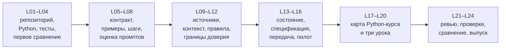

# Учебник: разработка с помощью AI-агентов

**Полное название:** «Разработка с помощью AI-агентов: создаём курс Python с нуля в OpenCode и Codex».

Этот учебник учит не «просить код у чата», а вести проект с агентом: ставить проверяемую задачу, готовить контекст, ограничивать полномочия, сохранять состояние, проверять результат и честно сравнивать OpenCode с Codex. Сквозной практический результат — собственный курс Python от первых программ до согласованной границы Junior и три готовых урока. Сам курс Python — материал проекта, а не предмет, который нужно полностью изучить за 60 часов агентной разработки.

## Кому подходит

- Новичку в систематической агентной разработке.
- Человеку, который уже пробовал отдельные задачи с AI-агентом, но не вёл длительный проект.
- Тому, кто хочет научиться проверять работу агента, а не доверять красивому ответу.

Python, Git, терминал и тестирование вводятся с нуля перед первым применением. Если вы ещё ни разу не запускали агента, начните с вводного маршрута ниже.

## Вводный маршрут до L01 (45–60 минут)

Этот маршрут **не является 25-м занятием** и не меняет число, результаты или время L01–L24. Его цель — привести читателя в состояние, в котором L01 можно начать без паники: открыть терминал, проверить версии, запустить агент в пустой учебной папке и остановить его.

> Всё, что вы делаете в этом маршруте, — тренировка в отдельной пустой папке. Не открывайте агенту домашний каталог, рабочий репозиторий или папку с секретами.

### Шаг 1. Терминал и текущая папка (5 минут)

**Терминал** — программа, в которой команды вводятся текстом. На macOS это Terminal или iTerm, на Linux — терминал вашей среды, на Windows — PowerShell или WSL, если так настроена учебная среда.

```bash
pwd
ls
```

- `pwd` печатает полный путь к текущей папке. Слово `pwd` означает «print working directory».
- `ls` перечисляет файлы и папки. Если папка пуста, вывода может не быть.

**Ожидаемый результат:** вы видите путь и понимаете, где находитесь. Если путь похож на `/Users/ваше-имя` или `C:\Users\ваше-имя`, это домашний каталог — для агента он слишком широк.

Создайте отдельную учебную папку:

```bash
mkdir -p ~/agent-course-intro
cd ~/agent-course-intro
pwd
```

`mkdir -p` создаёт папку и не жалуется, если она уже есть. `cd` переходит в неё.

### Шаг 2. Проверить Python и Git (5 минут)

Python понадобится на L02, Git — на L01. Сейчас достаточно убедиться, что команды существуют.

```bash
python3 --version
git --version
```

**Ожидаемый результат:** две строки с версиями. Если команда не найдена, запишите это и сообщите преподавателю до L01. Не устанавливайте несколько версий наугад и не меняйте глобальные настройки Git.

### Шаг 3. Проверить, установлен ли агент (5 минут)

```bash
opencode --version
codex --version
```

**Ожидаемый результат:** строка версии или сообщение «команда не найдена». Второе — не провал, а факт для записи. Установка и вход выполняются по официальной документации вашей среды; не копируйте команды установки из чатов и случайных страниц.

- OpenCode: <https://opencode.ai/docs/>
- Codex CLI: <https://developers.openai.com/codex/cli>

Если доступна только одна среда, это не отменяет курс: вторая попытка помечается как недоступная, а не выдумывается. Для полного сравнения нужны обе среды.

### Шаг 4. Первый запуск в пустой папке (10 минут)

Откройте агент **в папке** `~/agent-course-intro`, а не в домашнем каталоге. Точная команда зависит от установленной версии и способа запуска; в OpenCode обычно запускают `opencode` из нужной папки, в Codex — `codex` из нужной папки или с указанием рабочей папки. Сверьтесь с интерфейсом установленной версии.

Первый запрос должен быть **безопасным и только читающим**:

```text
Ты работаешь в пустой учебной папке. Ничего не создавай, не изменяй и не запускай.
Ответь одним предложением: какие файлы ты видишь в этой папке?
```

**Ожидаемый результат:** агент сообщает, что папка пуста, или перечисляет файлы. Если он пытается создать файл, остановите его и отклоните действие. Это и есть первый навык: «технически может» не значит «разрешено».

### Шаг 5. Записать наблюдение (10 минут)

Создайте вне учебной папки файл `intro-notes.md` и запишите:

- дату и время;
- среду и версию;
- рабочую папку;
- дословный запрос;
- запросил ли инструмент разрешение;
- что фактически появилось в папке;
- что вам было непонятно.

Не записывайте «всё работало», если не можете показать команду и вывод. Формулировка «не проверено» честнее выдуманного успеха.

### Шаг 6. Остановиться (5 минут)

Завершите сеанс. Не начинайте L01 в том же сеансе: L01 требует нового сеанса и чистой папки. Вводный маршрут нужен, чтобы вы увидели интерфейс и попробовали границу, а не чтобы пройти часть L01.

### Что вы получили

- отдельную учебную папку;
- проверенные команды `pwd`, `ls`, `python3`, `git`;
- один безопасный запуск агента;
- запись наблюдений;
- понимание, что сеанс и рабочая папка — разные вещи.

### Чего пока не делать

- Не устанавливайте пакеты.
- Не давайте агенту домашний каталог.
- Не просите «сделать весь курс».
- Не включайте авто-подтверждение всех действий.
- Не сравнивайте скорость инструментов по одному запуску.

## Как устроен учебник

Каждая глава L01–L24 имеет обязательную часть и необязательное «Углубление».

| Часть | Что делать | Обязательно |
|---|---|---|
| Паспорт и результаты | Понять место занятия, вход и артефакт | Да |
| Маршрут 75 + 75 | Пройти объяснение и практику в пределах занятия | Да |
| Теория и примеры | Разобрать механизм и воспроизвести примеры | Да |
| Схема | Прочитать схему и её текстовое пояснение | Да |
| Практика | Открыть точное условие в `practice_card.md` | Да |
| Самопроверка | Проверить наблюдаемые признаки | Да |
| Углубление | Прочитать при интересе или затруднении | Нет |
| Словарь и вопросы | Использовать для повторения | По необходимости |

**Точное условие практики всегда находится в `practice_card.md` соответствующего занятия.** Глава даёт объяснение, маршрут и подсказки, но не заменяет карточку и не добавляет обязательных требований.

**Эталоны и полные решения** находятся только в `teacher_key/` и не входят в ученический комплект. Если вы нашли ссылку на `teacher_key/` в ученической главе, это дефект: сообщите преподавателю.

## Оглавление

### Введение

- [Вводный маршрут до L01](#вводный-маршрут-до-l01-4560-минут) — эта страница.

### Модуль 1. Рабочая основа (L01–L04)

| Занятие | Тема | Руководство | Практика |
|---|---|---|---|
| L01 | Среда, полномочия, Git | [student_guide.md](../module_1/L01/student_guide.md) | [practice_card.md](../module_1/L01/practice_card.md) |
| L02 | Минимальный Python | [student_guide.md](../module_1/L02/student_guide.md) | [practice_card.md](../module_1/L02/practice_card.md) |
| L03 | Тест и исправление | [student_guide.md](../module_1/L03/student_guide.md) | [practice_card.md](../module_1/L03/practice_card.md) |
| L04 | Первое сравнение | [student_guide.md](../module_1/L04/student_guide.md) | [practice_card.md](../module_1/L04/practice_card.md) |

### Модуль 2. Prompt Engineering (L05–L08)

| Занятие | Тема | Руководство | Практика |
|---|---|---|---|
| L05 | Контракт задачи | [student_guide.md](../module_2/L05/student_guide.md) | [practice_card.md](../module_2/L05/practice_card.md) |
| L06 | Ограничения и примеры | [student_guide.md](../module_2/L06/student_guide.md) | [practice_card.md](../module_2/L06/practice_card.md) |
| L07 | Декомпозиция | [student_guide.md](../module_2/L07/student_guide.md) | [practice_card.md](../module_2/L07/practice_card.md) |
| L08 | Оценка промптов | [student_guide.md](../module_2/L08/student_guide.md) | [practice_card.md](../module_2/L08/practice_card.md) |

### Модуль 3. Context Engineering (L09–L12)

| Занятие | Тема | Руководство | Практика |
|---|---|---|---|
| L09 | Карта источников | [student_guide.md](../module_3/L09/student_guide.md) | [practice_card.md](../module_3/L09/practice_card.md) |
| L10 | Объём контекста | [student_guide.md](../module_3/L10/student_guide.md) | [practice_card.md](../module_3/L10/practice_card.md) |
| L11 | Правила проекта | [student_guide.md](../module_3/L11/student_guide.md) | [practice_card.md](../module_3/L11/practice_card.md) |
| L12 | Недоверенный источник | [student_guide.md](../module_3/L12/student_guide.md) | [practice_card.md](../module_3/L12/practice_card.md) |

### Модуль 4. Длительная работа с агентами (L13–L16)

| Занятие | Тема | Руководство | Практика |
|---|---|---|---|
| L13 | Контрольная точка | [student_guide.md](../module_4/L13/student_guide.md) | [practice_card.md](../module_4/L13/practice_card.md) |
| L14 | Краткая спецификация | [student_guide.md](../module_4/L14/student_guide.md) | [practice_card.md](../module_4/L14/practice_card.md) |
| L15 | Передача задачи | [student_guide.md](../module_4/L15/student_guide.md) | [practice_card.md](../module_4/L15/practice_card.md) |
| L16 | Пилотный урок | [student_guide.md](../module_4/L16/student_guide.md) | [practice_card.md](../module_4/L16/practice_card.md) |

### Модуль 5. Создание курса Python (L17–L20)

| Занятие | Тема | Руководство | Практика |
|---|---|---|---|
| L17 | Карта Python-курса | [student_guide.md](../module_5/L17/student_guide.md) | [practice_card.md](../module_5/L17/practice_card.md) |
| L18 | Второй урок: условия | [student_guide.md](../module_5/L18/student_guide.md) | [practice_card.md](../module_5/L18/practice_card.md) |
| L19 | Третий урок: циклы | [student_guide.md](../module_5/L19/student_guide.md) | [practice_card.md](../module_5/L19/practice_card.md) |
| L20 | Сборка линии | [student_guide.md](../module_5/L20/student_guide.md) | [practice_card.md](../module_5/L20/practice_card.md) |

### Модуль 6. Качество и сопровождение (L21–L24)

| Занятие | Тема | Руководство | Практика |
|---|---|---|---|
| L21 | Независимое ревью | [student_guide.md](../module_6/L21/student_guide.md) | [practice_card.md](../module_6/L21/practice_card.md) |
| L22 | Автоматические проверки | [student_guide.md](../module_6/L22/student_guide.md) | [practice_card.md](../module_6/L22/practice_card.md) |
| L23 | Сравнение инструментов | [student_guide.md](../module_6/L23/student_guide.md) | [practice_card.md](../module_6/L23/practice_card.md) |
| L24 | Выпуск и передача | [student_guide.md](../module_6/L24/student_guide.md) | [practice_card.md](../module_6/L24/practice_card.md) |

## Сквозная линия проекта



**Текстовая версия:** L01–L04 создают рабочую основу → L05–L08 учат формулировать и оценивать задачи → L09–L12 учат управлять контекстом и доверием → L13–L16 учат вести длительную работу → L17–L20 создают карту и уроки Python → L21–L24 проверяют, автоматизируют и выпускают.

**Что заметить:** каждый модуль оставляет артефакт, который становится входом следующего. Нельзя «перепрыгнуть» модуль: сравнение L04 без репозитория L01 и тестов L03 нечем подтвердить.

## Формат и время

- 24 занятия по 150 минут: 75 минут объяснения и демонстрации + 75 минут практики.
- Всего 60 часов.
- Обязательной домашней работы нет: обязательное выполняется в пределах занятия.
- «Углубление» — необязательное чтение, а не скрытая нагрузка.
- Точное условие практики и критерии — в `practice_card.md`; рубрика — в `assessment.md` модуля.

**О расхождении в источниках.** В карте занятий и части планов встречается «140 / 75». Это редакционный дефект: 140 + 75 = 215 минут противоречит утверждённым 150 минутам и сумме 3600 минут. Учебник использует 75 + 75. Подробный разбор — в [production_plan.md](production_plan.md#41-главное-противоречие-150-минут-против-140--75).

## Что нужно иметь к L01

- доступ к OpenCode и Codex (или подтверждённую недоступность одной среды);
- терминал;
- Python 3 и Git;
- две пустые рабочие папки;
- возможность записывать наблюдения вне репозитория;
- эту страницу и карточку L01.

Если чего-то нет, сообщите преподавателю до первого запроса. Не заменяйте отсутствующую среду вымышленным запуском.

## Статус проверки

- Текст сверен с программой, картой занятий и спецификацией проекта 4 ноября 2026 года.
- Изменчивые сведения об OpenCode и Codex сверены с официальной документацией 4 ноября 2026 года.
- OpenCode и Codex в ходе подготовки учебника не запускались; их интерфейс, модели, разрешения и время не считаются проверенными до пилота.
- Python-примеры, отмеченные в [validation_report.md](validation_report.md), запускались локально; остальные примеры являются учебными и требуют запуска на занятии.
- CI не настраивался и не проверялся.

## Связанные документы

- [Производственный план и аудит источников](production_plan.md)
- [Отчёт проверки учебника](validation_report.md)
- [Утверждённая программа](../../agentic_development_course_program.md)
- [Карта занятий L01–L24](../../course_lesson_map_L01-L24.md)
- [Спецификация итогового проекта](../../final_project_specification.md)
- [Материалы курса](../README.md)
